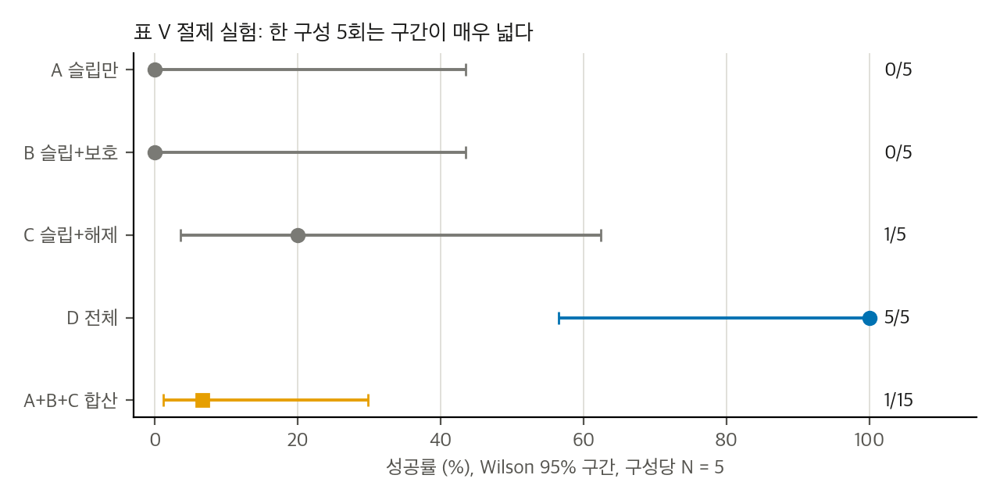
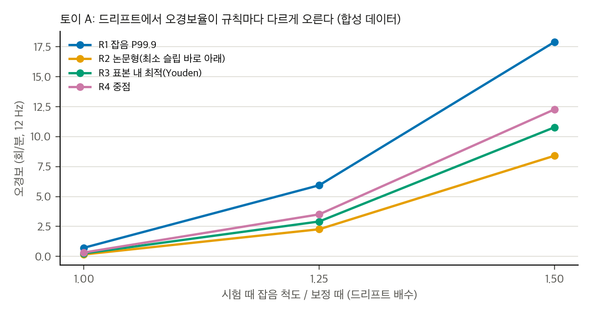
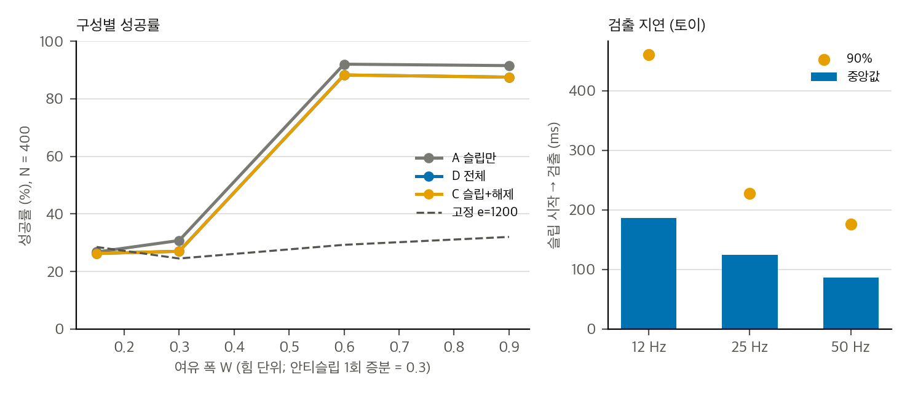

> **논문:** Feng 외 8인. *TactileReflex: Noise-Statistics-Driven Vision-Tactile Reflex Control for Force-Sensitive Manipulation.* IROS 2026 채택, arXiv:2605.23568 (v4, 2026-09-23).
> 논문 그림은 라이선스(arXiv 비독점 배포) 때문에 싣지 않았습니다. 이 글의 그래프는 논문 표의 수치와 직접 만든 토이로 그렸습니다. 공식 저장소에는 라이선스가 없어 코드는 옮기지 않고, 파일 위치만 인용합니다.

---

## 논문이 묻는 것

얇은 일회용 컵을 물을 담아 붓는 일은 어렵습니다. 힘이 부족하면 미끄러지고, 조금만 세게 잡아도 벽이 찌그러집니다. 이 논문은 그리퍼 손가락의 두 비전 촉각 센서(MC-Tac)에서 세 가지 이미지 지표를 뽑습니다. 전단 Sy, 접촉 강도 Fn, 무게 중심 CoP입니다. 이 지표로 세 가지 반사 동작을 약 12 Hz로 돌립니다. 미끄럼이 나면 힘을 올리고, 하중이 줄면 힘을 풀고, 힘이 한계를 넘으면 낮춥니다.

논문의 가장 큰 주장은 **임계값을 짧은 정지 보유 보정(약 2분)의 노이즈 통계에서 모두 유도한다**는 것입니다. 실험은 절제(세 채널 중 몇 개가 필요한가)와 붓기(반사가 있을 때와 없을 때)로 나눕니다.

## 결과를 다시 계산해 보기

논문 표 세 개(Table III, V, VI)의 숫자를 다시 계산했습니다. 숫자 자체는 모두 맞았습니다. 해석에서 짚을 곳이 있었습니다.

| 항목 | 논문 | 다시 본 것 |
|---|---|---|
| 절제 (N = 5) D 대 A+B+C | 5/5 대 1/15, p < 0.001 | Fisher p = 0.0004 (재현) |
| 절제 D 대 C | 5/5 대 1/5 | p = 0.048, 한 시행(1/5 → 2/5)으로 p = 0.17 |
| 붓기 전체 | 0/10 대 9/10 | Fisher p = 0.0001 (재현) |
| 붓기 effort | 반사 끔 1200 고정, 켬 4200–5000 | 평균 힘 차이가 피드백 효과와 섞임 |
| 보호 채널 Fn 피크 | Flim = 45 | 피크 평균 63–71, 45보다 큼 |
| 릴리스 후 effort | "초기 수준으로 회복" (∆e = 667 ± 1155) | ∆e는 범위일 뿐, 회복을 보이지 않음 |

**N = 5의 한계가 큽니다.** 검정력은 참 성공률이 0.8 대 0.2일 때도 0.38입니다. 절제 결과는 "D만 된다"는 방향은 맞아 보이지만, 세 채널이 모두 필요하다는 강한 결론은 한 시행에 기댑니다.

## 임계값은 노이즈에서 나왔나

가장 중요한 질문입니다. 본문 규칙을 하나씩 따라가 보면 답이 나뉩니다.

- **τ, θq:** 노이즈 분위수에서 나왔습니다. 다만 θq는 P95와 정확히 같지 않고, 보고된 P95보다 0.01–0.02 높습니다. 가산 여유가 들어 있습니다.
- **Flim:** P99.9 기법이지만 P99.9 값이 보고되지 않았고, Fn이 무차원이라 변형 힘과 연결되지 않습니다.
- **θs = 0.20:** 노이즈 상한과 관측된 최소 슬립 사이에서 골랐습니다. 그런데 선택한 값은 최소 슬립 0.2006 바로 아래입니다. 최솟값은 같은 실험에서 나왔습니다. 논문은 이 실험을 "교차검증"이라 부르지만, 상한은 이미 이 자료를 보고 정해졌습니다. 교환 가능하다고 가정하면, 다음 슬립이 관측된 최솟값보다 작을 확률은 1/(n+1)입니다. n = 100이면 약 1%입니다.
- **θc:** 수동 하중 감소 이벤트의 약한 끝입니다. 노이즈가 아닙니다.
- **Fstop:** 재료 의존이라고 적혀 있지만 유도 과정이 없습니다.

요약하면 "모든 임계값이 노이즈에서 나온다"는 과장입니다. 노이즈에서 나온 것은 일부이고, 나머지는 자료의 경계나 이벤트에서 얻었습니다.

## 드리프트에 대한 토이

노이즈 분위수 임계값은 보정 때와 같은 조건이라면 0.1%의 프레임 오경보를 냅니다. 12 Hz에서는 분당 약 0.7회입니다. 시험 때 잡음이 25% 커지면 같은 규칙이 분당 약 6회를 냅니다. 오경보 한 번은 안티슬립에서 힘을 한 단계 올리므로, 분당 6회면 힘이 계속 쌓입니다. 이 토이는 합성 데이터이고 논문 값에 맞춘 것이 아닙니다. 방향만 봅니다.

## 여유와 검출 지연

두 번째 토이는 1차원 파지 모형입니다. 여유 폭을 안티슬립 1회 증분의 배수로 바꿔 봅니다. 여유가 1회 증분 이하이면 한 번의 증분이 힘을 여유 밖으로 밀어 컵이 찌그러집니다(66–72%). 2회 이상이면 찌그러짐이 사라집니다. 12 Hz에서 슬립을 검출하는 데 중앙값 187 ms가 걸립니다. 논문이 보고한 170–340 ms 응답과 맞는 범위입니다. 해제 채널은 이 설정에서 오히려 성공률을 약 4%p 낮췄습니다. 하중 반전을 막는 장치가 없으면 해제가 다음 하중 상승의 미끄럼을 부른다는 뜻입니다.

## 공식 저장소와 논문의 차이

공식 저장소(라이선스 없음)는 커밋이 두 개뿐입니다. 첫 커밋에서 Sy는 2차원 광흐름 크기의 중앙값이었습니다. 두 번째 커밋에서 논문 식 (6)에 맞춰 세로 성분의 절댓값 중앙값으로 바뀌었습니다. 같은 저장소에 오른쪽 영상을 기본으로 상하 반전하는 처리가 있고, 두 영상을 동기화하지 않고 차례로 읽습니다. 기본 제어 주기는 25 Hz입니다. 논문은 12 Hz를 보고합니다. 논문 수치를 이 저장소로 다시 얻을 수 있는지는 지금으로선 알 수 없습니다.

## 구현할 수 있나

- **공식 재현:** 두 MC-Tac 센서, Piper 그리퍼, CAN 어댑터, 리눅스 PC가 있을 때만 가능합니다. 카메라 탐지와 CAN이 리눅스 전용이라 맥에서는 실물 제어 루프를 돌릴 수 없습니다.
- **재구현:** 제어 로직은 수백 줄이고 쉽습니다. 실제 노력은 센서 동기화와 실물 튜닝입니다. 1–2주로 추정합니다.
- **안전층으로 쓰기:** 논문에 VLA 실험은 없습니다. 정책이 낸 그리퍼 명령과 반사 보정이 충돌하는 문제는 따로 풀어야 합니다.

## 정리

이 논문의 방향(촉각 영상 지표로 파지력을 낮은 수준에서 조정하는 반사 층)은 설득력이 있습니다. 그러나 "노이즈로 모든 임계값을 정했다"는 설명과 "세 채널이 모두 필요하다"는 결론은 근거가 약합니다. 검증하려면 Sy 정의와 동기화를 고정한 뒤, 고정 effort 대조군과 드리프트 실험을 넣은 실물 시험이 필요합니다.

## 자료

- [통합 리포트 PDF](report/report_public.pdf)
- [01. 논문 분석: TactileReflex](analysis/01_paper_analysis.md)
- [02. 선행연구와 관련 저장소](analysis/02_prior_work.md)
- [03. 재계산, 유의성, 임계값 유도, toy 검증](analysis/03_analysis.md)
- [04. 코드 대조: 논문 ↔ shayfeng/tactile-reflex-open-source](analysis/04_code_verification.md)
