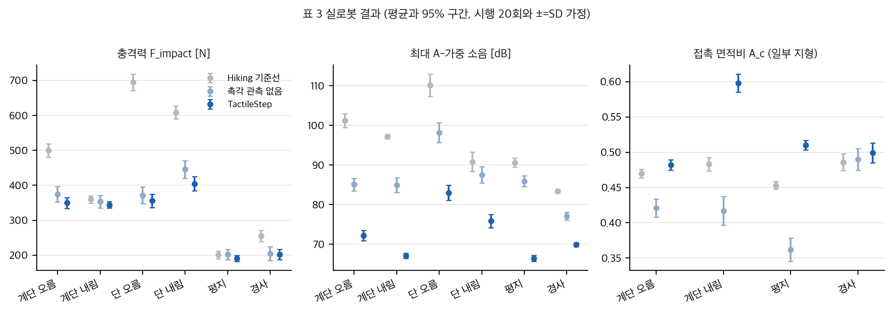
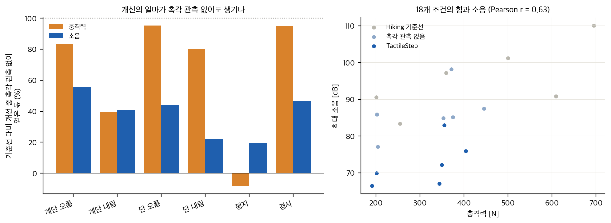
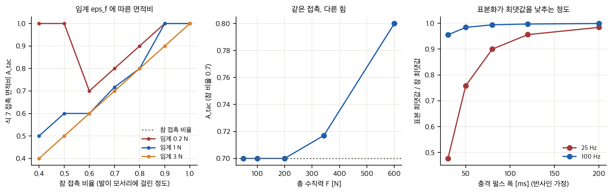

> **논문:** Zizhuo Wang, Ming-Ju Lee 외. *TactileStep: Sole Tactile Learning for Regulating Foot–Terrain Interaction in Humanoid Locomotion.* CoRL 2026 스포트라이트, arXiv:2609.28959 (v1, 2026-09-24).
> 공식 코드는 공개되지 않았습니다(프로젝트 페이지에 "Code Soon"). 논문 그림은 싣지 않고, 우리가 만든 그래프만 씁니다. 시행 수를 가정한 계산은 문장 안에 가정을 적었습니다.

## 논문이 묻는 것

휴머노이드 파쿠르 정책은 계단과 단을 넘어가면서도 거칠게 착지하거나 모서리를 밟을 수 있습니다. 이 논문은 발바닥 압력 인솔에서 **합력, 접촉 면적비, CoP** 세 특징만 뽑아 정책 관측에 넣고, 발의 접촉을 SWING, PRE-LANDING, LANDING, STANCE 네 단계로 나눠 단계마다 보상을 겁니다. 비평가는 dense와 sparse 보상 묶음에 하나씩 둡니다. Unitree G1에서 지각형 파쿠르 정책(Hiking in the Wild)과 비교해 충격력, 소음, 접촉 면적을 잽니다.

## 이 글에서 확인한 것

**초록의 세 수치는 표 3에서 그대로 나옵니다.** 충격력 48.8% 감소는 단 오름(695.0 → 355.7 N), 소음 30.1 dB 감소와 접촉 면적 23.8% 증가는 계단 내림의 값입니다. 세 값은 서로 다른 지형의 최대값이고, 계단 내림의 충격력 차이는 4.2%(359.3 → 344.1 N)입니다.

**충격력 개선은 지형마다 크기가 다릅니다.** 조건당 20 샘플과 ±=SD를 가정한 Welch 검정에서 기준선 대비 단 오름, 단 내림, 계단 오름, 경사는 분명하고, 계단 내림(p = 0.033, 48개 비교 Holm 후 0.43)과 평지(−5.0%, p = 0.14)는 구분되지 않습니다. 표 3의 ±는 정의가 없어서, 95% 구간 반폭이라면 핵심 대비가 모두 p > 0.2가 됩니다.

**충격력 개선의 큰 부분은 촉각 관측 없이도 나타납니다.** 촉각 관측만 뺀 변형(w/o tac. obs.)은 이 논문의 보상으로 학습한 정책입니다. 기준선에서 TactileStep까지의 충격력 감소 중 이 변형이 이미 만든 몫이 평지를 뺀 다섯 지형에서 40–95%입니다. 소음은 촉각 관측이 나머지 44–80%를 더하고, 접촉 면적은 이 변형이 기준선보다 낮아졌다가 촉각 관측에서 뒤집힙니다. 논문의 "촉각 관측이 중심 역할"이라는 서술은 소음과 접촉 면적에서 표와 맞고, 충격력에서는 표 3의 차이가 작습니다.

**힘과 소음의 변화량이 맞지 않는 지형이 있습니다.** 4.3절은 "힘과 소리의 일치가 부드러운 착지를 확인한다"고 씁니다. 18개 조건의 평균을 모으면 같은 방향이지만(Pearson r = 0.63), 같은 지형에서 정책을 바꾼 비교에서는 계단 내림에서 힘이 4.2% 바뀔 때 소음이 30.1 dB 바뀝니다. 소음계가 정강이 바깥쪽 관절 근처에 있고 배경이 55–60 dB(G1 팬)라서, 소음에는 발-지면 충격 외의 요소가 들어갈 가능성이 있습니다.

**이중 비평가의 기여가 큽니다.** 부록 표 4의 단일 비평가는 같은 보상으로 충격력이 7.5–80.8% 높고, 평지와 경사의 접촉 면적비가 기준선보다 낮습니다(0.824 대 0.912, 0.635 대 0.804). 기준선 대비 차이에는 보상, 촉각 관측, 이중 비평가가 함께 들어 있습니다. 그림 6에서 w/o soft landing 변형이 설명하는 몫은 기준선 대비 감소의 22–62%입니다.

**시뮬과 실물의 특징 값이 평지·경사에서 다릅니다.** 계단에서 접촉 면적비는 시뮬과 실물이 비슷하지만(0.536 대 0.482, 0.545 대 0.598), 평지는 시뮬 0.929, 실물 0.510이고 경사는 0.805 대 0.499입니다. 충격력은 시뮬이 착지 창 최대, 실물이 25 Hz 인솔 곡선의 첫 상승 가장자리로 정의가 다릅니다. 그림 4의 sim-to-real 정렬은 계단 내림 한 구간의 곡선 비교이고 정량 지표는 없습니다.

**본문 식과 부록 보상표가 다릅니다.** 식 9–12는 단순화된 형태이고, 표 5–6에는 임계값(0.24 m/s, 6 m/s², 체중, 40,000 N/s, 38 mm), 선형 항, 본문에 없는 점하중 항이 있습니다. 촉각 지연 확률도 표 9(0.10)와 표 10(0.08)이 다릅니다. 단계 추정 임계값은 본문과 부록에 없습니다.

## 촉각 시뮬레이터를 다시 구현해 보면

3.2절의 식 3–7을 numpy로 다시 구현했습니다. 발 크기, 타셀 배치, 임계값은 논문에 없어 가정했습니다(발 0.22 × 0.09 m, 타셀 60개, ε_f = 1 N 등). 결과는 "이 가정에서 식이 이렇게 움직인다"는 뜻입니다.

- 면적비는 타셀 힘의 절대 임계와 총 힘에 의존합니다. 같은 접촉에서 총 힘만 바꾸면 A_tac이 0.70(200 N 이하)에서 0.80(600 N)이 됩니다.
- 식 3은 gap_max에서도 가중이 1/50이라 허공의 타셀에 힘이 조금 남고, 임계가 낮으면 활성으로 셉니다.
- 25 Hz 인솔은 폭 50 ms 충격 펄스의 최댓값을 약 24% 낮게 잡습니다(반사인 펄스 가정). 부록 C.3의 100 Hz 재측정 차이(4.1%, 5.7%)는 폭 약 100–120 ms의 펄스와 같은 크기입니다. 실제 펄스 폭은 논문에 없습니다.

## 구현할 수 있는지

**이 맥(Apple M4 Pro, 24 GiB, CUDA 없음)에서 논문 수치의 재현은 불가능합니다.** 학습은 Isaac Sim과 RTX 4090 급 GPU, 평가는 G1과 압력 인솔이 필요합니다. 촉각 시뮬은 numpy로 재구현해 점검했고, MuJoCo 축소판(이중 비평가, 촉각 관측 절제)은 새 설치 없이 시작할 수 있는 조건부 가능으로 보며 노력은 2–4주(추정)입니다.

## 논문이 직접 밝힌 한계와 남은 질문

논문은 제한된 명령 범위(전진 속도 0.45–0.55 m/s), 손으로 만든 단계 추정기, 강체 접촉 가정, 인솔 내구성 미평가를 한계로 적습니다. 저자 확인이 필요한 부분은 표 1·2·3의 ±의 정의와 실물 20 샘플의 독립 단위, 기준선의 재학습 설정, 단계 추정 임계값, 평지·경사 면적비의 시뮬-실물 차이, 소음계 위치의 영향입니다.

## 자료

- [통합 리포트 PDF](report/report_public.pdf)
- [01. 논문 분석: TactileStep](analysis/01_paper_analysis.md)
- [02. 선행연구와 구성 요소별 출처](analysis/02_prior_work.md)
- [03. 표 재계산과 일관성 검사, 토이](analysis/03_analysis.md)
- [04. 주장 검증과 구현 가능성: TactileStep](analysis/04_claim_verification.md)
