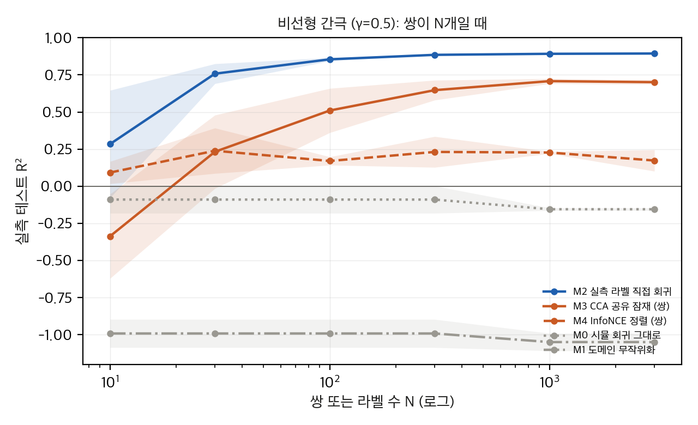
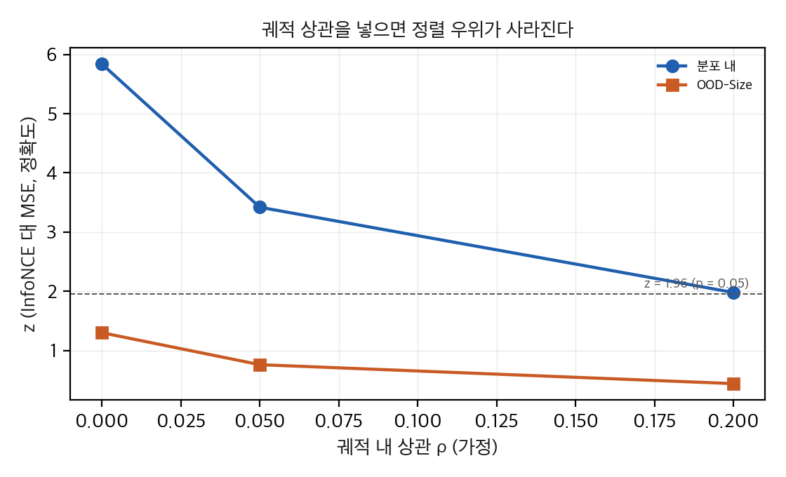
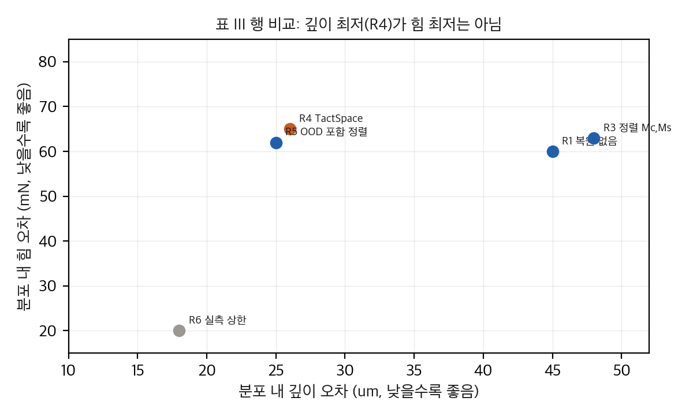

# TactSpace: 공유 잠재로 촉각 sim-to-real 옮기기

IROS 2026에 채택된 TactSpace 논문을 표 재계산과 공개 코드 대조, numpy 토이로 분석했다. 논문 그림은 라이선스(CC BY-NC-ND 4.0) 때문에 넣지 않았고, 아래 그래프는 직접 그린 것이다.

## 핵심 발견

1. **정렬에는 실측 쌍이 필요하다.** 같은 (형상, 위치, 변위) 자극의 실측 캡처가 정렬 단계에 쓰인다. "zero-shot"은 하위 과제 학습 단계에만 맞다. 논문도 쌍 요구 완화를 미래 과제로 적었다.
2. **헤드라인 16.7%와 45.8%는 선택된 행끼리 비교다.** 두 수치는 ablation 표의 특정 행 쌍에서만 나온다. 정렬 없음 대비는 깊이 29.7%, 힘 27.0%다.
3. **표와 본문이 엇갈린다.** 정렬 우위가 모든 지표에서 맞지 않고, RBS 확대로 깊이가 나아지지 않는다.
4. **불확실성이 크다.** 시드 반복과 하이퍼파라미터가 없다. 궤적 상관을 넣으면 OOD 우위는 유의하지 않다.
5. **토이의 교훈.** 비선형 간극에서 시뮬 회귀와 도메인 무작위화는 실패한다. 공유 잠재는 쌍 100개 이상에서 살아나지만, 같은 수의 실측 라벨 회귀가 더 낫다. 쌍 하나가 라벨 하나와 같은 정보를 주기 때문이다.
6. **구현 가능성.** 공식 재현은 불가능하다. 시뮬레이터와 정렬 저장소는 접근되지 않고, FEM은 상용 소프트웨어와 큰 모델이 필요하며, 실측 수집에는 전용 하드웨어가 필요하다. 침투 깊이 분포를 numpy로 다시 만들어 봤지만, 중앙값은 taxel 간격에 따라 0에서 65 µm까지 움직여서 논문의 깊이 통계로는 시뮬을 검증할 수 없다.

## 그래프

## 분석 노트

자세한 내용(표 재계산, 유도, 토이 설정, 코드 대조 D1–D18)은 `publish/git/`의 분석 문서와 `report_public.pdf`에 있다.

## 자료

- [통합 리포트 PDF](report/report_public.pdf)
- [01. 논문 분석: TactSpace (arXiv:2606.18959v1)](analysis/01_paper_analysis.md)
- [02. 선행연구와 관련 저장소](analysis/02_prior_work.md)
- [03. 표 재계산, 유도, toy 검증](analysis/03_analysis.md)
- [04. 코드 대조와 구현 가능성: 논문 ↔ leggedrobotics/TactSpace](analysis/04_code_verification.md)
