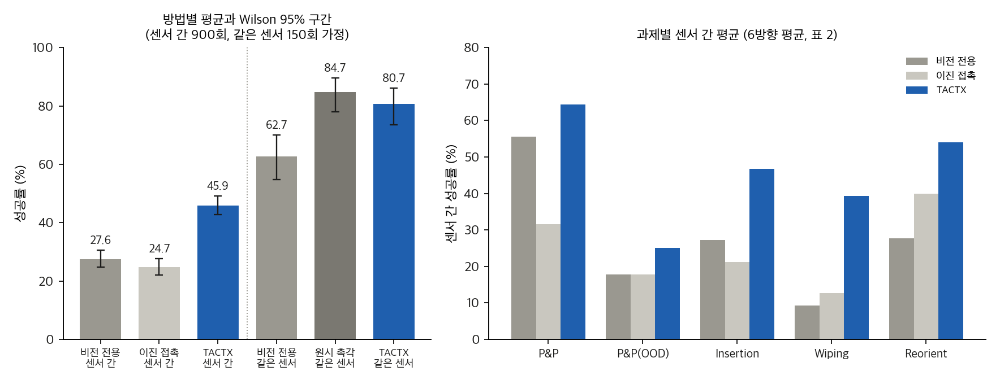
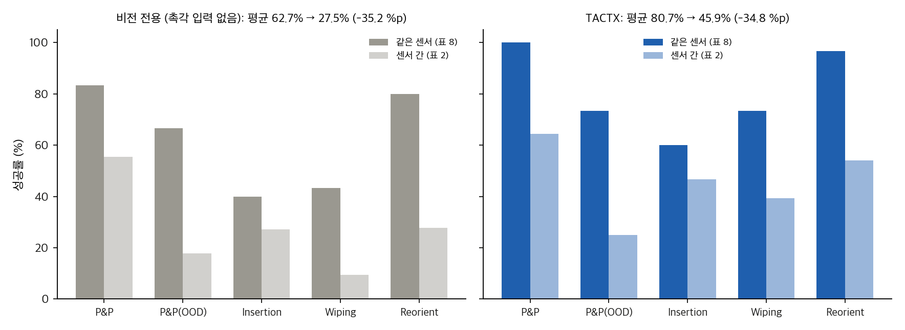
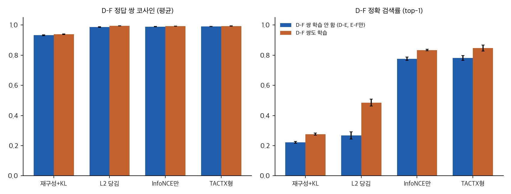

> **논문:** Junsung Park, Sachin Bhadang, Carmelo Sferrazza, Sha Yi, Xiaolong Wang. *TACTX: Learning Shared Tactile Representations Across Diverse Sensors.* CoRL 2026 포스터, arXiv:2606.31236 (v1, 2026-06-30).
> 공식 코드는 GitHub tactx-project/TactX에 있습니다(LICENSE 파일 없음). 논문 라이선스가 arXiv 비독점 배포라서 이 글에는 논문 그림을 넣지 않았고, 우리가 그린 그래프만 실었습니다.

## 논문이 묻는 것

촉각 정책은 학습에 쓴 센서의 관측 공간에 묶입니다. 센서를 바꾸면 시연을 다시 모으고 정책을 다시 학습해야 합니다. 센서 간 전이를 다룬 기존 연구는 대부분 영상형(비전 기반) 센서 사이에 머물렀습니다.

TACTX는 비전 기반(Daimon), 자기식(eFlesh), 저항식(FlexiTac) 센서를 16차원 공유 잠재 공간에 정렬합니다. 정렬 신호는 서로 다른 센서가 같은 접촉을 동시에 본 **쌍 데이터**입니다. 센서마다 인코더와 디코더를 두고, 대칭 대조 손실(NT-Xent, 온도 0.01)로 쌍을 당기며, 자기·교차 재구성과 KL 항을 더합니다. 센서 하나로 학습한 ACT 정책이 다른 센서에서 정책 재학습 없이 돌아간다는 것이 핵심 주장입니다.

## 이 글에서 확인한 것

**1. 평균 이득은 재계산과 맞고, 방향이 분명합니다.** 표 2의 30칸(6방향 × 5과제) 평균은 비전 전용 27.50%, 이진 접촉 24.63%, TACTX 45.87%로 초록의 27.5 → 45.9%와 같습니다. 서론의 "약 20%"는 18.4 %p이고 상대 증가로는 66.8%입니다. 한 칸이 10회 × 3반복(시행 수 가정: 칸당 30회)이라고 두고, 칸 30개의 쌍체 차이로 보면 평균 +18.4 %p, 부트스트랩 95% 구간 [10.7, 26.4]입니다. 과제 5개를 독립 단위로 보면 p = 0.016, 방향 6개를 단위로 보면 p = 8e-4입니다. 합산 900회를 독립으로 본 Fisher p = 8e-16은 낙관적인 값이라 이 단위별 값을 함께 봐야 합니다.

*그래프 (우리가 그림). 왼쪽은 표 2(센서 간, 900회 가정)와 표 8(같은 센서, 150회)의 방법별 평균과 Wilson 95% 구간, 오른쪽은 과제별 센서 간 평균입니다.*

**2. 촉각이 없는 정책도 센서를 바꾸면 비슷한 폭으로 떨어집니다.** 표 8의 같은 센서 평균은 비전 전용 62.7%, TACTX 80.7%이고, 센서 간 평균은 27.5%와 45.9%입니다. 비전 전용은 촉각 입력을 쓰지 않는데도 35.2 %p 떨어지고, TACTX는 34.8 %p 떨어집니다. 촉각 경로가 더하는 이득은 같은 센서에서 +18.0 %p, 센서 간에서 +18.4 %p로 거의 같습니다. 센서 간 TACTX 평균(45.9%)은 같은 센서 비전 전용 평균(62.7%)보다 낮습니다. 가능한 원인은 센서를 바꾸면서 시야, 그리퍼 형상, 접촉 컴플라이언스가 함께 바뀌는 것이지만 논문은 이 요인을 따로 떼어 측정하지 않았습니다. 따라서 45.9%라는 숫자가 촉각 표현의 전이 능력만을 말한다고 읽기는 어렵습니다.

*그래프 (우리가 그림). 표 8(같은 센서)과 표 2(센서 간)의 과제별 성공률입니다.*

**3. 30칸 중 TACTX가 최고이거나 동률인 칸은 21개입니다.** 이득은 판 닦기 +30.0 %p, 재배향 +26.3, 삽입 +19.5, 픽앤플레이스 +8.8, 흰 물체 OOD +7.2 순으로 접촉이 많은 과제에서 큽니다. 최고가 아닌 9칸 가운데 eFlesh → FlexiTac의 세 칸에서는 이진 접촉이 더 높고, 이 방향의 평균은 이진 접촉 24.6%, TACTX 22.6%입니다. 본문의 "가장 약한 방향"은 TACTX와 비전 전용에서는 맞고 이진 접촉에서는 최저 방향이 다릅니다.

**4. 같은 센서의 이득 유지율은 평균 82%입니다.** TACTX의 이득이 원시 촉각 이득의 몇 %인지 보면 픽앤플레이스 167%, 재배향 125%, 판 닦기 75%, 삽입 60%, OOD 50%입니다(분모가 작은 과제는 100%를 넘습니다). 표 8의 칸 15개 중 TACTX와 비전 전용이 10회 기준으로 구별되는 칸은 eFlesh 판 닦기(8/10 대 0/10) 하나입니다. 표 8 캡션의 "픽앤플레이스에서 두 기준선과 같거나 높다"는 OOD에서는 Daimon 5/10이 비전 전용 8/10보다 낮습니다.

**5. 표 2의 표준편차는 모표준편차입니다.** 90칸 모두에서 평균 × 3이 정수이고, 모표준편차로 3회 횟수(각 0–10)를 맞출 수 있습니다. 표본표준편차로는 21칸만 맞습니다. 변동의 크기는 독립 이항 시행 3회의 기대값(0.83)과 비슷합니다(관측 평균 0.85). 3회 반복에 정책 학습 시드가 들어 있는지는 논문에 적혀 있지 않습니다.

**6. §4.2의 "D–F 쌍을 보지 않고 학습"은 공개 코드로 만들 수 없습니다.** 논문 §4.2는 D–E와 E–F 쌍으로 학습하고 D–F 접촉은 함께 관측하지 않았다고 쓰는데, 부록 A와 표 3은 D_FD를 쌍 데이터셋으로 둡니다. 공개 학습 루프는 세 쌍 로더가 모두 있어야 시작하고, 쌍을 뺄 옵션이 없습니다. 그림 3의 D–F 코사인 0.928이 어떤 학습 조건의 값인지는 논문과 코드에서 구분되지 않아 저자 확인이 필요합니다.

**7. 합성 센서 토이에서 양성 쌍 코사인은 방법을 거의 가르지 못하고, 정확 검색률이 가릅니다.** 접촉 파라미터(위치, 반경, 종횡비)를 세 가짜 센서(영상, 15차원 벡터, 압력 격자)로 렌더링해 같은 구조를 작게 다시 짰습니다. D–E와 E–F 쌍만 학습한 조건에서 D–F 정답 쌍 코사인은 재구성+KL 0.93, L2 당김 0.99, 대조 계열 0.99인데, D 잠재로 F 잠재를 찾는 top-1 검색률은 0.22, 0.27, 0.78입니다. D–F 쌍까지 학습하면 0.28, 0.49, 0.83(TACTX형 0.85)이 됩니다. 이 토이는 합성 센서 한 가지, 시드 2개이며 실제 센서의 정렬 품질을 말하지 않습니다. 논문 그림 3의 지표는 양성 쌍 코사인뿐이고, 공식 평가 코드는 무작위 쌍 코사인도 계산하지만 논문에는 나오지 않습니다.

*그래프 (우리가 그림). 합성 센서 토이의 D–F 정답 쌍 코사인(왼쪽)과 정확 검색률(오른쪽). 시드 2개 평균이며 오차 막대는 모표준편차입니다.*

## 공식 코드와 논문의 차이

코드는 `9381ee0`(2026-10-21, 단일 커밋)를 정적으로만 읽었고 실행하거나 설치하지 않았습니다. 표 5의 하이퍼파라미터(d = 16, 배치 64, lr 1e-4, τ = 0.01, β_max 0.1, KL 워밍업 30 에폭)는 대부분 일치합니다. 다른 점은 이렇습니다.

- **정렬 손실의 정의.** 식 (3)은 상대 센서 N개를 분모로 하는 형태인데 코드는 SimCLR의 `NT_Xent`로 2N개 앵커, 같은 센서의 다른 항목을 음성에 포함합니다.
- **대조 전용 기준선.** 코드의 대조 전용 모델은 옛 FlexiTac CNN과 100 에폭이고, TACTX는 잔차 CNN과 300 에폭입니다. README도 이 구조 차이를 비교에서 염두에 두라고 씁니다. 그림 3과 4의 비교에 구조와 학습 길이 차이가 섞입니다.
- **정리 전후.** 저장소의 정리 기록은 정리 전 코드가 Adam의 weight decay를 적용하지 않았고, 정렬을 첫 에폭에 켜지 않았다고 적습니다. 정리된 공개본은 논문 결과를 낸 코드와 비트 단위로 같지 않다고도 씁니다.
- **그림 4 오른쪽의 객체 분류 프로브**는 공개 평가 코드에 없습니다.
- **정책 설정.** 카메라 백본 학습률이 논문 1e-5, 공개 설정 1e-4입니다. 비전 전용, 원시 촉각, 이진 접촉 정책의 설정과 임계값 코드는 공개되어 있지 않습니다.
- **공개 범위.** 정책 시연 데이터(센서 3 × 과제 4, 544 에피소드, 약 130 GB)는 Hugging Face에 있지만 표현 학습용 쌍 데이터(2,670 궤적)와 인코더·정책 체크포인트는 없습니다.

## 구현 가능성

실로봇 정책 평가는 Franka, GELLO, 센서 세 종이 있어야 하고, 쌍 데이터와 체크포인트가 공개되어 있지 않아 공개 코드만으로 표현 학습도 이어 갈 수 없습니다. 이 맥(Apple M4 Pro, CUDA 없음)에서는 표 재계산과 합성 센서 토이를 구현했고, 공개 시연 데이터 일부 확인과 공식 합성 테스트는 다운로드와 설치 승인이 있으면 가능합니다.

## 한계와 읽는 법

- 표 2의 시행 수(칸당 30회)와 합산 900회는 캡션에서 가정한 값이고, 독립이라는 가정이 낙관적이어서 단위별 검정을 함께 적었습니다.
- 그림 4의 막대 값(대조 전용 약 42%, L2 약 57.5%, 객체 분류 막대)은 그림에서 읽은 값입니다. 본문이 적은 값(67.5%, 47.5%, 60.8%, 56.2%)은 그대로 썼습니다.
- 이 글의 원인 설명(센서 장착이 시야와 접촉을 바꾼다)은 가능성이며 논문의 실험으로 확인된 것이 아닙니다.
- 재계산 스크립트(`analysis/recompute.py`), 토이(`analysis/toy_transitive.py`), 분석 문서는 함께 올린 저장소 폴더에 있습니다.

## 자료

- [통합 리포트 PDF](report/report_public.pdf)
- [01. 논문 분석: TACTX (arXiv:2606.31236)](analysis/01_paper_analysis.md)
- [02. 선행연구와 관련 저장소](analysis/02_prior_work.md)
- [03. 수치 재계산, 일관성 검사, 토이](analysis/03_analysis.md)
- [04. 공식 코드 대조 (정적 읽기)](analysis/04_code_verification.md)
