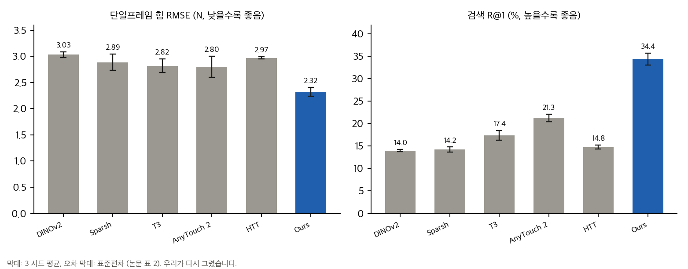
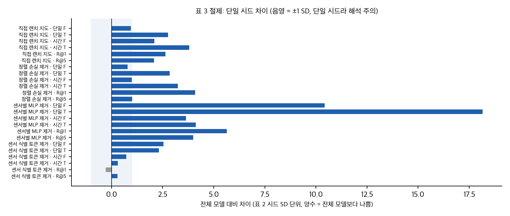
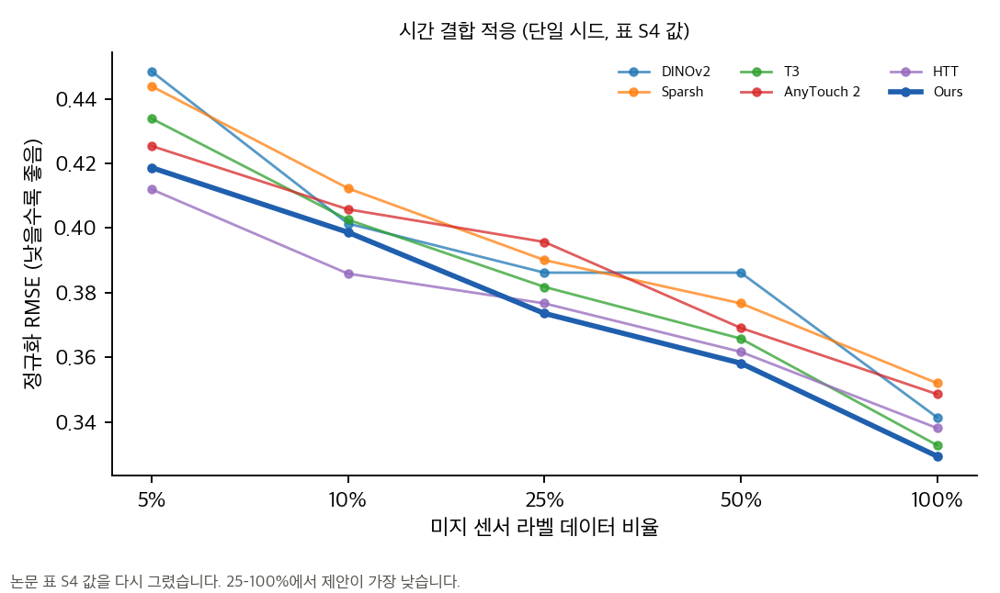
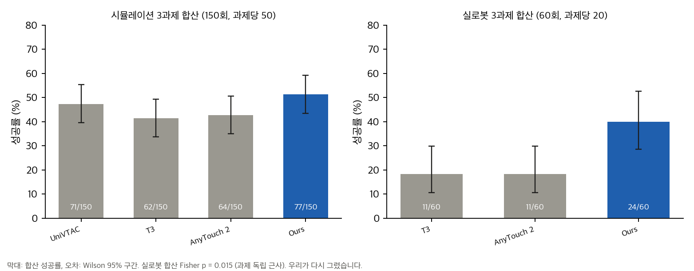

> **논문:** Jiaming Jiang, Yuzhe Huang, Baokun Yang, Hao Liang, Li Gao, Haoran Guo, Pei Lin, Shengcheng Luo, Chenxi Xiao, Wanlin Li, Ziyuan Jiao. *TaF-Foundation: Wrench-Grounded Cross-Sensor Tactile Representations.* arXiv:2611.20718 (v1, 2026-11-16).
> 학회 표기는 없습니다. 이 글의 그림은 모두 우리가 그린 그래프입니다. 논문 그림은 쓰지 않았습니다(arXiv 비독점 배포 라이선스).

## 논문이 묻는 것

촉각 센서는 원리가 제각각입니다. 광학 센서는 영상을, 자기 센서는 채널 신호를, 압력 센서는 압력 행렬을 냅니다. 같은 접촉이라도 출력 형식이 달라서 한 센서에서 배운 것을 다른 센서로 옮기기 어렵습니다.

이 논문은 공통 기준으로 **6축 렌치**(힘 3 + 토크 3)를 씁니다. 접촉은 뉴턴 역학을 따르므로, 어떤 센서든 같은 접촉에서 측정한 렌치는 같은 물리량입니다. 그래서 촉각끼리 짝을 맞출 필요 없이, 각 센서의 관측을 측정된 렌치에 묶으면 됩니다.

## 데이터: 같은 접촉에서 동시에 기록

저자들은 장치를 만들어 24개 촉각 센서에서 **101,298,854 프레임**(30,503 에피소드)을 모았습니다. 장치는 yaw 액추에이터로 센서를 돌리고, 프로브를 두 축으로 회전시켜 접촉 방향을 바꿉니다. 기준 렌치는 6축 힘토크 센서로 같은 순간에 잽니다.

TaF-VLA(같은 저자의 전작)는 촉각과 힘을 다른 접촉에서 따로 모았습니다. 이 장치는 같은 접촉에서 동시에 기록하므로 접촉 조건이 어긋난 쌍이 생기지 않습니다.

## 방법: 어댑터, 공유 인코더, 세 손실

- **센서별 입력 어댑터.** 광학 센서는 현재 영상과 무접촉 기준 영상의 차를 6채널로 쌓아 패치로 나눕니다. 센서마다 잔차 MLP를 붙이는데, 처음에는 영 초기화되어 원래 토큰을 그대로 통과시킵니다.
- **공유 Transformer.** DINOv2 ViT-B/14에서 초기화합니다. 학습 가능한 물리 질의가 출력을 모아 768차원 표현 z를 만듭니다.
- **세 손실.** 렌치 재구성(L_w), 촉각에서 렌치 예측(L_t), EMA 렌치 인코더와의 정렬(L_align)을 더합니다. 부록은 정렬 가중치를 0.2로 적었지만, 본문 식에는 값이 없습니다.

추론 때는 촉각 관측과 센서 식별자만 필요합니다. 렌치는 학습 때만 씁니다.

## 이 글에서 확인한 것

**1. 벤치마크는 점 추정으로 6지표 모두 최강 기준선보다 낫습니다.** 단일프레임 힘 RMSE는 2.799 N에서 2.321 N으로 17.1% 줄었습니다(AnyTouch 2 대비). 검색 R@1은 21.27%에서 34.38%로 13.11 pp 올랐습니다. 3 시드 Welch 검정에서는 6지표 중 5개가 p < 0.05입니다. 시간 토크(−6.1%)는 p = 0.14로 확정할 수 없습니다.

*그림 1. 표 2의 3 시드 평균과 표준편차를 다시 그렸습니다. 우리가 그린 그래프입니다.*

**2. 가장 중요한 부품은 센서별 입력 MLP입니다.** 이를 빼면 단일 힘 RMSE가 3.29 N으로 나빠지고 R@1은 25.9%로 떨어집니다. 렌치 지도와 정렬 손실의 효과는 단일 시드 수준이라 크기를 말하기 어렵습니다.

*그림 2. 표 3의 단일 시드 차이를 표 2의 시드 SD로 환산했습니다. 대략적인 비교입니다. 우리가 그린 그래프입니다.*

**3. 검색 지표는 렌치로 정답을 정하므로 조심해서 읽어야 합니다.** 정답 후보는 질의와 렌치 거리가 가장 가까운 후보입니다. 인코더는 바로 그 렌치를 예측하도록 학습되므로, 렌치로 지도하지 않은 기준선에 불리한 지표일 수 있습니다. 논문은 이 점을 한계로 다루지 않았습니다.

**4. 미지 센서 적응은 큰 차이가 없습니다.** 세 개의 미지 센서에서 종합 점수는 제안 0.4468, T3 0.4497입니다. 차이는 0.003이고 단일 시드입니다. 시간 결합 적응에서는 25–100% 데이터에서 제안이 가장 낮습니다.

*그림 3. 표 S4의 값을 다시 그렸습니다. 단일 시드입니다. 우리가 그린 그래프입니다.*

**5. 정책 결과는 실로봇 합산에서만 통계적으로 뚜렷합니다.** 시뮬레이션 3과제 합산은 51.3%로, UniVTAC 47.3%(근사 p ≈ 0.56)와 AnyTouch 2 42.7%(p ≈ 0.17) 어느 쪽과도 차이가 확인되지 않습니다. 실로봇 4과제 합산은 46.3% 대 23.8%이고 근사 검정으로 p ≈ 0.005입니다. 그러나 과제당 20회라 과제별 차이는 대부분 유의하지 않습니다. 22 pp 차이를 80% 검정력으로 잡으려면 과제당 약 66회가 필요합니다.

*그림 4. 표 4와 표 5의 합산 성공률과 Wilson 95% 구간을 다시 그렸습니다. 근사 검정입니다. 우리가 그린 그래프입니다.*

## 재현할 수 있을까

- **데이터와 가중치는 아직 공개되지 않았습니다.** 프로젝트 페이지는 acceptance 이후 공개라고만 적었습니다. 공식 코드 저장소도 없습니다.
- **원 규모 재현은 개인 장비에서 불가능합니다.** 1억 프레임의 데이터 수집, GPU 여러 장의 사전학습, NVIDIA 기반 시뮬레이터, 실로봇이 필요합니다.
- **방법의 소형 재구현은 가능합니다.** 합성 센서 몇 개로 입력 어댑터, 세 손실, EMA 정렬을 구현하는 작업입니다. 노력은 1–2주로 추정합니다(측정 전).

## 더 확인할 것

- 기준선이 TaF 데이터로 다시 학습되었는지 본문에 없습니다. 공정성의 핵심 질문입니다.
- 절제의 "전체 모델" 값(2.415 N)과 벤치마크의 "Ours" 평균(2.321 N)이 다릅니다. 단일 시드와 3 시드의 차이로 보입니다.
- 시뮬과 실로봇의 시드 수, 식 5의 λ, 표준편차의 정의가 본문에 없습니다.

한 줄 요약: **촉각 표현을 렌치로 묶는 아이디어는 명확하고, 벤치마크 개선도 대체로 맞습니다. 다만 정책 우위와 미지 센서 우위는 아직 근거가 약하고, 데이터가 공개되어야 검증할 수 있습니다.**

## 자료

- [통합 리포트 PDF](report/report_public.pdf)
- [01. 논문 분석: TaF-Foundation (arXiv:2611.20718)](analysis/01_paper_analysis.md)
- [02. 선행연구와 저장소 (TaF-Foundation, arXiv:2611.20718)](analysis/02_prior_work.md)
- [03. 재계산과 일관성 검사 (TaF-Foundation, arXiv:2611.20718 v1)](analysis/03_analysis.md)
- [04. 주장 검증과 구현 가능성 (TaF-Foundation, arXiv:2611.20718)](analysis/04_claim_verification.md)
