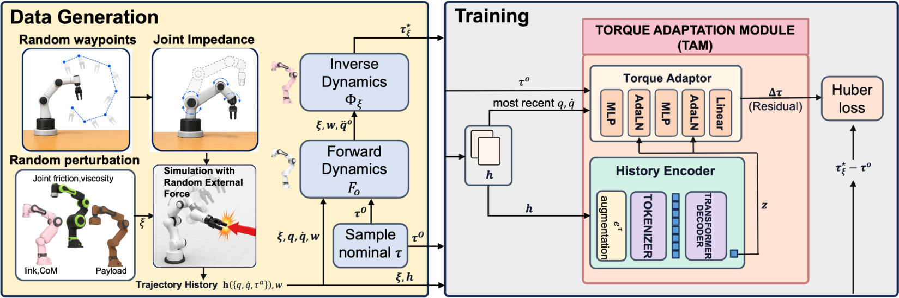
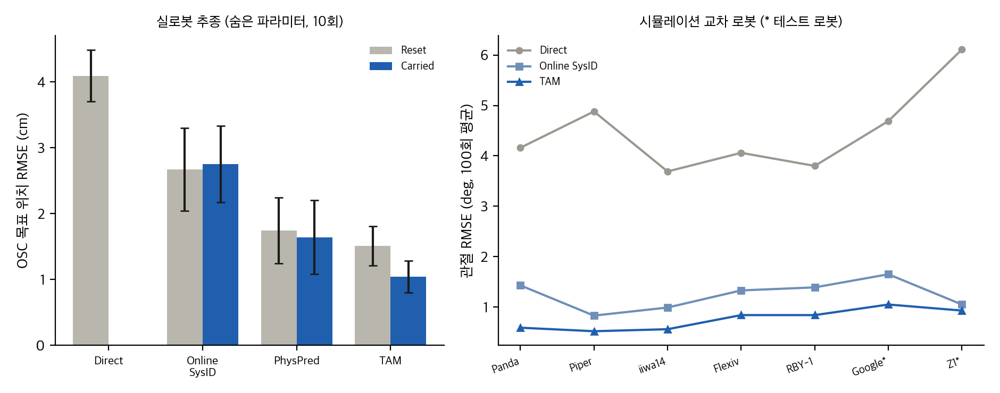
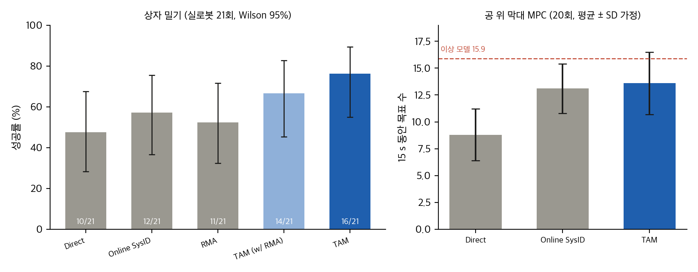
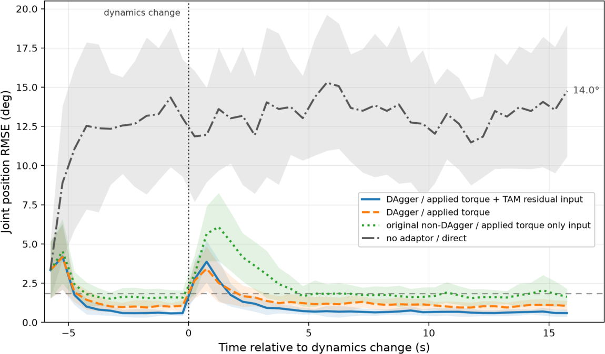
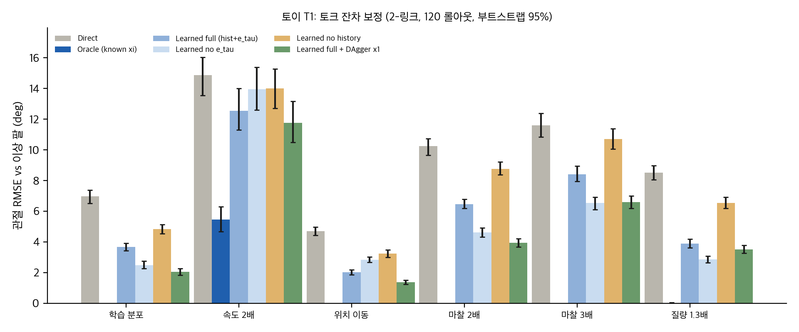

> **논문:** Dongwon Son, Florian Shkurti, Jason Lee, Naman Shah, Beomjoon Kim, Dieter Fox. *TAM: Torque Adaptation Module for Robust Motion Transfer in Manipulation.* CoRL 2026 Spotlight, arXiv:2606.06218 (v3, 2026-10-12).
> 공식 코드는 GitHub Dongwon-Son/TAM에 있습니다(라이선스 파일 없음). 이 글의 그림은 논문 그림 두 장(출처 표기)과 우리가 그린 그래프입니다.

## 논문이 묻는 것

정책은 한 로봇에서 배우고 다른 로봇에서 돌립니다. 질량, 마찰, 토크 이득이 조금만 달라도 접촉이 많은 동작은 타이밍이 어긋나 실패합니다. 흔한 대응은 두 가지입니다. 도메인 무작위화로 정책을 보수적으로 만들거나, 시스템 식별로 로봇마다 모델을 다시 맞추는 것입니다.

TAM은 세 번째 자리를 택합니다. 정책과 저수준 컨트롤러 사이가 아니라 **컨트롤러와 토크 명령 사이**에 작은 학습 모듈을 둡니다. 이력 인코더가 고유감각과 적용 토크의 긴 히스토리(12 s, 1 kHz)를 잠재 상태로 줄이고, 토크 어댑터가 1 kHz에서 잔차 토크를 더합니다. 정책 관측과 행동 공간을 보지 않으니 같은 가중치를 관절 목표, 말단 목표, 직접 토크 정책에 붙일 수 있습니다.

*그림 2 (논문 원문). © 저자, CC BY 4.0, 출처 arXiv:2606.06218.*

## 이 글에서 확인한 것

**1. 추종 오차 개선은 확실합니다.** 실로봇 Franka Panda에서 OSC 목표 위치 오차는 Online SysID보다 모든 조건에서 낮습니다. Welch 검정 p < 0.001(10회, 표 2)입니다. 교차 로봇 시뮬레이션(7대, 100회)에서도 모든 로봇에서 SysID보다 낮습니다(표 3, p ≤ 8e-5).

*그래프 (우리가 그림). 표 2와 표 3의 평균과 SD를 다시 그렸습니다. 이름 뒤 별표(\*)는 테스트 로봇입니다.*

**2. 실로봇 과제 성공률은 방향만 맞습니다.** 상자 밀기는 21회입니다. TAM 76.2%는 Direct 47.6%보다 높지만 Fisher p = 0.11입니다. Online SysID 57.1%와는 p = 0.33입니다. 80% 검정력으로 Online SysID와 가르려면 팔당 약 95회가 필요합니다. flip(50회)은 Online SysID보다 확실히 낫습니다(p = 0.0003). 공 MPC는 Direct보다 낫지만 Online SysID 13.1 대 TAM 13.6은 차이가 없습니다(p = 0.55, SD 가정). 논문의 "두 기준선보다 낫다"는 Direct에 대해서만 맞습니다.

*그래프 (우리가 그림). 상자 밀기는 Wilson 95% 구간, 공 MPC는 평균 ± SD(가정)입니다.*

**3. 부록의 한 주장은 맞지 않습니다.** 부록 D.2는 "eτ를 빼면 모든 로봇에서 나빠진다"고 씁니다. Piper에서는 0.52대 0.54로 차이가 없습니다(p = 0.36).

**4. 역변환 식은 서로 맞습니다.** 불감대, 액추에이터 역함수, 교사 토크(식 1)를 수치로 확인했습니다. 왕복 오차는 10^-13 수준입니다. 이 계산이 라벨을 만드는 기반입니다.

## 공식 코드와 논문의 차이

공식 저장소의 구조(인코더, 어댑터, e_τ 필터, 마찰과 불감대 식, 배포 분할)는 논문과 맞습니다. 다만 기본 학습 설정이 본문과 다릅니다.

- 제어 주파수가 1 kHz가 아니라 200/500/1000 Hz에서 무작위로 뽑힙니다(기본값). 논문 본문에는 없습니다.
- DAgger 기본 Huber 임계값이 1.0입니다. 본 학습의 0.01과 다르고, 논문에는 DAgger 값이 없습니다. 영잔차 항도 있습니다.
- 교사 토크 샘플 수 기본값이 256입니다(표 B.2는 64).

재현하려면 이 값을 명시해야 합니다. 기준선(온라인 SysID, PhysPred, RMA) 코드와 실로봇 Panda 가중치는 저장소에 없습니다. 공개된 것은 다중 로봇 추론용 체크포인트(16.8 MB)입니다.

**5. 적응 지연은 신뢰구간 없이 보고됩니다.** 논문 4.4절은 파라미터를 갑자기 바꾼 뒤 원 TAM이 안정 수준에 도달하는 데 4.6 s, DAgger 변형은 1.7 s라고 씁니다(20 궤적). 원자료와 신뢰구간이 없어 다시 계산하지 못했습니다.

*그림 4 (논문 원문). © 저자, CC BY 4.0, 출처 arXiv:2606.06218.*

## 토이로 본 것

논문의 핵심 주장, 즉 히스토리로 질량과 마찰을 추정해 토크를 보정한다는 생각을 2-링크 팔 토이에서 확인했습니다(numpy, 한 시드, 약 3.5분).

- 학습 분포에서 추종 오차는 Direct 6.98°에서 히스토리 모델 3.67°, 1회 DAgger 2.04°로 줄었습니다.
- 라벨 검증 손실이 더 낮은 모델(e_τ 포함)이 폐루프에서는 더 나빴습니다. 학습 데이터는 보정 없이 모았기 때문입니다. 1회 DAgger가 이 격차를 줄였습니다. 데이터 양이 늘어난 점과 섞여 있어 원인은 확정하지 않았습니다.
- 학습 범위 밖의 마찰(3배)에서는 보정으로 줄어드는 오차 비율이 학습 분포의 47%에서 28%로 줄었습니다. 속도를 2배로 올리면 필요한 토크가 ±30 Nm 한계를 넘어 오라클도 5.4°의 오차가 남습니다.

*그래프 (우리가 그림). 2-링크 토이, 롤아웃 120개, 한 시드. 실로봇 결과가 아닙니다.*

## 구현 가능성 (Apple M4 Pro, CUDA 없음)

- **실로봇 재현: 불가.** Franka, 토크 명령 인터페이스, 컨트롤러 브리지(저장소 밖)가 필요합니다.
- **공식 코드로 학습: 사실상 불가.** README가 JAX CUDA를 전제합니다.
- **공식 체크포인트로 시뮬 추론: 조건부.** 새 설치, 코드 실행 승인, 체크포인트 다운로드가 필요합니다. 이 글에서는 하지 않았습니다.
- **구조 재구현(토이): 가능.** 이 글의 토이가 그 예입니다.

이 글은 재현 실험을 하지 않았습니다. 재현은 사용자 승인 뒤에 시작하는 것이 맞습니다.

## 한계

- 실로봇 시도 수가 작습니다(상자 21, flip 50, 공 20, 추종 10). 신뢰구간과 시드 반복이 보고되지 않았습니다.
- 공 MPC의 ±가 SD인지 SE인지 밝히지 않습니다. 이상 시뮬 flip 73.5%의 시도 수도 없습니다.
- 토크 한계를 넘는 빠른 동작과 접촉 패턴은 범위 밖입니다. 부록 G의 안정성 증명은 수동성 형태 제어기를 가정하며, 실험의 임피던스와 OSC 제어기와는 다릅니다.

## 출처와 라이선스

- 논문: arXiv:2606.06218, CC BY 4.0(arXiv 라이선스 페이지 확인). 원문 PDF 저작권 표시는 찾지 못했습니다.
- 그림 2와 그림 4는 논문 원문에서 잘라 실었습니다(© 저자, CC BY 4.0). 실로봇 사진이 있는 그림 1과 3은 싣지 않았습니다.
- 표 값은 인용과 재계산을 위해 옮겼습니다. 그래프, 토이, 분석 문서와 스크립트는 이 저장소 작성자가 만들었습니다.
- 공식 코드, 체크포인트, 데이터는 받아서 실행하지 않았습니다. 코드는 정적으로만 읽었습니다.

## 자료

- [통합 리포트 PDF](report/report_public.pdf)
- [01. 논문 분석: TAM (arXiv:2606.06218)](analysis/01_paper_analysis.md)
- [02. 선행연구와 관련 저장소](analysis/02_prior_work.md)
- [03. 수치 재계산, 일관성 검사, 토이 실험](analysis/03_analysis.md)
- [04. 공식 코드 대조와 구현 가능성](analysis/04_code_verification.md)
