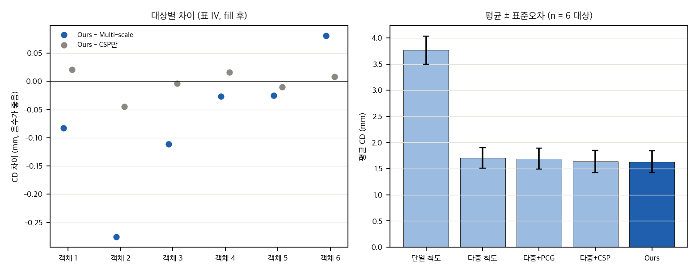
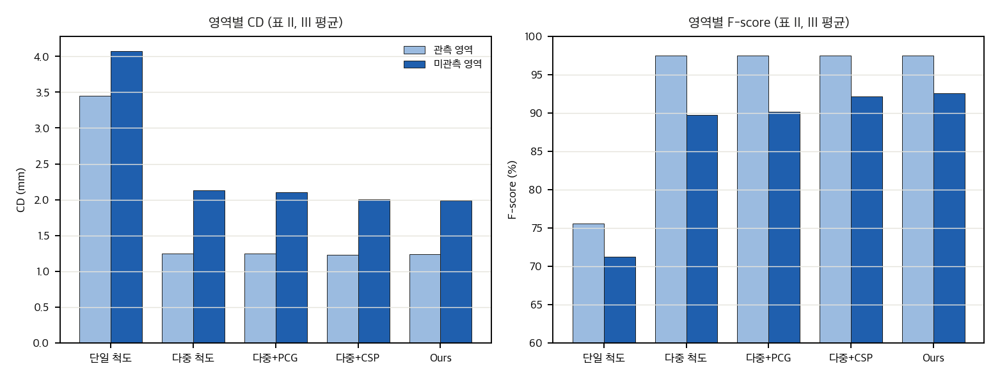
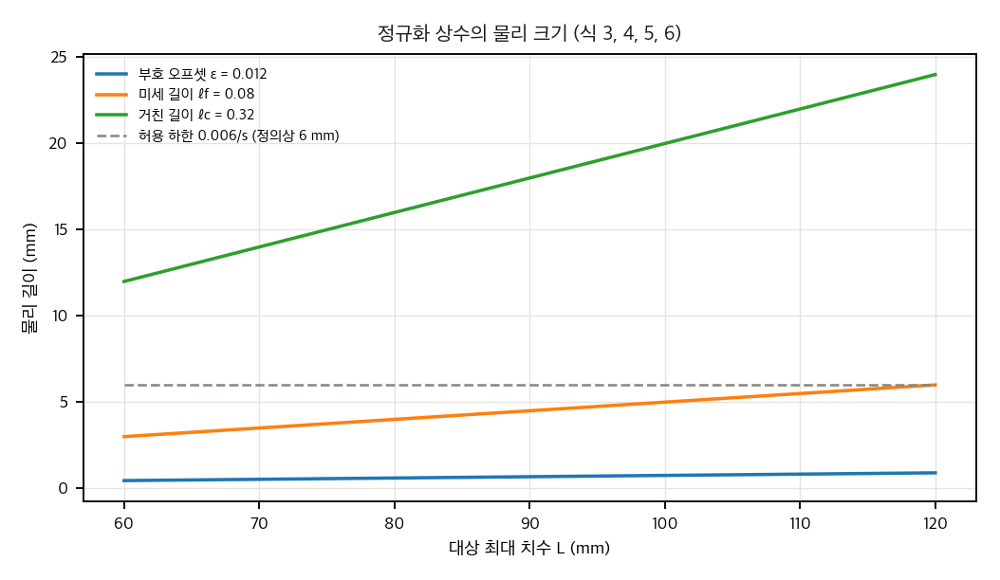

> **논문:** Yoobin Shin, Jaeyoung Lee, Jieun Kang, Hyun Song, Woojin Kim, Andrew Jaeyong Choi. *TapTacTouch: Shape Completion from Sparse Tactile Contacts with Geometric Priors.* arXiv:2611.24207 (v1, 2026-11-18, 8쪽).
> 학회 채택 기록은 확인되지 않았습니다. 공식 코드와 프로젝트 페이지도 찾지 못했습니다. 이 글의 그래프는 저자가 표 값으로 그린 것이고, 논문 그림은 싣지 않았습니다(라이선스 non-exclusive).

## 논문이 묻는 것

카메라가 가려진 상황에서 로봇이 물체의 모양을 알려면 손가락으로 만지는 수밖에 없습니다. 이 논문은 질문을 좁힙니다. 시각도, 물체 종류에 대한 사전 지식도, 학습 데이터도 없이, 여러 손가락의 접촉점만으로 연속된 3차원 표면을 만들 수 있을까요?

방법은 가우시안 과정 암묵 곡면(GPIS)입니다. 접촉점과 법선을 부호 거리 제약으로 바꾸고, 다중 척도 커널로 보간해 0 등위면을 마칭 큐브로 뽑습니다. 여기에 두 가지를 더합니다. 하나는 법선이 맞는 접촉 쌍 사이에 가상 접촉을 만드는 것이고, 다른 하나는 층별 측면 접촉의 공통 단면을 평균 함수로 쓰는 것입니다.

## 이 글에서 확인한 것

**표의 평균은 맞습니다.** 초록의 CD 1.610, EMD 7.738, F-score 95.00, 재구성 시간 49.99초는 대상별 값의 평균과 같습니다. 다만 CD는 여섯 대상의 표준편차가 0.52 mm이고, 95% 신뢰구간이 1.06–2.16 mm입니다.

**"실로봇" 수치의 조건이 다릅니다.** 논문은 접촉점을 GT 표면에 투영하고 표준편차 0.5 mm의 잡음을 더한 입력으로 지표를 계산했다고 밝힙니다. 로봇으로 실제 촉각 신호를 모아 같은 방식으로 계산한 결과는 없습니다.

**효과가 확실한 것은 다중 척도 커널뿐입니다.** 단일 척도 GPIS에 비해 평균 CD가 약 2.06 mm 낮고, 여섯 대상 모두에서 그렇습니다. 부호 뒤집기 검정의 p 값은 0.031로, 여섯 대상에서 가능한 최소값입니다.

**CSP와 PCG의 추가 효과는 구분되지 않습니다.** Ours와 CSP만 사용한 구성의 차이는 평균 −0.002 mm이고, 여섯 대상 중 세 개에서만 Ours가 낮습니다. PCG만 쓴 경우 관측 영역의 값은 다중 척도와 완전히 같습니다.

**표 I과 표 IV가 대상 1–3에서 다릅니다.** 초록의 1.610은 표 I에서 오는데, 채움 후 표 IV의 평균은 1.632입니다. 어느 단계의 값인지 논문에 명시되어 있지 않습니다.

**평균 함수에는 불연속이 있습니다.** CSP를 켜는 조건(기하 일관성 점수 0.6)에서 평균 함수가 0에서 0.3으로 뜁니다. 여섯 대상의 점수 분포는 보고되지 않았습니다.

정규화 상수는 대상 크기에 따라 물리 길이가 달라집니다. 커널의 짧은 척도는 대상 크기 60–120 mm에서 3–6 mm, 긴 척도는 12–24 mm입니다. 같은 파라미터가 작은 물체와 큰 물체에서 다르게 작동합니다.

## 구현 가능성

- **구현은 가능합니다.** 식 (3)–(14)의 파이프라인은 신경망이 없으므로 numpy와 scipy만으로 CPU에서 돌릴 수 있습니다. 노력은 2–4주로 추정합니다.
- **논문 수치와 실측 재현은 어렵습니다.** 로봇(6자유도 팔, 20자유도 손, 3×3 압력 배열), 대상의 GT 메쉬, 대상별 등록 변환 방법이 공개되지 않았습니다.
- **학습 기반 방법과의 비교는 없습니다.** 논문의 "학습 없이 충분하다"는 주장을 평가하려면 TouchAnything, Touch2Shape 같은 방법과 같은 벤치에서 비교해야 하는데, 이 비교는 논문에 없습니다.

## 빈칸

측정 접촉의 기본 잡음 표준편차, taxel 간격과 FK 보정 오차, 활성 taxel 임계값, 채움 단계의 알고리즘, 대상별 접촉 수가 보고되지 않았습니다. 재현을 시도한다면 이 값들을 직접 정해야 하고, 결과가 그 선택에 따라 달라질 수 있습니다.

## 한계

여섯 개의 3D 프린트 물체, 밑면이 평평한 대상, 반복 측정 없음, 대상별 영역 분해 없음. 이 근거로는 "희소 촉각으로 충분하다"를 일반화하기 어렵습니다. 저자도 적응형 탐색과 더 적은 접촉으로의 재구성을 향후 과제로 밝혔습니다.

## 자료

- [통합 리포트 PDF](report/report_public.pdf)
- [01. TapTacTouch 논문 분석](analysis/01_paper_analysis.md)
- [02. 선행연구, 학회 확인, 코드 탐색](analysis/02_prior_work.md)
- [03. 수치 재계산과 일관성 검사](analysis/03_analysis.md)
- [04. 주장 검증 (공식 코드 없음)](analysis/04_claim_verification.md)
