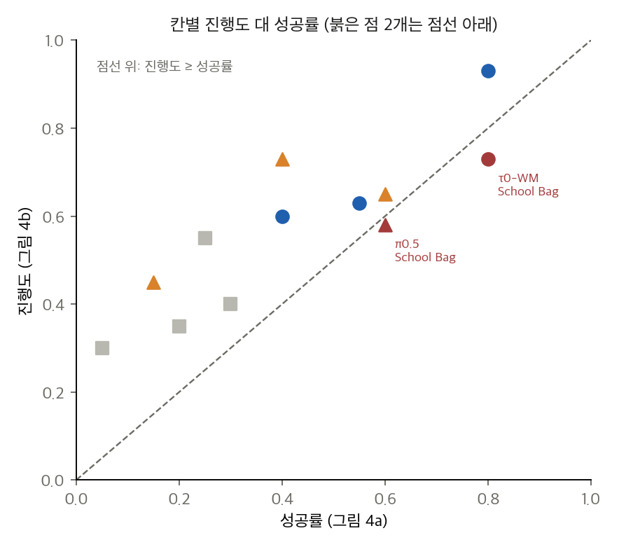
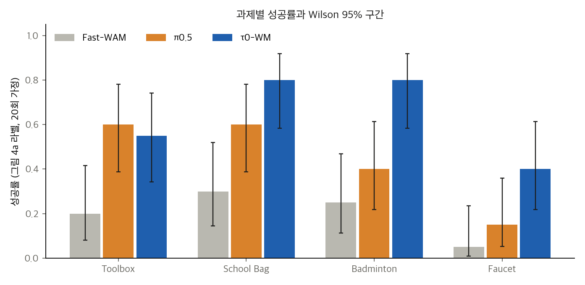
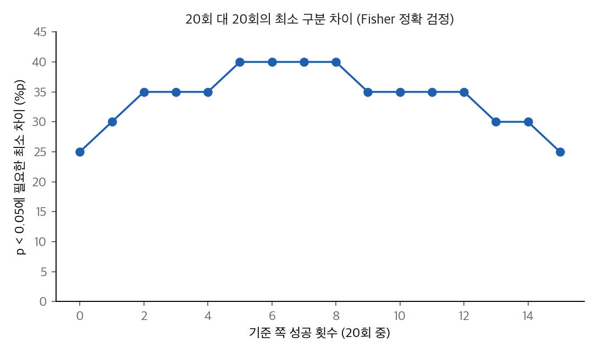
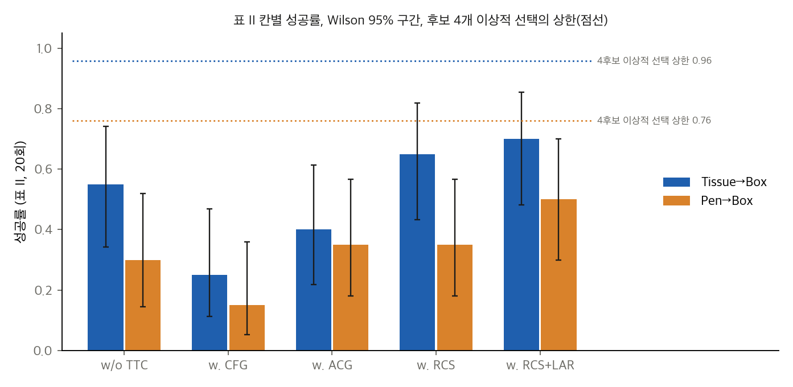
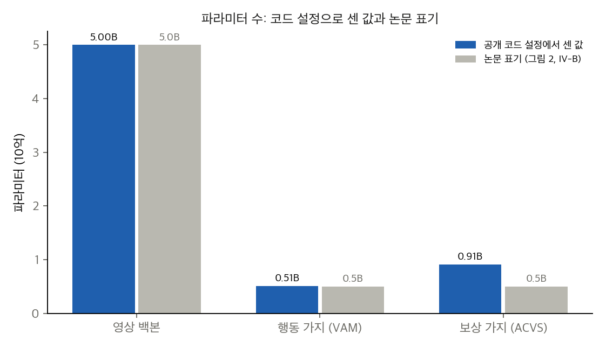
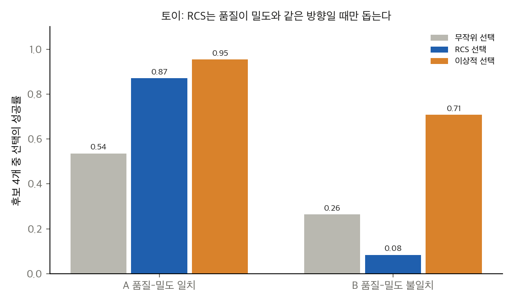

# 03. 수치 재계산과 해석: τ0-WM

재계산은 `analysis/recompute.py`(수 초, numpy·scipy), `analysis/param_count.py`(해석적 파라미터 수), `analysis/toy_rcs_selection.py`(토이 T1, 약 40초)로 했고 결과는 각각 `recompute_results.json`, `param_count_results.json`, `toy_rcs_selection_results.json`에 있습니다. 새 설치, 학습, 가중치 다운로드는 없습니다.

## 0. 시행 수에 대하여 (먼저 읽을 것)

논문이 시행 수를 밝힌 곳은 **표 II의 "20회 반복"(VII-B)** 하나입니다. 그림 4와 표 I에는 없습니다. 아래 검정은 다음 가정을 씁니다. 가정은 결과 옆에 적었습니다.

| 대상 | 가정한 시행 수 | 이유 |
|---|---|---|
| 표 II | 20 (본문) | VII-B |
| 그림 4 성공률 | 20 | 모든 값이 0.05의 배수이고 평균(0.44, 0.64)도 20회 가정과 맞음 (V3) |
| 표 I SFT | 20 | 네 값이 모두 0.05의 배수 |
| 표 I zero-shot | 32 | 0.22, 0.06, 0.56, 0.53이 정수 성공 수로 복원되는 가장 작은 n (7, 2, 18, 17회). 20회로는 복원되지 않음 (V3) |

가정이 틀리면 p 값이 달라집니다. 시행 수가 더 크면 같은 값이라도 더 뚜렷해지고, 더 작으면 덜 뚜렷해집니다. 이 가정은 표본 크기를 정하는 것이어서, 저자가 시행 수를 밝히면 바로 다시 계산할 수 있습니다. 모든 검정은 두 비율에 대한 Fisher 정확 검정(양측)이며, 같은 칸에서 방법끼리 비교할 때 시행이 짝지어졌는지는 알 수 없어 독립 비교로 계산했습니다.

## V1. 데이터 구성 (III절, 그림 1)

| 항목 | 계산 | 보고 값 | 일치 |
|---|---|---|---|
| 시간 합 | 17.8 + 6.5 + 3.0 = 27.3 K h | 27.3K h | 일치 |
| 비율 | 65.2%, 23.8%, 11.0% | 65%, 24%, 11% (그림 1) | 일치, 합 100 |

한 가지 서술 차이: III절은 세 소스의 합이 27.3K h라고 쓰고, 초록·서론·결론·부록은 27.3K h가 "rollout or failure trajectories"를 포함한다고 씁니다. 롤아웃·실패 궤적이 세 소스 중 어디에 속하는지, 별도 시간이 있는지는 논문에 없습니다(`01` G9). 저자 확인이 필요합니다.

## V2. 그림 4의 평균

| 방법 | 성공률 4칸 평균 | 라벨 | 진행도 4칸 평균 | 라벨 |
|---|---|---|---|---|
| Fast-WAM | 0.200 | 0.20 | 0.400 | 0.40 |
| π0.5 | 0.4375 | 0.44 | 0.6025 | 0.60 |
| τ0-WM | 0.6375 | 0.64 | 0.7225 | 0.72 |

여섯 평균 모두 막대 라벨과 반올림이 일치합니다. 성공률 평균 차이는 τ0-WM 대 π0.5가 +20.0 %p(상대 +46%), 대 Fast-WAM이 +43.8 %p입니다.

## V3. 표 I, II의 평균과 정수 복원

- **표 II의 평균** 다섯 행 모두 두 칸 평균과 일치합니다(0.425→0.43, 0.20, 0.375→0.38, 0.50, 0.60). 0.425와 0.375는 반올림 경계 값이라 "올림" 규칙으로 읽으면 맞습니다.
- **표 I의 평균** 네 행 모두 일치합니다. zero-shot Robot+UMI+Ego의 평균 (0.56 + 0.53)/2 = 0.545가 0.55로 표기되어 있어 역시 올림 규칙입니다. 시행 수 32에서는 정수 성공 수(18 + 17)/64 = 0.547이라 같은 값이 나옵니다.
- **정수 복원 (n이 20 이하인 가장 작은 값을 탐색)**

| 칸 집합 | 모든 값이 복원되는 가장 작은 n |
|---|---|
| 표 II (0.55, 0.30, 0.25, 0.15, 0.40, 0.35, 0.65, 0.70, 0.50) | 20 |
| 그림 4 성공률 12칸 | 20 |
| 표 I SFT (0.85, 0.55, 0.90, 0.75) | 20 |
| 표 I zero-shot (0.22, 0.06, 0.56, 0.53) | **32** (다음은 36, 64) |

표 I zero-shot 칸은 20회로는 정수가 되지 않으므로 SFT 칸과 시행 수가 다를 가능성이 있습니다(Clean과 Clut의 시행 수가 서로 다를 가능성도 배제하지 않았습니다). 저자 확인이 필요합니다.

## V4. 진행도와 성공률의 관계 (그림 4a, 4b)

성공한 시행의 진행도를 1로 보는 정의에서는 칸마다 진행도 ≥ 성공률이어야 합니다. 12칸 중 10칸은 맞고 **두 칸은 진행도가 성공률보다 낮습니다.**

| 칸 | 성공률 (4a) | 진행도 (4b) |
|---|---|---|
| π0.5, School Bag | 0.60 | 0.58 |
| τ0-WM, School Bag | 0.80 | 0.73 |

진행도의 정의가 본문에 없어서(그림 4 캡션은 "stepwise task accomplishment progress") 이 관계가 어긋나는 이유는 알 수 없습니다. 하위 단계의 가중이 성공 판정과 다르게 정의되었거나, 두 지표를 다른 평가 묶음에서 얻었을 가능성이 있고 저자 확인이 필요합니다. 진행도 값은 모두 1/80의 배수(0.0125 격자)와 맞아서, 20회에 4단계 진행도라는 구조와는 모순되지 않습니다. 

## V5. 그림 4 성공률 검정 (20회 가정)

| 비교 | Toolbox | School Bag | Badminton | Faucet | 4과제 합산 |
|---|---|---|---|---|---|
| τ0-WM 대 π0.5 (성공 횟수) | 11 대 12 | 16 대 12 | 16 대 8 | 8 대 3 | 51/80 대 35/80 |
| Fisher p | 1.00 | 0.30 | **0.0225** | 0.155 | **0.017** |
| τ0-WM 대 Fast-WAM (성공 횟수) | 11 대 4 | 16 대 6 | 16 대 5 | 8 대 1 | 51/80 대 16/80 |
| Fisher p | 0.048 | 0.0036 | 0.0012 | 0.020 | 3×10⁻⁸ |

- τ0-WM 대 π0.5는 칸별로는 Badminton만 p < 0.05이고 네 비교의 Holm 보정 뒤에는 0개입니다(최소 보정 p = 0.09). 합산(51/80 대 35/80)으로는 p = 0.017입니다.
- τ0-WM 대 Fast-WAM은 네 칸 모두 p < 0.05이고 Holm 보정 뒤에도 모두 0.05 미만입니다(0.0048–0.048).
- 합산 성공률의 Wilson 95% 구간: τ0-WM 0.64 [0.53, 0.73], π0.5 0.44 [0.33, 0.55], Fast-WAM 0.20 [0.13, 0.30]. τ0-WM과 π0.5의 구간이 조금 겹칩니다.
- "대부분의 과제에서 최고"는 성공률 기준 3/4(Toolbox는 π0.5가 0.60 대 0.55), 진행도 기준도 3/4(Toolbox에서 π0.5가 0.65 대 0.63)입니다. 본문이 Toolbox를 "π0.5가 경쟁력 있다"고 쓴 서술과 같습니다.
- 정리하면 **τ0-WM이 π0.5보다 높다는 방향은 4과제 중 3과제에서 같고 합산에서 뚜렷하지만, 과제별로는 20회 가정에서 구분되지 않습니다**(`01` G2). 

## V6. 표 I 검정 (SFT 20회, zero-shot 32회 가정)

| 평가 | Clean | Clut. | 합산 |
|---|---|---|---|
| zero-shot (n = 32 가정), 18 대 7 / 17 대 2 | p = 0.0097 | p = 7×10⁻⁵ | 35/64 대 9/64, p = 2×10⁻⁶ |
| SFT (n = 20 가정), 18 대 17 / 15 대 11 | p = 1.0 | p = 0.32 | 33/40 대 28/40, p = 0.29 |

- zero-shot에서 UMI·egocentric 추가의 효과(0.14 → 0.55, 약 3.9배)는 시행 수 32와 100 어느 쪽 가정에서도 뚜렷합니다(n = 100이면 p ≈ 10⁻⁶ 이하).
- SFT의 개선(0.70 → 0.83)은 20회 가정에서 칸별, 합산 모두 구분되지 않습니다. 본문의 "benefit remains visible after SFT, particularly under cluttered conditions"는 방향(+20 %p, 15/20 대 11/20)이 있지만 p = 0.32입니다.

## V7. 표 II 검정 (20회)

| 비교 | 성공 횟수 (두 칸 합) | 칸별 p (Tissue→Box, Pen→Box) | 합산 p |
|---|---|---|---|
| RCS 대 w/o TTC | 20/40 대 17/40 | 0.75, 1.00 | 0.65 |
| RCS+LAR 대 RCS | 24/40 대 20/40 | 1.00, 0.52 | 0.50 |
| **RCS+LAR 대 w/o TTC** | 24/40 대 17/40 | 0.51, 0.33 | **0.18** |
| RCS+LAR 대 ACG | 24/40 대 15/40 | 0.11, 0.52 | 0.073 |
| RCS+LAR 대 CFG | 24/40 대 8/40 | 0.010, 0.041 | 0.0005 |
| CFG 대 w/o TTC | 8/40 대 17/40 | 0.11, 0.45 | 0.053 |
| ACG 대 w/o TTC | 15/40 대 17/40 | 0.53, 1.00 | 0.82 |

- 결론(VIII절)의 "significant improvements from test-time computation"은 통계적 유의성으로 읽으면 20회 가정에서 RCS+LAR 대 w/o TTC가 합산 p = 0.18로 확인되지 않습니다(`01` G3). 논문이 "significant"를 통계 검정 의미로 쓴 것인지는 적혀 있지 않습니다. 방향은 모든 칸에서 같습니다(+15 %p, +20 %p).
- 20회 대 20회에서 p < 0.05가 되려면 기준 성공 횟수가 0–15회일 때 25–40 %p의 차이가 필요합니다(최소는 양 끝, 최대 40 %p는 기준 5–8회). 표 II의 칸별 차이(+5 ~ +20 %p)는 모두 그 아래입니다. 

- **본문의 "substantial portion of failures originates from selecting suboptimal action samples"**(RCS만으로 0.43 → 0.50): 후보 4개를 같은 확률로 독립 추출한다고 보면, 후보 중 하나라도 성공이면 고르는 이상적 선택의 성공률 상한은 1 − (1 − 0.425)⁴ = 0.89(칸별 0.96, 0.76)입니다. 보고된 RCS(0.50)와 RCS+LAR(0.60)은 이 상한과 기준 0.425 사이 격차(0.466)의 각각 16%, 38%를 메웁니다. 후보 성공이 독립이라는 가정이 필요하고(같은 장면의 후보는 서로 상관이 클 수 있어 상한이 더 낮을 수 있음) 실제 이득의 한계가 아니라 해석용 눈금입니다.
- **기준선(CFG, ACG) 서술:** 표 II에서 w. CFG(0.20)와 w. ACG(0.38)는 w/o TTC(0.43)보다 낮습니다. CFG의 하락은 합산 p = 0.053입니다. 이 기준선이 공개 코드에는 구현되어 있지 않아(`04` D9) 설정을 확인할 수 없습니다. 

## V8. 지연 산술 (부록 A, B)

220 ms → 180 ms(텍스트 표현 캐시, 출력 변화 없음, −18.2%) → 140 ms(`torch.compile`과 층별 컴파일 등, 추가 −22.2%). 전체 −36.4%. 질의당 180 ms면 초당 5.6회, 140 ms면 7.1회입니다. 덩어리 길이 30을 후퇴 수평선으로 실행한다고 적혀 있어 제어 주파수에 따라 질의가 여유 있거나 부족할 수 있으나, 제어 주파수는 논문에 없습니다. 본문 결과는 `torch.compile` 없이 얻었다고 적혀 있어 140 ms는 본문 성공률의 배포 설정이 아닙니다.

## V9. 입력 크기와 계산량 산술 (공개 코드 설정 기준)

공개 코드 설정(`img_size: [192, 256]`, 두 시점을 가로로 이어 붙임, Wan VAE 스트라이드 16, 패치 (1, 2, 2), `chunk: 9` 프레임)에서 영상 토큰은 3개 잠재 프레임 × 96 = **288개**입니다. 영상 백본(5.0B) 한 번 순전파는 2 × 5.0e9 × 288 ≈ **2.9 TFLOP**(어텐션 항, VAE, 텍스트 인코더 제외 근사)입니다. 논문에는 해상도와 프레임 수가 없습니다(`04` D4).

ACVS 평가를 후보 4개, 시뮬레이터 5스텝, 기억 프레임 3개(코드 기본값, 토큰 576개)로 하면 영상 백본 계산이 약 **115 TFLOP**으로, VAM 한 번의 약 **40배**입니다. 그래서 알고리즘 1이 RCS로 호출 횟수를 줄이는 구조(γ 게이트)는 계산 면에서 타당합니다. 공개 코드의 `sim_refine`는 매 질의마다 ACVS를 돌립니다(`04` D7).

## V10. RCS 이득의 크기 눈금

표 II의 RCS 이득 +7.5 %p(0.425 → 0.50)의 표준오차는 두 칸 합산(40회씩)으로 약 11.2 %p입니다. 즉 이 이득은 표준오차의 0.7배이고, 시행 수가 20이라는 가정 아래에서 RCS의 효과 자체는 이 표만으로 확인할 수 없습니다.

## V11. 파라미터 수 (`analysis/param_count.py`)

공개 코드의 모델 정의와 설정 값으로 층별 파라미터를 해석적으로 세었습니다(코드 실행 없음). 같은 계산이 Hugging Face 파일 크기(API 메타데이터)와 맞는지 확인했습니다.

| 구성 | 계산 | 논문 표기 |
|---|---|---|
| 영상 백본(Wan2.2-TI2V-5B 구조) | 4.9998 B | 5B |
| VAM 행동 가지 (1024차원, FFN 2048, 30층, 영상 특징 cross-attn) | 0.5117 B | 0.5B |
| **VAM 합계** | **5.511 B** | 5.5B |
| ACVS 보상 가지 (1536차원, FFN 2048, 30층) | 0.9145 B | "Optional Reward Expert 0.5B" (그림 2b) |
| ACVS 행동 조건 사영 (26차원 입력) | 0.0378 B | 표기 없음 |
| **ACVS 합계** | **5.952 B** | 표기 없음 |

- 파일 크기가 bf16이라고 보면 VAM 가중치(11,023,431,512 B)는 5.5117 B 파라미터, 시뮬레이터(11,904,308,045 B)는 5.9522 B 파라미터이고, 해석적 계산과의 비는 각각 1.0000(차이 0.005% 이하)입니다. 이는 코드 정의와 공개 가중치 파일이 같은 구조라는 간접 확인입니다(bf16 가정).
- VAM의 5.5B는 논문과 맞습니다. **그림 2b의 보상 가지 "0.5B" 표기는 공개 설정(`act_cond_dim` 기본값 1536)으로 센 값 0.91B와 다릅니다.** 같은 시뮬레이터가 논문 실험의 것인지는 알 수 없고(`04` D10), 

## V12. 본문 서술과 표의 대조

| 서술 | 위치 | 표·그림 | 판정 |
|---|---|---|---|
| zero-shot "0.14 to 0.55" | VII-B | 표 I | 일치 |
| RCS "0.43 to 0.50", RCS+LAR "0.60" | VII-B | 표 II | 일치 |
| "RCS + LAR consistently achieves the best performance across all tasks" | VII-B | 표 II | 일치(두 과제 모두 최고. Pen→Box에서 RCS만 0.35는 ACG와 같은 값) |
| "larger improvement on Pen→Box" | VII-B | 표 II | 방향 일치(+20 %p 대 +15 %p), 차이는 한 시행 규모(20회 가정에서 성공 4회 대 3회) |
| "highest average success rate and best on most tasks" | VII-A | 그림 4a | 일치(3/4) |
| "Faucet remains challenging for every method" | VII-A | 그림 4a | 일치 (0.05, 0.15, 0.40) |
| "four precision-sensitive tasks ... all excluded from the pre-training corpus" | VII-A | - | 확인 불가(코퍼스 목록 없음) |
| "significant improvements from test-time computation" | VIII | 표 II | 20회 가정에서 합산 p = 0.18 (V7) |
| 그림 4a와 4b의 관계 | 그림 4 | 같은 그림 | 두 칸에서 진행도 < 성공률 (V4) |
| 평가 프로토콜 | VII-B | 그림 4 | 표 II만 "no retries"를 명시. 그림 4는 재시도와 성공 판정, TTC 사용 여부가 적혀 있지 않음 |
| 과제 순서 | 그림 3, 4 | - | 그림 3은 Toolbox, School Bag, Faucet, Badminton 순이고 그림 4는 Toolbox, School Bag, Badminton, Faucet 순. 내용은 같음 |

## T1. 토이: RCS가 후보 선택에서 무엇을 가려내는가 (`analysis/toy_rcs_selection.py`)

**질문.** RCS는 "학습된 조건부 행동 분포와의 일관성"을 재는 점수입니다(VI-A). 후보 선택에서 이 점수가 품질(성공)을 가려내는 조건은 무엇인가?

**설정(우리가 만든 모형).** 2차원 행동, 목표 g = (0, 0)에서 거리 0.2 이내를 성공으로 봅니다. flow matching 정책(MLP 4층)을 20,000 샘플로 학습하고 논문의 절차를 그대로 따릅니다. 후보 N = 4를 샘플하고(5 스텝 오일러), 샘플러 시각 5개 중 index int(5 × 0.5)에서 후보 전체에 같은 새 잡음으로 재잡음해 속도 오차를 재고 음수를 취해 최댓값을 고릅니다(공개 코드의 기본 절차와 같은 방식, `04` D6). 시드 5개, 시행 4,000.

| 시나리오 | 데이터 | 무작위 선택 | RCS 선택 | 이상적 선택 | 점수-성공 AUC |
|---|---|---|---|---|---|
| A 품질-밀도 일치 | 성공 성분이 좁음 (σ = 0.05, 비율 0.4), 실패 성분은 넓음 (σ = 0.5) | 0.54 | **0.87** | 0.95 | 0.88 |
| B 품질-밀도 불일치 | 성공 성분이 넓음 (σ = 0.15, 비율 0.4), 실패 성분은 좁고 g에서 떨어짐 | 0.26 | **0.08** | 0.71 | 0.13 |

**해석.** RCS는 학습 분포에서 "밀도가 높은" 후보를 고릅니다. 성공 행동이 밀도가 높은 쪽(정밀한 시연이 모여 있는 경우)이면 이득이 매우 크지만(0.54 → 0.87), 실패 행동이 좁게 모여 있으면(예: 흔한 충돌 패턴) 무작위보다 나빠집니다(0.26 → 0.08). 논문 표 II의 RCS 이득(+7.5 %p)은 이 두 극단 사이의 값이며, 어느 쪽에 가까운지는 후보별 RCS와 성공의 관계(AUC)를 보고해야 가를 수 있습니다. 토이는 2차원 모형이며 논문의 모델과 과제를 대신하지 않습니다. 재현은 `python3 analysis/toy_rcs_selection.py`(torch 필요)입니다. 

## 해석 요약

1. 숫자 자체는 대체로 정합합니다. 평균, 비율, 표와 본문의 대응은 일치하고 반올림도 규칙과 맞습니다(V1, V2, V3, V12).
2. **통계적 근거의 크기는 시행 수에 달렸고 논문에 시행 수가 없습니다.** 20회 가정에서 π0.5 대 τ0-WM은 합산에서만, 테스트 시간 계산의 이득은 합산에서도 구분되지 않습니다(V5, V7).
3. 그림 4의 진행도 정의가 없고 두 칸이 성공률과 어긋납니다(V4).
4. 보상 가지의 크기 표기와 공개 구성이 다릅니다(V11).
5. RCS는 품질이 밀도와 같은 방향일 때 가장 잘 듣는 필터일 가능성이 큽니다(T1, 모형 가정).
