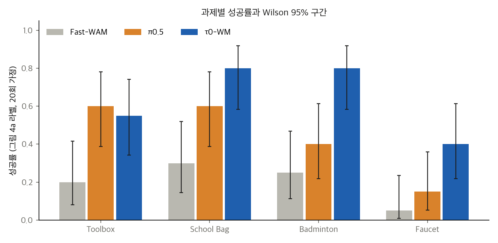
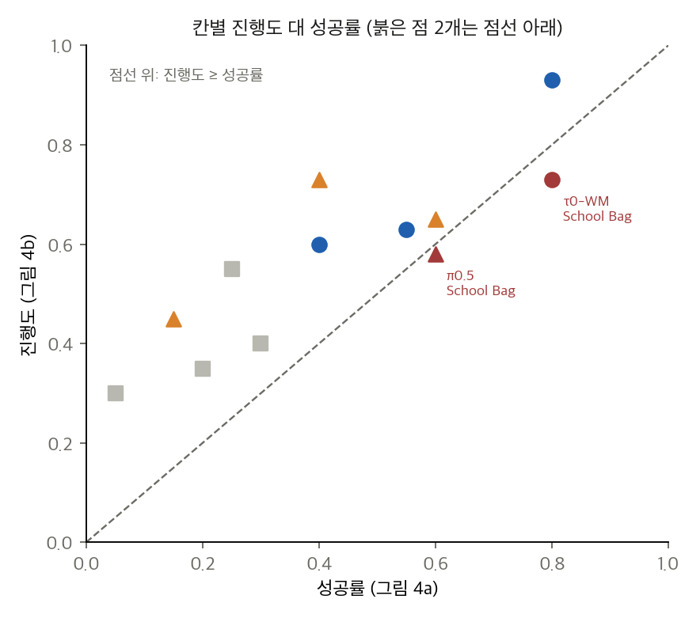
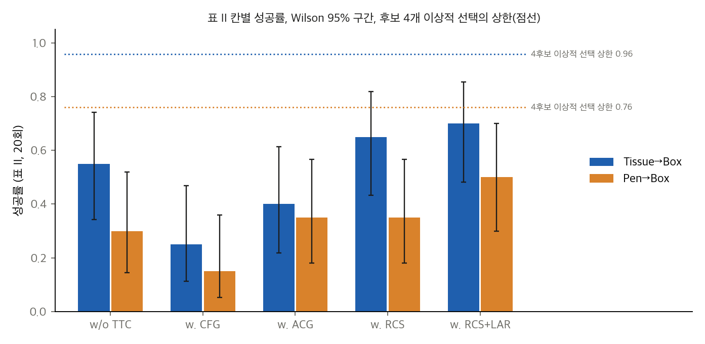
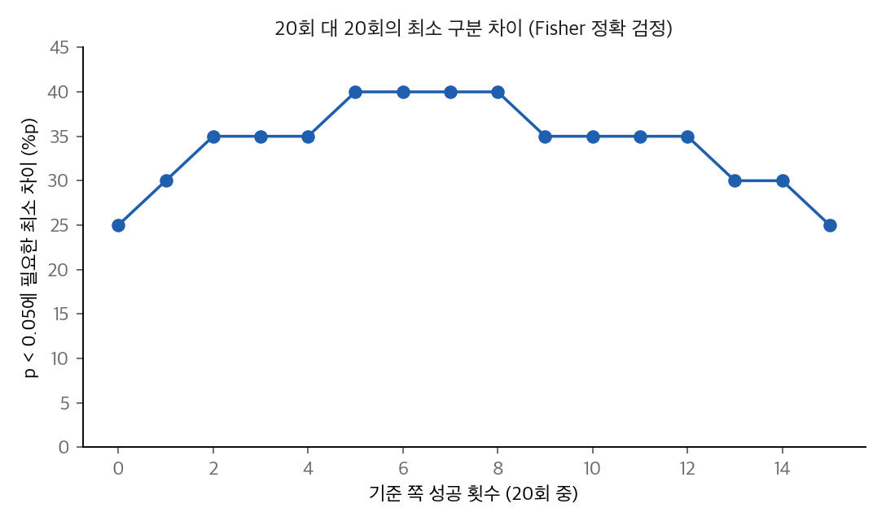
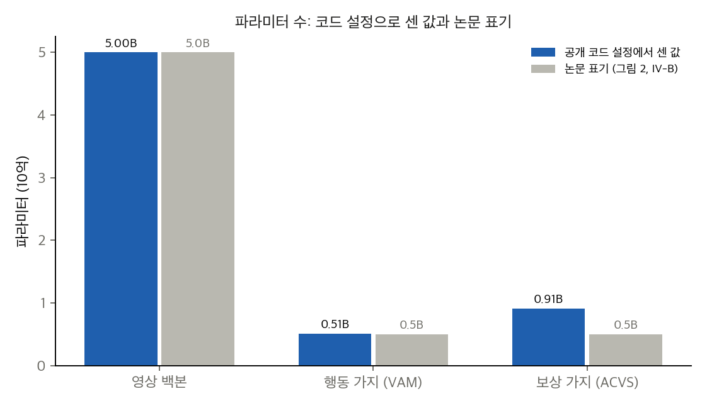
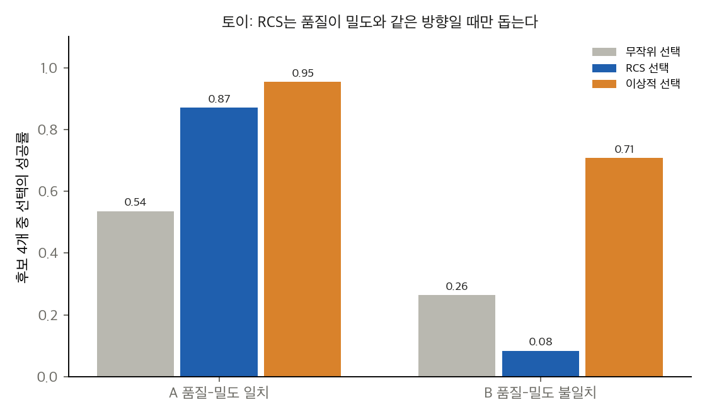

> **논문:** Pengfei Zhou, Shengcong Chen 외. *τ0-WM: A Unified Video-Action World Model for Robotic Manipulation.* CoRL 2026 포스터, arXiv:2606.01027 (v2, 2026-08-23). v1(2026-05-31)과 본문, 표, 그림이 같고 표지의 프로젝트 주소만 다릅니다.
> 공식 코드는 정적으로만 읽었고 실행하지 않았습니다. 논문 그림은 싣지 않고 우리가 만든 그래프만 씁니다(논문 라이선스 CC BY-NC-SA 4.0).

## 논문이 묻는 것

로봇 시연은 행동 라벨이 있지만 좁고 비싸고, 영상은 넓지만 행동 라벨이 없습니다. τ0-WM은 미래 관측, 행동, 과제 진행을 한 영상 확산 백본(Wan2.2-TI2V-5B) 위에 올립니다. 정책 역할의 Video Action Model(VAM)은 다시점 관측, 언어, 로봇 상태에서 미래 영상 잠재와 행동 덩어리를 함께 생성하고, 행동 조건 영상 시뮬레이터(ACVS)는 후보 행동을 넣어 미래 영상과 밀집 보상을 예측합니다. 데이터는 약 27,300시간(로봇 원격조작 17.8K, UMI 계열 6.5K, egocentric 영상 3.0K)이고, 소스마다 자기가 가진 신호만 감독하는 마스크를 씁니다. 배포 때는 후보 행동 4개를 뽑아 재잡음 일관성 점수(RCS)로 고르고, 믿기 어려우면 ACVS로 미래를 상상해 다시 질의합니다. 보고된 네 과제 평균 성공률은 τ0-WM 0.64, π0.5 0.44, Fast-WAM 0.20입니다.

## 이 글에서 확인한 것

**보고된 평균과 비율은 표, 본문과 맞습니다.** 그림 4의 평균 여섯 개, 표 I·II의 평균, 데이터 시간의 합(17.8 + 6.5 + 3.0 = 27.3K 시간)과 비율(65/24/11%)을 다시 계산했고 모두 일치합니다. 서술 하나는 확인이 필요합니다. 데이터 절은 세 소스의 합이 27.3K 시간이라고 쓰고, 초록과 결론은 27.3K 시간에 롤아웃·실패 궤적이 포함된다고 씁니다. 롤아웃·실패 궤적이 세 소스 중 어디에 속하는지는 적혀 있지 않습니다.

**시행 수가 본문에 없습니다.** 표 II만 "20회 반복"이라고 적혀 있고 그림 4와 표 I에는 없습니다. 그림 4의 성공률은 모두 0.05의 배수라서 칸당 20회로 보면 정수와 맞습니다(시행 수 20 가정). 표 I의 zero-shot 칸(0.22, 0.06, 0.56, 0.53)은 20회로는 정수 성공 수가 되지 않고, 모두 맞는 가장 작은 정수는 32입니다. 같은 표의 SFT 칸은 20회와 맞아서, 칸마다 시행 수가 다를 가능성이 있습니다.

**π0.5 대비 우위는 합산에서 뚜렷하고 과제별로는 구분되지 않습니다.** 칸당 20회 가정에서 τ0-WM 대 π0.5는 네 과제 합산 51/80 대 35/80(Fisher p = 0.017)입니다. 과제별로는 Badminton만 p = 0.0225이고(16/20 대 8/20), 네 비교를 Holm 보정하면 0개입니다. Toolbox에서는 π0.5가 0.60 대 0.55로 높고 본문도 이를 적었습니다. Fast-WAM 대비는 네 과제 모두 p < 0.05입니다.

그래프: 그림 4a의 막대 라벨을 옮기고 칸당 20회를 가정해 Wilson 95% 구간을 그렸습니다. 우리가 그린 그래프입니다.

**그림 4b의 진행도가 4a의 성공률보다 낮은 칸이 두 곳 있습니다.** π0.5의 School Bag은 성공률 0.60, 진행도 0.58이고 τ0-WM의 School Bag은 성공률 0.80, 진행도 0.73입니다. 성공한 시행의 진행도를 1로 보는 정의라면 진행도가 성공률 이상이어야 하지만, 진행도의 정의가 본문에 없어서 어긋나는 이유는 알 수 없습니다. 하위 단계의 가중이 다르거나 두 지표를 다른 평가 묶음에서 얻었을 가능성이 있고 저자 확인이 필요합니다.

그래프: 그림 4a(성공률)와 4b(진행도)의 칸별 값. 점선 위쪽이 진행도 ≥ 성공률이며 붉은 점 두 개가 점선 아래에 있습니다. 우리가 그린 그래프입니다.

**테스트 시간 계산의 이득은 20회 가정에서 구분되지 않습니다.** 표 II에서 RCS+LAR은 24/40 대 17/40(w/o TTC, p = 0.18), RCS만은 20/40 대 17/40(p = 0.65)입니다. 두 과제 모두에서 방향은 같고(+15, +20 %p), 20회 대 20회에서 p < 0.05가 되려면 25–40 %p의 차이가 필요해서 칸별 차이(+5 ~ +20 %p)는 모두 그 아래입니다. 결론의 "significant improvements from test-time computation"을 통계적 유의성으로 읽으면 이 가정에서는 확인되지 않습니다. 같은 표에서 CFG(0.20)와 ACG(0.38)는 기준(0.43)보다 낮고, 공개 코드에는 두 기준선의 구현이 없습니다. 후보 4개가 서로 독립이라고 가정하면 이상적 선택의 성공률 상한은 0.89(과제별 0.96, 0.76)이고, 보고된 RCS+LAR(0.60)은 기준과 상한 사이 격차의 38%입니다.

그래프: 표 II의 칸별 성공률과 Wilson 95% 구간(20회), 후보 4개를 같은 확률로 독립 추출할 때 이상적 선택의 상한(점선). 우리가 그린 그래프입니다.

그래프: 기준 쪽 성공 횟수별로 20회 대 20회에서 Fisher 정확 검정 p &lt; 0.05가 되는 최소 차이. 우리가 그린 그래프입니다.

**표 I: 사전학습 데이터의 효과는 zero-shot에서 뚜렷하고 SFT에서는 이 시행 수로 구분되지 않습니다.** zero-shot Pen-to-holder는 Robot 0.14 대 Robot+UMI+Ego 0.55로, 시행 수 32 가정에서 35/64 대 9/64(p = 2×10⁻⁶)이고 100회로 가정해도 방향과 크기가 같습니다. SFT는 0.70 대 0.83이며 20회 가정에서 33/40 대 28/40(p = 0.29)입니다.

## 파라미터와 계산량

공개 코드의 모델 정의와 설정 값으로 층별 파라미터를 해석적으로 세었습니다(코드는 실행하지 않았습니다). 영상 백본 5.00B, VAM 행동 가지 0.51B로 합계 5.51B이고, 공개 가중치 파일 크기(bf16 가정)에서 거꾸로 센 값과 0.005% 이내로 맞습니다. 논문의 5.5B와 일치합니다. 반면 시뮬레이터의 보상 가지는 공개 설정(차원 1536)으로 0.91B이고, 논문 그림 2b는 "0.5B"로 표시합니다. 공개 시뮬레이터가 논문 실험의 것과 같은 구성인지는 알 수 없습니다.

그래프: 공개 코드 설정에서 센 파라미터와 논문 표기의 비교. 우리가 그린 그래프입니다.

공개 설정(해상도 192×256, 두 시점, 영상 9프레임)에서 영상 토큰은 288개이고, 영상 백본 한 번 순전파는 약 2.9 TFLOP(근사)입니다. ACVS로 후보 4개를 5스텝씩 평가하면 약 115 TFLOP으로 VAM 한 번의 약 40배입니다. 논문이 RCS로 호출 횟수를 줄이는 구조(알고리즘 1)를 둔 이유가 계산 면에서 설명됩니다.

## 공식 코드와 논문의 차이

공식 저장소(커밋 `e03902a`)를 논문과 대조했습니다. 공개된 것은 사후학습, 추론, 테스트 시간 계산, 시뮬레이터이고 사전학습 코드, 감독 마스크 구현, 평가 코드, 기준선은 없습니다.

- **게이트 방식.** 논문의 알고리즘은 RCS가 임계값 γ 미만일 때만 ACVS를 부릅니다. 공개 코드에는 γ가 없고, `sim_refine`를 켜면 매번 ACVS로 모든 후보를 평가한 뒤 예측 보상이 음수일 때만 재질의합니다. 재질의에는 시뮬레이터의 중간 잠재를 씁니다.
- **RCS 시각.** 논문은 무작위 `K`개의 흐름 시각을 말하고, 코드의 기본값은 샘플러 시각 하나(비율 0.5)이며 후보 전체가 같은 새 잡음을 씁니다.
- **행동 전용 추론.** 영상 DiT를 미래 칸이 순수 잡음인 상태로 한 번만 돌려 특징을 얻고, 행동 가지가 그 특징을 보며 5스텝으로 노이즈 제거합니다. 미래 영상은 노이즈 제거되지 않습니다.
- **보상 라벨.** 논문은 하위 과제 단위의 진행 라벨과 구간 내 몬테카를로 전파를 말하고, 공개 예제 데이터셋은 에피소드 전체를 한 구간으로 보고 감쇠 0.9의 반환을 씁니다(예제로 명시).
- **기억 관측.** 논문의 `o_{t−M:t}`는 최근 M개로 읽히고, 코드는 3개 프레임을 에피소드 시작부터 현재까지 균등 간격으로 뽑습니다.
- **크기와 값.** 예측 행동 33개 중 30개 실행, 영상 9프레임(미래 잠재 2칸), 학습 때 캡션과 행동 드롭아웃 같은 값은 논문에 없고 코드에서만 확인됩니다.
- **라이선스.** README는 Apache-2.0이라고 쓰지만 링크가 다른 저장소의 LICENSE이고 저장소에 라이선스 파일이 없습니다.

## 토이: RCS는 언제 후보 선택을 돕는가

RCS는 학습된 행동 분포와의 일관성을 재는 점수입니다. 2차원 행동 분포를 flow matching으로 학습한 작은 모델에서 논문의 절차(후보 4개, 같은 잡음으로 재잡음, 속도 오차의 음수, 최댓값 선택)를 그대로 돌렸습니다. 성공 행동이 학습 분포에서 밀도가 높은 쪽이면 후보 4개 중 선택의 성공률이 무작위 0.54에서 0.87로 올라(이상적 선택 0.95), 점수와 성공의 AUC는 0.88입니다. 반대로 실패 행동이 좁게 모여 밀도가 높으면 0.26에서 0.08로 내려가고 AUC는 0.13입니다. 이 토이는 우리가 만든 2차원 모형이며 논문의 모델과 과제를 대신하지 않습니다. 표 II의 RCS 이득이 이 둘 사이 어디에 있는지는 후보별 점수와 성공의 관계를 보고해야 가를 수 있습니다.

그래프: 2차원 flow matching 정책에서 후보 4개 중 선택의 성공률(무작위, RCS, 이상적), 두 시나리오, 시드 5개 평균. 우리가 그린 그래프입니다.

## 구현 가능성

논문 수치의 재현에는 비공개 로봇 데이터(17.8K 시간), 사전학습 코드, 다중 GPU, 실로봇(AGIBOT-G01, ARX, 이중 Franka)이 필요합니다. 공개 코드와 가중치(VAM 11.0 GB, 시뮬레이터 11.9 GB, Wan2.2 텍스트 인코더 11.4 GB)로 추론은 할 수 있으나, 테스트 시간 계산과 시뮬레이터 경로는 코드에 CUDA 호출이 고정되어 있습니다. 소형 장치에서는 구조의 축소 재구현과 후보 선택 로직의 장난감 검증이 현실적입니다.

## 저자에게 확인하고 싶은 것

1. 그림 4와 표 I의 시행 수, 성공 판정 규칙, 재시도 허용 여부, 그림 4의 τ0-WM이 테스트 시간 계산을 쓴 값인지.
2. 진행도(그림 4b)의 정의와 School Bag 두 칸의 관계.
3. 알고리즘 1의 γ, `K`, 영상·행동 시야, 기억 길이와 공개 코드의 보상 부호 게이트의 관계.
4. 그림 2b의 보상 가지 크기와 공개 시뮬레이터의 구성.
5. 롤아웃·실패 궤적이 27.3K 시간에 포함되는지.

## 자료

- [통합 리포트 PDF](report/report_public.pdf)
- [01. 논문 분석: τ0-WM (arXiv:2606.01027)](analysis/01_paper_analysis.md)
- [02. 선행연구와 관련 자료: τ0-WM](analysis/02_prior_work.md)
- [03. 수치 재계산과 해석: τ0-WM](analysis/03_analysis.md)
- [04. 공식 코드 대조와 구현 가능성: τ0-WM](analysis/04_code_verification.md)
