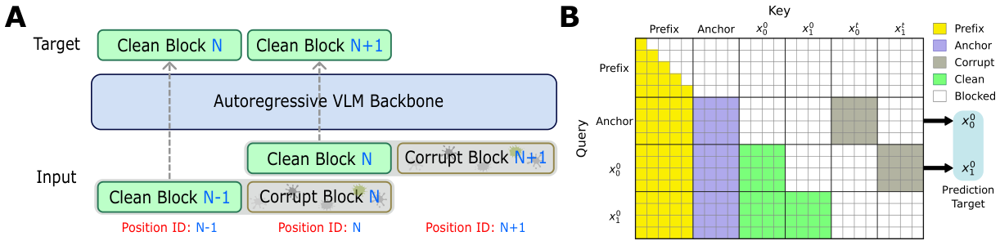
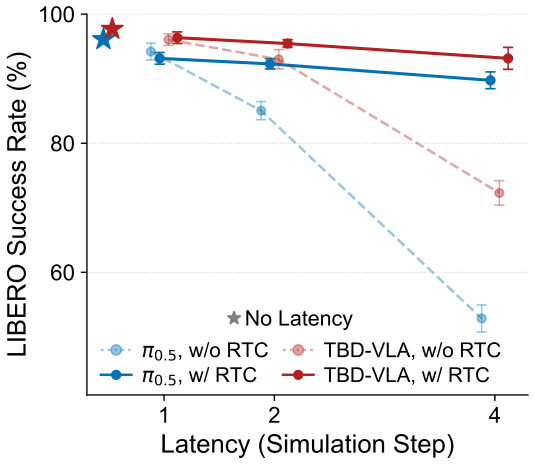
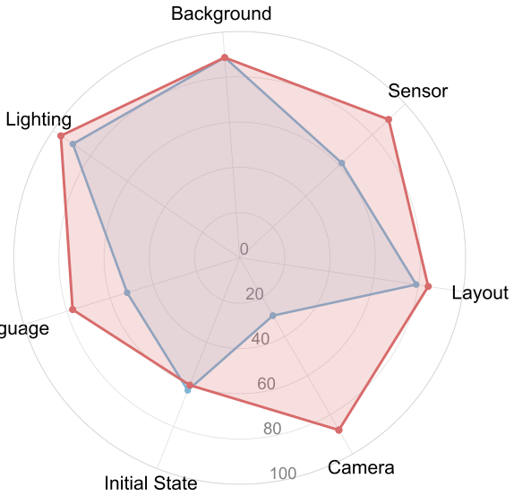
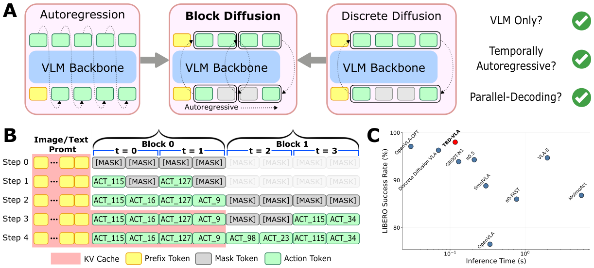
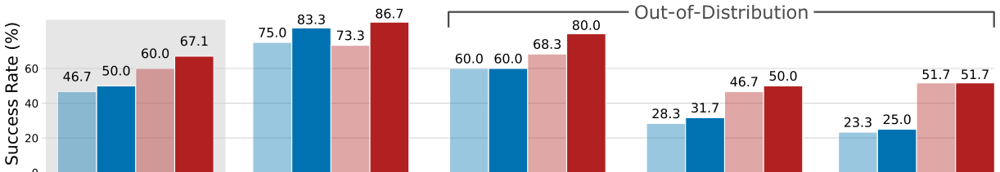

# 01. 논문 분석: TBD-VLA (arXiv:2606.07895)

*TBD-VLA: Temporal Block Diffusion Vision Language Action Model* (Sung-Wook Lee, Xuhui Kang, Yen-Ling Kuo, University of Virginia). 분석 대상은 arXiv v1(2026-06-05)이며 유일한 판본입니다(abs 페이지 Submission history에 v1만 있음, 2026-11-26 확인). 쪽수 20쪽.

## 0. 판본, 학회, 라이선스

| 항목 | 내용 |
|---|---|
| 판본 | v1만 있음(2026-06-05). 판본 간 차이 없음 |
| 학회 | CoRL 2026 포스터. corl.org 공식 채택 목록(Poster post-p1, 11/9 5:00–6:30 PM, 포스터 11번)에 있고 프로젝트 페이지도 CoRL 2026을 표기. arXiv 주석란은 비어 있음 |
| 라이선스 | abs 페이지의 license 링크가 `http://creativecommons.org/licenses/by/4.0/`(CC BY 4.0). PDF 첫쪽과 끝쪽에서 ©, copyright, All rights reserved, 회사 고지를 찾지 못함 |
| 코드 | `github.com/TBD-VLA/lerobot`(LeRobot 포크, Apache-2.0), 프로젝트 페이지 `tbd-vla.github.io`, Hugging Face 체크포인트 `sean1295/tbdvla_libero` |

## 1. 한 문단 요약

이산 토큰 VLA는 행동을 토큰으로 바꿔 VLM이 직접 생성하게 한다. 한 토큰씩 생성하면 느리고, 이산 확산으로 병렬 디코딩하면 빠르지만 시간 축 의존성을 따로 모델링하지 않는다. TBD-VLA는 행동 시퀀스를 시간 블록(m = 4 스텝)으로 나눠 **블록 안에서는 마스크 이산 확산으로 병렬 디코딩하고 블록 사이는 자기회귀**로 생성한다(Block Diffusion, Arriola et al.의 행동 토큰판). 백본은 Qwen3-VL 2B, 행동은 512 bin으로 이산화한 토큰이다(§4.1, 표 8). 같은 틀로 "앞 청크의 꼬리를 확정 토큰으로 고정"하는 hard in-painting을 하면 Real-Time Chunking(RTC)이 된다(§4.3).

## 2. 방법

### 2.1 문제 설정과 분해 (§3)

행동 청크 A_t를 H_p = 16 스텝, 행동 차원 D_a(코드와 LIBERO 설정에서 7)로 두면 토큰 수는 L = H_p · D_a = 112이다. 우도는 블록 k = 0..K−1(K = H_p/m = 4)에 대해 p(a_{1:H_p}|o,g) = Π_k p_θ(a_{km+1:(k+1)m} | o, g, a_{1:km})로 분해한다(§3의 식).

### 2.2 학습 (§4.2, 그림 2, 식 1)

- **시간 단위 토큰 이동(temporal-level token shift).** 현재 블록의 토큰이 다음 블록을 예측하도록 목표를 한 블록 민다. 첫 블록은 전부 [MASK]인 앵커 블록 s에서 예측한다(식 1의 z_k).
- **이산 블록 확산.** 블록 k의 각 토큰을 확률 t_{k,i} ~ U(0,1)로 마스크해 x^t_k를 만든다. 손실은 마스크된 위치의 평균 교차 엔트로피이다(식 1 아래).
- **블록 수준 어텐션 마스크(이중 배치).** 깨끗한 열 x^0과 오염된 열 x^t를 이어 붙이고 RoPE 위치를 공유한다. 블록 n의 예측에는 접두 (o,g), 이전 깨끗한 블록 x^0_{0:n−1}, 현재 오염 블록 x^t_n이 쓰인다. 한 번의 순전파로 모든 블록을 학습한다(그림 2B).

그림: 논문 그림 2 (학습: 토큰 이동과 이중 배치 어텐션 마스크). © 저자, CC BY 4.0, 출처 arXiv:2606.07895.

### 2.3 추론 (§4.3)

1. **필요한 블록만 디코딩**: 실행할 길이 H_a에 대해 K_exec = ⌈H_a/m⌉ 블록만 만든다. 순전파 수는 K_exec · n_d(표 5의 열).
2. **접두 KV 캐시**: 영상·프롬프트 토큰과 이미 만든 블록을 캐시한다.
3. **신뢰도 순 마스크 해제**: logit이 높은 토큰부터 확정한다.
4. **기대값 샘플링**: 행동 성분을 예측 분포 전체의 기대값 a = Σ_x p(x) c_j(x)로 디코딩한다(argmax 대신).
5. **RTC**: 지연 창에 해당하는 앞 청크의 꼬리를 얼려 이른 블록의 in-painting 문맥으로 쓴다.

### 2.4 학습 설정 (§5.2, 부록 A, 표 7–10)

| 항목 | 값 | 출처 |
|---|---|---|
| 사전학습 | 11개 데이터 혼합, 160,268 에피소드, 32,351,396 샘플, 80K 스텝, 배치 1008, 약 1,600 GPU 시간(A100 4장) | 표 7, 9, 부록 A.1 |
| LIBERO 미세조정 | 80K 스텝, 배치 72, 약 120 GPU 시간 | 표 9, A.2 |
| SimplerEnv | Widow-X는 Bridge-V2 20K 스텝(약 40 GPU 시간), Google은 Fractal 40K 스텝(약 60 GPU 시간), 배치 256 | 표 9, A.2 |
| 공통 | H_p 16, m 4, n_d 2, 512 bin, MinMax 정규화, AdamW lr 1e-4, wd 0.01, 워밍업 500, 코사인, bf16 | 표 8 |
| 추론 | H_a: LIBERO 12, Widow-X 8, Google 8, 실로봇 12. 기대값 디코딩 | 표 10 |

## 3. 실험과 주요 수치

### 3.1 LIBERO (표 2 왼쪽)

TBD-VLA: Spatial 97.6, Object 99.6, Goal 97.4, Long 96.6, 평균 97.7(§5.3 본문은 97.6). 비교 대상은 π0.5 96.9, dVLA 96.4, Disc Diff VLA 96.3 등. 스위트당 10과제 × 50 롤아웃(§5.1).

### 3.2 지연과 RTC (그림 4, 표 11)

지연 L = 4 시뮬 스텝에서 RTC 없이 72.3%, RTC로 93.2%(+20.9 pp). 본문은 π0.5 + RTC보다 3.4%p 높다고 한다.

그림: 논문 그림 4 (LIBERO 지연 대비 성공률). © 저자, CC BY 4.0, 출처 arXiv:2606.07895.

### 3.3 LIBERO-Plus (표 2 오른쪽 레이더, 표 12)

LIBERO 원본 데이터로만 미세조정한 제로샷. 본문 숫자는 평균 83.0%(§5.3), 부록은 83.49%(B.3). 사전학습 없이는 66.18%로, 사전학습이 +17.31 pp를 낸다(Camera +58.38, Noise +28.29, Language +25.24). 논문 본문의 표 2 오른쪽은 레이더 차트이며 기준선 수치표는 본문에 없다.

그림: 논문 그림 6 (LIBERO-Plus, 사전학습 유무). © 저자, CC BY 4.0, 출처 arXiv:2606.07895.

### 3.4 SimplerEnv (표 3, 4)

Widow-X 평균 66.8%(UniVLA 69.8% 다음 2위). Google Robot Visual Matching 91.0%, Variant Aggregation 86.3%(비교 행 중 최고).

### 3.5 설계 분석 (표 5, 6)

Google Robot 평균 88.7% 설정(m = 4, n_d = 2, 기대값)이 기준. m = 1은 순전파 16회·0.223 s, m = 16은 2회·0.061 s로 성공률이 −4.7 pp, n_d = 1은 −3.0 pp, argmax는 −7.1 pp(RTX A40). 최적화 분해: 기준 0.185 s에서 필요 블록만 0.125, KV 캐시 0.113, VLM 컴파일 0.086 s.

그림: 논문 그림 1 (개요, 디코딩 예, 정확도-지연 산점도). © 저자, CC BY 4.0, 출처 arXiv:2606.07895.

### 3.6 실로봇 (그림 5, 표 13)

Franka Research 3, 과제 셋(Everything in Bin, Bread in Toaster, Transfer the Liquid), 과제당 데모 50개. 네 설정(분포 내, 카메라, 언어, 배경+조명) × 20회 × 3과제 = 방법당 240회. TBD-VLA + RTC 67.1%, π0.5 + RTC 50.0%, RTC 없이 TBD-VLA 60.0%, π0.5 46.7%. 기준선 π0.5는 DROID 체크포인트에서 미세조정했다.

그림: 논문 그림 5의 막대 그래프(실로봇 성공률. 왼쪽부터 평균, 분포 내, 배경·조명, 언어, 카메라이고 각 묶음은 π0.5, π0.5 + RTC, TBD-VLA, TBD-VLA + RTC 순). © 저자, CC BY 4.0, 출처 arXiv:2606.07895.

## 4. 한계(논문 §6)와 이 분석이 본 간격

논문이 밝힌 한계: 보조 VLM 목적과의 공동 학습 미탐색, VLM 단독 디코딩 해석 미탐색, Transfer the Liquid에서 카메라 이동 시 전면 실패.

이 분석이 추가로 본 것(자세한 수치는 `03`):

- **사전학습 대 구조**: LIBERO-Plus 우위는 사전학습 유무에서 나온다. 사전학습 없는 TBD-VLA는 평균 66.2(가중 추정 63.7)로 기준선 OpenVLA-OFT 67.9, RIPT-VLA 68.4보다 낮다. 실로봇 기준선 π0.5(DROID 체크포인트)와는 사전학습 데이터가 다르다.
- **실로봇 우위의 집중**: TBD-VLA + RTC와 π0.5 + RTC의 차이 41회 중 31회가 두 셀(Bread/카메라 19, Liquid/언어 12)에서 나온다. 분포 내 성공은 52/60 대 50/60으로 차이가 없다.
- **수치 표기 불일치**: LIBERO 평균이 본문 97.6, 표 97.7, 행 평균 97.8로 다르고, 표 2와 표 11(L = 0)의 스위트별 값이 다르다. LIBERO-Plus 본문 83.0 대 부록 83.49.
- **지연 수치**: 표 1(0.117 s), 부록 C.3(0.119 s), 표 5·6(H_a = 8에서 0.086 s)이 서로 다른 조건의 값이다. 프로젝트 페이지는 0.095 s(H_a = 12)와 0.070 s(H_a = 8)로 갱신되어 있다.
- **마스크 비율**: 식 1은 토큰마다 t_{k,i}를 뽑는다고 쓰지만 코드는 블록마다 하나의 t를 뽑는다(`04` D2).
