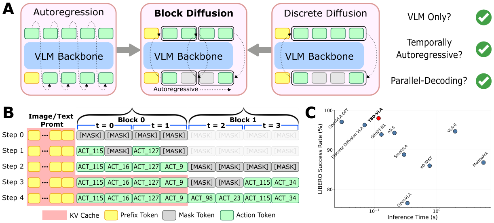
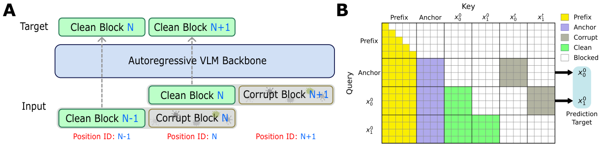
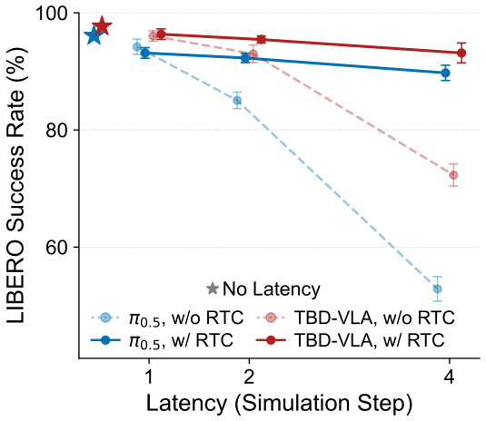
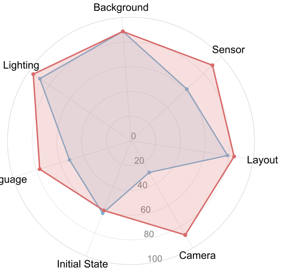
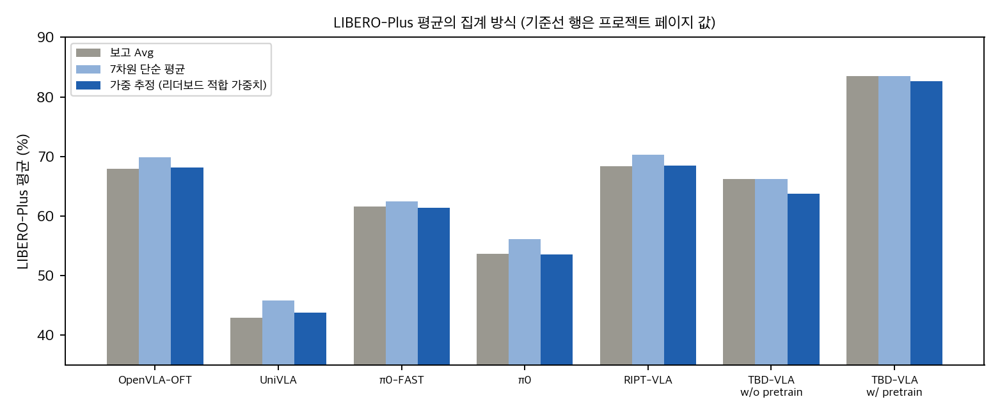
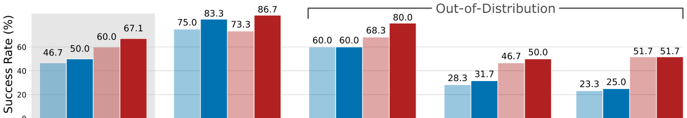
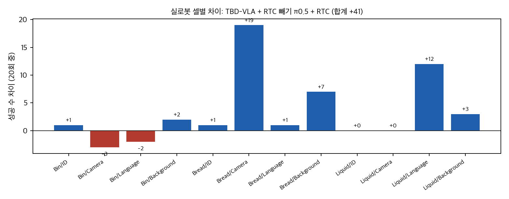
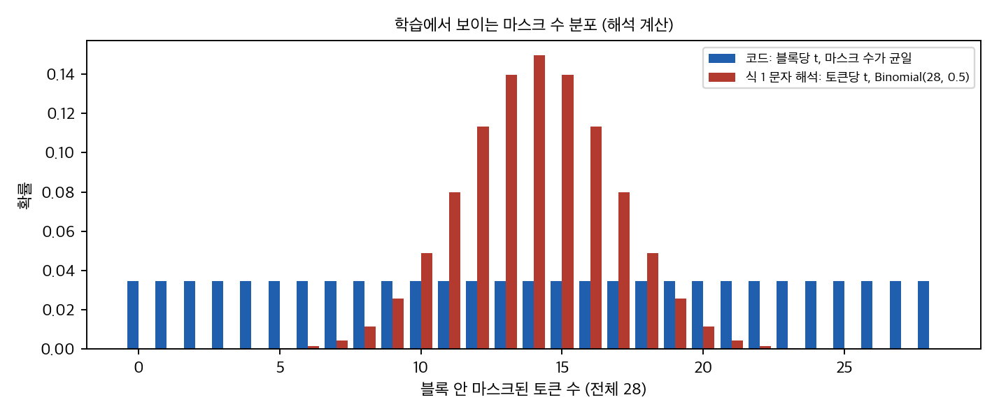

> **논문:** Sung-Wook Lee, Xuhui Kang, Yen-Ling Kuo. *TBD-VLA: Temporal Block Diffusion Vision Language Action Model.* CoRL 2026 포스터, arXiv:2606.07895 (v1, 2026-06-05, 유일한 판본).
> 공식 코드는 GitHub TBD-VLA/lerobot(Apache-2.0)에 있고 이 글은 커밋 `41c746ed487520cf6cc49eb767d090837691e2b2`를 정적으로 읽었습니다. 논문 그림은 arXiv의 CC BY 4.0에 따라 출처를 적어 실었습니다.

## 논문이 묻는 것

이산 토큰 VLA는 행동을 토큰으로 바꿔 VLM이 직접 내놓게 합니다. 토큰을 하나씩 내면 느립니다. 이산 확산으로 한꺼번에 내면 빠르지만 시간 순서 의존성은 따로 다루지 않습니다. TBD-VLA는 행동 청크(16스텝 × 7차원 = 112 토큰)를 4스텝짜리 시간 블록으로 나눕니다. **한 블록 안의 28개 토큰은 마스크 이산 확산으로 병렬 해제하고, 블록 사이는 자기회귀**로 잇습니다. 백본은 Qwen3-VL 2B이고 행동은 512 bin 토큰입니다.

*그림 1 (논문 원문). © 저자, CC BY 4.0, 출처 arXiv:2606.07895.*

학습은 깨끗한 열과 오염된 열을 이어 붙인 이중 배치 어텐션 마스크 한 번의 순전파로 모든 블록을 처리합니다. 추론은 필요한 블록만 디코딩하고 접두 KV를 캐시합니다. 앞 청크의 꼬리를 확정 토큰으로 고정하면 Real-Time Chunking(RTC)도 같은 틀에서 됩니다.

*그림 2 (논문 원문). © 저자, CC BY 4.0, 출처 arXiv:2606.07895.*

## 이 글에서 확인한 것

**1. 이중 배치 마스크는 설계대로 동작합니다.** 공식 코드의 허용 쌍 표를 numpy로 옮겨 2층 무작위 트랜스포머에서 160회 검사했습니다. 정답 블록 이후를 바꿔도 예측 위치의 출력은 변하지 않았고(최대 변화 0), 블록 j까지만 이어 붙인 짧은 열의 출력은 긴 열의 출력과 7e-7 안에서 같았습니다. 무작위 가중치의 작은 모델 결과이고 실제 Qwen3-VL의 RoPE와 캐시 구현은 보지 않았습니다.

**2. RTC는 지연이 클 때 분명히 도움이 됩니다.** LIBERO 네 스위트(표 11, 시행 스위트당 500회 가정)에서 지연 4스텝에 RTC가 없으면 72.3%, 있으면 93.2%입니다(Fisher p ≈ 1e-71). 지연 1스텝에서는 96.1% 대 96.4%로 차이가 관측되지 않습니다(p = 0.68).

*그림 4 (논문 원문). © 저자, CC BY 4.0, 출처 arXiv:2606.07895.*

**3. LIBERO 평균은 가장 높지만 격차는 작습니다.** 표 2의 TBD-VLA 평균은 97.7이고, 본문(§5.3)은 97.6, 네 스위트 값의 평균은 97.8입니다. 가장 강한 기준선 π0.5(96.9)와의 차이는 스위트당 500회 가정에서 p = 0.077입니다. 유의한 차이는 LIBERO-Long(96.6 대 92.4, p = 0.005)에 모입니다. 또 표 2와 표 11(지연 0)의 스위트별 값이 서로 다릅니다(Object 99.6 대 99.0, Goal 97.4 대 98.6, Long 96.6 대 95.6). 같은 평가의 다른 체크포인트인지 등은 저자 확인이 필요합니다.

**4. LIBERO-Plus의 우위는 사전학습에서 나옵니다.** 평균 83.49%(본문은 83.0%)는 사전학습 모델이고, 사전학습 없는 모델은 66.18%입니다(부록 표 12, +17.31 pp, 카메라 +58.38). 프로젝트 페이지의 기준선 행으로 OpenVLA-OFT 67.9, RIPT-VLA 68.4와 비교하면 사전학습 없는 모델은 그 아래입니다. 기준선 Avg는 단순 평균보다 1–2.5 pp 낮아, 시행 수 가중 평균으로 보입니다(리더보드 적합 가중치를 쓴 추정이며 참고값입니다). TBD-VLA의 83.49는 7개 차원의 단순 평균입니다. 이 표는 구조(블록 확산)의 기여와 사전학습 데이터의 기여를 가르지 못합니다.

*그림 6 (논문 원문). © 저자, CC BY 4.0, 출처 arXiv:2606.07895.*

*그래프 (우리가 그림). 기준선 행은 프로젝트 페이지 값이고 가중 추정은 참고값입니다.*

**5. 실로봇의 격차는 몇 개 셀에 모여 있습니다.** 방법당 240회(3과제 × 4설정 × 20회)에서 TBD-VLA + RTC 161/240, π0.5 + RTC 120/240입니다(Fisher p = 0.0002, 셀 독립 가정). 그러나 차이 41회 중 31회가 두 셀(Bread in Toaster/카메라 19 대 0, Transfer the Liquid/언어 12 대 0)에서 나옵니다. 분포 내 성공은 52/60 대 50/60으로 같습니다. π0.5가 0/20인 세 셀을 빼면 130/180 대 120/180(p = 0.30)입니다. 두 모델의 사전학습 데이터도 다릅니다(TBD-VLA는 160K 에피소드 혼합 사전학습, π0.5는 DROID 체크포인트에서 미세조정). RTC의 +7.08 pp는 Fisher p = 0.13입니다.

*그림 5의 막대 그래프만 (논문 원문). 각 묶음은 왼쪽부터 π0.5, π0.5 + RTC, TBD-VLA, TBD-VLA + RTC이고 묶음은 평균, 분포 내, 배경·조명, 언어, 카메라 순입니다. © 저자, CC BY 4.0, 출처 arXiv:2606.07895.*

*그래프 (우리가 그림). 표 13에서 셀별로 계산한 성공 수 차이입니다.*

**6. 식 1의 마스크 비율 서술은 공개 코드와 다릅니다.** 식 1은 토큰마다 t를 뽑는다고 읽힙니다. 문자 그대로면 블록(28 토큰)의 마스크 수는 Binomial(28, 0.5)이라 "전부 마스크된 상태"가 3.7e-9의 확률입니다. 공개 코드는 블록마다 하나의 t를 뽑아 마스크 수가 0–28에서 균일하고 전부 마스크된 상태가 3.4%입니다. 추론의 첫 단계가 바로 그 상태이므로 코드 방식이 더 맞는 설계로 보이며, 서술을 코드에 맞추면 좋겠습니다.

*그래프 (우리가 그림). 두 해석에서 학습에 보이는 마스크 수 분포를 해석적으로 계산했습니다.*

**7. 코드와 판의 이력.** 학습 마스크에서 깨끗한 블록이 앵커를 보는지가 그림 2(B)(보임)와 현재 main(안 봄, 2026-10-15 변경)에서 다릅니다. 2026-08-10 커밋은 "추론 마스크가 학습 마스크와 세 경우에서 달랐다"고 고쳤고 열린 루프 청크 오차가 0.0724에서 0.0693으로 줄었다고 적었습니다. 공개 LIBERO 체크포인트의 모델 파일은 2026-06-07에 올라왔습니다. 논문 수치가 어느 판으로 나왔는지는 기록에서 확인되지 않았습니다. 표 11의 지연 시뮬레이션 환경은 이 저장소에서 확인되지 않았고, 지연 수치(표 1의 0.117 s, 부록의 0.119 s, 표 5·6의 0.086 s)는 조건이 서로 다릅니다.

## 구현 가능성

논문 수치의 재현에는 사전학습(약 1,600 A100 시간), LIBERO 미세조정(약 120 GPU 시간), 실로봇이 필요해 개인 환경에서는 어렵습니다. 방법의 구조(앵커, 토큰 이동, 이중 배치 마스크, 신뢰도 순 해제)는 작은 행동 모델로 구현할 수 있고 마스크 검사 스크립트를 함께 올렸습니다.

## 한계

표 값과 본문 수치는 논문과 프로젝트 페이지에서 옮긴 것이고, 기준선 값은 각 논문의 보고값이라 시행 수와 시드가 같은지 알 수 없습니다. 검정은 모두 시행 독립과 시행 수 가정(LIBERO 스위트당 500회, 실로봇 셀당 20회)에서 계산했습니다. 그림 4의 π0.5 값은 본문 문장에서 역산한 값입니다. 공식 코드는 실행하지 않고 읽기만 했습니다.

## 자료

- [통합 리포트 PDF](report/report_public.pdf)
- [01. 논문 분석: TBD-VLA (arXiv:2606.07895)](analysis/01_paper_analysis.md)
- [02. 선행연구와 공식 저장소](analysis/02_prior_work.md)
- [03. 수치 재계산과 일관성 점검](analysis/03_analysis.md)
- [04. 공식 코드 대조와 구현 가능성](analysis/04_code_verification.md)
