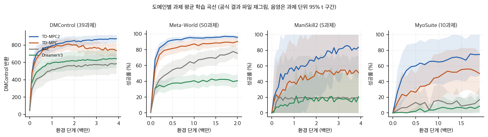
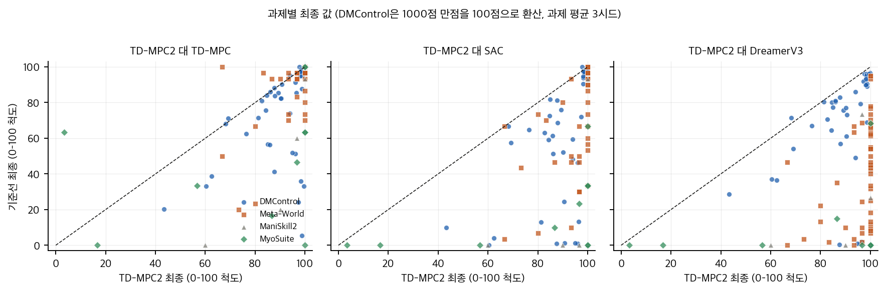
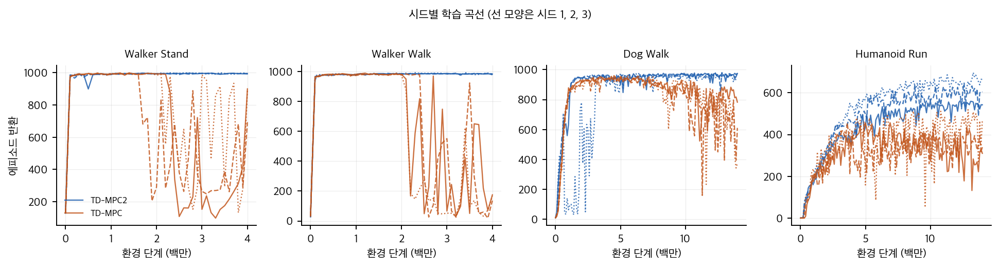
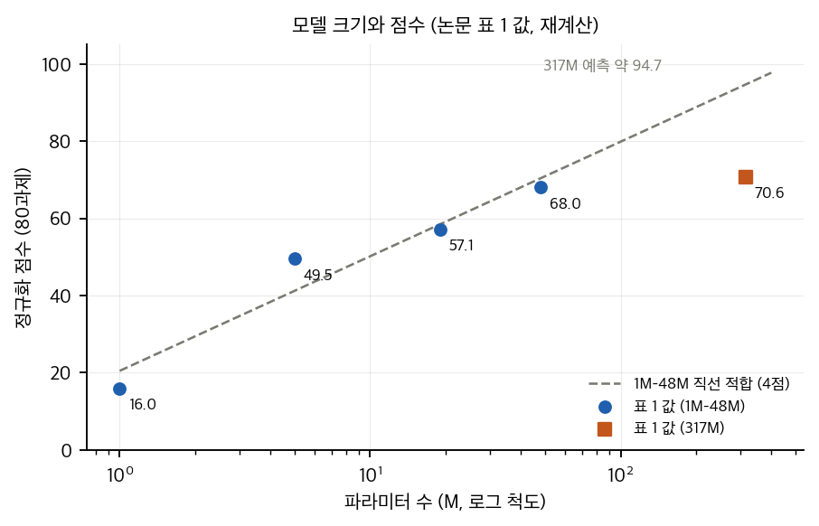

> **논문:** Nicklas Hansen, Hao Su, Xiaolong Wang. *TD-MPC2: Scalable, Robust World Models for Continuous Control.* ICLR 2024 (Spotlight), arXiv:2310.16828 (v2, 2024-03-21).
> 공식 코드는 GitHub nicklashansen/tdmpc2(MIT)에 있습니다. 이 글의 그래프는 모두 우리가 공식 결과 파일과 논문 표 값으로 새로 그린 것입니다. 논문 그림은 넣지 않았습니다(논문 라이선스는 CC BY 4.0).

## 논문이 하는 주장

TD-MPC2는 TD-MPC의 잠재 공간 계획을 유지하면서 학습 방식을 고쳤습니다. 세계 모델은 관측을 재구성하지 않습니다. 잠재 예측, 보상, 가치만으로 학습합니다. 가치 예측은 로그 변환 공간의 two-hot 회귀로 하고, 잠재는 SimNorm으로 정규화합니다. 하이퍼파라미터는 과제와 무관하게 하나로 고정합니다. 저자는 이 설정으로 104개 연속 제어 과제(DMControl 39, Meta-World 50, ManiSkill2 5, MyoSuite 10)에서 SAC, DreamerV3, TD-MPC를 이긴다고 씁니다. 같은 구조를 1M에서 317M 파라미터로 키워 80과제를 한 모델로 푸는 결과도 보고합니다.

## 공개 결과 파일로 확인한 것

공식 저장소에는 네 알고리즘의 학습 곡선 파일이 있습니다(104과제, 시드 3). 이 파일로 최종 값을 다시 계산했습니다.

*우리가 그린 그래프입니다. 공식 결과 파일의 과제 평균이며, 음영은 과제 단위 95% t 구간입니다.*

- **도메인 평균은 모두 TD-MPC2가 가장 높습니다.** 최종 평균은 DMControl 883, Meta-World 96%, ManiSkill2 89%, MyoSuite 76%입니다.
- **TD-MPC 대비 과제 단위 유의성은 두 도메인에서만 확실합니다.** DMControl(39과제)과 Meta-World(50과제)는 p < 0.01입니다. ManiSkill2(5과제)와 MyoSuite(10과제)는 방향이 맞지만 p > 0.05입니다. 과제 수가 적어 검정력이 없습니다.

*우리가 그린 그래프입니다. 과제마다 TD-MPC2(가로)와 기준선(세로)의 최종 값을 0–100 척도로 맞춰 찍었습니다.*

## 발산은 공개 곡선에서 확인됩니다

논문은 TD-MPC가 일부 과제에서 기울기 폭발로 발산한다고 씁니다. 공개 곡선에서 Walker Stand의 TD-MPC 최종 값은 시드별로 281–418이고, TD-MPC2는 992–996입니다. 이 글의 기준(시드 단위, 피크 대비 최종 값이 절반 이하)으로 TD-MPC2의 시드는 한 번도 해당하지 않았습니다.

*우리가 그린 그래프입니다. Walker Stand와 Walker Walk에서 TD-MPC의 붕괴가 보입니다.*

반면 Dog Run과 Dog Walk에서 SAC와 DreamerV3의 최종 값은 10 안팎입니다. 곡선만으로는 논문이 말하는 "수치 불안정"과 "학습 실패"를 구분하기 어렵습니다.

## 모델 크기와 점수

논문 표 1의 점수는 1M에서 16.0, 5M에서 49.5, 19M에서 57.1, 48M에서 68.0, 317M에서 70.6입니다. 1M–48M 네 점은 log 파라미터에 대해 거의 직선입니다. 317M 점은 그 직선보다 24점 낮습니다. 48M에서 317M로 파라미터가 6.6배 늘 때 점수는 2.6점 오릅니다. "포화되지 않았다"는 해석은 이 숫자만으로는 약합니다.

*우리가 그린 그래프입니다. 직선은 1M–48M 네 점의 적합입니다.*

## 논문 안의 숫자와 공식 설정

- **같은 설정, 다른 점수.** 19M 모델의 80과제 점수는 표 1과 그림 7에서 57.1, 표 10에서 56.54, 그림 9와 그림 18에서 54.2입니다. 설명은 없습니다.
- **절제의 기본값.** 그림 9에서 Q 함수 10개가 기본 5개보다 2.8점 높습니다. 본문은 기본값이 최선인지 말하지 않습니다.
- **표 8과 공식 코드.** 인코더 학습률은 표 8에 1e-4로 적혀 있지만, 공식 설정에서는 3e-4 × 0.3 = 9e-5입니다. 식 3의 일관성 항은 차원 합이 아니라 차원 평균으로 구현되어 있습니다. 계획은 σ를 이어받지 않고, 실행 행동은 엘리트 중 하나를 골라 잡음을 더하는 방식입니다. 이런 차이는 재현 결과를 바꿀 수 있으니 설정에 명시해야 합니다.
- **테스트 시 정규화.** 부록 J는 계획 때 Q 앙상블의 분산을 벌점으로 쓰면 평균이 56.5에서 62.0으로 오른다고 보고합니다. 단일 실행이고 시드와 구간이 없습니다.

## 이 맥에서 구현할 수 있는가

**전체 재현은 불가능합니다.** 공식 코드는 CUDA를 전제하고 곳곳에 `cuda:0`이 있습니다. 80과제 317M 학습은 저자 기준 33 GPU일(RTX 3090)과 대형 데이터가 필요합니다.

**단일 과제 축소 실행은 조건부입니다.** 포팅(디바이스 인자화, `compile` 끄기)과 패키지 설치, 체크포인트 다운로드가 필요합니다. 실행 시간은 측정하지 않았습니다.

**개념 재구현은 가능합니다.** SimNorm, two-hot 회귀, 잠재 계획은 작은 토이로 옮길 수 있습니다. 이 글에서는 토이를 만들지 않았습니다.

## 한계

- 논문에는 별도의 한계 절이 없습니다. 저자는 이산 행동 공간을 열린 문제로, 로봇 안전을 위험으로 적습니다.
- 80과제 점수는 DMControl 반환과 성공률을 섞습니다. 평균 방법이 정의돼 있지 않습니다.
- 시드가 3개여서 과제별 구간이 넓습니다. 논문 그림 4의 구간 계산 방법도 없습니다.

## 출처와 라이선스

- 논문: arXiv:2310.16828, CC BY 4.0 (arXiv abs 페이지의 license 링크 확인). PDF에서 저작권 표시는 찾지 못했습니다.
- 공식 코드: github.com/nicklashansen/tdmpc2, MIT. 이 글은 코드를 복사하지 않았고, 정적으로 읽었습니다.
- 결과 파일: 공식 저장소의 `results/` 폴더. 재계산과 그래프는 이 글 작성자가 만들었습니다.
- 체크포인트와 데이터셋은 받지 않았습니다.

## 자료

- [통합 리포트 PDF](report/report_public.pdf)
- [01. 논문 분석: TD-MPC2 (arXiv:2310.16828)](analysis/01_paper_analysis.md)
- [02. 선행연구와 관련 저장소](analysis/02_prior_work.md)
- [03. 수치 재계산, 일관성 검사, 주장 판정](analysis/03_analysis.md)
- [04. 공식 코드 대조와 구현 가능성](analysis/04_code_verification.md)
