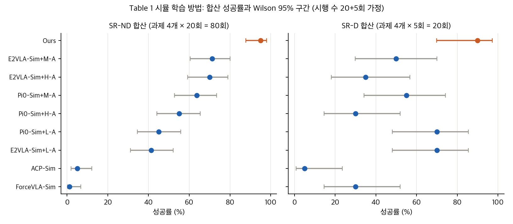
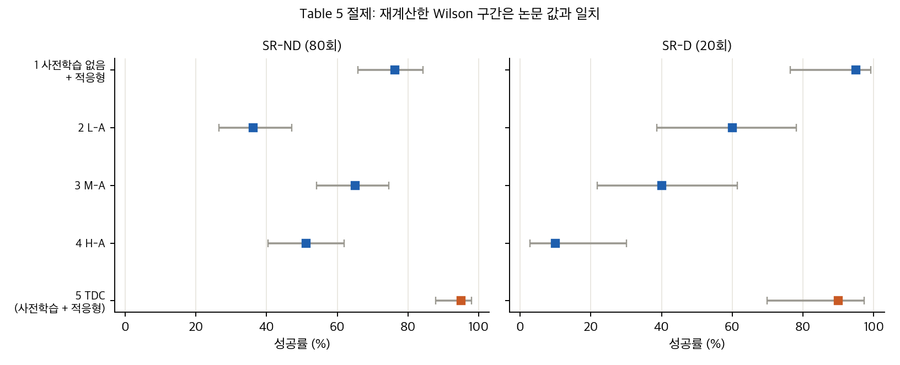
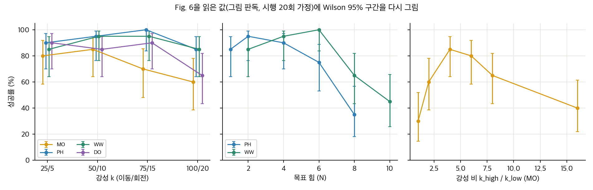
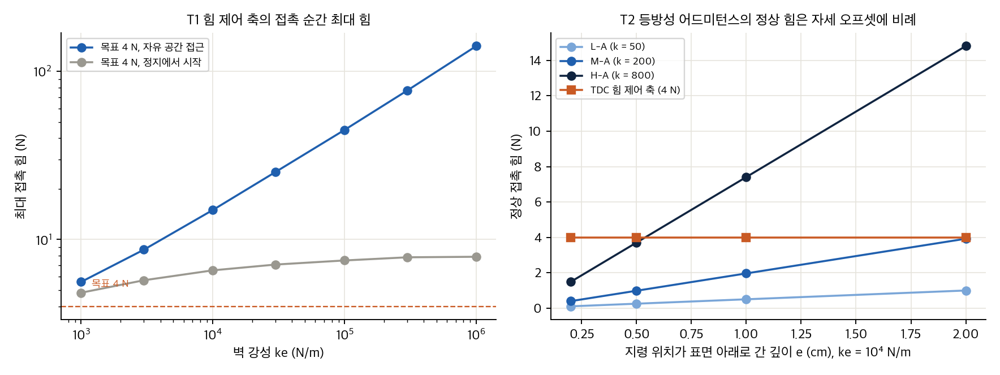

> **논문:** Yang, Chen, Zhu, Xu, Mao, Wei, Chen, Xiong, Wang. *TDC: Sim-to-Real Transferable Directional Compliance for Contact-Rich Manipulation.* CoRL 2026, arXiv:2602.14174 (v2).
> 논문 그림은 라이선스(arXiv 비독점 배포) 때문에 싣지 않았습니다. 그림과 영상은 [프로젝트 페이지](https://yifei-y.github.io/project-pages/TDC/)에서 볼 수 있습니다. 이 글의 그래프는 논문 표의 수치와 직접 만든 toy로 그렸습니다. 공식 코드는 2026-11-24에 찾지 못했습니다. Fig. 5와 Fig. 6의 값은 그림에서 읽은 값이고, 시행 수는 논문 4.1절의 20회 + 교란 5회를 가정했습니다.

## 한 줄 요약

힘 조절을 **방향**(각 축을 힘 제어, 고강성 위치 제어, 저강성 위치 제어 중 무엇으로 다룰지)과 **크기**(강성 값, 목표 힘)로 나눕니다. 방향은 사전학습 VLA(E2VLA) 기반 정책이 과제 프레임과 제어 모드 벡터로 출력하고, 크기는 사람이 정해 어드미턴스 제어기에 넣습니다. 시연은 시뮬레이션의 특권 전문가가 만듭니다. 네 실물 과제의 교란 없는 합산 성공률은 95%(76/80)입니다.

## 1. 표를 다시 계산하면

Table 1의 Overall 열, 시행 수 정수 조건(교란 없음 20회는 5의 배수, 교란 5회는 20의 배수), Fig. 5의 실패 횟수, Table 5의 Wilson 구간이 모두 논문 값과 맞습니다. 본문의 "가장 높은 기준선 대비 +24, +20 %p"도 그대로 재계산됩니다.

*그림 1. Table 1 시뮬 학습 방법의 합산 성공률과 Wilson 95% 구간(시행 수 20 + 5회 가정).*

합산 시행으로 보면 TDC 76/80이 가장 높은 기준선(E2VLA-Sim+M-A) 57/80보다 높습니다(Fisher p = 8×10⁻⁵). 과제별로 가장 높은 기준선과 비교하면 20회 대 20회라 p = 0.24–1.0으로 구분되지 않습니다. 같은 정책에 등방성 어드미턴스(M-A)를 붙인 경우와는 화이트보드에서 20 대 11(p = 0.001)입니다. 교란 칸은 5회이고 접촉 상태에서 시작하므로 칸 단위 SR-D는 20 %p 단위이며, 5/5의 Wilson 구간이 [56.6, 100]입니다.

## 2. 절제와 실패 유형

*그림 2. Table 5 다섯 줄의 SR-ND와 SR-D. 재계산한 Wilson 구간은 논문 값과 일치합니다.*

사전학습의 효과(61/80 → 76/80)는 확실하고(p = 0.001), 교란 조건에서는 구분되지 않습니다(19/20 대 18/20). 본문의 "사전학습 없이도 등방성 No.2–4보다 낫다"는 SR-D 세 칸과 SR-ND의 L-A, H-A에서 성립하고, M-A(61/80 대 52/80)에서는 p = 0.16입니다. 한계 2("행동 공간 확장이 원래 목표 성능을 떨어뜨린다")는 여섯 칸이 모두 같은 방향이며 보정 전 유의한 칸은 H-A SR-ND(56/80 → 41/80, p = 0.023) 하나입니다.

Fig. 5의 비율을 정수로 복원하면 TDC의 실패 6회는 과도한 힘 4회와 기타 2회입니다(그림 판독). 이는 L-A 기준선의 과도한 힘 실패(1회, 3회)보다 많고, M-A(14, 12)와 H-A(24, 25)보다 적습니다. 힘 관련 실패의 감소는 L-A 기준선의 불충분한 힘 실패(32, 40회)가 사라진 효과가 큽니다.

## 3. 민감도

*그림 3. Fig. 6에서 읽은 값에 Wilson 95% 구간을 다시 그린 그림(그림 판독, 시행 20회 가정).*

극단값의 하락은 확실합니다(MO 강성 비 4 → 16에서 85 → 40, p = 0.008, PH 목표 힘 2 → 8 N에서 95 → 35, p = 0.0001). 이웃 점의 차이(예: 85 대 65)는 점마다 20회라 p = 0.27이고, 구분하려면 점마다 약 72회가 필요합니다. 그래서 "넓은 범위에서 낮은 민감도"는 극단값 하락과 함께 읽는 것이 맞고, 1절 첫 문단의 "정확한 값에 강건"이라는 서술은 4.2절 결과보다 강합니다. 같은 문단이 v2에 두 번 나오며 마지막 문장만 다릅니다.

## 4. v1과의 차이

v1 제목은 *Direction Matters*였고 정책 출력은 법선 힘 방향과 접촉 상태였습니다. v2는 과제 프레임과 축별 3모드 벡터로 바뀌었고 안정성 명제는 사라졌으며, 기준선과 절제가 확장되었습니다. Ours 행은 네 과제 칸이 모두 바뀌었습니다(합산 SR-ND 72/80 → 76/80, SR-D 19/20 → 18/20, p = 0.37). 변경 이유는 v2에 적혀 있지 않아 저자 확인이 필요합니다.

## 5. 어드미턴스 toy

식 2, 3과 4.1절 값(m = 1, ξ = 2, k_low = 50, k_high = 200)으로 1축 toy를 만들었습니다. 제어 주기는 v1 Fig. 2의 1 kHz를 가정했고, 위치 루프 지연과 마찰은 뺀 이상화입니다.

*그림 4. 왼쪽: 벽 강성에 따른 접촉 순간 최대 힘. 오른쪽: 지령 위치 오프셋에 따른 등방성 어드미턴스의 정상 힘.*

힘 제어 축의 정상 힘은 환경 강성과 무관하게 목표값(4 N)으로 수렴합니다. 반면 접촉 순간의 최대 힘은 접근 속도(F_h/D, 4 N에서 14 cm/s)와 벽 강성에 의존해 ke = 10³ N/m에서 목표의 1.4배, 10⁵에서 11배입니다. 등방성 어드미턴스는 오프셋 1 cm당 H-A 7.4 N, M-A 2.0 N, L-A 0.5 N을 냅니다. 이 결과는 "크기는 사람이 한 번 정하면 된다"는 서술이 정상 상태에는 성립하고 과도 응답에는 접근 속도 설정이 더해진다는 뜻입니다. 실로봇 값을 예측하지는 않습니다.

## 6. 남는 질문

- 방향 출력(과제 프레임, 제어 모드)의 실물 예측 정확도와 모드 값 {0, 1, 4}를 실수 출력에서 이산화하는 규칙이 논문에 없습니다.
- 크기 성분이 시뮬에서 전이되지 않는다는 서술은 -Sim 기준선의 낮은 성공률로 보이지만, 동역학 외에 입력, 구조, 데이터 양이 함께 다릅니다.
- 공개 E2VLA 저장소의 회전 손실 가중치(10)가 식 1의 값(30)과 다릅니다. 논문이 쓴 버전과 같은지는 확인하지 못했습니다.
- 안전 정지 임계값과 제어 주기가 v2 본문에 없습니다.

## 자료

- [통합 리포트 PDF](report/report_public.pdf)
- [01. 논문 분석: TDC (arXiv:2602.14174)](analysis/01_paper_analysis.md)
- [02. 선행연구와 관련 저장소](analysis/02_prior_work.md)
- [03. 수치 재계산, 일관성 검사, toy](analysis/03_analysis.md)
- [04. 주장 검증과 구현 가능성](analysis/04_claim_verification.md)
