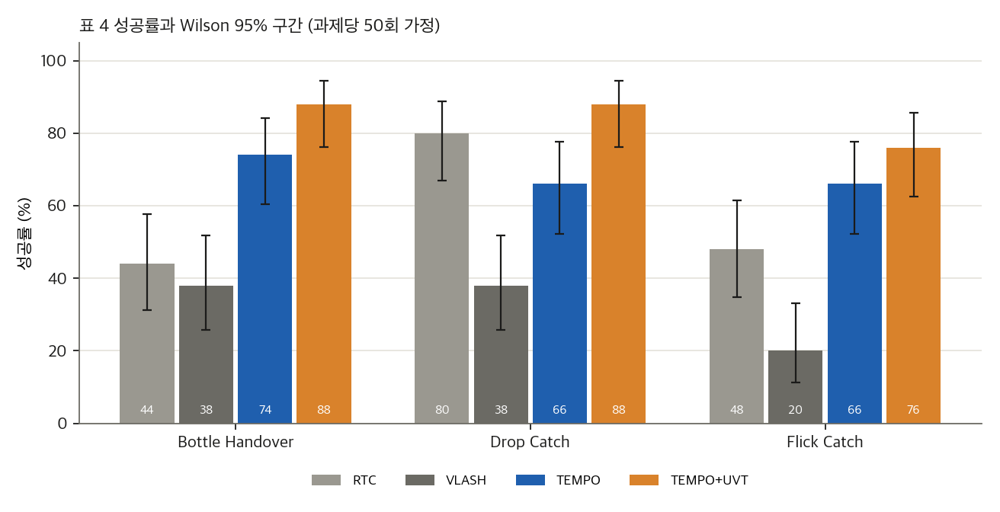
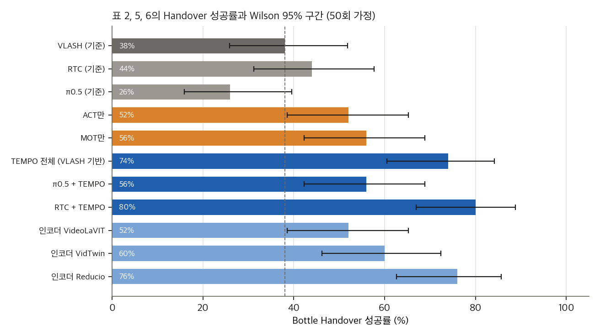
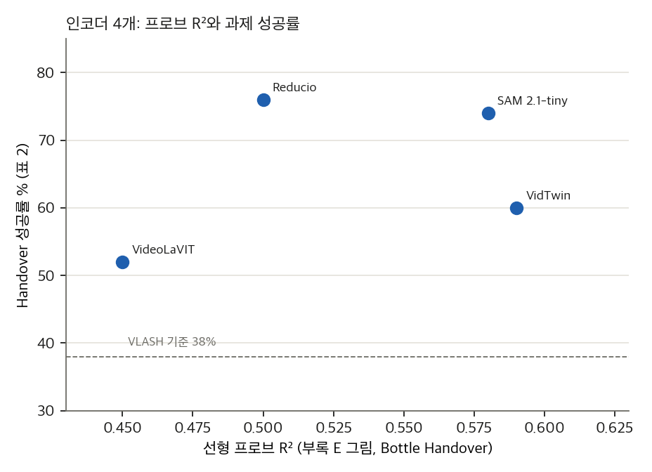
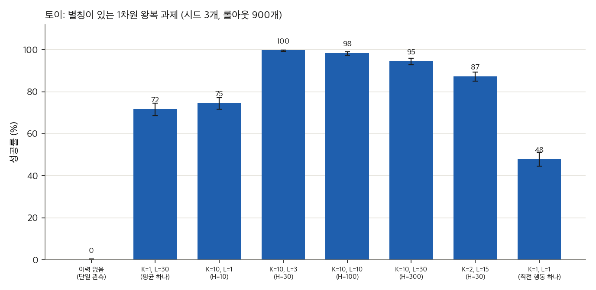

> **논문:** Zhenyang Feng, Jimin Heo, Erik B. Sudderth, Unnat Jain. *TEMPO: Learning Temporal Context for Dynamic Robot Manipulation.* CoRL 2026 구두 발표, arXiv:2609.16864 (v1, 2026-09-15).
> 공식 코드(Apache-2.0, tempo-robot/TEMPO)는 정적으로만 읽었고 실행하지 않았습니다. 논문 그림은 싣지 않고, 우리가 만든 그래프만 씁니다. 시행 수는 논문 §5.2의 "50 trials"를 따라 과제당 50회로 가정했습니다.

## 논문이 묻는 것

사전학습 VLA는 현재 관측 한 장만 봅니다. 저자들은 움직이는 물체 앞에서 두 가지가 부족하다고 봅니다. 한 장에는 속도가 없고(움직임 모호성), 접근과 후퇴가 같은 장면을 만들어 반대 행동이 필요한 구간이 있습니다(상태 별칭). 해법 TEMPO는 두 입력을 더합니다. 얼린 영상 모델(SAM 2.1-tiny)이 만든 움직임 코드와, 최근 300개 명령을 10개 버킷으로 평균한 고유수용 이력입니다. 비동기 VLA인 VLASH 위에 얹어 쌍팔 로봇 네 과제에서 평가합니다.

## 이 글에서 확인한 것

**VLASH 대비 이득은 세 과제 모두에서 구분되고, RTC 대비는 Handover에서만 구분됩니다.** Handover에서 TEMPO 37/50, RTC 22/50이면 Fisher p = 0.0042(Holm 보정 0.017)입니다. Drop Catch는 표에서 RTC가 80%, TEMPO가 66%이고(p = 0.18), Flick Catch의 RTC 대비 +18%p는 p = 0.11입니다. 50회, 방법당 정책 한 번 학습이라는 설계에서 검출 가능한 최소 차이는 약 19–29%p입니다.

**본문의 증가폭은 VLASH 기준입니다.** §5.2의 "+36%, +4.1%, +46%"는 VLASH와의 차이이고, RTC와는 +30, +17.3, +18입니다. 초록의 "44%에서 74%"는 최고 기준선(RTC)과 VLASH 기반 TEMPO의 비교이며, 같은 백본끼리는 38에서 74(표 5에서 RTC는 44에서 80)입니다.

**단일 신호 절제는 50회로는 구분되지 않습니다.** 표 6에서 ACT만(52%)과 MOT만(56%)이 VLASH(38%)보다 높다는 서술은 p = 0.23과 0.11이고, 전체(74%)가 MOT만보다 높다는 것도 p = 0.093입니다. 세 백본(π0.5, RTC, VLASH) 모두에서 TEMPO를 더한 이득(+30, +36, +36%p)은 구분됩니다.

**프로브 R²의 격차와 성공률 격차는 과제별로 같이 움직이지 않습니다.** 표 7에서 TEMPO는 모든 행에서 가장 높지만, 성공률 이득이 가장 큰 Handover의 R² 격차는 +0.06이고 Flick Catch는 +0.54입니다. 인코더 4개에서 프로브 R²(그림 A5)와 Handover 성공률(표 2)의 순위 상관은 0.2입니다. 점이 4개라 검정이 아니라 관찰입니다.

**상태 별칭을 푼다는 결과는 표 1의 한 줄이고, 어느 입력의 기여인지는 시험되지 않았습니다.** 미절단 Flick Catch에서 기준선 0/50, TEMPO 34/50(68%)입니다(p ≈ 2e-14). 다만 미절단 과제에서 ACT만, MOT만 행이 없고 이력 길이(H)와 버킷 수(K)의 절제도 없습니다. 토이에서는 이 두 값에 따라 성공률이 달라졌습니다(아래).

## 작은 토이: 별칭이 있는 1차원 왕복

위치만 보는 정책이 팔을 물체까지 보냈다가 되돌리는 과제입니다. 시작 대기와 종료, 왕복 중간, 도착과 멈춤이 같은 위치를 만들어 별칭이 생기도록 구성했고, 행동은 소프트맥스에서 뽑습니다. 이력은 식 2와 같은 버킷 평균입니다. 시드 3개, 롤아웃 900개입니다.

이력이 없으면 0%이고(도달 1.9%), 이력이 있으면 올라갑니다. 이력 길이와 버킷 수에 따라 48%(직전 행동 하나)에서 99.8%(K = 10, L = 3)까지 갈렸고, 논문의 K와 L 비율(H = 300, 과제 길이의 약 3배)은 94.6%였습니다. 이 토이는 별칭을 구성해 넣은 것이라 실제 과제의 별칭 정도를 말하지 않습니다. 공개 TempoBench의 관절 상태에서 같은 자세를 2초 이상 떨어져 반대 방향으로 지나가는 프레임을 세어 보면, ball_drop과 spartan 과제에는 많고 dynamic_handover와 dynamic_pour에는 거의 없었습니다(거리 기준 eps에 민감한 근사입니다).

## 공개 코드와 논문 서술의 차이

- 논문 식 1은 움직임 코드를 VLM 접두에 덧붙인다고 쓰지만, 코드는 SAM2 토큰 64개를 현재 head 카메라 토큰에 영초기화 게이트 교차 어텐션으로 더합니다. 여기에 논문에 없는 SigLIP 시공간 어텐션(3프레임)이 함께 있습니다.
- 추가 파라미터는 논문이 2M(0.08%)이라 하고, 코드의 모듈 shape으로 세면 ACT 경로는 약 2.3M이고 SAM2 융합 블록이 약 17.5M이라 합이 약 19.7M입니다. 논문 구성과 공개 구성이 같은 모델인지는 확인할 수 없습니다.
- VLASH와 RTC 비동기 코드, 학습 데이터, 체크포인트, 평가 코드는 저장소에 없고, 학습 사슬의 첫 체크포인트를 만드는 구성도 없습니다. 접두 토큰은 영초기화가 아니라고 구성 파일 주석이 직접 적고 있습니다.
- 공개 데이터 TempoBench의 검출 프레임은 55,482개(초록의 "5만 프레임 이상"과 같은 규모)이고, 총 97,265프레임입니다. LICENSE는 사용 조건이 정해지지 않은 자리표시자입니다.

## 구현 가능성

논문 수치의 재현은 맥(Apple M4 Pro, CUDA 없음)에서 불가능합니다. 실로봇, GPU 학습, 미공개 데이터가 필요합니다. 표 재계산, 별칭 토이, TempoBench 관절 상태 통계는 CPU에서 끝냈고, 새 설치 없이 MuJoCo 축소판을 시작할 수 있습니다(처리량 미측정).

## 저자에게 묻고 싶은 것

표 4의 TEMPO가 SAM2 융합과 SigLIP 시간 어텐션을 모두 쓴 모델인지, 창 길이 W와 SAM2 입력 해상도, 표 6의 단일 신호 변형에서 시간 어텐션이 켜져 있었는지, 미절단 과제의 신호별 결과, 프로브의 분할 단위가 무엇인지입니다.

상세 분석, 재계산 스크립트, 코드 대조 표는 함께 올린 분석 노트에 있습니다.

## 자료

- [통합 리포트 PDF](report/report_public.pdf)
- [01. TEMPO 논문 분석](analysis/01_paper_analysis.md)
- [02. 선행연구와 자료](analysis/02_prior_work.md)
- [03. 수치 재계산, 일관성 검사, 토이, 주장 판정](analysis/03_analysis.md)
- [04. 공식 코드 대조와 구현 가능성](analysis/04_code_verification.md)
