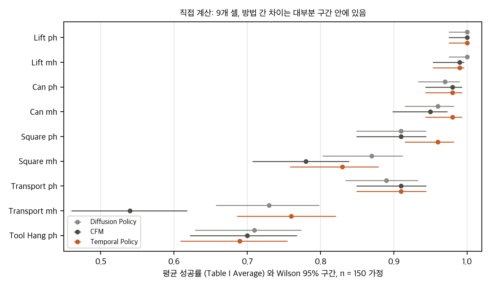
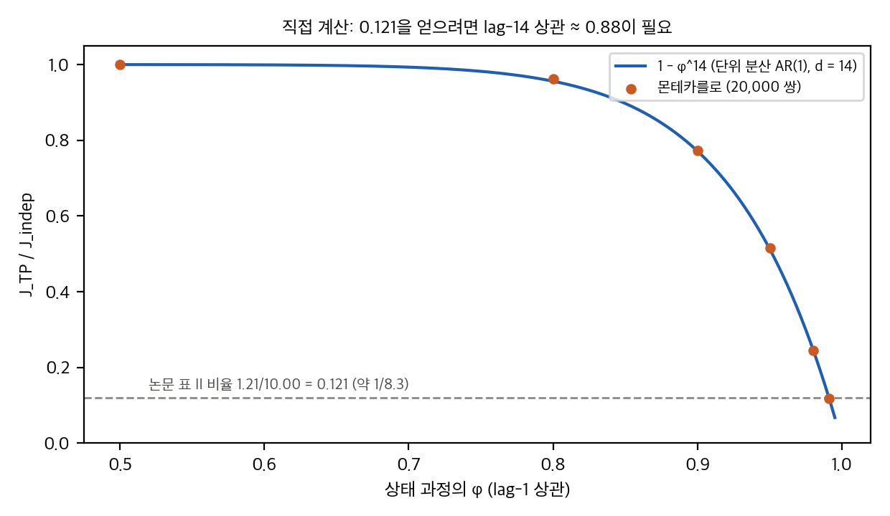
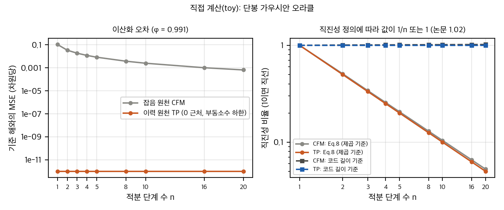
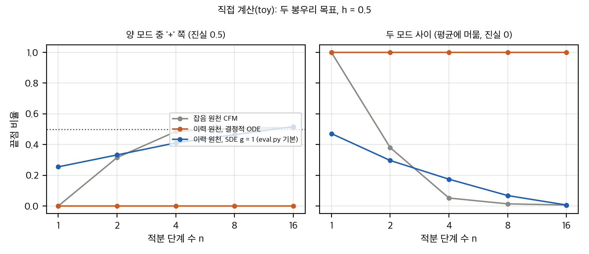

# Temporal Policy: 가우시안 잡음 대신 행동 이력에서 흐름을 시작하면 무엇이 달라지나

플로우 매칭 정책은 보통 가우시안 잡음에서 행동 청크로 가는 흐름을 배웁니다. Temporal Policy(Miller & Jagersand, IROS 2026 채택)는 그 출발점을 로봇의 최근 상태 이력으로 바꿉니다. 목표는 14 스텝 뒤의 행동 청크이고, 추론은 Euler 10단계입니다. 논문은 전달 비용이 CFM 대비 약 8배, Diffusion Policy 대비 150배 이상 줄고, 성공률은 기준선과 비슷하다고 보고합니다.

이 글은 논문과 공개 코드(MIT), 저자의 학위논문을 읽고 표를 다시 계산하고 CPU 토이로 샘플러 성질을 검사한 결과입니다. 재현 실험은 하지 않았습니다.

## 1. 방법을 한 줄로

원천 `x0`는 상태 이력 16개, 목표 `x1`은 16 스텝 뒤로 밀린 행동 16개입니다. 보간과 손실은 표준 확률적 보간(Albergo et al., Chen et al.)을 따릅니다. 원천이 점질량이라는 점이 핵심입니다.

## 2. 전달 비용 "거의 한 자릿수"는 어디서 오나

단위 분산 가정에서 이력 원천의 결합 비용은 `J_TP / J_indep = 1 − ρ₁₄`입니다. 여기서 ρ₁₄는 14 스텝 떨어진 행동의 상관입니다. CFM 대비 8.3배를 얻으려면 ρ₁₄가 0.76–0.88이어야 합니다. 쌍 간격을 바꾸면 비율이 크게 달라지는데, 논문은 이 민감도를 보고하지 않았습니다.

Diffusion Policy 대비 157배는 다른 이야기입니다. 두 방법은 같은 잡음 원천을 쓰는데 차이가 19배입니다. 샘플러 단계 수와 측정 방식이 섞여 있다고 보는 편이 맞습니다.

*직접 계산: 논문 Table I의 Average와 Wilson 95% 구간(유효 표본 150 가정).*

*직접 계산: 단위 분산 AR(1)에서 J_TP / J_indep과 1 − φ^14.*

## 3. 직진성 1.02는 정의에 달려 있다

논문 식 7–8의 제곱 정의로 10단계 직선 경로를 재면 1/10입니다. 공개 코드는 거리의 합(제곱 없음)을 쓰고, 그 값은 직선이면 1입니다. 논문 표의 1.02와 1.08은 코드 정의와 맞습니다. 보고할 때는 정의와 단계 수를 함께 적어야 합니다.

*직접 계산(토이): 단봉 가우시안 오라클의 이산화 오차와 두 정의의 직진성.*

## 4. 결정적 샘플러는 평균을 낸다

이력은 점 원천이라 결정적 ODE는 조건부 평균 경로에 머뭅니다. 두 봉우리 목표에서 모든 단계 수에 끝점이 두 모드 사이에 옵니다. 잡음 원천 CFM은 8단계에서 두 모드를 나눕니다. 다중 모드는 확률적 샘플링(SDE)에서만 나옵니다. 논문 표의 NFE 10은 결정적 설정이라, 다중 모드 행동을 보여 주지 않습니다.

*직접 계산(토이): 두 봉우리 목표(h = 0.5)에서 단계 수별 끝점 위치.*

## 5. 성공률과 지연

Table I의 성공률은 Diffusion Policy와 차이가 없습니다(9셀 CMH p = 0.69). CFM 대비로는 Transport mh 한 셀만 Holm 보정 후 남습니다. 지연 19.1 ms는 NFE 10이 같은 CFM보다 3.3배 빠른데, 이 차이는 파라미터 255M에서 17M로 줄인 데서 옵니다. 이력 원천의 효과는 이 비교로는 분리되지 않습니다.

실물 시험은 20회에 10회 성공이고, 비교 기준선이 없습니다.

## 6. 공개 코드와 논문의 차이

- 공개 평가 스크립트는 추론을 SDE(계수 1.0)와 100단계로 덮어씁니다. 표의 설정과 다릅니다.
- 저장소 기본 학습 길이는 4500 epoch이고, 논문은 1500 epoch이라고 씁니다.
- 행동은 [−1, 1]로 범위 정규화되는데, 분석은 분산 1을 가정합니다.
- 실물 제어 코드는 공개되지 않았습니다.

## 7. 정리

이 논문의 흥미로운 점은 "원천을 바꾸면 경로가 짧아진다"는 관찰입니다. 다만 그 이득의 크기는 쌍 간격에 달려 있고, 결정적 샘플러에서는 평균 회귀와 구별되지 않습니다. 다중 모드 과제에 쓰려면 확률적 샘플링이나 혼합 원천을 함께 봐야 합니다.

재현은 GPU가 필요해 보류했습니다. 분석 문서와 토이 코드는 저장소에서 확인할 수 있습니다.

## 자료

- [통합 리포트 PDF](report/report_public.pdf)
- [01. 논문 분석: Temporal Policy (arXiv:2607.29482v1)](analysis/01_paper_analysis.md)
- [02. 선행연구와 관계](analysis/02_prior_work.md)
- [03. 재계산과 유도](analysis/03_analysis.md)
- [04. 코드 대조: 논문 ↔ dmiller12/TemporalPolicy (e1e7ee5)](analysis/04_code_verification.md)
