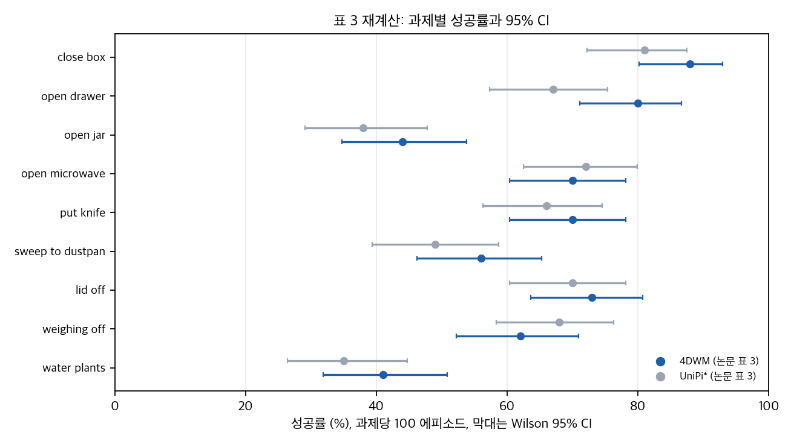
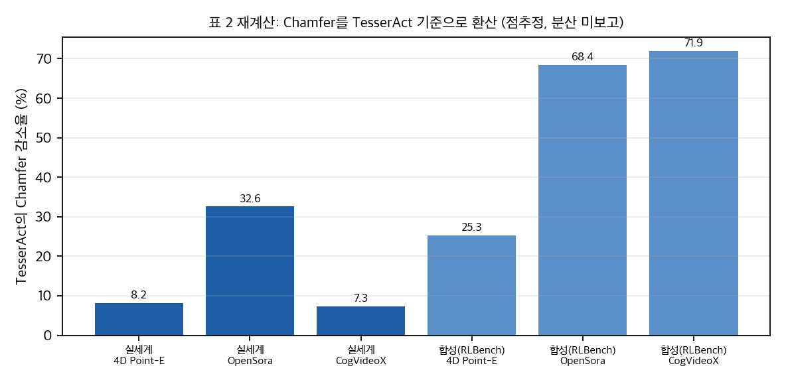

> **논문:** Haoyu Zhen, Qiao Sun, Hongxin Zhang, Junyan Li, Siyuan Zhou, Yilun Du, Chuang Gan. *TesserAct: Learning 4D Embodied World Models.* arXiv:2504.20995 (v1, 2025-04-29), ICCV 2025 (CVF판 제목은 *Learning 4D Embodied World Models*).
> 공식 코드(MIT)는 정적으로만 읽었고 실행하지 않았습니다. 논문 그림은 싣지 않았고, 그래프 두 장은 우리가 재계산한 값으로 그렸습니다.

## 한 줄 요약

TesserAct는 비디오 세계모델이 픽셀에만 머문다는 문제를, **RGB·깊이·법선을 함께 생성하는 4D 세계모델**로 풉니다. 생성된 깊이와 법선을 최적화해 4D 장면을 만들고, 그 점군으로 행동을 예측합니다. 아이디어는 분명하지만 실험 근거는 세 군데에서 약합니다. 실세계 깊이 평가의 기준이 학습 라벨과 같은 추정기이고, 행동 계획의 우위는 통계적으로 확정되지 않으며, 핵심 기여(4D 재구성 최적화, 역동역학)가 공개 코드에 없습니다.

## 무엇을 했나

- **데이터:** 합성 RLBench 80k(깊이는 시뮬레이터, 법선은 DSINE 계산), 실세계 Fractal 80k·Bridge 25k·사람 손 영상 100k(깊이는 RollingDepth, 법선은 Temporal Marigold-LCM)를 씁니다. 실세계 합계는 205k입니다.
- **모델:** CogVideoX-5B를 미세조정합니다. 새 깊이·법선 투영기는 0으로 초기화해서 RGB 출력이 처음에는 원래 모델과 같게 둡니다.
- **4D 재구성:** 법선으로 깊이를 정규화하고(식 3), 광학 흐름으로 정적 배경의 깊이 일관성을 맞추고(식 5), 생성된 깊이에 가깝게 둡니다(식 6).
- **행동:** 4D 점군과 다음 상태, 지시문을 입력으로 PointNet 기반 역동역학이 7-DoF 행동을 냅니다.

## 숫자를 다시 계산해 보니

**행동 계획 (표 3).** 9개 과제, 과제당 100 에피소드입니다. 4DWM 평균은 64.9%, UniPi*는 60.7%, Image-BC는 10.6%입니다. 4DWM은 Image-BC를 9/9에서 이기고, UniPi*를 7/9에서 이깁니다. 평균 차이 +4.2 pp의 p 값은 0.05–0.06입니다(풀링 비율 p = 0.064, 과제 단위 쌍체 t p = 0.051). 과제별 Fisher 검정은 모두 p > 0.05입니다. 방향은 맞아 보이지만, 본 실험 규모로는 확정되지 않습니다.

**4D 장면 (표 2).** 실세계 Chamfer는 TesserAct 0.2030으로 가장 낮습니다. CogVideoX 대비 7.3% 낮은 값입니다. 합성은 0.0811로 CogVideoX 대비 71.9% 낮습니다. 다만 실세계의 기준은 RollingDepth와 Marigold 출력이고, 베이스라인도 같은 추정기로 깊이와 법선을 얻습니다. 그래서 이 수치는 추정기와의 일치도로 읽어야 합니다. 실세계 RGB 품질(PSNR, SSIM, FVD)은 CogVideoX가 더 좋습니다.

## 공식 코드에 무엇이 있나

공개 저장소(MIT)는 RGB-DN 생성 모델의 학습과 추론, 깊이·법선 라벨링 파이프라인, 점군 렌더링을 제공합니다. **없는 것**은 4D 재구성 최적화(식 3–7), 역동역학, 베이스라인, 평가 지표 코드입니다. 4D 학습 데이터셋도 공개되지 않았습니다. 저장소 README는 법선 라벨이 "sometimes not perfect"라고 적고 있어서, 라벨 품질 문제는 저자도 인정하고 있습니다.

## 구현할 수 있나

- **학습과 표 3 재현:** 이 맥에서는 불가능합니다. 다중 GPU, 미공개 데이터, RLBench 시뮬레이터가 필요합니다.
- **공개 체크포인트 추론:** 저장소 표는 25–29 GB를 요구합니다. 통합 메모리 24 GiB에서는 빠듯해 보입니다(추정, 미측정).
- **4D 재구성 최적화의 축소판:** 직접 구현하면 CPU나 MPS에서 저해상도로 가능할 것으로 봅니다. 노력은 1–2주로 추정합니다.

## 읽고 남은 질문

1. 실세계 깊이 평가가 추정기 일치도가 아니라 기하 정확도를 재고 있는가?
2. 일관성 손실과 정규화 손실을 끈 정량 실험은 어떤 결과인가? (논문에는 그림 3의 정성 비교뿐입니다.)
3. 식 (3)의 ∂_u는 오타이고, λ_g1·λ_g2는 어디에 쓰이는가?
4. 공개 체크포인트는 논문 표 2·3의 모델과 같은가? 공개 학습 설정(lr 5e-5, AdamW)은 논문(1e-4, Adam)과 다른데 무엇이 맞는가?

## 자료

- [통합 리포트 PDF](report/report_public.pdf)
- [01. 논문 분석: TesserAct (arXiv:2504.20995, ICCV 2025)](analysis/01_paper_analysis.md)
- [02. 선행 연구, 학회 확인, 공식 자료](analysis/02_prior_work.md)
- [03. 수치 재계산과 일관성 검사](analysis/03_analysis.md)
- [04. 논문 ↔ 공식 코드 대조](analysis/04_code_verification.md)
