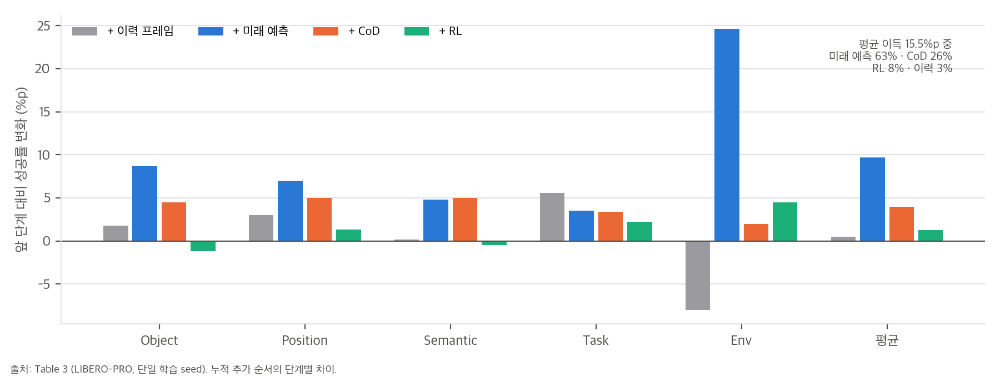
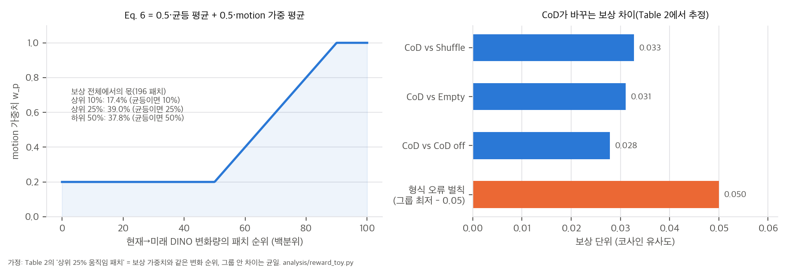
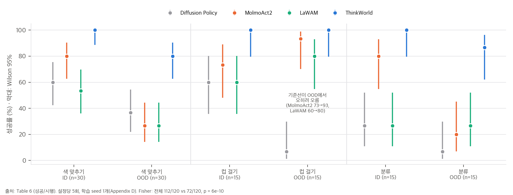

# 03. 핵심 식 해석과 수치 재계산

스크립트는 `analysis/table_check.py`(표·리더보드 대조, 결과 `table_check_results.json`)와 `analysis/reward_toy.py`(Eq. 6 보상과 GRPO 표준화 toy, 결과 `reward_toy_results.json`)입니다. 모두 numpy·scipy만 쓰고 CPU 단일 스레드로 몇 초 안에 끝납니다. 공식 코드가 없으므로 보상 식은 부록 A.6의 글을 그대로 옮겨 구현했습니다.

## 1. 배포된 정책은 무엇인가

부록 A.2와 C.5를 합치면 다음과 같습니다.

- Action SFT와 추론은 빈 `<think></think>`로 합니다.
- action expert는 **입력 토큰의 KV만** 받습니다. 생성된 CoD 토큰과 미래 질의 토큰은 expert의 직접 맥락이 아닙니다.

따라서 추론 그래프는 "Qwen3-VL-2B → MolmoAct2 action expert"이고, Table 3의 "Qwen baseline"과 구조가 같습니다. 차이는 VLM 가중치를 만든 학습 목적과 데이터뿐입니다. 이 관점에서 Table 3을 다시 읽으면 다음과 같습니다(`04` C5).

| 학습 신호 | LIBERO-PRO 평균 이득 | 총 이득 15.5%p 중 몫 |
|---|---|---|
| 이력 프레임 | +0.5 | 3% |
| **미래 DINO 특징 예측 (CoD 없이)** | **+9.7** | **63%** |
| CoD 토큰 생성 + CoD 조건 예측 | +4.0 | 26% |
| 세계 상상 RL | +1.3 | 8% |

즉 성능의 대부분은 "**1초 뒤 장면 특징을 예측하라**"는 보조 손실이 만듭니다. CoD("추론")와 RL은 그 위에 더해지는 작은 몫입니다. 단일 seed라서 +1.3%p는 seed 변동과 구분할 수 없습니다.

## 2. 세계 상상 보상(Eq. 6)의 신호 폭

### 2.1 가중치는 순위만의 함수
w_p는 변화량이 중앙값 이하면 0.2, 90분위에서 1이고 그 사이는 선형입니다. 변화량의 크기와 관계없이 **패치 순위**로만 정해집니다. 그래서 196 패치에서 각 구간이 받는 몫은 변화량 분포와 무관하게 거의 같습니다. lognormal, uniform, exponential 분포로 각각 2,000번 표본을 뽑아 확인했습니다(R1).

| 패치 구간 | motion 가중 항에서의 몫 | Eq. 6 전체에서의 몫 | 균등 평균이라면 |
|---|---|---|---|
| 변화 상위 10% | 22–25% | **17.4%** | 10% |
| 변화 상위 25% | 52–53% | 39.0% | 25% |
| 변화 하위 50% | 23–26% | 37.8% | 50% |

Eq. 6의 절반은 균등 평균입니다. 그래서 움직임이 거의 없는 하위 절반의 패치가 여전히 보상의 38%를 차지합니다.

### 2.2 CoD가 바꾸는 보상 차이
Table 2의 차이를 보상 단위로 환산합니다(R2). 가정은 두 가지입니다.
- Table 2의 "상위 25% 움직임 패치"는 보상 가중치와 같은 변화 순위로 고른 것입니다.
- 각 구간 안에서 코사인 차이는 균일합니다.

전체 패치 차이 Δ_all과 상위 25% 차이 Δ_top에서, 나머지 75% 패치의 차이는 Δ_rest = (Δ_all − 0.25 Δ_top) / 0.75입니다.

| 비교 | Δ_all | Δ_top25 | Δ_rest | Eq. 6 보상 차이 |
|---|---|---|---|---|
| CoD vs Shuffle | 0.024 | 0.071 | 0.0083 | 0.033 |
| CoD vs Empty | 0.020 | 0.079 | 0.0003 | 0.031 |
| CoD vs CoD off | 0.018 | 0.071 | 0.0003 | 0.028 |

**해석:**
- 상위 25% 밖의 패치에서는 CoD가 예측을 거의 바꾸지 못합니다(Δ_rest ≈ 0.0003). 따라서 Eq. 6의 균등 평균 항은 CoD 선택에 거의 둔감하고, 보상의 CoD 의존성은 대부분 motion 가중 항에서 나옵니다.
- "올바른 CoD를 쓴 경우"와 "CoD가 아예 없는 경우"의 차이가 코사인 0.03입니다. RL에서 비교하는 것은 그보다 비슷한 후보 4개 사이의 차이이므로, 실제 보상 폭은 0.03보다 작을 것으로 봅니다.

## 3. 형식 오류 벌칙과 그룹 표준화 (R3, R4)

### 3.1 형식 오류 벌칙이 신호보다 큽니다
형식이 깨진 CoD는 그룹 최저보다 0.05 낮은 보상을 받습니다. 이 값은 §2.2의 "CoD 있음 대 없음" 차이(평균 0.031)의 **1.6배**입니다. 4개 후보 중 하나가 형식 오류이면, 그룹 표준편차가 이 벌칙에 끌려갑니다. 그 결과 나머지 정상 후보 3개의 advantage 폭이 줄어듭니다(시행 20,000번).

| 정상 후보 사이 진짜 보상 차이(표준편차) | 형식 오류 없음: 정상 후보 advantage 폭 | 형식 오류 1개: 정상 후보 advantage 폭 | 축소 비율 |
|---|---|---|---|
| 0.25 × 0.031 | 2.58 | 0.50 | 19% |
| 0.5 × 0.031 | 2.58 | 0.84 | 33% |
| 1.0 × 0.031 | 2.58 | 1.25 | 49% |

학습 초기처럼 형식 오류가 자주 나오는 동안은, RL 신호의 대부분이 "형식을 지켜라"가 됩니다. 논문은 형식 오류 비율을 보고하지 않았습니다.

### 3.2 그룹 표준화는 절대 크기를 지웁니다
그룹 표준화는 보상 차이가 0.001이든 0.1이든 advantage의 분산을 1로 맞춥니다. 그래서 신호 품질은 오직 **잡음 / 후보 간 차이** 비율로 정해집니다. 여기서 잡음은 예측 오차, DINO 특징 변동, 프레임 선택 오차 등입니다.

| 잡음 / 차이 | advantage와 진짜 품질의 상관 | 최고 advantage가 진짜 최선일 확률 |
|---|---|---|
| 0 | 1.00 | 1.00 |
| 0.5 | 0.85 | 0.74 |
| 1 | 0.64 | 0.58 |
| 2 | 0.38 | 0.43 |
| 4 | 0.21 | 0.34 (우연 0.25) |

보상 폭이 0.03 수준이면, 같은 장면에서도 비슷한 크기의 예측 잡음이 생길 수 있습니다. 그러면 잡음/차이 비율이 1 근처가 되어 최고 후보를 고를 확률은 60% 안팎입니다. RL 이득이 +1.3%p에 그친 것과 모순되지 않는 그림입니다. 다만 실제 잡음 크기는 측정하지 않았으므로 가설입니다.

## 4. 보상이 모델 자신에 기대는 구조

RL 보상의 기준은 실제 실행 결과가 아닙니다. **모델 자신의 미래 예측**(동결 projector + 계속 갱신되는 VLM이 만드는 질의 q̃)과 데이터 속 관찰 미래가 얼마나 일치하는지가 기준입니다. 이 구조는 세 가지를 뜻합니다.

1. **역동역학 추론과 같습니다.** "관찰된 미래를 가장 잘 설명하는 CoD"를 고르는 것은, 학습된 순방향 모델을 거꾸로 써서 행동을 추정하는 것과 같습니다. 순방향 모델은 teacher-forcing된 정답 CoD로만 학습되었으므로, 이 추정의 정확도는 순방향 모델의 정확도를 넘을 수 없습니다.
2. **실제 탐색이 없습니다.** 후보 CoD를 실행하지 않고 기록된 영상의 미래와 비교만 합니다. 그래서 오프라인 데이터에 없는 결과는 배울 수 없습니다. 이 방법이 개선할 수 있는 것은 "이미 일어난 일을 더 잘 설명하는 표현"입니다.
3. **보상 해킹 경로가 있습니다.** VLM이 갱신되면 같은 CoD에서도 q̃가 달라집니다. 그래서 CoD를 바꾸지 않고도 예측 질의 쪽 표현이 보상을 바꿀 수 있습니다. GRPO의 기울기는 CoD 토큰 log-prob로만 흐르지만, 같은 VLM 가중치를 공유합니다. KL 0.04, 학습률 10⁻⁶, 2k iteration, replay 0.001이 이 이동을 작게 묶어 두는 장치로 보입니다.

## 5. 실물 로봇 통계 (C1–C3)

- **전체:** 112/120 대 72/120(MolmoAct2)이고, Wilson 95% 구간은 [87.4, 96.6] 대 [51.1, 68.3], Fisher p = 6.4×10⁻¹⁰입니다.
- **ID만:** 60/60 대 47/60, p = 1.2×10⁻⁴입니다. 논문은 "ID에서 비슷하다"고 썼지만 ID에서도 유의하게 앞섭니다.
- **OOD만:** 52/60 대 25/60, p = 3.9×10⁻⁷입니다.
- **설정 6개별 MolmoAct2 대비 p:** 0.024, 7.3×10⁻⁵, 0.10, 1.0, 0.22, 6.8×10⁻⁴입니다. 3개만 0.05 미만입니다.
- **ID → OOD 변화:** MolmoAct2는 색 맞추기 −53.3, 컵 걸기 **+20.0**, 분류 −60.0입니다. LaWAM도 컵 걸기에서 **+20.0**이고, ThinkWorld는 −20.0, 0.0, −13.3입니다. 컵 걸기 OOD(새 물체, 새 환경)는 기준선에게 ID보다 쉬웠습니다.

이 수치는 시행들이 독립이라고 가정한 것입니다. 실제로는 설정당 5회를 묶고, 정책마다 체크포인트가 하나입니다. 학습 seed 변동은 들어 있지 않으므로 p값은 낙관적인 하한으로 읽어야 합니다.

## 6. 시뮬레이션 표 (C4, C8)

- **LIBERO:** ThinkWorld 97.25(표기 97.3)와 VLA-JEPA 97.2의 차이는 0.05%p입니다. 반올림 하나로 1위가 갈린 셈이고, Object(99.6 대 98.8)와 Long(95.8 대 94.2)은 VLA-JEPA가 높습니다.
- **LIBERO-PRO:**
  - 기준선 4개 값은 공식 리더보드(Zxy-MLlab/LIBERO-PRO @ `eafdb80`)의 suite별 값을 평균한 값과 최대 0.05%p 차이로 맞습니다.
  - ThinkWorld의 축별 순위는 Task 1위, Position 2위(π0.5 20.8), Environment 2위(OpenVLA 68.0), Semantic 4위, **Object 6위(최하)**입니다.
  - 평균 1위(55.6 대 π0.5 53.2)는 Task·Environment·Position에서 나옵니다.
- **LIBERO-Plus:**
  - 표의 Avg는 일곱 차원의 단순 평균이 아닙니다(ThinkWorld 단순 평균 73.4).
  - 공식 리더보드 11행(sylvestf/LIBERO-plus @ `4976dc3`)으로 합이 1인 비음수 차원 가중치를 추정했습니다. 결과는 Camera 0.157, Robot 0.158, Language 0.166, Light 0.114, Background 0.113, Noise 0.161, Layout 0.131이고, 적합 RMSE는 0.13%p입니다.
  - 이 가중치로 Table 8의 네 행을 계산하면 69.66 / 61.36 / 69.66 / **71.73**이고, 보고값은 69.6 / 61.6 / 69.9 / 71.7로 0.3%p 안에서 맞습니다. 즉 Table 8의 Avg는 리더보드와 같은 방식의 과제 수 가중 평균입니다.

## 7. 데이터 규모와 "레이블 없음" (C7)

Table 4의 합계(769.0K 에피소드, 390.4M 프레임, 4,276.2시간)는 반올림 범위에서 맞습니다. 프레임/시간으로 계산한 주파수도 표의 Hz와 같습니다(YAM 29.98, DROID 15.03, RT-1 3.01 등). 사람 데이터 비율은 시간 44%, 프레임 52%, 에피소드 48%입니다.

그러나 사람 데이터 두 종의 행동 표현 칸은 "One-second 6D/12D motion tokens"입니다. 손목 자세 주석이 CoD의 정답 토큰으로 쓰인다는 뜻입니다. 따라서 이 1,880시간은 "행동 레이블 없는 영상"이 아니라 **손 자세가 주석된 영상**입니다. 레이블 없는 영상의 효과를 보려면 같은 사람 영상에서 주석을 지우고 RL·미래 예측 손실만 쓰는 대조가 필요한데, 그런 실험은 없습니다.
