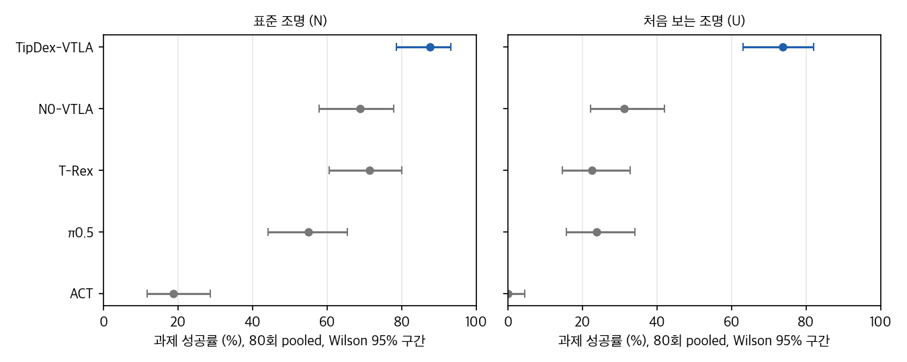
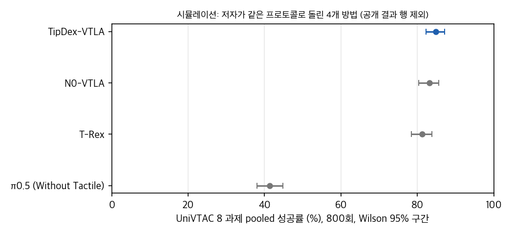
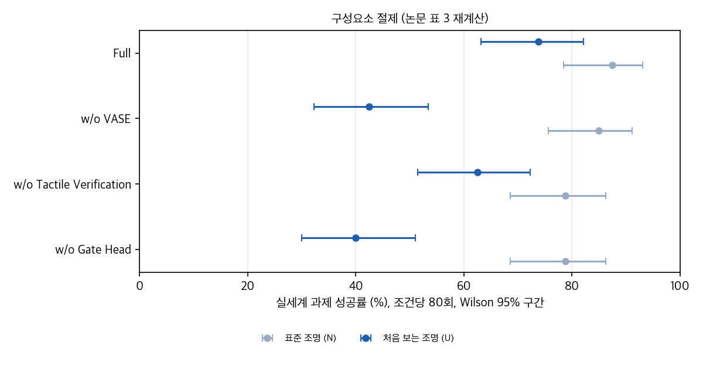

> **논문:** Xudi Ge, Yepeng Liu, Haifeng Liu, Enze Shi, Liangqi Zhang, Yongchao Xu. *TipDex-VTLA: Learning When to Refine Actions with Touch for Dexterous Manipulation.* arXiv:2611.25683 (v1, 2026-11-19). 학회 표기는 없습니다.
> 공식 추론 구현은 GitHub `tiplab/TipDex-VTLA`(Apache-2.0)에 있습니다. 학습 루프는 없고 손실 정의 일부만 있습니다. 이 글의 그래프는 우리가 논문 표 값으로 다시 그린 것이고, 논문 그림은 싣지 않았습니다(arXiv 비독점 라이선스).

## 논문이 묻는 것

조명이 바뀌면 물리 상태는 같은데 시각 정책의 행동이 흔들립니다. 촉각을 더한 정책도 문제가 남습니다. 촉각 신호를 언제, 얼마나 행동 수정에 쓸지 정해 두지 않으면, 흔들리는 시각 판단에 맞춰 촉각이 잘못 끼어듭니다.

TipDex-VTLA는 두 신호를 함께 씁니다. 하나는 **시각 행동 신뢰도**입니다. 같은 장면을 조명만 바꿔 찍은 짝 이미지에서 얼린 기준 정책의 행동 차이를 재고, 그 차이를 신뢰도 목표로 씁니다. 다른 하나는 **촉각 예측 오차**입니다. 행동을 고칠 때마다 촉각을 미리 예측해 두고, 측정 시각이 맞는 예측과 비교합니다. 두 값으로 보정 게이트를 열고, 보정은 아직 실행되지 않은 행동에만 들어갑니다. 실행된 명령과 실행 시각은 그대로 둡니다.

## 이 글에서 확인한 것

**1. 처음 보는 조명에서의 차이는 뚜렷합니다.** 논문 표 2의 실세계 4과제는 조건당 과제별 20회입니다. 이를 합치면 조건당 80회입니다. TipDex는 처음 보는 조명에서 73.75%, N0-VTLA는 31.25%입니다. 차이는 42.5 pp이고 Fisher 검정으로 p가 0에 가깝습니다. 두 Wilson 95% 구간은 겹치지 않습니다.

*그래프 (우리가 그림). 논문 표 2의 조건당 80회 성공률과 Wilson 95% 구간입니다. 평균은 논문 값과 맞습니다.*

**2. 시뮬레이션의 우위는 약합니다.** UniVTAC 8과제에서 TipDex 평균은 84.9%로 가장 높습니다. 하지만 N0-VTLA와의 차이는 1.75 pp이고 p = 0.38입니다. 과제별로 보면 Put Bottle 한 과제에서 +20 pp가 나오고, 나머지 과제에서는 N0-VTLA가 같거나 더 높은 경우가 많습니다. 이 시뮬레이션은 표준 조명에서만 돌렸습니다.

*그래프 (우리가 그림). 저자들이 같은 프로토콜로 돌린 네 방법의 800회 풀링 성공률과 Wilson 95% 구간입니다. 공개 결과로 가져온 행은 뺐습니다.*

**3. 구성요소 중 시각 신뢰도는 확실하고, 촉각 검증은 확인되지 않았습니다.** 처음 보는 조명에서 신뢰도 신호를 빼면 성공률이 73.75%에서 42.5%로 떨어집니다. 게이트 헤드를 빼면 40.0%입니다. 이 두 효과는 모두 p < 0.001입니다. 촉각 검증을 빼면 62.5%로 떨어지지만, 차이 11.25 pp는 p = 0.17입니다. 조건당 80회로는 이 차이를 찾기에 부족합니다. 80% 검정력으로는 약 270회가 필요합니다.

*그래프 (우리가 그림). 논문 표 3의 절제 변형별 성공률과 Wilson 95% 구간입니다.*

**4. 공식 코드는 추론 쪽만 있습니다.** 저장소에는 VASE 헤드, 게이트 보정, 촉각 예측 검증이 있고, 수식도 논문과 대체로 맞습니다. 하지만 학습 절차와 평가 코드가 없습니다. 학습 목적 함수도 논문 식 (5)–(8)과 다릅니다. 실행 점수의 임계값과 감소 형태도 논문에 없습니다. 공개 백본은 촉각 융합 방식을 `action_adapter`로 기록하는데, 논문 결과 설정은 `context_concat`입니다. 이 불일치는 실행해 보지 않고는 확인할 수 없습니다.

**5. 백본 이름이 본문에 없습니다.** 메타데이터를 보면 π0.5 계열입니다. 논문에서 π0.5는 기준선으로도 나옵니다. 따라서 TipDex의 추가 기여(신뢰도와 게이트)가 얼마나 되는지는 논문 표 2로 어느 정도 가늠할 수 있지만, 촉각 인코더와 예측기의 기여는 분리되어 있지 않습니다.

## 구현할 수 있는가

- **공식 추론:** 조건부입니다. 저장소는 CUDA 12를 전제합니다. JAX의 CPU 경로로 옮길 수 있을지는 측정하지 않았습니다.
- **학습 재현:** 불가입니다. 학습 루프가 없고 A100 8장 규모입니다.
- **실로봇과 시뮬 평가:** 불가입니다. 하드웨어와 평가 코드가 공개되지 않았습니다.

## 남은 질문

- 처음 보는 조명이 학습 때 쓴 합성 교란과 종류가 겹치는지. 그렇다면 "처음 본다"는 말의 뜻이 좁아집니다.
- 기준선도 같은 짝 이미지로 학습했는지. 그렇지 않다면 개선이 구조 때문인지 증강 때문인지 나뉘지 않습니다.
- 촉각 검증의 효과를 보려면 시행 수를 몇 배로 늘려야 하는지.

논문은 신뢰도가 "정책에 따라 달라지는 대리 값"이라고 스스로 적습니다. 이 점을 기억하고 읽으면 결과의 범위가 분명해집니다.

## 자료

- [통합 리포트 PDF](report/report_public.pdf)
- [TipDex-VTLA: 논문 분석 (arXiv:2611.25683)](analysis/01_paper_analysis.md)
- [TipDex-VTLA: 선행연구와 관련 저장소](analysis/02_prior_work.md)
- [TipDex-VTLA: 수치 재계산, 검정, 일관성 검사](analysis/03_analysis.md)
- [TipDex-VTLA: 논문 ↔ 공식 코드 대조 (정적 읽기)](analysis/04_code_verification.md)
