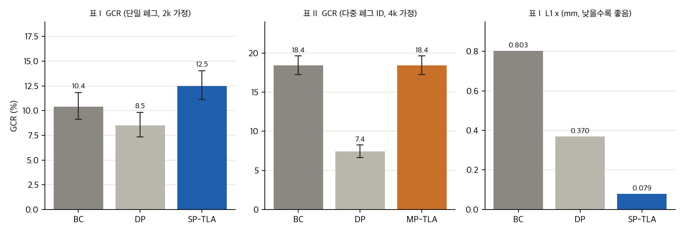
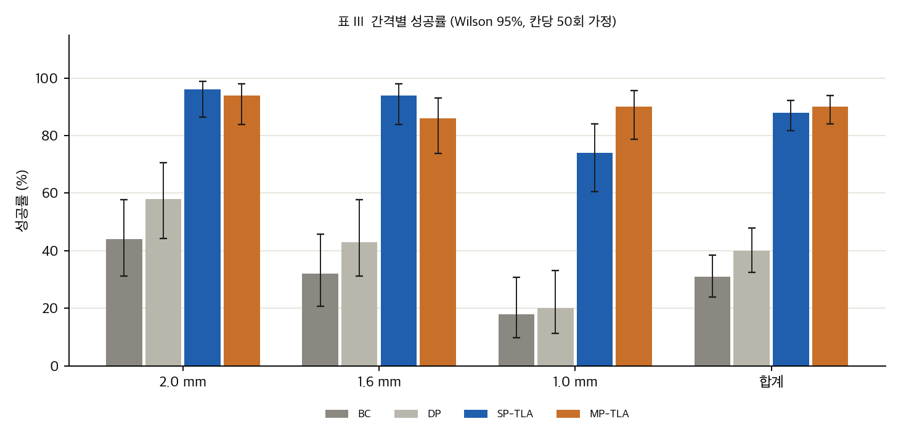
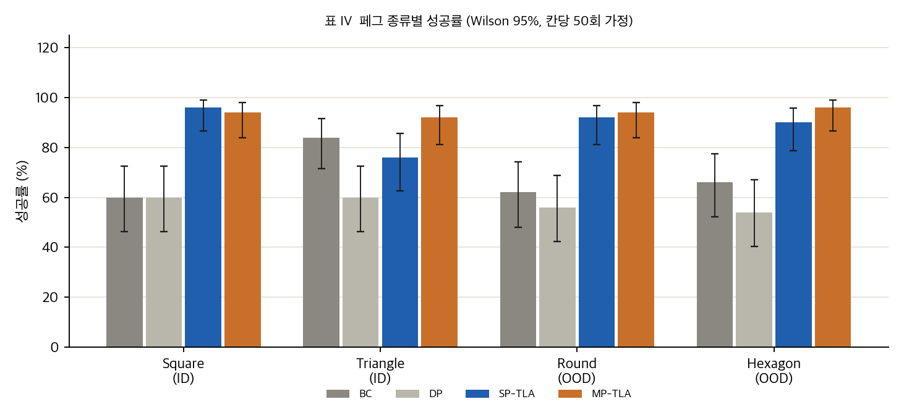

> **논문:** Peng Hao, Chaofan Zhang, Dingzhe Li, Xiaoge Cao, Xiaoshuai Hao, Shaowei Cui, Shuo Wang. *TLA: Tactile-Language-Action Model for Contact-Rich Manipulation.* arXiv:2503.08548 (v1, 2025-03-11). 저널 게재본은 *Robot Learning* 2026, DOI 10.55092/rl20260001입니다.
> 이 글은 arXiv v1을 읽었습니다. 게재본에는 실로봇 실험이 추가되어 있는데, 아래 '버전 차이'에서 따로 적었습니다. 논문 그림은 arXiv 라이선스(CC BY-NC-SA 4.0) 때문에 싣지 않았고, 이 글의 그래프는 논문 표 수치를 우리가 다시 그린 것입니다.

## 논문이 하려는 것

접촉이 많은 조립은 시각만으로 어렵습니다. 페그가 구멍 가장자리에 닿았을 때 어느 방향으로 얼마나 움직여야 하는지는 손가락의 촉각에서 읽어야 합니다. 이 논문은 촉각 이미지를 **언어 모델 입력**으로 넣고, 다음 동작을 "[Δx, Δy, Δrz]"라는 텍스트로 쓰게 합니다. 백본은 Qwen2-VL(ViT와 Qwen2 7B)이고, LoRA로 언어 모델만 학습합니다.

핵심 설계는 두 가지입니다.

1. **촉각 이미지 8장을 한 장으로 붙입니다.** 손가락 두 개의 시점 네 개를 3×3 격자에 놓고 616×616으로 줍니다. 시간 순서를 공간 배치로 바꾸는 방식입니다. 저자도 이것이 시간 정보를 잘 쓰지 못한다고 한계로 적었습니다.
2. **정답은 시뮬레이션의 자세 오차에서 계산합니다.** 간격 c와 자세 오차 (e_x, e_y, e_rz)로 식을 만들고, 범위를 잘라 정답을 씁니다. 사람의 시연이 아닙니다.

데이터는 Isaac Gym과 FEM 기반 촉각 시뮬레이션으로 만들었고, 2.0 mm 간격 페그만 수집했습니다. 논문은 약 24k 쌍이라고 합니다.

## 확인한 것

**1. 행동 오차는 L1에서 크게 줄었습니다.** 단일 페그에서 x 방향 L1은 0.370에서 0.079로 줄었습니다(78%). 논문의 "78%"는 표와 맞습니다. 다만 GCR(x, y, rz가 모두 맞는 비율)은 8–13%에 그칩니다. 엄격한 지표라서 절대값은 낮습니다.

*그래프 1. 표 I과 표 II의 GCR과 표 I의 L1 x를 다시 그렸습니다. GCR 구간은 논문이 밝히지 않은 표본 수(단일 2k, 다중 ID 4k)를 가정한 Wilson 95% 구간입니다. 우리가 그린 그래프입니다.*

다중 페그에서는 GCR이 BC(행동 복제, ResNet-50 기준선)와 같습니다(18.4%). 차이는 L1에서만 보입니다.

**2. 삽입 성공률 차이는 시도 잡음으로 설명되지 않습니다.** 간격별로 칸당 50회씩 시도했다고 본문이 적었습니다. 이 가정에서 TLA와 기준선의 차이는 모두 p < 0.001입니다. 다만 학습은 방법마다 한 번뿐입니다. 학습을 여러 번 했을 때도 같은 차이가 날지는 이 논문만으로 알 수 없습니다.

*그래프 2. 표 III의 간격별 성공률. 칸당 50회로 가정했고 합계는 150회입니다. 우리가 그린 그래프입니다.*

**3. "기준선보다 50% 높다"는 맞지 않습니다.** 본문은 2순위 방법보다 성공률이 50% 높다고 씁니다. 상대 증가로는 2.0 mm 66%, 1.6 mm 119%, 1.0 mm 270%, 합계 120%입니다. 절대 차이로는 38, 51, 54, 48%p입니다. 어느 쪽으로도 "50%"가 정확히 나오지 않습니다.

**4. "85% 이상"은 절반만 맞습니다.** 초록은 2.0 mm만 학습한 모델이 1.6 mm와 1.0 mm에서 85% 이상을 얻는다고 합니다. 2.0 mm만 학습한 SP-TLA는 1.6 mm에서 94%이지만 1.0 mm에서는 74%입니다. 정사각과 삼각을 함께 학습한 MP-TLA는 86%와 90%로 맞습니다.

**5. 삼각형에서 한 칸이 어긋납니다.** 본문은 두 TLA 모두 기준선보다 낫다고 씁니다. 페그 종류별 표에서 삼각형 ID의 SP-TLA는 76%이고 BC는 84%입니다. 이 칸에서는 TLA가 낮습니다.

*그래프 3. 표 IV의 페그 종류별 성공률. 칸당 50회로 가정했습니다. 우리가 그린 그래프입니다.*

**6. 효율 주장은 2.0 mm에서 맞지 않습니다.** 논문은 TLA가 조작 효율도 높다고 합니다. 그런데 2.0 mm에서 성공한 에피소드의 평균 스텝은 SP-TLA 3.15, BC 2.60, DP 2.45입니다. 성공 수가 다른 집단의 평균이라 선택 편향도 있습니다. DP는 확산 정책(Diffusion Policy) 기준선입니다.

## 버전 차이: arXiv와 게재본

- **arXiv는 v1 하나입니다.** 실로봇 실험은 없고, 저자가 앞으로 하겠다고만 씁니다.
- **게재본(2026)에는 실로봇 실험이 있습니다.** UR3에 GelStereo 2.0 센서 두 개를 달았습니다. 간격별로 20회씩 시도해 80%, 70%, 55%를 얻었습니다. 페그별로는 80, 80, 95, 75%입니다. 시뮬레이션 표는 같습니다.
- **라이선스가 다릅니다.** arXiv 페이지는 CC BY-NC-SA 4.0이고, 게재본은 CC BY 4.0입니다. 이 글은 arXiv 라이선스를 기준으로 그림을 뺐습니다.
- **데이터와 코드.** 초록은 "데이터와 코드를 모두 공개한다"고 합니다. 그러나 공식 저장소와 데이터 링크를 찾지 못했습니다. 게재본 Data availability에는 "문의 시 제공"이라고 적혀 있습니다.

## 구현할 수 있는가

이 맥(Apple M4 Pro, MPS, CUDA 없음)에서 논문의 TLA를 그대로 재현하는 것은 불가능합니다. 학습은 8장의 A6000을 쓴 7B 모델 미세조정이고, 데이터 생성은 CUDA 기반 Isaac Gym을 씁니다. 실로봇 검증도 장비가 필요합니다.

가능한 것은 두 가지입니다. 첫째, 라벨 식과 자세 오차에서 정답을 만드는 과정을 numpy로 옮기고, 영벡터 기준선의 L1을 계산해 0.079가 작은 값인지 판단합니다. 둘째, 같은 입력 형식을 쓰는 소형 촉각 회귀기를 2.0 mm에서만 학습해 1.6, 1.0 mm에서 시험하는 간격 외삽입니다. 둘째 항목은 합성 촉각 데이터를 어떻게 만들지 정해야 판단할 수 있습니다.

## 남은 질문

1. 언어 조건이 실제로 도움이 되는지. 같은 백본을 텍스트 없이 학습한 대조가 없습니다.
2. 정답이 시뮬레이터의 참 자세에서 나온다는 점. 실제 센서에서는 같은 정답을 얻을 수 없습니다.
3. 스케일 인자 s, 빔 폭, 학습률이 없어 L1의 단위와 크기를 해석하기 어렵습니다.
4. 시드를 여러 번 바꾼 결과가 없습니다.

입력 형식 자체는 간단하고 쓸 만합니다. 여러 프레임을 한 장으로 붙이면 기존 ViT 인코더를 그대로 쓸 수 있습니다. 평가 설계, 특히 간격을 나눈 외삽과 칸당 횟수, 구간 보고는 다른 촉각 연구에도 옮길 만합니다.

## 자료

- [통합 리포트 PDF](report/report_public.pdf)
- [TLA: Tactile-Language-Action Model for Contact-Rich Manipulation (arXiv:2503.08548) 논문 분석](analysis/01_paper_analysis.md)
- [TLA 선행연구와 관련 자료](analysis/02_prior_work.md)
- [TLA 수치 재계산과 일관성 검사](analysis/03_analysis.md)
- [TLA 주장 검증 (공식 코드 없음)](analysis/04_claim_verification.md)
