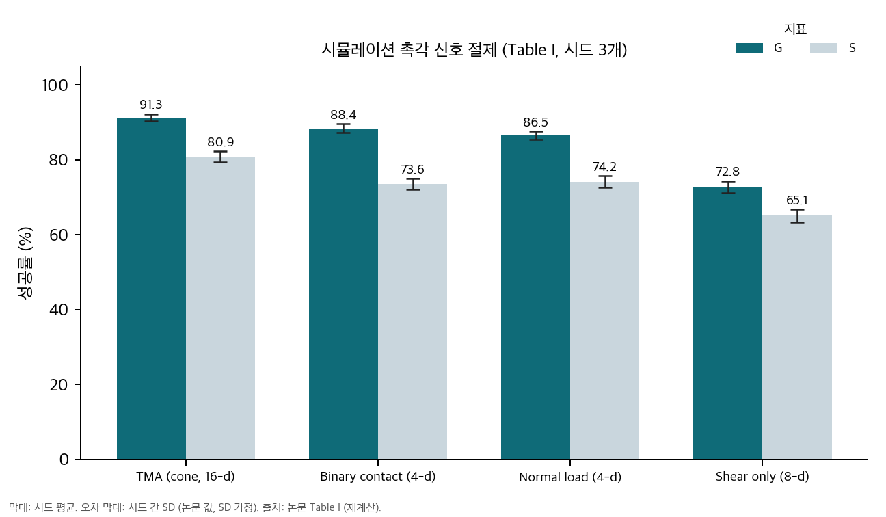
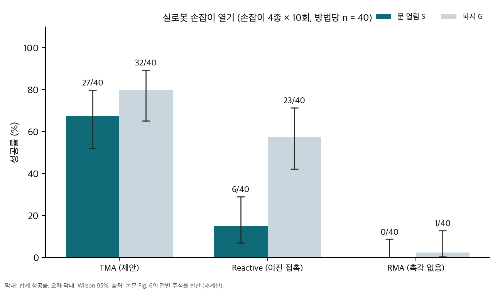

> **논문:** Yiting Chen 외 7명. *TMA: Sim-to-Real Forceful Humanoid Manipulation via Tactile-Driven Motor Adaptation.* arXiv:2611.18976 (v1, 2026-11-13). 학회 표기 없음.
> 공식 코드는 찾지 못했습니다. 프로젝트 페이지는 영상과 그림 중심입니다. 이 글의 그림은 우리가 그린 그래프 두 장입니다(논문 그림은 라이선스가 CC BY가 아니어서 싣지 않았습니다).

## 한 줄 요약

휴머노이드가 원형 손잡이를 열려면 손가락 힘의 크기와 방향, 그리고 접촉이 어떻게 변해 왔는지를 알아야 합니다. TMA는 촉각 힘을 원뿔 좌표로 바꾸고, 2초 촉각 이력에서 숨은 접촉 조건을 추정해 정책을 조절합니다. 시뮬레이션에서만 학습해도 실로봇에서 문을 열었습니다.

## 왜 어려운가

원형 손잡이는 마찰과 스프링 토크, 래치의 저항에 따라 결과가 크게 달라집니다. 잘 잡힌 상태와 곧 미끄러질 상태는 시각과 관절 각도에서 거의 같게 보입니다. 그래서 같은 명령에도 결과가 갈립니다. 논문은 이를 관측 불가능성 문제로 보고, 촉각으로 접촉의 반응을 직접 재는 방식을 택합니다.

## 방법

- **촉각 표현.** 손가락 끝 힘을 법선 하중, 힘 원뿔 각, 전단 방향으로 나눕니다. 마찰 원뿔 기하를 따르므로 마찰 조건을 명시적으로 담습니다.
- **두 단계 학습.** 1단계에서 특권 정보(마찰, 스프링 강성, 래치 상태)를 보는 오라클 정책을 강화학습으로 학습합니다. 2단계에서 특권 정보 없이 촉각 이력만 보고 같은 잠재를 추정하는 인코더를 지도 회귀로 학습합니다.
- **전신 제어.** 다리와 허리는 동결된 보행 컨트롤러가 맡고, 팔과 손은 TMA 정책이 맡습니다.

## 결과

시뮬레이션에서 촉각 표현을 바꿔 보면, 원뿔 좌표 입력이 이진 접촉, 법선 하중, 전단만 쓴 입력보다 높았습니다.

*그림 1. 시뮬레이션 촉각 신호 절제(논문 Table I). 막대는 시드 평균, 오차 막대는 시드 간 SD입니다. 우리가 그렸습니다.*

실로봇에서는 상용 손잡이 4종, 각 10회(방법당 40회)로 평가했습니다.

*그림 2. 실로봇 결과(논문 Fig. 6의 주석 합산). 막대는 합계 성공률, 오차 막대는 Wilson 95% 구간입니다. 우리가 그렸습니다.*

- 문 열림은 TMA 27/40, 촉각 반응형 기준선 6/40, RMA 0/40입니다. TMA와 반응형 기준선의 차이는 Fisher p = 3e-6입니다.
- 파지는 TMA 32/40, 반응형 기준선 23/40입니다. 차이는 p = 0.053으로 확실하지 않습니다. 그래서 "반응형 기준선은 잡기는 하지만 열지 못한다"는 말은 문 열림에만 맞습니다.

## 조심해서 읽을 점

- **실로봇 표본이 작습니다.** 방법당 40회, 손잡이당 10회이고 시드가 없습니다.
- **zero-shot의 조건.** 손잡이 테두리에 테이프를 붙였고 AprilTag로 손잡이 자세를 추정했습니다. 초록에는 이 조건이 없습니다.
- **"능동 접촉"의 근거가 약합니다.** 논문은 접촉을 능동적으로 얻는 관측이라고 쓰지만, 보상에 정보 이득 항이 없고 탐색 행동 분석도 없습니다.
- **잠재의 의미를 보이지 않습니다.** 적응 인코더가 무엇을 추정하는지 분석하지 않았습니다.

## 구현할 수 있을까

- **이 맥(CUDA 없음)에서 논문 결과를 재현하는 것은 불가능합니다.** 시뮬레이션 학습에는 GPU가 필요하고(논문은 한 GPU에서 약 15시간), 실험은 휴머노이드와 촉각 손이 필요합니다.
- **알고리즘의 핵심은 구현할 수 있습니다.** 촉각 힘을 원뿔 좌표로 바꾸는 변환과 이력 기반 잠재 회귀는 작은 규모로 검사할 수 있습니다. 이것만으로 논문 결과를 확인하지는 못합니다.

자세한 근거는 분석 노트에 있습니다. 그 노트에는 주장 검증 표와 재계산 결과가 들어 있습니다.

## 자료

- [통합 리포트 PDF](report/report_public.pdf)
- [TMA: Sim-to-Real Forceful Humanoid Manipulation via Tactile-Driven Motor Adaptation (arXiv:2611.18976) 논문 분석](analysis/01_paper_analysis.md)
- [02. 선행연구와 관련 자료](analysis/02_prior_work.md)
- [03. 재계산과 일관성 검사](analysis/03_analysis.md)
- [04. 주장 검증 (공식 코드 없음)](analysis/04_claim_verification.md)
