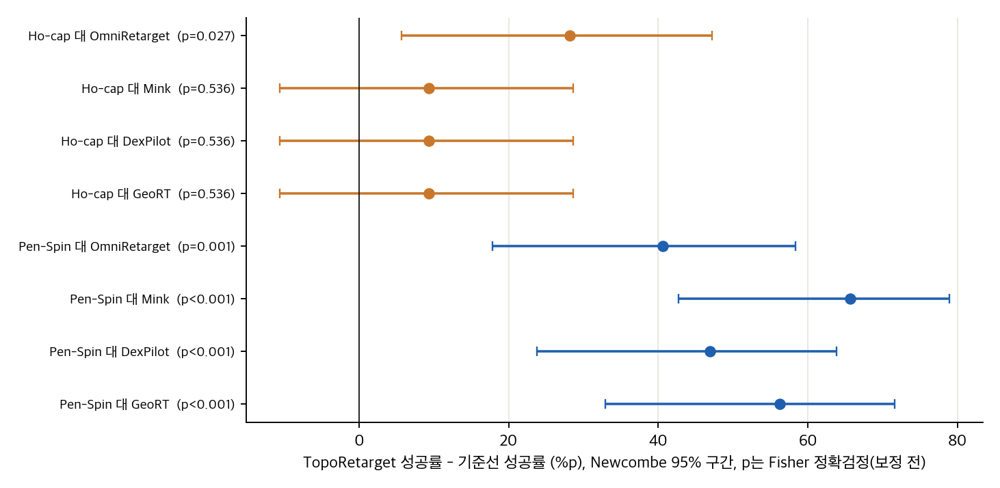
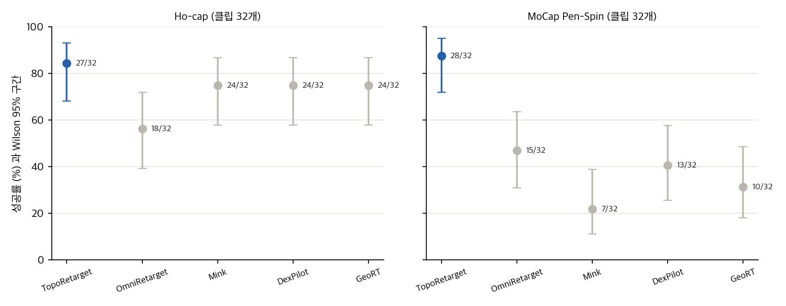
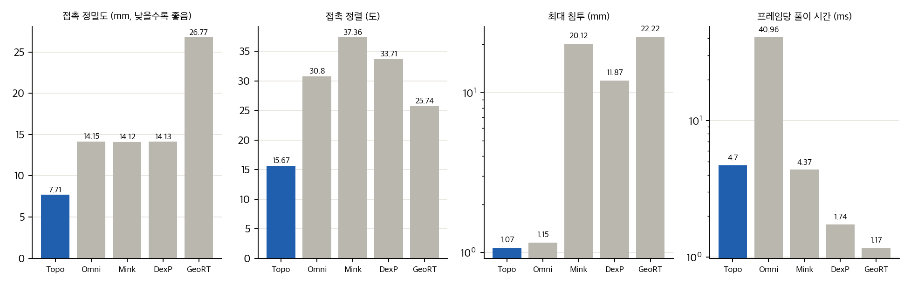
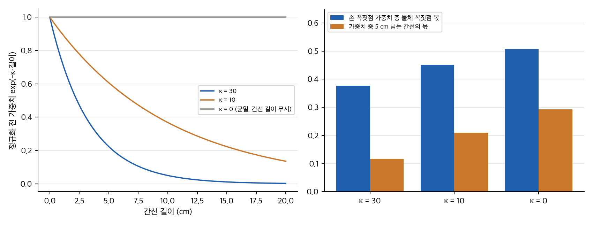
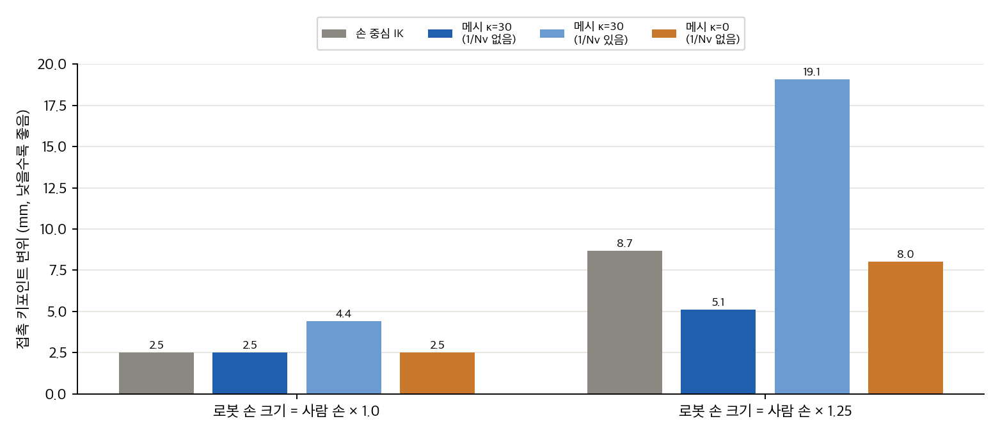

# TopoRetarget 보고 수치 재계산과 일관성 검사

원문 표 1–6의 값을 `paper/paper.txt`에서 정규식으로 읽어 옮겨 적은 값과 대조했고(`analysis/recompute.py`, 결과는 `analysis/recompute_results.json`), 성공률은 시행 수 32개(클립)를 근거로 Wilson 구간과 Fisher 정확검정을 계산했습니다. 상호작용 메시의 성질은 공개 저장소의 예제 클립을 읽어 확인했습니다(`analysis/toy_interaction_mesh.py`, 결과는 `toy_interaction_mesh_results.json`). 어느 계산도 논문에 없는 값을 쓸 때는 문장 안에 가정을 적었습니다. 확인 번호는 V1–V15입니다.

## 0. 요약표

| ID | 확인한 것 | 결과 |
|---|---|---|
| V1 | 표 2 성공 수 ↔ 백분율 10칸 | 모두 일치. 56.2%와 31.2%는 정확한 값이 56.25, 31.25이고 짝수쪽 반올림 표기 |
| V2 | 본문·프로젝트 페이지 문장 ↔ 표 1, 2 | 일치. 프로젝트 페이지의 "정밀도 55%, 최대 관통 92% 감소"는 기준선 평균 대비로 재현(55.4%, 92.3%) |
| V3 | Topo ↔ 기준선 성공률 검정 | **Pen-Spin은 4개 모두 보정 후에도 유의(p ≤ 0.006). Ho-cap은 OmniRetarget만 보정 전 p = 0.027(보정 후 0.11), 나머지 셋은 27/32 대 24/32, p = 0.54** |
| V4 | "40.6%p" | 28/32 − 15/32 = 40.625%p, 최고 기준선(OmniRetarget) 대비. 95% 구간 [17.8, 58.3] |
| V5 | 분석 단위와 검출력 | 방법당 정책 1개, 클립 32개. 검출 가능한 최소 차이 약 22–28%p. 학습 시드 변동 없음 |
| V6 | 표 2 오차 열 | 위치는 두 데이터에서 TopoRetarget이 최저. Ho-cap 회전은 5.76°로 셋째(DexPilot 4.99, Mink 5.55). 오차의 모집단(전체/성공) 미기재 |
| V7 | 표 1 상대 개선과 순위 | 접촉 정밀도 −45%, 정렬 −39%(최고 기준선 대비). 최대 관통 −7%(1.07 대 1.15 mm). 풀이 시간 5개 중 4위 |
| V8 | "관통 > 2 mm 프레임 %" 정수 가능성 | 0, 84, 88, 96은 n이 25의 배수일 때만 가능. n = 25(파지 수) 가정 시 0, 0, 21, 22, 24개 |
| V9 | 풀이 시간 | 4.70 ms = 213 Hz. OmniRetarget 40.96 ms(24 Hz)보다 8.7배 빠르고 Mink(4.37 ms)보다 1.08배 느림. 장비 미기재 |
| V10 | 부록 표 3–6 산술 | 163,840 = 4096 × 40, 20 Hz = 1/(0.01 × 5), 400 스텝 = 20 s 모두 일치. $N_v$ = 71 |
| V11 | 보상 커널 값 | 보고된 평균 오차에서 물체 보상 0.85–0.95, 종료 문턱 5 cm에서 0.21 |
| V12 | v1 ↔ v2 | 감사의 글 추가 외 표·식·수치 동일 |
| V13 | 간선 가중치와 그래프 통계 | $\kappa$ = 30이면 가중치 몫 11.7%만 5 cm 넘는 간선. 손 꼭짓점 가중치의 38%가 물체 꼭짓점. 평균 이웃 15.6개 |
| V14 | 프로젝트 페이지의 실로봇 5/5 | 시행 수 5, Wilson 95% [56.6, 100]%. 논문 본문에는 횟수 없음 |
| V15 | 축소 리타게팅 장난감 | 로봇 손을 1.25배로 키우면 손 중심 IK의 접촉 변위 8.7 mm, 가중치 500의 메시(κ = 30) 5.1 mm, κ = 0 8.0 mm. 크기가 같으면 두 방법 2.5 mm로 같음 |

## 1. 표와 본문의 일관성

### 1.1 표 2 성공률 환산 (V1)

| 데이터 | 방법 | 성공 수 | 정확한 값 | 논문 표기 | 반올림 | Wilson 95% |
|---|---|---|---|---|---|---|
| Ho-cap | TopoRetarget | 27/32 | 84.375 | 84.4 | 일치 | [68.2, 93.1] |
| Ho-cap | OmniRetarget | 18/32 | 56.25 | 56.2 | 짝수쪽 | [39.3, 71.8] |
| Ho-cap | Mink | 24/32 | 75.0 | 75.0 | 일치 | [57.9, 86.7] |
| Ho-cap | DexPilot | 24/32 | 75.0 | 75.0 | 일치 | [57.9, 86.7] |
| Ho-cap | GeoRT | 24/32 | 75.0 | 75.0 | 일치 | [57.9, 86.7] |
| Pen-Spin | TopoRetarget | 28/32 | 87.5 | 87.5 | 일치 | [71.9, 95.0] |
| Pen-Spin | OmniRetarget | 15/32 | 46.875 | 46.9 | 일치 | [30.9, 63.6] |
| Pen-Spin | Mink | 7/32 | 21.875 | 21.9 | 일치 | [11.0, 38.8] |
| Pen-Spin | DexPilot | 13/32 | 40.625 | 40.6 | 일치 | [25.5, 57.7] |
| Pen-Spin | GeoRT | 10/32 | 31.25 | 31.2 | 짝수쪽 | [18.0, 48.6] |

- 10칸 모두 표의 "(k/32)"와 백분율이 같은 정수에서 나옵니다. 56.25와 31.25는 소수 첫째 자리에서 "5"로 끝나는 정확한 값이라 반올림 규칙에 따라 56.3/31.3 또는 56.2/31.2가 되며, 표는 후자(프로그래밍 언어의 기본 서식 방식)입니다. 값의 문제는 아닙니다.
- Wilson 구간은 방법당 정책 하나의 32개 클립을 독립 시행으로 보고 계산했습니다. 논문은 구간이나 시드를 보고하지 않습니다.
- 세 기준선(Mink, DexPilot, GeoRT)이 Ho-cap에서 같은 24/32를 기록합니다. 위치·회전 오차는 서로 다릅니다(0.90–0.92 cm, 4.99–6.07°). 클립별 성공 목록이 없어 같은 클립을 실패했는지는 알 수 없습니다.

### 1.2 본문·프로젝트 페이지 문장과 표 (V2)

| 문장 | 위치 | 표에서 재계산 | 판정 |
|---|---|---|---|
| "contact precision과 alignment가 가장 낮다, 7.71 mm와 15.67°" | §5.1 | 표 1에서 두 열 모두 최저 | 일치 |
| "최대 관통 1.07 mm" | §5.1 | 표 1 | 일치 |
| "평균 풀이 시간 5 ms 미만" | §5.1 | 4.70 ms | 일치 (V9) |
| "Ho-cap 성공률 84.4%, 위치 오차 최저 0.87 cm" | §5.2 | 표 2 | 일치 |
| "회전 오차는 기준선 사이에서 비슷하다" | §5.2 | Ho-cap 4.99–7.87° (TopoRetarget 5.76, 셋째) | 일치 (V6) |
| "Pen-Spin 87.5%, 모든 기준선보다 40%p 이상" | §5.2 | 최소 격차 40.625%p | 일치 (V4) |
| 초록: "Pen-Spin 학습 성공을 40.6%p 향상" | 초록 | 28/32 − 15/32 | 일치 (V4) |
| 결론: "더 높은 성공률과 더 낮은 물체 추적 오차" | §6 | Ho-cap 회전 오차는 셋째 | 위치와 Pen-Spin에서 성립, Ho-cap 회전 제외 |
| 프로젝트 페이지: "기준선 평균 대비 접촉 정밀도 오차 55%, 최대 관통 92% 감소" | 프로젝트 페이지 | 기준선 평균 17.29 mm, 13.84 mm → (17.29 − 7.71)/17.29 = 55.4%, (13.84 − 1.07)/13.84 = 92.3% | 일치 |

프로젝트 페이지의 두 수치는 **네 기준선의 단순 평균**과 비교한 값입니다. 최고 기준선과 비교하면 접촉 정밀도는 45.4%(Mink 14.12 mm), 최대 관통은 7.0%(OmniRetarget 1.15 mm) 감소입니다 (V7).

## 2. 통계적 확실성

### 2.1 성공률 차이 검정 (V3)

방법당 정책 1개, 32개 클립을 독립 시행으로 가정한 Fisher 정확검정(양측)과 Newcombe 95% 구간입니다. Holm 보정은 8개 비교 전체와 데이터셋 안의 4개 비교 두 가지를 계산했고, 8개 기준이 더 보수적입니다.

| 데이터 | 기준선 | 성공 수 (Topo : 기준선) | 차이 (%p) | 95% 구간 | Fisher p | Holm p (8개) |
|---|---|---|---|---|---|---|
| Ho-cap | OmniRetarget | 27 : 18 | +28.1 | [5.7, 47.2] | 0.027 | 0.109 |
| Ho-cap | Mink | 27 : 24 | +9.4 | [−10.6, 28.6] | 0.536 | 1.0 |
| Ho-cap | DexPilot | 27 : 24 | +9.4 | [−10.6, 28.6] | 0.536 | 1.0 |
| Ho-cap | GeoRT | 27 : 24 | +9.4 | [−10.6, 28.6] | 0.536 | 1.0 |
| Pen-Spin | OmniRetarget | 28 : 15 | +40.6 | [17.8, 58.3] | 0.0011 | 0.0056 |
| Pen-Spin | Mink | 28 : 7 | +65.6 | [42.7, 78.8] | < 0.0001 | < 0.0001 |
| Pen-Spin | DexPilot | 28 : 13 | +46.9 | [23.7, 63.8] | 0.0002 | 0.0011 |
| Pen-Spin | GeoRT | 28 : 10 | +56.2 | [33.0, 71.5] | < 0.0001 | 0.0001 |

그림 1. 표 2에서 TopoRetarget과 기준선의 성공률 차이(%p), Newcombe 95% 구간. 방법당 32개 클립을 독립 시행으로 가정한 계산이고, p는 Fisher 정확검정(보정 전)입니다. 논문 그림이 아닌 우리가 그린 그래프입니다.

- **Pen-Spin의 우위는 통계적으로 확실합니다.** 가장 가까운 OmniRetarget과도 13개 클립 차이이고 보정 후 p = 0.006입니다.
- **Ho-cap에서는 Mink, DexPilot, GeoRT와 구분되지 않습니다.** 3개 클립 차이(27 대 24)이고 구간이 0을 지나갑니다. OmniRetarget(18/32)과의 차이만 보정 전에는 유의하나 8개 비교로 보정하면 p = 0.11입니다. 논문 본문의 "highest success rate"는 점추정으로는 맞으나 이 표만으로는 셋과의 순위를 말하기 어렵습니다.
- 두 데이터셋을 합친 64개 클립으로 보면(참고용, 서로 다른 데이터를 풀링한 값) TopoRetarget 55/64(85.9%)이고 기준선은 31–37/64(48.4–57.8%)입니다. Fisher p는 기준선별로 1e−5에서 7e−4입니다.

### 2.2 분석 단위와 검출력 (V5)

- 논문의 설명에 따르면 방법마다, 데이터셋마다 정책을 하나씩 학습하고(§5.2, A.4) 학습된 정책을 클립 32개로 평가합니다. 학습 시드 여러 개의 반복이 없습니다. 위 구간은 **클립 표본의 불확실성**만 담고, RL 학습의 시드 변동은 담지 못합니다. 시드 변동이 있으면 구간은 더 넓어집니다.
- 클립별 성공 여부가 없어 같은 클립에 대한 짝 검정(McNemar)이나 클립 난이도 보정은 할 수 없습니다.
- n = 32씩일 때 Fisher p < 0.05가 되는 최소 격차는 기준선 7–18/32에서 28.1%p(9개 클립), 기준선 24/32에서 21.9%p(7개 클립)입니다. Ho-cap의 격차 9.4%p는 이 표본 크기로는 검출할 수 없는 크기입니다.
- Ho-cap 32개는 "단일 손 상호작용에서 무작위로 추출"했다고 하며(A.4), 추출 시드와 전체 후보 수는 적혀 있지 않습니다.

그림 2. 표 2 성공률과 Wilson 95% 구간(클립 32개 독립 시행 가정). 논문 그림이 아닙니다.

### 2.3 표 2 오차 열 (V6)

| 데이터 | 지표 | TopoRetarget | 최저 방법 | TopoRetarget 순위 |
|---|---|---|---|---|
| Ho-cap | 위치 (cm) | 0.87 | TopoRetarget | 1위 (2위 GeoRT 0.90, 격차 0.03 cm) |
| Ho-cap | 회전 (°) | 5.76 | DexPilot 4.99 | **3위** (DexPilot, Mink 5.55 다음, 최저보다 15% 높음) |
| Pen-Spin | 위치 (cm) | 0.98 | TopoRetarget | 1위 (2위 GeoRT 1.19) |
| Pen-Spin | 회전 (°) | 9.25 | TopoRetarget | 1위 (2위 OmniRetarget 14.26) |

- 논문은 Ho-cap의 회전 오차를 "과제가 파지 중심이라 방법 사이 차이가 작다"고 설명합니다(§5.2). 순위로는 셋째이고 값 차이는 작습니다.
- 평균 오차가 **모든 클립**의 값인지 **성공한 롤아웃**만의 값인지 적혀 있지 않습니다. 성공률이 방법마다 다르므로(21.9–87.5%) 두 경우 비교의 의미가 달라집니다.
- 평균 위치 오차 0.87–1.61 cm는 종료 문턱 5 cm(표 4)보다 훨씬 작습니다. 표준편차나 구간은 없습니다.

## 3. 표 1: 접촉 지표와 풀이 시간

### 3.1 상대 개선 (V7)

| 지표 | TopoRetarget | 기준선 평균 | 평균 대비 감소 | 최고 기준선 | 최고 대비 감소 | TopoRetarget 순위 |
|---|---|---|---|---|---|---|
| 접촉 정밀도 (mm) | 7.71 | 17.29 | 55.4% | Mink 14.12 | 45.4% | 1/5 |
| 접촉 정렬 (°) | 15.67 | 31.90 | 50.9% | GeoRT 25.74 | 39.1% | 1/5 |
| 최대 관통 (mm) | 1.07 | 13.84 | 92.3% | OmniRetarget 1.15 | 7.0% | 1/5 |
| 관통 > 2 mm (%) | 0.00 | 67.00 | — | OmniRetarget 0.00 | 동률 | 공동 1위 |
| 풀이 시간 (ms) | 4.70 | 12.06 | 61.0% | GeoRT 1.17 | −301% | **4/5** |

그림 3. 표 1의 네 지표. 최대 관통과 풀이 시간은 로그 축입니다. 논문 그림이 아닙니다.

- TopoRetarget은 접촉 정밀도와 정렬을 함께 가장 낮게 달성했습니다. 정렬이 두 번째로 낮은 GeoRT(25.74°)는 정밀도 오차가 가장 큽니다(26.77 mm). 두 지표 사이에 절충이 있을 수 있다는 것을 표가 보여 줍니다.
- 관통에서 TopoRetarget과 OmniRetarget은 모두 2 mm 이하이고 최대 관통 차이는 0.08 mm입니다. 나머지 세 기준선은 물체 형상에 대한 충돌 처리를 쓰는지 논문에 적혀 있지 않습니다(§5는 "해당되는 경우 같은 물체 형상"). 관통 열은 충돌 처리를 가진 방법과 갖지 않은 방법의 비교일 가능성이 있습니다.
- 표 1은 25개 파지의 평균이며 표준편차는 없습니다.

### 3.2 관통 비율의 정수 가능성 (V8)

표의 비율 0.00, 0.00, 84.00, 88.00, 96.00은 모두 4의 배수입니다. 소수 둘째 자리까지 같게 나오는 분모 n은 300 이하에서 **25, 50, 75, …, 300**(25의 배수)뿐입니다. A.4가 쓰는 파지 수는 25개이므로 표의 비율은 "파지당 1개씩 25개"의 비율로 읽으면 0, 0, 21, 22, 24개(시행 수 25 가정)입니다. 본문은 "% frames"라고 쓰고 식 12도 프레임 평균이므로, 파지마다 한 프레임을 평가했거나 25의 배수 프레임을 평가했을 가능성이 있습니다. 어느 쪽인지는 저자 확인이 필요합니다.

- n = 25에서 0/25의 Wilson 95% 상한은 13.3%입니다. "0.00%"는 "0%에 가깝다"는 정도로 읽을 수 있습니다.
- 최대 관통과의 정합: 최대 관통이 2 mm 이하이면 비율은 0이어야 하고 초과하면 0보다 커야 합니다. 다섯 방법 모두 이 관계가 성립합니다(1.07, 1.15 mm → 0%, 11.87–22.22 mm → 84–96%).
- TopoRetarget의 최대 관통 1.07 mm는 소프트 허용치 $\tau$ = 1 mm(표 3)보다 0.07 mm 큽니다. 슬랙 상한은 $b - \tau$ = 29 mm입니다. 허용치 근방에서 제약이 작동한다는 것과 일치합니다.

### 3.3 풀이 시간 (V9)

- 4.70 ms/프레임 = 213 Hz입니다. 참조 주파수는 20 Hz(표 6)라 TopoRetarget뿐 아니라 OmniRetarget(40.96 ms = 24 Hz)도 20 Hz의 50 ms 예산 안에 들어옵니다. "real-time"이 이 맥락에서 20 Hz 참조에 대한 것인지, 텔레오퍼레이션 같은 더 높은 주파수에 대한 것인지는 본문에 없습니다.
- 표 1에서 TopoRetarget은 4위입니다. OmniRetarget보다 8.7배 빠르고, Mink보다 1.08배, DexPilot보다 2.7배, GeoRT보다 4.0배 느립니다.
- 측정 장비, 스레드 수, 충돌 질의 포함 여부, 반복 횟수가 적혀 있지 않습니다. 공개 저장소 README는 예제 클립(231프레임, 50 Hz)을 "한 코어에서 약 30초"라고 적습니다. 모든 시간이 풀이였다고 가정한 상한으로 프레임당 130 ms이며(시작 시간과 뷰어 포함 가능), 표의 4.70 ms와 직접 비교할 수 없습니다. 다른 손 모델, 합성 충돌 형상, 클립 전체 후처리 때문일 수 있습니다 (`04` D5, D8).

## 4. 부록 표 3–6의 산술

### 4.1 일관성 (V10)

| 항목 | 값 | 확인 |
|---|---|---|
| 샘플 / PPO 반복 | 4096 환경 × 40 스텝 = 163,840 | 표 6과 일치 |
| 제어 주파수 | 1/(0.01 s × 5) = 20 Hz | 표 6과 일치 |
| 에피소드 | 20 s × 20 Hz = 400 스텝 | 표 6, 표 4 timeout과 일치 |
| 미니배치 | 163,840 / 32 = 5,120 | 표 6에는 값이 없음 |
| 꼭짓점 수 | $N_v$ = 21 + 50 = 71 | 식 3 |
| 유효 $\lambda_{IM}/N_v$ | 500/71 = 7.04 | 식 7, 표 3의 literal 해석 (`04` D1) |
| 슬랙 상한 | $b - \tau$ = 29 mm | 식 8 |
| Pen-Spin 클립 길이 | 평균 12.4 s = 248 스텝(20 Hz) < 400 스텝 | 일치 |
| ContactPose 파지 수 | 25/28, 제외 3(머그, 가위, 유타 주전자) | A.4 |
| 표 3 매개변수 12개 | 원문 텍스트에서 모두 확인 | 일치 |

### 4.2 보상 커널 값 (V11)

$\psi(e;\sigma)=\exp(-\|e/\sigma\|^2)$이고 표 4의 $\sigma$가 물체 0.04 m, 링크 0.025 m, 관절 0.1(범위로 정규화)입니다.

| 항 | 오차 | $\psi$ |
|---|---|---|
| 물체 ($\sigma$ = 0.04) | 0.87 cm (Ho-cap TopoRetarget 평균) | 0.95 |
| 물체 | 1.61 cm (Pen-Spin Mink 평균) | 0.85 |
| 물체 | 5 cm (종료 문턱) | 0.21 |
| 링크 ($\sigma$ = 0.025) | 1 cm / 2 cm / 5 cm | 0.85 / 0.53 / 0.018 |
| 관절 ($\sigma$ = 0.1) | 정규화 오차 0.05 / 0.1 / 0.2 | 0.78 / 0.37 / 0.018 |

- 항별 최대 가중 합은 8.0 + 1.0 + 1.0 = 10이고 물체 항이 80%입니다. 보고된 평균 오차 범위에서는 물체 보상이 0.85–0.95 사이에 있으므로, 방법 사이 성공률 차이가 보상 크기 차이보다 종료 조건(5 cm, 45°) 도달 여부에서 나올 가능성이 있습니다. 이는 표만으로 확인할 수 없는 해석입니다.

## 5. 버전과 프로젝트 페이지

### 5.1 v1 ↔ v2 (V12)

`pdftotext -layout`으로 만든 두 판의 텍스트를 줄 단위로 비교하면 바뀐 줄은 28개이고 그 중 내용이 있는 것은 **감사의 글**(Fan Yang, Chaoyi Pan, Cunxi Dai, Xiaofeng Guo의 논의와 피드백, Tongbin Liu와 Wenkai Nie의 실험 준비 지원)뿐입니다. 나머지는 arXiv 표지 줄의 버전 표기와 쪽 번호입니다. 표 1–6의 값과 식은 같습니다. 쪽수는 v2 16쪽, v1 15쪽입니다.

### 5.2 프로젝트 페이지 서술 (V14)

- 프로젝트 페이지는 펜 돌리기에서 "Across 5 / 5 zero-shot trials the policy keeps the pen spinning on the Wuji Hand"라고 적습니다. n = 5에서 5/5의 Wilson 95% 구간은 56.6–100%입니다. 논문 본문에는 시행 횟수와 지속 시간이 없습니다. "전체 길이 중단 없는 안정성 실행" 영상이 따로 있다고 적혀 있으나 논문 표에는 없습니다.
- 프로젝트 페이지의 일반화 문단은 MANO, Wuji, Leap 손을 언급합니다. 논문 그림 5가 같은 세 손을 보이는지는 그림만으로 판독하지 못했습니다.

## 6. 상호작용 메시의 성질 (장난감 1, 2)

공개 저장소의 예제 클립 `pen_spin_029`(231프레임, 50 Hz, 손 21점과 펜 포즈)와 펜 메시를 읽어 계산했습니다. 저장소 코드는 쓰지 않았고(실행·가져오기 없음) 데이터 파일만 읽었습니다. 펜 표면 50점은 면적 비례 균일 추출(시드 0)이고, 저장소 기본값(곡률과 손가락 끝 근접 가중)과는 다릅니다.

### 6.1 그래프 통계 (V13)

5프레임마다 47프레임, 71개 꼭짓점(손 21 + 펜 50)의 Delaunay 그래프입니다.

| 항목 | 값 |
|---|---|
| 간선 수 | 손-손 79, 손-물체 170, 물체-물체 195 (합 약 443, 평균 차수 12.5) |
| 손 꼭짓점의 평균 이웃 수 | 15.6 |
| 물체 이웃을 가진 손 꼭짓점 | 99.6% |
| 손가락 끝과 펜 축 사이 거리 | 최소 0.77 cm, 중앙값 2.5 cm, 2 cm 이내인 (프레임, 손가락) 33.7% |

| $\kappa$ | 손 꼭짓점 가중치 중 물체 꼭짓점 몫 | 가중치 중 5 cm 넘는 간선 몫 | 손 꼭짓점의 유효 이웃 수 $1/\sum w^2$ |
|---|---|---|---|
| 30 | 0.377 | 0.117 | 10.9 |
| 10 | 0.451 | 0.210 | 14.6 |
| 0 (균일) | 0.507 | 0.292 | 15.6 |

그림 4. 왼쪽은 정규화 전 간선 가중치 exp(−κ·길이), 오른쪽은 예제 클립에서 κ별 가중치 구성(5프레임마다 47프레임 평균). 논문 그림이 아닙니다.

- $\kappa$ = 30이면 가까운 이웃으로 가중치가 모이지만(유효 이웃 10.9개), 5 cm를 넘는 먼 간선에도 가중치의 11.7%가 남습니다.
- 71개 점의 Delaunay 그래프는 평균 차수 12.5, 손 꼭짓점은 15.6으로 "sparse interaction graph"(초록)라고 부르기엔 간선이 많습니다. 사면체 분할의 일반적인 차수 범위이고, 희소하다는 말이 거리 가중으로 유효 이웃이 줄어든다는 뜻인지는 본문에 없습니다.
- 펜을 돌리는 클립에서도 손가락 끝은 펜 축에서 중앙값 2.5 cm 떨어져 있어, 2 cm 이내인 (프레임, 손가락) 쌍은 3분의 1 정도입니다.

### 6.2 축소 리타게팅 비교 (V15)

사람 손 키포인트(예제 클립 10프레임)를 뼈 길이가 사람과 다른 26자유도 골격(손목 6 + 손가락 20)에 대해 풀었습니다. 골격은 사람 손 0번 프레임의 뼈 방향을 기준 자세로 하고 뼈 길이에 배율 0.85–1.15의 고정 난수를 곱했으며, 관절 상자 한계(±1.2/0.5 rad)가 있습니다. 비교한 것은 (가) **손 중심 IK**(21개 키포인트 위치 일치)와 (나) **상호작용 메시**(식 7, 가중치 500, Delaunay 71점)입니다. (나)는 뼈 방향 항(가중 0.1), 관절 정규화, 손목 사전을 함께 둡니다. 접촉 점은 펜 표면 샘플에서 1.5 cm 이내인 손 키포인트(프레임당 평균 1.9개, 10프레임)이고, 지표는 사람 키포인트와의 변위(식 10의 정의)입니다. 관통 제약, 슬랙, 논문의 $E_{reg}$ 전체는 넣지 않았습니다. 정규화 가중치는 이 장난감의 임의 값입니다.

| 로봇 손 크기 | 방법 | 접촉 변위 (mm) | 뼈 방향 오차 (°) |
|---|---|---|---|
| 사람 × 1.0 | 손 중심 IK | 2.50 | 3.28 |
| 사람 × 1.0 | 메시 κ = 30, $1/N_v$ 없음 | 2.52 | 3.29 |
| 사람 × 1.0 | 메시 κ = 30, $1/N_v$ 있음 | 4.40 | 6.90 |
| 사람 × 1.0 | 메시 κ = 0, $1/N_v$ 없음 | 2.53 | 2.98 |
| 사람 × 1.25 | 손 중심 IK | 8.70 | 10.58 |
| 사람 × 1.25 | 메시 κ = 30, $1/N_v$ 없음 | **5.10** | 7.15 |
| 사람 × 1.25 | 메시 κ = 30, $1/N_v$ 있음 | 19.06 | 16.16 |
| 사람 × 1.25 | 메시 κ = 0, $1/N_v$ 없음 | 8.01 | 11.96 |

그림 5. 축소 리타게팅 장난감의 접촉 키포인트 변위. 예제 클립 10프레임, 프레임당 평균 접촉 점 1.9개, 장난감 규모의 값입니다. 논문 그림이 아닙니다.

- 로봇 손이 사람 손과 같은 크기이면 메시 방법은 손 중심 IK와 같은 값(2.5 mm)으로 수렴합니다. 이 경우 접촉 변위만으로는 두 목적의 차이가 드러나지 않습니다.
- 로봇 손이 25% 크면 **물체 꼭짓점을 포함한 메시가 접촉 변위를 8.7 → 5.1 mm로 줄이고**, 거리 가중을 끄면(κ = 0) 8.0 mm로 그 이득이 대부분 사라집니다. 방향은 논문의 설계 의도(거리 가중으로 가까운 이웃의 관계를 우선)와 같습니다. 표본이 작아(접촉 점 약 19개) 크기는 방향의 확인으로만 읽어야 합니다.
- **$E_{IM}$에 $1/N_v$를 literal로 적용하면(유효 가중치 500/71) 이 장난감에서는 값이 크게 나빠집니다**(19.1 mm). 이는 같은 계수 안에서 정규화 항(관절 0.1, 손목 10, 뼈 방향 0.1)에 대한 상대 가중치가 71분의 1이 되기 때문이며, 장난감의 정규화 값이 임의이므로 논문 구현에서도 같은 일이 일어난다는 증거는 아닙니다. 다만 공개 코드는 이 $1/N_v$를 적용하지 않으므로(`04` D1) 두 서술의 차이가 결과에 영향을 줄 수 있는 크기임을 보여 줍니다.
- 이 장난감은 식 8의 관통 제약과 시간 정규화를 포함하지 않으므로 표 1을 재현하는 실험이 아닙니다.

## 7. 그래프 (우리가 그린 것)

`analysis/plot_figures.py`가 `report/figures/own_success_wilson.png`, `own_success_diff.png`, `own_table1_metrics.png`, `own_graph_weights.png`, `own_toy_scale.png` 다섯 장을 만듭니다. 논문 그림은 쓰지 않았고(개인용 리포트와 PPT에만 원문 그림 세 장), 값은 `recompute_results.json`과 `toy_interaction_mesh_results.json`에서 읽습니다.
