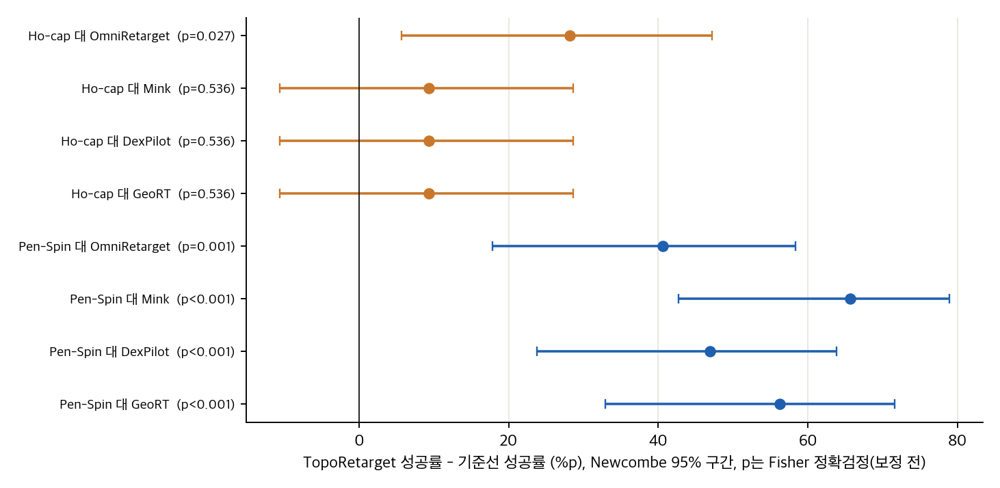
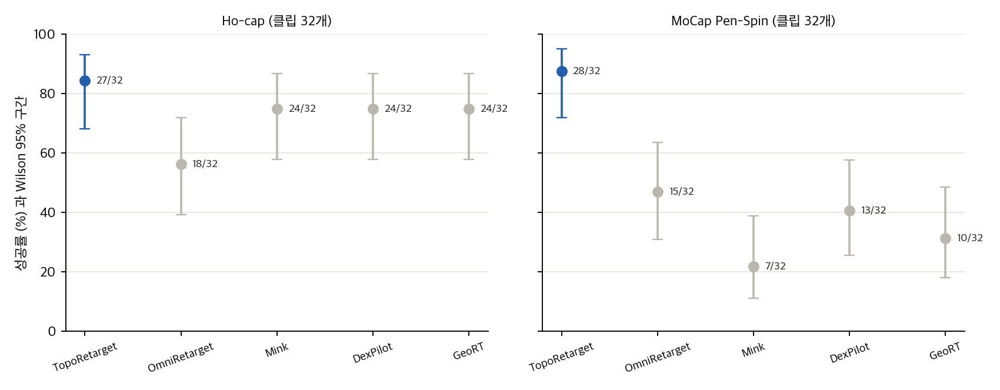
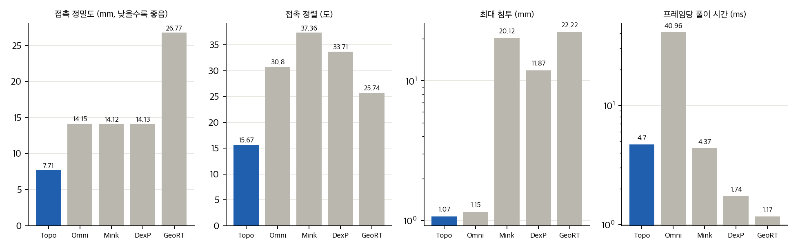
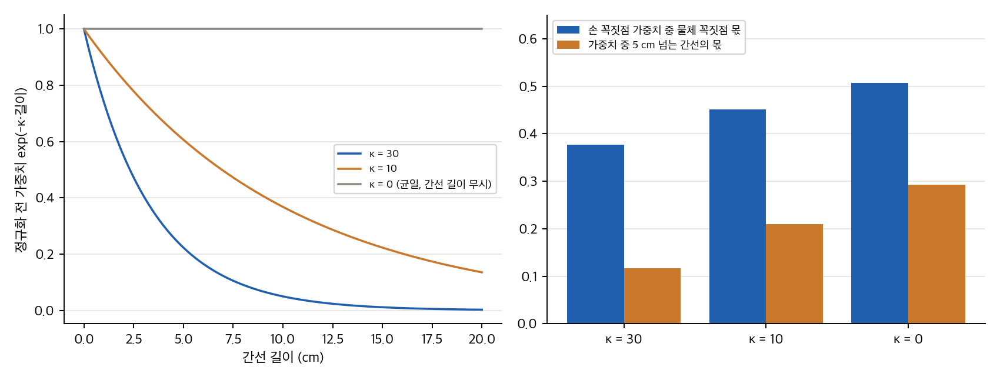
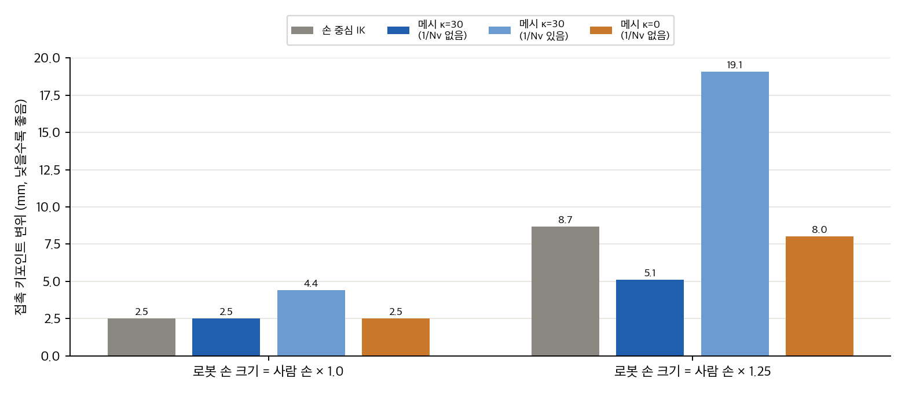

> **논문:** Jielin Wu, Shenzhe Yao, Guanqi He, Xiaohan Liu, Zhaoqing Zeng, Xiangrui Jiang, Han Yang, Wentao Zhang, Hang Zhao. *TopoRetarget: Interaction-Preserving Retargeting for Dexterous Manipulation.* arXiv:2606.16272 (v2, 2026-06-22). CoRL 2026 포스터.
> 논문은 arXiv 비독점 배포 라이선스(CC BY 아님)라 이 글은 논문 그림을 쓰지 않고, 논문 표의 숫자를 인용하며 우리가 그린 그래프를 넣었습니다.

## 논문이 하는 것

사람 손-물체 시연을 로봇 손 궤적으로 옮길 때 손 모양만 맞추면 "어디가 닿는가"가 사라집니다. TopoRetarget은 손 키포인트 21개와 물체 표면 샘플 50개를 꼭짓점으로 Delaunay 그래프를 만들고, 꼭짓점마다 이웃과의 상대 위치(거리 가중 라플라시안 좌표)를 로봇 손에서도 같게 만들도록 관절을 최적화합니다. 관통은 슬랙을 둔 제약으로, 손가락 마디 방향은 보조 항으로 다룹니다. 한 벌의 매개변수로 ContactPose의 접촉 지표, 추적 정책의 성공률, Wuji Hand 제로샷 전이를 보였다고 합니다.

## 이 글에서 확인한 것

**1. Pen-Spin의 성공률 우위는 확실하고, Ho-cap의 우위는 구분되지 않습니다.** 방법마다 정책 하나를 학습하고 클립 32개로 평가한 표 2를 클립을 독립 시행으로 가정해 Fisher 정확검정으로 다시 보면, Pen-Spin의 TopoRetarget 28/32는 기준선 7–15/32와의 차이가 Holm 보정 후에도 p ≤ 0.006입니다. Ho-cap의 27/32는 세 기준선의 24/32와 3개 클립 차이(p = 0.54)이고, 18/32인 OmniRetarget과만 보정 전 p = 0.027(Holm 후 0.11)입니다. 표본 크기 32에서 유의해지는 최소 격차는 약 22–28%p입니다.

*그림 1. 표 2에서 TopoRetarget과 기준선의 성공률 차이(%p), Newcombe 95% 구간(방법당 클립 32개를 독립 시행으로 가정). 논문 그림이 아닌 우리가 그린 그래프입니다.*

초록의 "40.6%p"는 28/32 − 15/32 = 40.625%p로, 가장 높은 기준선(OmniRetarget)과의 차이입니다. 구간은 [17.8, 58.3]%p이고, 학습 시드를 여러 번 반복하지 않았으므로 RL 시드 변동은 이 구간에 들어 있지 않습니다.

*그림 2. 표 2 성공률과 Wilson 95% 구간(클립 32개 독립 시행 가정). 논문 그림이 아닙니다.*

**2. 표 1은 접촉 지표 둘이 모두 가장 낮고, 풀이 시간은 5개 중 4위입니다.** 접촉 정밀도 7.71 mm, 정렬 15.67°는 모든 기준선보다 낮습니다. 프로젝트 페이지의 "기준선 평균 대비 55%, 92% 감소"는 재계산에서 55.4%, 92.3%로 재현됩니다. 최고 기준선과 비교하면 접촉 정밀도는 45%, 최대 관통은 7%(1.07 대 1.15 mm) 줄어듭니다. 풀이 시간 4.70 ms는 OmniRetarget(40.96 ms)보다 8.7배 빠르지만 Mink(4.37 ms)보다 약간 느리고, 측정 장비는 적혀 있지 않습니다.

*그림 3. 표 1의 네 지표(최대 관통과 풀이 시간은 로그 축). 논문 그림이 아닙니다.*

**3. "관통 > 2 mm 프레임 %"는 25의 배수 단위입니다.** 값 0, 0, 84, 88, 96이 모두 4의 배수라 분모가 25의 배수일 때만 가능합니다. 부록이 쓰는 파지 수 25를 분모로 가정하면(시행 수 25 가정) 0, 0, 21, 22, 24개이고, 0/25의 Wilson 95% 상한은 13%입니다. 본문은 "프레임"이라고 쓰므로 분모의 정의는 저자 확인이 필요합니다.

## 공개 코드와 논문의 차이

공식 풀이기(`wuji-technology/toporetarget`, MIT, 커밋 `039c540`)를 읽기만 했습니다(실행하지 않음). 표 3의 매개변수 12개는 기본값과 모두 같고, 다음은 논문 서술과 다른 곳입니다.

- 식 7의 $1/N_v$가 코드에 없습니다. 식을 그대로 읽으면 상호작용 에너지의 상대 가중치가 71분의 1이 됩니다.
- 물체 표면 샘플은 균일 추출이 아니라, 클립 전체의 손가락 끝 위치에 따른 곡률·근접 가중 추출이며 클립마다 한 번 뽑습니다. 그래서 스트리밍 사용과는 맞지 않습니다.
- 로봇 베이스는 사람 손목에서 ±5 cm, ±45° 안의 보정으로 풉니다.
- 논문에 없는 손가락 자기 충돌 제약과 클립 전체 슬라이딩 후처리가 있습니다.
- 뼈 방향 초기화는 인접 뼈 방향의 차이(식 1) 대신 뼈 20개의 방향 일치로 구현되어 있습니다.
- 공개된 강화학습 과제(`wuji-mjlab` pen_spin)는 제어 주파수(50 대 20 Hz), 신경망 크기, 보상 항, 종료 조건 등이 부록 표 4–6과 여러 곳 다릅니다. 어느 쪽이 논문 실험의 설정인지는 이 글에서 확인하지 못했습니다.
- ContactPose와 Ho-cap 가져오기, 기준선, 지표 계산 코드는 저장소에 없어 표 1, 2는 공개 자료만으로 다시 만들 수 없습니다.

## 상호작용 메시의 성질

공개 저장소의 예제 클립(펜 돌리기 231프레임)으로 그래프를 만들어 보면 71개 꼭짓점에 간선이 약 443개(평균 차수 12.5)이고, κ = 30에서는 손 꼭짓점 가중치의 38%가 물체 꼭짓점에, 12%가 5 cm 넘는 간선에 놓입니다(펜 표면 50점은 균일 추출 가정).

*그림 4. 정규화 전 간선 가중치와 κ별 가중치 구성(예제 클립 47프레임 평균). 논문 그림이 아닙니다.*

에너지가 미터 단위 절대 길이라 크기 정규화가 없으므로, 로봇 손 크기가 다른 장난감 실험을 했습니다(예제 클립 10프레임, 접촉 점 약 19개, 관통 제약 없음, 규모가 작은 경향 확인). 크기가 같으면 손 중심 IK와 메시가 모두 2.5 mm이고, 로봇 손이 1.25배일 때는 접촉 키포인트 변위가 메시(κ = 30) 5.1 mm, 거리 가중을 끈 메시 8.0 mm, 손 중심 IK 8.7 mm였습니다.

*그림 5. 축소 리타게팅 장난감의 접촉 키포인트 변위. 장난감 정규화 값은 임의이므로 $1/N_v$ 막대는 설정 민감도를 보이는 용도입니다. 논문 그림이 아닙니다.*

## 정리

- 접촉 충실도 지표와 Pen-Spin 성공률에서의 이점은 표만으로 뚜렷합니다. Ho-cap의 성공률은 이 표본 크기에서 구분되지 않습니다.
- 공개 코드는 풀이기만 있고 기준선·평가·RL 설정이 따로이거나 없어, 논문 서술과 코드의 차이(D1–D8)를 저자가 밝혀 주면 좋은 항목으로 남습니다.
- 한계로 논문이 적은 "가상 접촉"(손가락이 물체에 닿지 않는 입력)은 이 글에서 시험하지 않았습니다.

## 자료

- [통합 리포트 PDF](report/report_public.pdf)
- [TopoRetarget (arXiv:2606.16272) 논문 분석](analysis/01_paper_analysis.md)
- [TopoRetarget 선행연구와 공개 자료](analysis/02_prior_work.md)
- [TopoRetarget 보고 수치 재계산과 일관성 검사](analysis/03_analysis.md)
- [TopoRetarget 논문과 공개 코드 대조 (정적 읽기)](analysis/04_code_verification.md)
