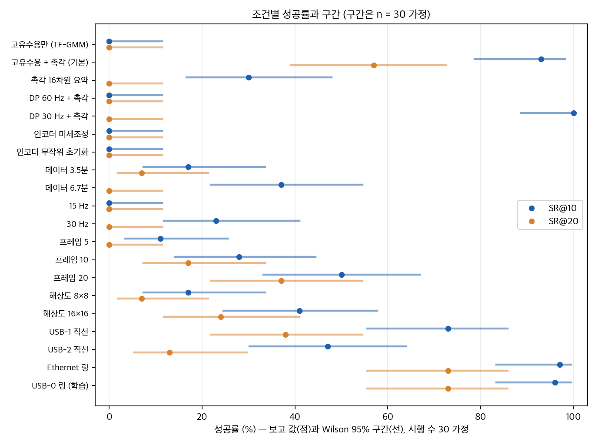
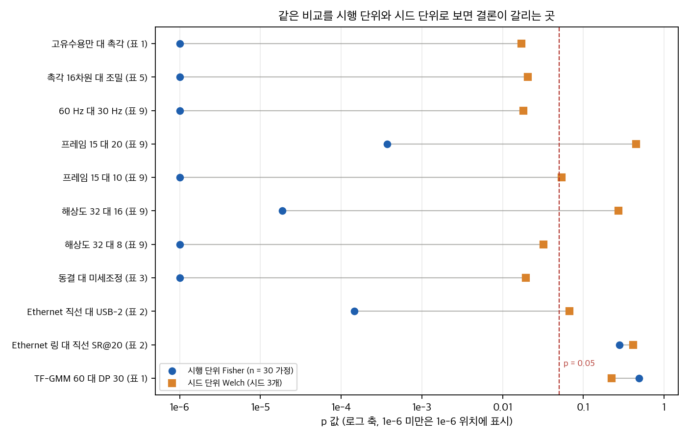
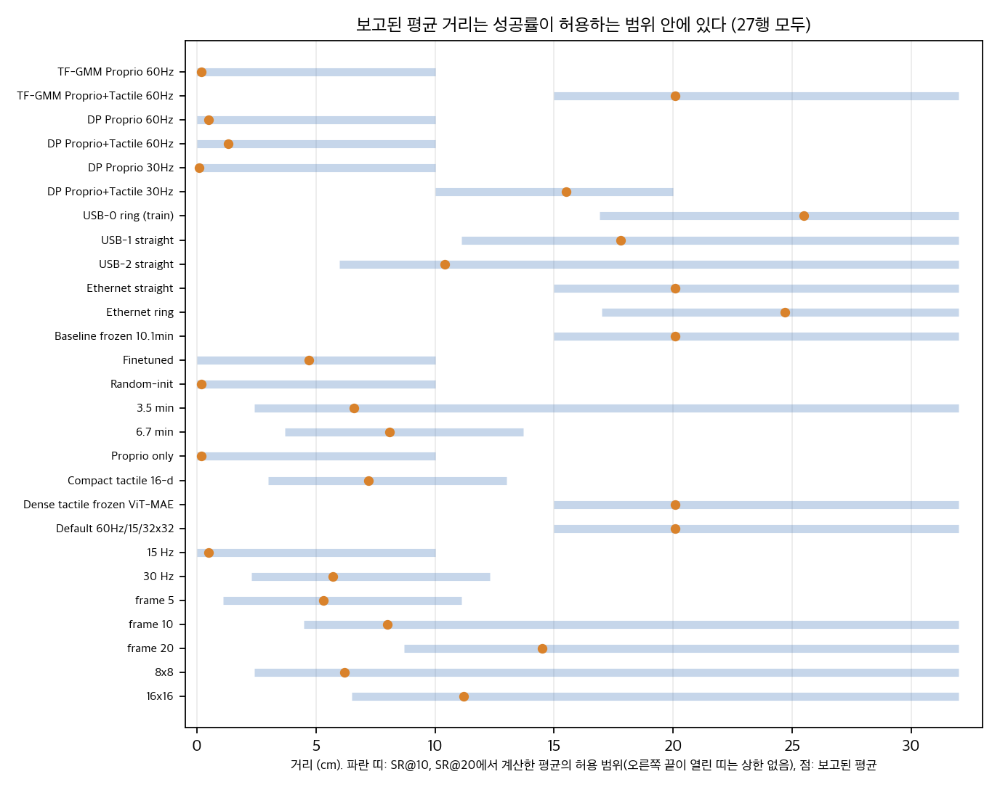
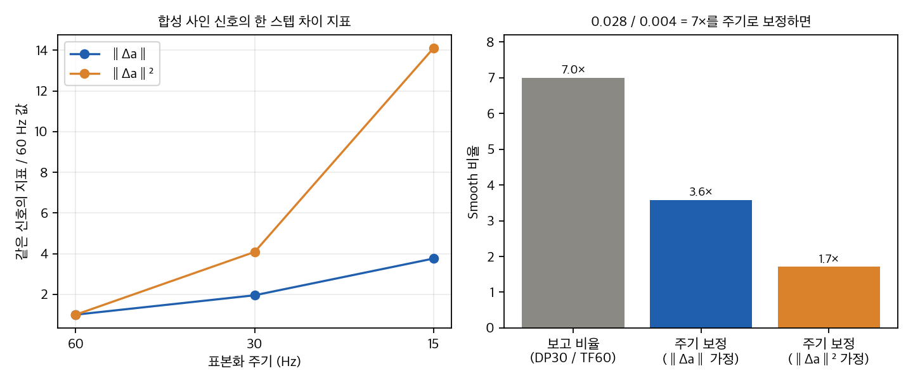

> **논문:** Matteo Grimaldi, David Klee, Ziling Chen, Tong Jian, Wonju Lee, Wenjie Lu, Tao Yu, Saleh Nabi. *Touch2Trace: Tactile-Driven Imitation Learning for Dexterous Cable Tracing.* CoRL 2026 포스터, arXiv:2609.15921 (v1, 2026-09-14).
> 논문은 arXiv non-exclusive 라이선스이므로 이 글에는 논문 그림을 넣지 않았고, 우리가 다시 그린 그래프만 실었습니다. 논문에 없는 시행 수를 가정한 곳은 "(n = 30 가정)"으로, 계산 실험의 합성 신호는 "(합성 신호)"로 표시했습니다. 공식 코드는 공개되어 있지 않아(프로젝트 페이지에서 "coming soon") 코드 대조는 하지 않았고, 논문의 표와 본문 수치를 재계산했습니다.

## 논문이 하는 것

손가락 끝에 32×32 압전 촉각 어레이(TacV5)를 단 5지 로봇 손(Tesollo DG-5F, 팔 없음)이 케이블을 엄지와 검지의 핀치-컬 동작으로 손 안에서 밀어 보냅니다. 12개 텔레오퍼레이션 시연(10.1분)으로 행동 복제를 하고, 얼린 ViT-MAE 촉각 인코더(1.6 M), 15프레임(250 ms)을 보는 인과 트랜스포머와 GMM 머리(전체 4.1 M)를 60 Hz로 돌립니다. 인코더 전략, 제어 주파수, 시간 창, 공간 해상도를 하나씩 바꾼 실물 롤아웃이 핵심 실험입니다. 한 조건은 3 시드 × 롤아웃 10회이고, 표의 ±는 시드 평균 3개의 표준편차입니다.

## 이 글에서 확인한 것

**1. 촉각이 있을 때와 없을 때의 차이는 확실합니다.** 표 1에서 고유수용만 쓰는 정책은 0.2 cm, 촉각을 더하면 20.1 cm(SR@10 93%)입니다. 성공 횟수를 28/30 대 0/30으로 보면(n = 30 가정) Fisher p = 8×10⁻¹⁵이고, 시드 3개 평균으로 보아도 Welch p = 0.017입니다. 다만 고유수용만 쓰는 정책은 접촉 여부를 관측할 수 없는 기준선이어서, 부록 C의 16차원 손수 만든 촉각 요약과의 비교(7.2 cm, 30% 대 20.1 cm, 93%; Fisher p = 5×10⁻⁷, 시드 단위 p = 0.020)가 조밀한 표현의 이득을 더 직접 보여 줍니다.

*그림 1. 우리가 그린 그래프. 표 1, 2, 3, 5, 9의 보고 SR@10, SR@20과 Wilson 95% 구간입니다(n = 30 가정).*

**2. 같은 절제 비교가 단위에 따라 갈립니다.** 성공 횟수를 시행 30회로 보면 표 9의 모든 절제(주파수, 프레임 수, 해상도)가 기본 조건과 유의하게 다릅니다(Holm 보정 후 가장 큰 p가 4×10⁻⁴). 그런데 논문이 보고한 단위인 시드 평균 3개로 거리 평균을 비교하면 프레임 15 대 20은 p = 0.45(14.5 ± 10.1 대 20.1 ± 4.6), 해상도 32 대 16은 p = 0.27입니다. 링 대 직선(24.7 대 20.1 cm)은 0.41입니다. 시드 3개에서 평균 차이를 p < 0.05로 잡으려면 SD가 4.6일 때 10.4 cm, 10.1일 때 22.9 cm 이상이 필요하고, 합성 모의에서 프레임 15 대 20을 잡을 확률은 약 9%입니다. 논문이 "20프레임도 떨어진다", "16×16은 부분적으로만 회복한다"고 쓴 곳은 이 설계로는 방향만 읽을 수 있습니다. 시드가 학습 시드인지 평가 구간인지는 논문에 없어서 저자 확인이 필요합니다.

*그림 2. 우리가 그린 그래프. 같은 비교를 시행 단위(Fisher, n = 30 가정)와 시드 단위(Welch, 시드 3개)로 계산한 p 값입니다. 1e-6 미만은 1e-6 위치에 표시했습니다.*

**3. 성공률 5행은 시행 수 30으로는 정수 횟수가 되지 않습니다.** 표 2의 USB-0 링(96%, 73%)과 USB-1 직선(73%, 38%), 표 9의 프레임 5(11%, 0%), 프레임 10(28%, 17%), 16×16(41%, 24%)입니다. 부록 G는 5초 미만 시작 중단 6회가 제외되었다고 적습니다. 한 조건의 시행을 합쳐 k/n으로 읽으면 이 다섯 행에 최소 12회가 빠져야 하지만, 시드별 비율의 평균으로 읽으면(시드당 9–10회) 행마다 1회 제외로 설명되어 합계 5회가 되고 6회와 어긋나지 않습니다. 표 2가 제외가 생긴 "보조 조건"에 속하는지도 논문에서는 알 수 없습니다. 조건별 시행 수와 SR의 집계 방식을 표에 밝히면 해소됩니다. 반면 평균 거리는 모든 27개 행에서 SR@10, SR@20이 허용하는 범위 안에 있습니다.

*그림 3. 우리가 그린 그래프. 점은 보고된 평균 거리, 파란 띠는 SR@10과 SR@20에서 계산한 평균의 허용 범위입니다(오른쪽 끝이 열린 띠는 상한 없음).*

**4. 주파수와 해상도 절제에는 다른 요인이 섞여 있습니다.** 주파수 절제는 프레임 수를 15로 고정해서 시간 창이 250, 500, 1000 ms로 같이 변합니다. 창을 약 250 ms로 고정한 결과는 "30 Hz에서 0.2 cm"라는 한 문장으로만 있고 표나 시행 수가 없습니다. 해상도 절제는 32×32 입력을 평균 풀링한 뒤 최근접 보간으로 32×32로 되돌려 같은 인코더에 넣었다고 부록 G가 밝히며, 공간 정보 손실과 사전학습 분포와의 불일치를 분리하기 어렵다고 저자도 적습니다. 따라서 "60 Hz, 250 ms, 32×32가 최적"은 이 플랫폼에서 시험한 세 점 안에서의 서술로 읽는 편이 맞습니다.

**5. Diffusion Policy 비교와 Smooth 지표.** DP 30 Hz의 SR@10은 100%(30/30 가정)로 TF-GMM 60 Hz의 93%와 구분되지 않고(p = 0.49), 차이는 SR@20(0% 대 57%)에서 나옵니다. 두 정책은 에폭 수(400 대 50), 관측 길이, 주파수, 파라미터 수(74.4 M 대 4.1 M)가 모두 달라 저자도 구성 전체의 비교라고 밝힙니다. "7배 덜 부드럽다"(0.028 대 0.004)는 샘플링 주기에도 의존합니다. 합성 사인 신호(합성 신호)를 60, 30 Hz로 표본화하면 한 스텝 차이의 노름은 약 2배, 제곱 노름은 약 4배가 되어, 같은 신호라는 가정에서 주기를 보정하면 7배가 3.6배(노름 가정) 또는 1.7배(제곱 가정)가 됩니다. Smooth의 정의(노름인지 제곱인지, 행동 정규화 여부)는 저자 확인이 필요합니다.

*그림 4. 우리가 그린 그래프(합성 신호). 왼쪽은 같은 신호를 60, 30, 15 Hz로 표본화했을 때 지표가 60 Hz 값의 몇 배가 되는지, 오른쪽은 7배를 주기로 보정한 값입니다.*

**6. 일반화는 케이블 3종, 조건당 30회입니다.** 미지의 Ethernet 링(24.7 cm)은 학습 케이블 USB-0 링(25.5 cm)과 구분되지 않고(p = 0.90), USB-1은 Ethernet 직선과 구분되지 않으며(p = 0.70), USB-2가 SR@10 47%로 낮습니다(Fisher p = 1.5×10⁻⁴, 거리는 p = 0.067). 이후 절제의 기본 조건을 Ethernet 직선으로 정한 근거와 "best policy"를 고른 기준이 적혀 있지 않아, 같은 조건에서 고르고 보고했는지는 확인이 필요합니다.

## 그 밖에 확인한 것

- 표 사이 같은 조건의 값, 초록의 수치, 파생 비율(2.75배, 7배, 37배, 155 대 25 taxels/cm² = 6.2배, 파라미터 18배), 지연 시간 합(4.2 + 4.3 + 3.3 = 11.8 ms)은 모두 일치합니다. 인코더와 정책 백본의 파라미터 수는 서술한 구조에서 추정하면 1.60 M과 2.46 M으로 논문의 1.6 M, 2.5 M과 맞습니다.
- 표 4의 DP 관측 지평 To = 2는 60 Hz에서 33 ms이고 30 Hz에서는 67 ms입니다. 표 1의 30 Hz 결과가 어느 설정인지, 실행 지평 Ah = 8과 32 ms 추론이 어떻게 맞물리는지 서술이 없습니다.
- 부록 H의 오프라인 평가는 학습에 쓴 시연 12개의 재생이어서 학습 적합도(MSE 0.0033, 부드러움 비율 0.84)이고, 검증 4개 시연의 용도는 적혀 있지 않습니다.
- 부록 D(시각 대 시각 + 촉각)의 퍼센트는 시행 수가 6, 12, 18, 24, 30 중 하나일 때만 정수 횟수가 됩니다. 시행 수가 없어서 방향만 읽을 수 있습니다.

## 구현 가능성

코드, 시연과 사전학습 데이터, 시뮬레이터, 센서 설계가 공개되어 있지 않고 Tesollo 손과 맞춤 TacV5 센서가 필요해 **실물과 논문 수치 재현은 공개 자료만으로는 할 수 없습니다.** 반면 표 4와 §4가 층 구성을 거의 정해 주고 파라미터 수가 맞으므로, 구조 재구현(약 4.1 M)과 합성 촉각 데이터에서의 소규모 절제는 일반 노트북급 CPU나 GPU로 가능해 보입니다(이번 글에서는 실행하지 않았고, 노력은 코드 3–5일, 합성 환경 1–2주로 추정). 합성 환경 결과는 실물 결과와 같다고 할 수 없습니다.

## 맺음

실물 12개 시연으로 손 안 케이블 추적을 보인 점, 한 플랫폼에서 네 축을 직접 바꿔 본 점, 정답 거리를 정책 센서와 독립으로 잰 점은 분명한 기여입니다. 재계산이 가리키는 것은 표를 읽는 방법입니다. 조건별 시행 수와 SR 집계 방식, 시드의 정의, Smooth의 정의, 고정 창 주파수 절제의 표, 해상도별 사전학습 인코더와의 비교를 밝히면 절제 결과를 더 단단히 읽을 수 있습니다. 위의 가정과 모의 결과는 모두 저자 확인이 필요합니다.

## 자료

- [통합 리포트 PDF](report/report_public.pdf)
- [01. 논문 분석: Touch2Trace](analysis/01_paper_analysis.md)
- [02. 선행연구와 관련 저장소](analysis/02_prior_work.md)
- [03. 수치 재계산, 일관성 검사, 작은 계산 실험](analysis/03_analysis.md)
- [04. 주장 검증과 구현 가능성](analysis/04_claim_verification.md)
