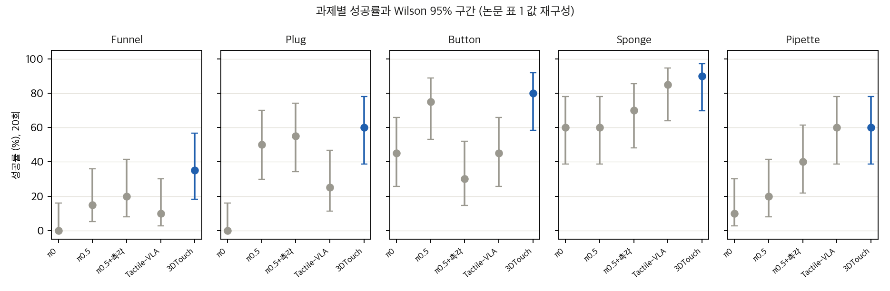
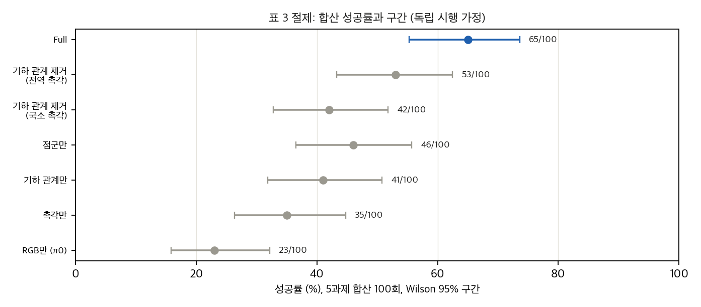

> **논문:** Xin Zhang 외 11인. *3DTouch: A Tactile-aware VLA Model with 3D Geometric Relations for Dexterous Manipulation.* arXiv:2611.23961 (v1, 2026-11-18). 학회 표기 없음.
> 이 글의 그림은 우리가 표 값으로 다시 그린 그래프입니다. 논문 그림은 넣지 않았습니다(논문 라이선스가 CC BY가 아닙니다).

## 한 줄 요약

접촉 위치가 가려진 손 조작에서, 촉각을 로봇 기저 좌표계에 두고 손과 물체의 상대 기하를 토큰으로 더하면 실로봇 5개 과제 평균 성공률이 65%입니다. 가장 강한 촉각 기준선은 45%입니다. 다만 이 차이 말고는 대부분 통계적으로 확실하지 않습니다.

## 무엇을 더했나

π0 행동 전문가에 두 묶음의 토큰을 더합니다.

- **3D 촉각 기반(3DTG):** RGB-D 점군 4096점을 33 토큰으로, 다섯 손가락의 촉각 600개(위치와 3차원 힘)를 손가락당 1 토큰으로 바꿉니다. 모두 같은 기저 좌표계에 있으므로 촉각 토큰이 장면 토큰과 공간적으로 맞물립니다.
- **기하 관계(GRM):** 손 키포인트 17개와 가까운 물체 표면 점 16개의 상대 변위와 거리로 손-물체 토큰 5개를, 물체 영역 8개씩의 쌍으로 물체-물체 토큰 5개를 만듭니다.

추가 손실은 없고, 원래의 flow matching 목표만 씁니다. 추론 때 SAM2 대신 학습된 경량 포즈 추정기를 씁니다. 참조 메쉬는 SAM 3D로 미리 재구성합니다.

*그림 1. 과제별 성공률(20회당)과 Wilson 95% 구간. 논문 표 1의 값을 우리가 다시 그렸습니다.*

## 숫자를 다시 계산해 보니

- **산술은 맞습니다.** 평균, 차이, 하락 값이 표와 본문에서 모두 일치합니다.
- **평균 우위는 유의합니다.** 합산 65/100 대 Tactile-VLA 45/100, 차이 +20 pp, Fisher p = 0.007, 95% 구간 +6 ~ +33 pp.
- **과제별 우위는 아닙니다.** 과제마다 20회라 구간이 넓고, 15개 검정을 Holm으로 보정하면 어느 것도 유의하지 않습니다.
- **기하 관계의 추가 효과는 확인되지 않았습니다.** 65 대 53, +12 pp, Fisher p = 0.11.
- **포즈 강건성 우위는 확인되지 않았습니다.** 하락은 5.0 대 13.3 pp로 표와 맞지만, 두 하락의 차이는 95% 구간이 −16 ~ +33 pp입니다.

*그림 2. 표 3 절제의 합산 성공률과 Wilson 95% 구간(100회 합산, 독립 시행 가정). 우리가 그렸습니다.*

## 구현할 수 있을까

이 맥(M4 Pro, CUDA 없음)에서 전체를 재현하기는 어렵습니다. 실로봇 평가가 필요하고, 공식 코드와 데이터가 없고, π0 학습은 GPU를 전제로 합니다. 다만 관계 토큰 계산과 촉각 좌표 변환은 CPU로 확인할 수 있습니다. 노력은 관계 토큰 1–2일, 토큰 인코더 포함 1–2주, π0 결합 학습 3–6주(GPU)로 추정합니다. 측정하지 않은 추정입니다.

## 읽으면서 남는 질문

1. 시드 수와 기준선 구현 출처가 없습니다. Tactile-VLA를 어떻게 구현했는지에 따라 결론이 달라질 수 있습니다.
2. 포즈 추정기가 기하 구조를 보존한다는 주장에 정량 지표가 없습니다.
3. 과제당 20회 시행으로 20 pp 안팎의 차이를 가리기는 검정력이 낮습니다. 다음 연구에서는 시행 수를 먼저 정하는 편이 좋습니다.

*재계산 스크립트와 검정 결과는 게시 패키지의 `analysis/`에 있습니다.*

## 자료

- [통합 리포트 PDF](report/report_public.pdf)
- [0. 메타와 버전](analysis/01_paper_analysis.md)
- [1. 선행연구 계보](analysis/02_prior_work.md)
- [0. 방법과 가정](analysis/03_analysis.md)
- [1. 대상과 방법](analysis/04_claim_verification.md)
