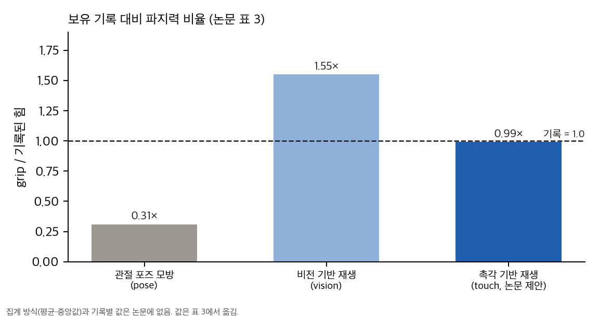
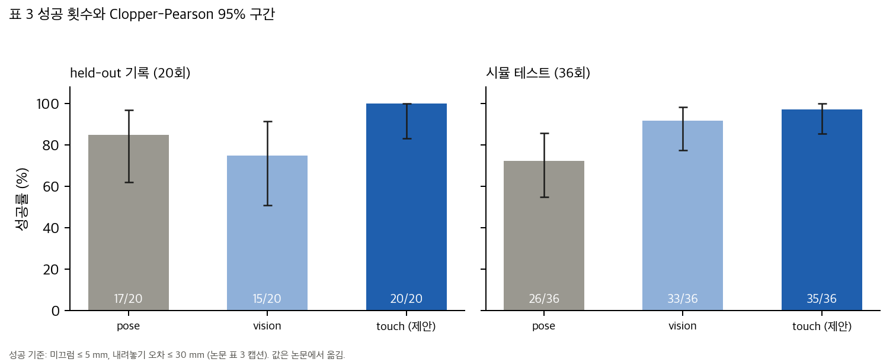

> **논문:** Huiwen Han, Nuo Chen, Ziyao Zeng 외. *TouchTwin: Scaling Human Touch Data via Real-to-Sim-to-Real.* arXiv:2611.17619 (v1, 2026-11-13). 학회 표기 없음.
> 공식 코드는 공개되어 있지 않습니다. 이 글의 그래프는 논문 표 값을 옮겨 다시 그린 것입니다. 논문 그림은 싣지 않았습니다.

## 논문이 묻는 것

사람 시연은 로봇 데이터로 가장 쉽게 모읍니다. 그래서 요즘은 영상에서 손의 움직임을 복원해 시뮬레이션에서 여러 번 재생하는 파이프라인이 늘고 있습니다. 문제는 영상이 **손이 어디서 멈췄는지**만 보여 준다는 것입니다. 손가락이 물체를 얼마나 세게 누르는지는 보이지 않습니다.

저자들은 이를 "힘 간극"이라고 부릅니다. 같은 기록을 세 방식으로 재생했을 때 파지력이 어떻게 달라지는지 봅니다.

- 손 포즈를 흉내 내면 기록 힘의 **0.31배**로 약하게 잡습니다.
- 영상에서 복원한 물리 재생은 **1.55배**로 과하게 잡습니다.
- 장갑 촉각으로 접촉과 닫힘 힘을 정한 재생(TouchTwin)은 **0.99배**입니다.

TouchTwin은 880 taxel 촉각 장갑으로 기록한 TouchScale 데이터를 MuJoCo에서 다시 만듭니다. 객체는 코딩 에이전트가 물리 검사를 거쳐 씁니다.

## 이 글에서 확인한 것

**1. 파지력 비율은 방향이 분명합니다.** 세 값의 차이는 큽니다. 다만 논문은 기록별 값과 집계 방식을 주지 않습니다. 그래서 0.99가 정말 1에 가까운지는 구간으로 말할 수 없습니다.

*그래프 (우리가 그림). 표 3의 기록 대비 파지력 비율. 기준선 1.0은 기록 힘입니다. 값은 논문에서 옮겼습니다.*

**2. 성공률은 시뮬레이션 테스트에서만 확실합니다.** 시뮬 테스트 36회에서 촉각 기반은 35회(97%), 포즈 기반은 26회(72%)가 성공했습니다. 세 비교를 보정하면 p = 0.019입니다. 비전 기반(33회, 92%)과의 차이 5.6 pp는 유의하지 않습니다. held-out 기록 20회에서는 촉각 20/20, 비전 15/20이지만 보정 후 p = 0.14입니다. 같은 차이를 확인하려면 조건당 27회 이상이 필요합니다.

*그래프 (우리가 그림). 표 3의 성공 횟수와 Clopper-Pearson 95% 구간입니다. 성공 기준은 미끄럼 5 mm 이하, 내려놓기 오차 30 mm 이하입니다.*

**3. 접촉 예측은 차이가 크지만 판단할 수 없습니다.** 촉각 기반 재생으로 학습한 접촉 예측기는 실제 접촉 프레임의 13.1%를 놓칩니다. 비전 기반은 32.2%를 놓칩니다. 그런데 평가 프레임 수가 없습니다. 프레임이 독립이라고 가정해도 두 값을 구분하려면 조건당 약 75프레임이 필요합니다. 클립 안의 프레임은 서로 독립이 아니므로 실제 필요량은 더 큽니다.

**4. 본문 수치는 거의 맞습니다.** 물 300 g을 넣으면 파지력이 20.8 N에서 27.4 N으로 늘어난다고 적혀 있습니다. 계산하면 +31.7%입니다. 반올림 차이입니다. 프로젝트 페이지는 "held-out objects"라고 쓰는데 논문은 "held-out recordings"라고 씁니다. 평가 단위가 다릅니다. 영상 생성기 인용(arXiv:2503.20314)은 Wan2.1 보고서 제목으로 보입니다. 본문은 Wan2.2라고 씁니다. 인용을 확인해야 합니다.

**5. 빠진 정보가 많습니다.** 가장 중요한 것은 닫힘 힘을 정하는 식입니다. "포즈를 넘어 얼마나 더 닫는가"를 어떻게 계산하는지 논문에 없습니다. 객체 검사 기준, 손 모델 맞춤 방법, 정책 학습 설정, 접촉 예측기 구조도 없습니다. 이 여섯 가지가 빠지면 같은 결과를 다시 내기 어렵습니다.

## 이 맥에서 구현할 수 있을까

**논문 규모의 재현은 불가능합니다.** 손 정책과 영상 생성은 GPU를 전제합니다. 접촉 예측기는 데이터와 구조가 없습니다. 실로봇 실험도 없습니다.

**방법의 핵심 원리는 작게 구현할 수 있습니다.** 촉각으로 닫힘 힘을 정해 MuJoCo에서 물체를 들어 보는 과정은 CPU로 됩니다. 머그 하나짜리 토이로 "포즈 기준과 촉각 기준의 파지력 비율"을 비교할 수 있습니다. 논문 수치를 재현하는 것은 아닙니다. 노력은 1–2일로 추정합니다(측정 전).

**한 기록의 재생은 조건부입니다.** TouchScale 데이터(500시간)를 받아야 하고, 손 추정과 객체 프로그램 생성에 외부 모델 호출이 필요합니다. 공개 여부와 크기는 확인하지 못했습니다. 노력은 2–4주로 추정합니다.

## 읽고 나서 남은 질문

- 영상 복원에서 힘 간극이 생기는 이유를 물리로 설명할 수 있는가? 포즈 추정 오차와 힘 설정 중 어느 쪽이 더 큰가?
- 힘 비율을 정책 평가 지표로 쓰면 포즈 추종 오차가 놓치는 실패가 드러나는가?
- 장갑이 덮지 않는 손바닥 피부 접촉(논문 Fig. 9)은 실제 힘과 얼마나 맞는가?

## 주의할 점

- 정책은 시뮬레이션에서만 시험했습니다. 접촉 시작 시점은 검사하지 않았습니다(held-out 클립은 이미 접촉한 상태에서 시작합니다).
- 시험 수가 작습니다(20회, 36회). 생성 영상 표(표 1)에는 표본 수와 시드가 없습니다.
- 이 글은 논문 수치를 재계산한 결과입니다. 원시 기록과 코드가 없어서 재현 결과가 아닙니다.

## 자료

- [통합 리포트 PDF](report/report_public.pdf)
- [01. 논문 분석: TouchTwin (arXiv:2611.17619)](analysis/01_paper_analysis.md)
- [02. 선행연구와 관련 저장소](analysis/02_prior_work.md)
- [03. 재계산과 일관성 검사](analysis/03_analysis.md)
- [04. 주장 검증과 구현 가능성](analysis/04_claim_verification.md)
