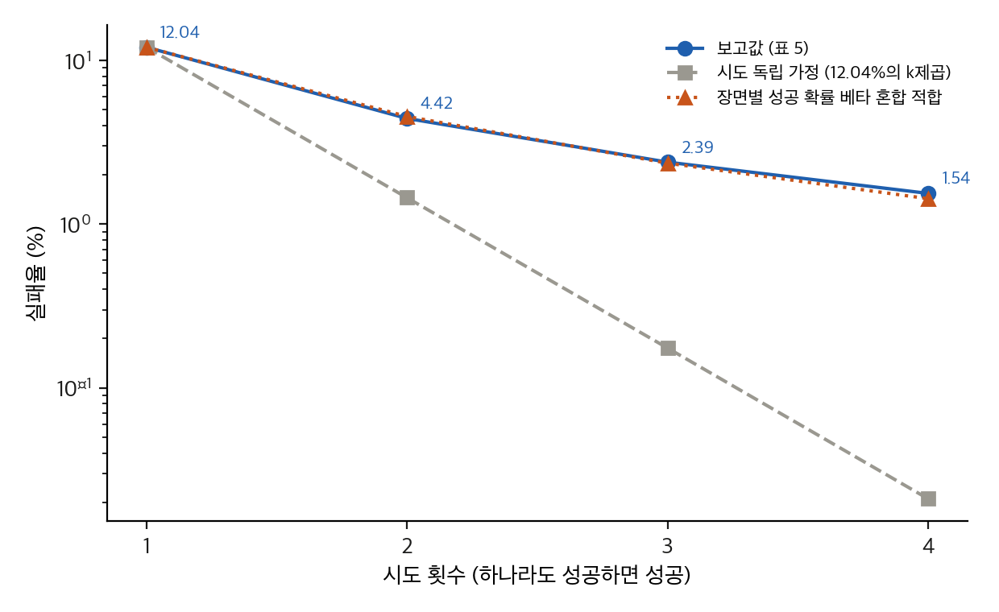
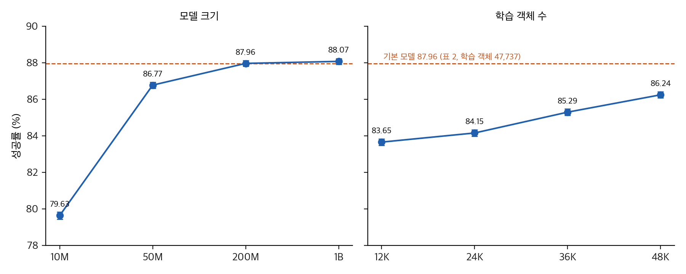
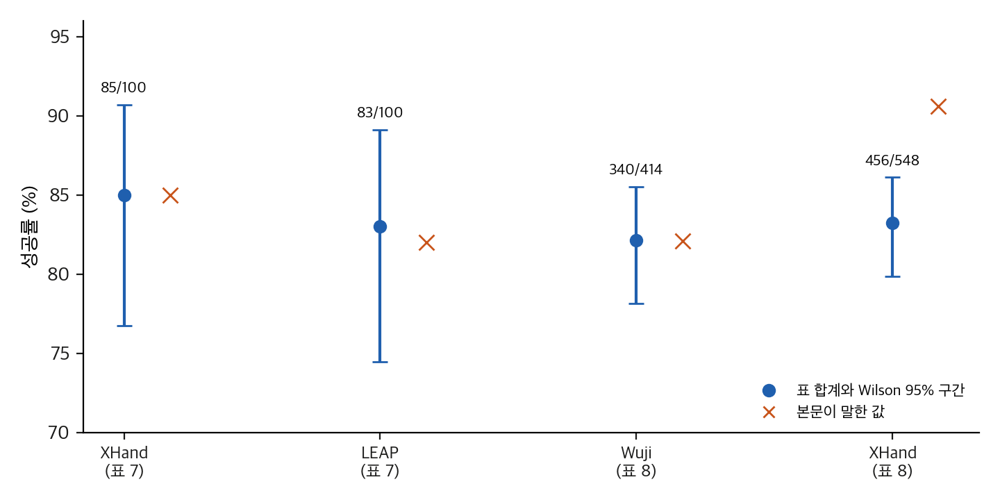
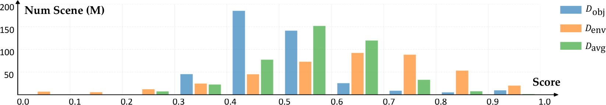
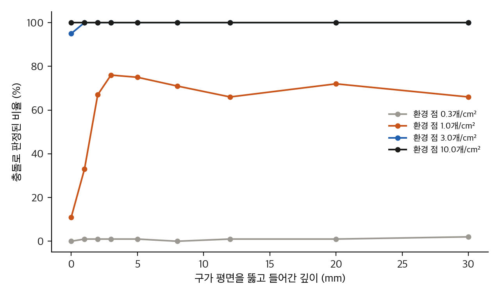

> **논문:** Xin Fei, Zhixuan Xu, Huaicong Fang, Fangjun Chen, Zhaoyu Mu, Rui Yang, Zhexi Luo, Lin Shao. *T(R,O) Grasp++: Cross-Embodiment Dexterous Grasping in Cluttered Environments at Scale.* CoRL 2026 포스터, arXiv:2610.25410 (v1, 2026-10-18).
> 공식 코드는 GitHub Barrybarry-Smith/TROGraspV2에 있습니다(라이선스 파일 없음). 이 글은 코드를 실행하지 않고 정적으로만 읽었습니다. 그림은 논문 그림 한 장(출처 표기)과 우리가 그린 그래프입니다.

## 논문이 묻는 것

어지러운 장면에서 표적 물체를 손으로 집는 자세를, 손 형태마다 모델을 따로 만들지 않고 하나의 확산 모델로 만들 수 있는가. 기존 방식은 장면 전체에서 파지 제안을 많이 뽑은 뒤 충돌 검사와 점수로 거릅니다. 이 논문은 표적 물체에 곧바로 파지를 만들고, 손의 각 링크를 노드로 하는 그래프(링크 6D 자세, 물체·환경 패치, 상대 자세 간선)에서 링크 자세를 확산시킨 뒤 IK로 관절 값을 얻습니다. 함께 8개 손, 약 5만 물체, 4.44억 파지의 시뮬레이션 벤치마크를 만들었습니다.

## 이 글에서 확인한 것

**1. 베이스라인과의 격차는 확실하지만 "30%"는 %p이고 손당 한 손입니다.** 같은 손끼리 보면 Allegro 88.79 대 54.44(+34.35 %p), LEAP 85.93 대 52.09(+33.84 %p)입니다. 그림 1의 +33.52는 8손 평균에서 AnyDexGrasp(Allegro 한 손)를 뺀 값입니다. 베이스라인은 "표적 제안 중 최고 점수 하나"로 바꿔 쓴 변형입니다.

**2. 다중 시도 98.46%는 장면에 묶인 실패를 시사합니다.** 한 번 실패율이 12.04%인데 독립이라면 4회 실패율이 0.021%여야 합니다. 보고값은 1.54%로 73배입니다. 시도들이 독립이 아니고 같은 장면에서 다시 뽑아도 실패가 반복될 가능성이 크다는 뜻이며, 이 값은 성공하면 멈추는 oracle 재시도입니다.

*그래프 (우리가 그림). 표 5의 시도 1–4회 성공률에서 계산한 실패율입니다. 베타 혼합 적합은 장면별 성공 확률 분포를 한 모수로 맞춘 사후 해석입니다.*

**3. 규모 곡선은 200M 이후 포화이고, 객체 규모 행 하나가 기본 모델과 맞지 않습니다.** 10M → 50M +7.14 %p, 50M → 200M +1.19 %p, 200M → 1B +0.11 %p(z = 1.0)입니다. 객체 12K → 48K는 +2.59 %p로 단조이지만 48K 행(86.24)이 학습 객체 47,737개로 학습한 기본 모델(87.96)과 1.72 %p 다릅니다. 모두 학습 한 번이라 시드 분산은 알 수 없습니다.

*그래프 (우리가 그림). 오차 막대는 8손 합계 160,000 장면을 가정한 장면 표본 오차의 95% 구간입니다.*

**4. 실로봇 표 합계가 본문과 두 곳에서 어긋납니다.** 표 7의 LEAP 합계는 83/100인데 본문은 82%입니다. 표 8의 "XHand" 실패 92/548은 성공 83.2%인데 본문 5.6절은 XHandPro 90.6%를 말하며, 시도 548회에서는 90.6%를 만드는 정수가 없습니다(90.51% 또는 90.69%). 두 손(XHand 85/100, LEAP 83/100)의 차이는 구별되지 않습니다(Fisher p = 0.85).

*그래프 (우리가 그림). 파란 점은 표 합계와 Wilson 95% 구간, 주황 ×는 본문이 말한 값입니다.*

**5. 데이터 규모는 맞지만 그림 8의 합과 공개 범위가 다릅니다.** 객체 13,049 + 40,626 = 53,675개와 물체·손당 약 1K 파지(1,034)는 맞습니다. 그러나 그림 8 막대에서 읽은 분포의 합은 약 413 M으로 표 1의 444 M보다 7% 작고, 초록의 "0.5B"는 444M의 1.126배입니다. 공개 데이터 카드는 학습 객체 25,228개(논문 학습 객체의 52.8%)를 담았다고 밝힙니다.

*논문 그림 8 (원문). © 저자, CC BY 4.0, 출처 arXiv:2610.25410. D_obj, D_env, D_avg의 장면 수 분포입니다.*

## 공식 평가 코드가 말해 주는 것

코드는 논문 서술보다 구체적이고 일부는 다릅니다.

- **성공 판정의 구조.** 들어올림 시뮬레이션에는 표적 물체와 테이블 상자만 있고 장애물, 선반, 상자는 없습니다. 환경과의 충돌은 별도 스크립트가 환경 점군 근접 규칙(손 표면 점 중 3 mm 이내가 48개 이상)으로 판정하고, 최종 성공은 둘의 곱입니다.
- **논문에 없는 수치.** 들어올림 3 cm 이상, 수평 이동 5 cm 이하, 마찰 3.0, 접근 단계 중력 끔, 손을 열림 한계 쪽 25%에서 닫힘 쪽 15% 더 닫는 규칙이 코드에 있습니다.
- **집계와 다양성.** 손의 SR은 물체별 SR의 평균이고, 비유한 예측과 메시 단순화에 실패한 물체는 분모에서 빠집니다. 표 2의 "다양성"은 성공한 파지의 손목·관절 벡터를 모든 물체에 걸쳐 합쳐 구한 표준편차 평균입니다(m와 rad 혼합). Allegro에서는 AnyDexGrasp(0.387)가 이 논문(0.369)보다 높습니다.
- **학습·추론 설정.** 옵티마이저는 AdamW가 아니라 Adam이고 코사인으로 0까지 감쇠합니다. 1M 스텝 × 8 GPU × 배치 48은 3.84억 샘플로 444M의 0.87배입니다. DDIM은 20단계 설정에서 19단계가 되고 확률 항에 0.2가 곱해집니다.
- **일치하는 것.** 공식 설정(768차원, 8층, 12헤드)으로 층별로 계산한 매개변수 수 176.53M은 표 4의 값과 소수점까지 같습니다.
- **빠진 것.** RL 주석 파이프라인, 난이도 점수, 베이스라인 평가, 링크 지문 절제, 규모·다중 시도 실험, 실로봇 코드는 저장소에 없습니다. 코드와 데이터 모두 라이선스가 명시되어 있지 않습니다.

## 토이로 본 충돌 규칙

평가의 충돌 규칙이 점군 밀도에 얼마나 민감한지 구(반지름 4 cm, 표면 점 4,608개)와 평면 장애물로 시험했습니다. 환경 점이 3/cm² 이상으로 조밀하면 닿기만 한 손(관통 0)도 95% 충돌로 판정하고, 0.3/cm²(간격 18 mm)로 성기면 30 mm를 관통해도 2%만 검출합니다. 검출률을 정하는 것은 관통 깊이가 아니라 점 밀도입니다. 실제 환경 점군의 밀도는 데이터를 받지 않아 보지 못했습니다.

*그래프 (우리가 그림). 구와 평면이라는 단순 모델이며 규칙의 반응 방식만 보여 줍니다.*

## 한계와 읽는 법

- 숫자는 모두 논문 표와 본문에서 옮겨 재계산했습니다. 표 5와 표 2의 분모는 손당 20,000 장면(§5.2)을 가정했고, 점수가 소수 둘째 자리까지라 20,000 장면이면 모두 정수 개수로 표현됩니다.
- 장면 독립 가정의 검정은 같은 장면의 쌍 비교에는 보수적이지만, 학습 시드가 하나뿐이라 모델 간 작은 차이는 시드 분산과 구별되지 않습니다.
- 코드는 실행하지 않았고 정적 읽기입니다. 맥에서 Isaac Gym 평가와 학습은 불가능하고, 체크포인트와 데이터는 받지 않았습니다.
- 격차 방향과 규모 곡선의 큰 흐름은 믿을 만합니다. 확인이 더 필요한 것은 구체적 수치의 정의(성공, 다양성, 집계 단위)와 일부 표 합계입니다.

분석 문서(재계산 스크립트, 코드 대조 17항목, 주장 판정)는 함께 공개한 저장소에 있습니다.

## 자료

- [통합 리포트 PDF](report/report_public.pdf)
- [01. 논문 분석: T(R,O) Grasp++ (arXiv:2610.25410)](analysis/01_paper_analysis.md)
- [02. 선행연구와 관련 저장소](analysis/02_prior_work.md)
- [03. 수치 재계산, 일관성 검사, 토이](analysis/03_analysis.md)
- [04. 공식 코드 대조와 구현 가능성](analysis/04_code_verification.md)
