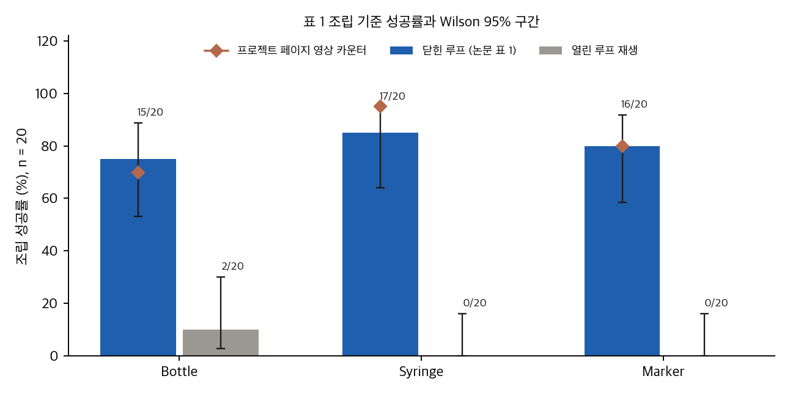
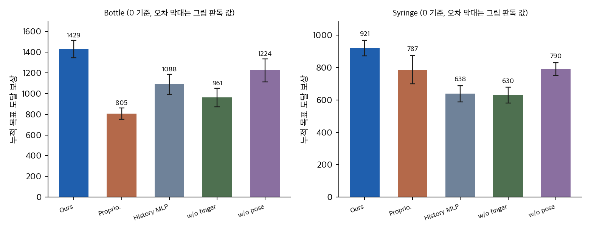
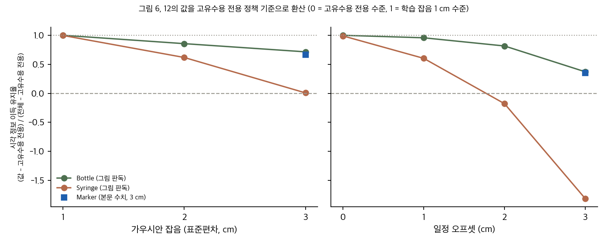
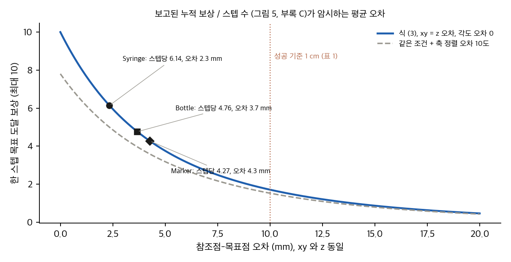

> **논문:** Liuao Pei, Tianyue Wu, Hui Zhang, Ping Luo, Jie Song. *Assembling Two Parts in One Hand.* CoRL 2026 포스터, arXiv:2609.10137 (v1, 2026-09-09, 단일 버전).
> 공식 저장소(`LTBGbird/in-hand-assembly`)에는 README와 TODO만 있고 구현은 아직 없습니다(2026-11-24 확인). 논문은 arXiv의 non-exclusive 라이선스라서 논문 그림은 옮기지 않고 표 수치를 다시 계산해 직접 그린 그래프만 실었습니다.

## 논문이 묻는 것

다지 손 연구는 파지와 손 안 회전 같은 반복적 기술에 몰려 있습니다. 이 논문은 한 손의 손가락 협응만으로 두 강체를 맞물리는 "손 안 조립"을 제안합니다. 두 번째 팔도 고정구도 없습니다. 과제는 Bottle(병뚜껑), Syringe(주사기 플런저), Marker(마커 캡) 셋이고, 시뮬레이션 RL로 학습한 정책을 22자유도 Sharpa Wave 손에 영샷으로 옮깁니다.

방법의 뼈대는 세 가지입니다. (1) 한 물체를 다른 물체에 대한 목표 상대 자세로 보내는 도달 보상(식 3). (2) 엄지·검지가 한 물체를 쥐고 중지·약지·소지가 다른 물체를 받치도록 하는 손가락 기능 보조 보상(식 4)과 사람 시연 스냅샷 하나에서 온 기준 자세 정규화. (3) 관측 잡음 무작위화와 순환(LSTM) 정책. 관측은 두 물체의 중심과 z축, 관절각 22개로 34차원이고, 관절 속도와 접촉력은 쓰지 않습니다.

## 이 글에서 확인한 것

**1. 닫힌 루프와 열린 루프의 차이는 매우 큽니다. 과제 사이의 차이는 20회로 구분되지 않습니다.**

*그림 1. 표 1의 조립 성공(20회)과 Wilson 95% 구간. 마름모는 프로젝트 페이지 영상 카운터. 우리가 그린 그래프.*

조립 성공은 닫힌 루프 15, 17, 16회(Bottle, Syringe, Marker), 성공한 시뮬레이션 궤적의 열린 루프 재생은 2, 0, 0회입니다. 합치면 48/60 대 2/60이고 Fisher p는 2.7e-19입니다(시행 독립 가정). 닫힌 루프의 75%, 85%, 80%는 Wilson 구간이 모두 겹쳐 과제 순위를 말할 수 없습니다(20회에서 반폭 약 ±17 %p). 한 가지 확인이 필요한 점이 있습니다. 프로젝트 페이지의 연속 시행 영상 설명은 최종 카운터가 Bottle 14/20, Syringe 19/20, Marker 16/20이고 이것이 논문 표와 다르다고 적습니다. 카운터가 정렬과 조립 중 어느 기준을 세는지는 적혀 있지 않아, 어느 쪽이 대표 값인지는 저자 확인이 필요합니다.

**2. 절제 결과의 일부는 오차 막대의 종류에 따라 해석이 달라집니다.**

*그림 2. 그림 5의 막대 위 숫자를 0 기준 막대로 다시 그림. 오차 막대는 그림에서 읽은 대략의 길이(그림 판독 값). 우리가 그린 그래프.*

원 그림의 막대 축은 0에서 시작하지 않습니다(그림 판독으로 Bottle 약 550, Syringe 500). 오차 막대가 표준편차(SD), 표준오차(SE), 95% 구간 중 무엇인지는 논문에 없습니다. 독립 학습 3회(§4.3)를 가정하고 세 해석으로 Ours와 각 변형을 Welch 검정하면, Bottle의 시각 정보 효과, Bottle의 손가락 보상 제거, Syringe의 history MLP와 손가락 보상 제거는 어느 해석에서도 p < 0.05입니다(Bottle의 history MLP는 SE 해석에서 p = 0.056). 반면 Syringe의 시각 효과(Ours 921.2 대 고유수용 전용 786.9)는 p = 0.10(SD), 0.27(SE), 0.01(95% 구간)이고, Bottle의 기준 자세 보상 효과(1429.1 대 1223.5)는 p = 0.066, 0.22, 0.004입니다. Marker의 부록 C는 500 에피소드 성공률이 있어 65% 대 27%(손가락 보상 제거), 40%(기준 자세 보상 제거)로 분명하지만, 이 비교도 한 정책의 에피소드를 독립으로 본 값이고 학습 시드 변동은 들어 있지 않습니다. 또한 순환 정책은 파라미터가 history MLP의 약 12.6배입니다(이력 입력을 관측 34 + 행동 22의 8프레임으로 가정한 계산). 논문의 "LSTM이 낫다"는 순환성과 용량이 섞인 비교일 수 있습니다.

**3. 잡음 견고성의 "60% 이상"은 기준을 정하면 읽기 쉬워집니다.**

*그림 3. 그림 6과 부록 C 그림 12의 값을 고유수용 전용 정책 기준의 "시각 정보 이득 유지율"로 환산(Bottle과 Syringe는 그림 판독 값, Marker는 본문 수치). 우리가 그린 그래프.*

본문은 3 cm 관측 잡음에서도 두 과제의 성능이 60% 이상 유지된다고 쓰는데, 무엇에 대한 비율인지 적혀 있지 않습니다. 학습 잡음(1 cm) 수준의 같은 정책 값을 분모로 하면 가우시안 3 cm에서 Bottle 약 88%, Syringe 약 86%이고 오프셋 3 cm에서 Syringe는 약 59%(그림 판독 값)입니다. 고유수용 전용 정책을 0, 학습 잡음 수준을 1로 하는 이득 유지율로 보면 Bottle과 Marker는 3 cm에서도 0.35–0.72가 남지만, Syringe는 가우시안 3 cm에서 약 0, 오프셋 3 cm에서 음수입니다. 저자도 Syringe의 큰 오프셋에서 고유수용 전용 기준선 아래로 내려간다고 적었고, 그 이유를 고유수용 이력 덕분일 수 있다고 추정합니다(검증하지 않은 가설).

**4. 보고된 누적 보상은 몇 mm의 평균 오차에 해당합니다.**

*그림 4. 식 (3)의 한 스텝 보상과 보고된 누적 보상 / 스텝 수가 암시하는 평균 오차(xy 오차 = z 오차, 각도 오차 0 가정). 우리가 그린 그래프.*

한 스텝 보상은 최대 10이고, 성공 기준(최종 깊이 1 cm 이내)에서는 약 1.7입니다. 보고된 누적 보상을 에피소드 길이(15 Hz × 20 s, 10 s, 20 s)로 나누면 평균 오차가 Syringe 약 2.3 mm, Bottle 약 3.7 mm, Marker 약 4.3 mm에 해당합니다(조기 종료와 워밍업, 보조 보상의 곱 여부를 무시한 대략값). 누적 보상은 성공 시점에서 끝나지 않고 목표 근처에 머문 시간을 합산하므로, 성공률과의 대응은 성공률이 보고된 Marker에서만 확인됩니다(다섯 변형에서 순위가 같음). Marker의 시뮬레이션 성공률 65%와 실로봇 16/20 = 80%는 구분되지 않습니다(p = 0.23). Bottle과 Syringe는 시뮬레이션 성공률이 없어 영샷 전이의 격차를 같은 방식으로 볼 수 없습니다.

**5. 그 밖의 표기 차이.** 표 3은 물체 자세 관측 잡음을 사원수 성분(σ = 0.05)으로, 관절 속도 관측 잡음(σ = 0.10 rad/s)도 적지만, §3.3의 관측은 중심과 z축 단위벡터이고 관절 속도는 넣지 않는다고 적습니다. 잡음이 추정 단계에서 더해지는 구현이거나 환경 전반의 목록일 가능성이 있고, 저자 확인이 필요합니다. 손 형태학 비교(그림 4)는 Syringe 한 과제의 128점 산점도이고 조기 종료하지 않은 시행만 보여, 손 사이의 성공 시행 수 비교는 읽히지 않습니다. 손가락 역할 분화는 보조 보상이 직접 보상하는 구조라서, 학습 결과로 나타난 것인지 보상 설계의 결과인지 §4의 통계로는 구분되지 않습니다.

## 구현 가능성

이 맥(Apple M4 Pro, MPS, CUDA 없음)에서 논문의 학습과 실로봇 결과는 구현할 수 없습니다. Isaac Sim과 NVIDIA GPU, Sharpa Wave 손과 Franka 팔이 필요하고 공식 코드도 없습니다. 보상·관측·무작위화 명세를 PyTorch로 옮기는 일은 가능하고(수 시간–2일, 추정), 소형 MuJoCo 두 부품 삽입 환경에서 절제 경향을 보는 일은 조건부입니다(2–6주 이상, 추정, 접촉 모델이 달라 논문 수치와 비교할 수 없음).

## 자료

- 논문: https://arxiv.org/abs/2609.10137
- 프로젝트 페이지: https://ltbgbird.github.io/in-hand-assembly-page/
- 공식 저장소(구현 미공개, README와 TODO만 있음): https://github.com/LTBGbird/in-hand-assembly
- 분석 노트와 재계산 스크립트는 같은 게시본의 `analysis/`에 있습니다.

## 자료

- [통합 리포트 PDF](report/report_public.pdf)
- [01. 논문 분석: Assembling Two Parts in One Hand (arXiv:2609.10137)](analysis/01_paper_analysis.md)
- [02. 선행연구와 관련 자료: Assembling Two Parts in One Hand (arXiv:2609.10137)](analysis/02_prior_work.md)
- [03. 수치 재계산과 일관성 검사: Assembling Two Parts in One Hand (arXiv:2609.10137)](analysis/03_analysis.md)
- [04. 주장 검증과 구현 가능성: Assembling Two Parts in One Hand (arXiv:2609.10137)](analysis/04_claim_verification.md)
