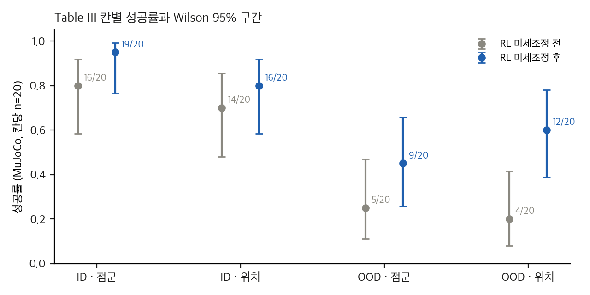
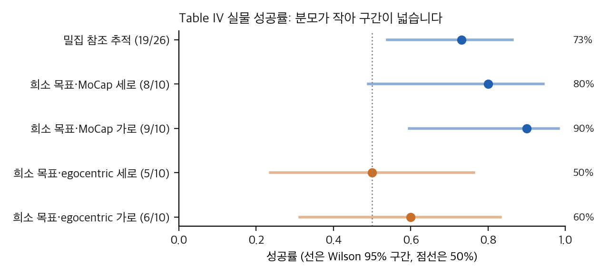
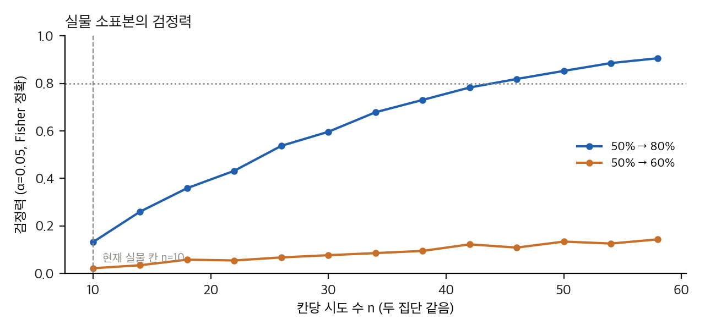
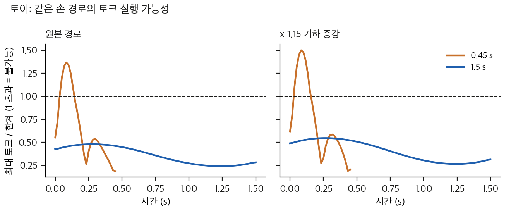

# ULTRA: 표 재계산, 유의성, 토이

재현 스크립트: `analysis/table_check.py`(표 재계산과 검정, 1초 미만), `analysis/power_toy.py`(실물 검정력, 수십 초), `analysis/retarget_toy.py`(리타게팅 토이, 1초 미만). 결과는 같은 이름의 `*_results.json`에 있습니다. 그래프는 `analysis/plot_figures.py`가 만듭니다.

## 0. 방법과 가정

- **입력 값:** 표 I–IV의 값은 `paper/paper.pdf` 6–7쪽을 200 dpi로 렌더해 눈으로 확인했습니다. 텍스트 추출과 같았습니다.
- **반복 수:** 표 III는 칸당 n = 20, 표 IV는 칸당 n = 10(밀집은 26), 표 I과 II는 n이 없습니다(±만 있음).
- **도구:** scipy(Fisher 정확 검정, 두 집단 Welch), statsmodels(Wilson 구간, Holm).
- **공식:**
  - Wilson 구간: 비율 p̂, 표본 n에서 중심 (p̂ + z²/2n)/(1 + z²/n), 반폭 z√(p̂(1−p̂)/n + z²/4n²)/(1 + z²/n). z = 1.96.
  - Fisher 정확 검정: 2×2 표의 초기하 분포에서 양측 합 p값.
  - Newcombe 차이 구간: 두 Wilson 구간의 끝점을 점수법으로 합침.
  - Holm: p값을 오름차순으로 정렬해 (m − i + 1)·p(i)를 구하고 단조 증가로 고침.
  - McNemar 정확 검정(쌍 설계): 불일치 쌍 b, c에 대해 2·P(X ≤ min(b, c)), X ~ Binom(b+c, 0.5). **에피소드별 쌍 정보가 없으므로** 가능한 (b, c)의 범위에서 p값의 최소와 최대를 봅니다.
  - Welch: n이 가정값일 때의 민감도 분석으로만 씁니다.
  - 검정력: 두 이항 분포의 모든 결과 쌍 (k1, k2)에 대해 Fisher p값을 계산하고 확률로 가중합합니다(몬테카를로 없음).

## 1. 표 재계산 일치 확인

| 확인 항목 | 결과 |
|---|---|
| 표 III 네 칸의 성공 수와 본문 증가율(+18.8%, +14.3%, +80%, +200%) | 19/16, 16/14, 9/5, 12/4의 비율과 일치 |
| 본문 "nearly doubling"(OOD 점군) | 9/5 = 1.8. 맞음 |
| 본문 "tripling"(OOD 위치) | 12/4 = 3.0. 맞음 |
| 표 I 교사와 학생의 ID 격차 | 97.57 − 67.30 = 30.27%p. 본문의 "residual gap"과 같은 수치 |
| 표 IV 밀집 추적 | 19/26 = 73.1%. 표의 73%와 맞음 |
| 표 II 승패 | 10개 칸 중 ULTRA 최고 8개. 지는 칸 2개(아래 §4) |

## 2. 표 III: RL 미세조정 전후 (칸당 n = 20)

| 설정 | 전 → 후 | 차이(%p) | Newcombe 95% 구간(%p) | Fisher p (원) | Holm p (4개) | 쌍 설계일 때 McNemar p 범위 |
|---|---|---|---|---|---|---|
| ID · 점군 | 16 → 19 | +15 | [−7.1, +37.0] | 0.342 | 0.961 | 0.25 – 0.375 |
| ID · 위치 | 14 → 16 | +10 | [−16.6, +34.9] | 0.716 | 0.961 | 0.50 – 0.754 |
| OOD · 점군 | 5 → 9 | +20 | [−9.1, +45.0] | 0.320 | 0.961 | 0.125 – 0.424 |
| OOD · 위치 | 4 → 12 | +40 | [+9.6, +61.7] | **0.0225** | **0.090** | **0.0078 – 0.0768** |

해석.

- **OOD 위치는 원 p값으로는 유의(0.022)하지만 네 검정의 Holm 보정 후에는 0.09입니다.** 실험을 네 번 한 것으로 보면 유의하다는 결론은 약합니다. 다만 쌍 설계라면 McNemar 범위는 0.008–0.077이라 쌍 정보에 따라 결론이 달라집니다.
- **OOD 점군(+20%p)은 어떤 정렬에서도 p < 0.05를 만들지 못합니다.** 원 p 0.32, 쌍 설계에서도 최소 0.125입니다. 저자의 "OOD 점군 두 배"는 세 건(5→9)의 차이입니다.
- ID 증가(+10~15%p)는 모든 검정에서 유의하지 않습니다.
- 칸당 20회라서 Wilson 구간 폭이 약 ±20%p입니다. 증가율 +200%는 분모 4에서 나온 값이라 비율 자체가 불안정합니다. 보고할 때는 %p 차이와 구간을 함께 쓰는 것이 낫습니다.

## 3. 표 IV: 실물 (칸당 n = 10)

| 칸 | 성공 | Wilson 95% |
|---|---|---|
| 밀집 참조 추적 | 19/26 | [53.9%, 86.3%] |
| 희소 목표 · MoCap · 세로 | 8/10 | [49.0%, 94.3%] |
| 희소 목표 · MoCap · 가로 | 9/10 | [59.6%, 98.2%] |
| 희소 목표 · egocentric · 세로 | 5/10 | [23.7%, 76.3%] |
| 희소 목표 · egocentric · 가로 | 6/10 | [31.3%, 83.2%] |

- **MoCap 대 egocentric(합계 17/20 대 11/20):** Fisher p = 0.082. 방향별로는 세로 p = 0.35(8/10 대 5/10), 가로 p = 0.30(9/10 대 6/10)입니다. 방향별 차이는 모두 검정하지 못했습니다.
- **분모 문제.** 캡션은 "two trials"라고 씁니다. 방향별 분모가 10이므로 두 방향을 가리키는 것으로 보입니다. 그러나 밀집 추적의 분모 26은 설명이 없습니다. 실물 결과의 실제 시도 수를 확인하려면 저자에게 물어야 합니다.
- **결론의 한계.** 칸 간 차이가 10–40%p인데 이 칸들의 검정력은 낮습니다(§6). 실물 결과는 "작동한다"는 증거는 되지만 "MoCap이 egocentric보다 낫다"는 증거는 아닙니다.

## 4. 표 I, II: 반복 수가 없음 (n 가정 민감도)

표 I과 II는 ±만 있고 n이 없습니다. Welch의 p값은 n을 가정한 값입니다(민감도 분석).

**표 I**

| 비교 | n=3 | n=5 | n=10 | n=20 |
|---|---|---|---|---|
| ID 추적 · 통합 학생 67.30±0.12 대 증류만 85.03±3.00 | 0.009 | 0.0002 | ≈0 | ≈0 |
| OOD 추적 · 통합 학생 70.57±0.54 대 OmniRetarget(재학습) 46.71±0.74 | 4e-6 | ≈0 | ≈0 | ≈0 |

- 표 I의 큰 차이는 n이 적어도 유의합니다. 다만 **표준편차가 시드 분산인지, 에피소드 분산인지, 평가 반복인지** 논문이 말하지 않습니다. 이것이 정해지지 않으면 어떤 n도 근거가 없습니다.
- 통합 학생과 증류만 학생의 차이 17.7%p(ID, 85.03 − 67.30)는 n이 3 이상이면 유의합니다. 저자가 "통합 때문"이라고 해석하는 격차는 **통계적으로는 확실하지만 원인은 확인되지 않았습니다.**

**표 II (Largebox 발 미끄럼 지속, 접촉 뜸)**

| 비교 | n=3 | n=5 | n=10 | n=20 |
|---|---|---|---|---|
| 발 미끄럼 지속 0.061±0.031 대 0.205±0.106 | 0.13 | 0.036 | 0.0019 | 7e-6 |
| 접촉 뜸 0.015±0.063 대 0.231±0.224 | 0.23 | 0.097 | 0.014 | 0.0004 |
| Suitcase 관통 지속 0.002±0.013 대 0.003±0.016 | 0.94 | 0.92 | 0.88 | 0.83 |

- 표 II의 큰 차이도 n에 따라 달라집니다. n이 5 이하면 유의하지 않습니다.
- 표준편차가 평균보다 큰 칸(0.015 ± 0.063)은 분포가 한쪽으로 치우쳐 있을 가능성이 큽니다. 평균과 표준편차 대신 중앙값과 사분위를 보고해야 합니다.
- 논문은 "lowest foot-skating … much less contact floating"이라고 씁니다. 이 결론은 n이 10 이상이면 유지되지만, 본문에서 n을 밝히지 않은 것이 문제입니다.

## 5. 텍스트 주장 대조

| 본문 문장 | 표와 맞는지 |
|---|---|
| "ULTRA outperforms baselines across nearly all metrics" (V-B) | 10개 칸 중 8개. 맞지만 "nearly all"로는 과함 |
| "while also reducing penetration" (V-B) | **틀림.** Largebox 관통 지속(0.008 대 0.000)과 Suitcase 관통 최대 깊이(0.017 대 0.012)에서 ULTRA가 짐 |
| "near-zero on Largebox/Suitcase" contact floating (V-B) | Largebox 0.015, Suitcase 0.008. 대략 맞음. "near-zero"는 ±가 평균보다 큼 |
| "tracking-only student already reaches 85.03%" (V-C) | 표 I 증류 행과 맞음 |
| "Table III: finetuning yields modest ID gains but large OOD gains" (V-D) | 방향 맞음. 크기 해석은 §2처럼 n에 민감 |
| "reliably grasps/transports on hardware" (V-E) | 실물 73–90%. 칸당 n이 작아 "reliably"는 과함 |

## 6. 실물 검정력과 설계

`analysis/power_toy.py`(Fisher 정확, 양측, α = 0.05)의 검정력 표. 칸당 n은 두 집단 같음.

| 차이 | n = 10 | n = 20 | n = 30 | n = 40 | 80% 검정력에 필요한 n (집단당) |
|---|---|---|---|---|---|
| 50% → 80% | 0.13 | 0.41 | 0.60 | 0.75 | 44 |
| 50% → 90% | 0.30 | 0.74 | 0.91 | 0.98 | 24 |
| 20% → 60% | 0.25 | 0.65 | 0.85 | 0.95 | 28 |
| 25% → 45% | 0.06 | 0.18 | 0.27 | 0.38 | 80 초과 |
| 50% → 60% | 0.02 | 0.05 | 0.08 | 0.11 | 80 초과 |

- **실물 칸 n = 10에서는 차이 30%p 이하를 거의 못 잡습니다.** 표 IV의 칸 간 차이(10–40%p)는 대부분 이 범위입니다.
- 80% 검정력을 얻으려면 차이 40%p(20% → 60%)에는 집단당 28회, 30%p(50% → 80%)에는 44회, 20%p(25% → 45%)에는 80회를 넘게 필요합니다.
- 이 수치는 실물 시도가 독립이라고 가정합니다. 같은 물체와 같은 날에 반복한 시도는 독립이 아닐 수 있습니다.

## 7. 토이 1: 운동학 리타게팅의 실행 가능성 (`retarget_toy.py`)

**이것은 ULTRA의 재현이 아니라 토이입니다.** 평면 2링크 팔(링크 0.35 m, 질량 1.5 kg, 끝 물체 1.0 kg, 토크 한계 30/15 N·m)이 같은 손 경로를 따라갑니다.

- 운동학 리타게팅: 손 경로를 damped least squares IK로 따라가 관절 궤적을 만듭니다(IK 오차 약 1e-7 m).
- 동역학 검사: 역동역학 τ = M q̈ + C q̇ + G로 토크를 계산하고, 한계와 비교합니다.
- 경로: 시작 (0.45, 0) → 끝 (0.25, 0.45), 5차 시간 법칙. 증강은 x 방향 1.15배.

| 조건 | 손 경로 시간 | 최대 토크 / 한계 | 불가능 프레임 비율 |
|---|---|---|---|
| 원본 | 0.30 s | 2.56 | 58% |
| 원본 | 0.45 s | 1.37 | 25% |
| 원본 | 1.50 s | 0.48 | 0% |
| x 1.15 증강 | 0.30 s | 2.80 | 68% |
| x 1.15 증강 | 0.45 s | 1.50 | 29% |
| x 1.15 증강 | 1.50 s | 0.55 | 0% |

- **실행 가능한 최소 시간:** 원본 0.558 s, 증강 0.608 s. 기하 증강은 같은 동작을 약 9% 더 느리게 만들어야 실행 가능합니다.
- 메시지: 운동학으로 만든 리타게팅 궤적은 빠른 동작에서 토크 한계를 넘고, 기하 증강은 이 문제를 키웁니다. 그래서 ULTRA가 증강 뒤에 물리 RL을 두는 설계는 **합리적**입니다. 다만 토이는 이 설계가 실제로 맞는지 보여 주지 않습니다.
- 한계: 토이는 정적·역동역학 실행 가능성만 봅니다. 접촉, 마찰, 미끄럼, 제어 오차는 없습니다. 토크 한계 값은 임의로 골랐습니다.

## 8. 열린 문제와 다음 검정

1. **OOD 위치 효과(p = 0.022 원, 0.09 Holm).** 같은 20개 모션에 쌍으로 적용했는지, 모션별 결과가 있는지 저자에게 묻습니다. 있다면 McNemar 검정으로 결론이 달라지는지 확인합니다.
2. **표 I, II의 n.** 시드 수, 평가 에피소드 수를 확인합니다. 이것이 없으면 §4의 결론은 모두 조건부입니다.
3. **실물 시도 수.** 밀집 추적 분모 26과 "two trials"의 의미를 확인합니다.
4. **공개 교사 가중치 대 논문 교사.** 공개 가중치는 AMASS와 BONES-SEED를 더 학습했습니다(`04` D11). 논문 표 I의 교사 성능을 공개 가중치로 재현하면 차이가 나는지 확인해야 합니다(GPU 필요).
