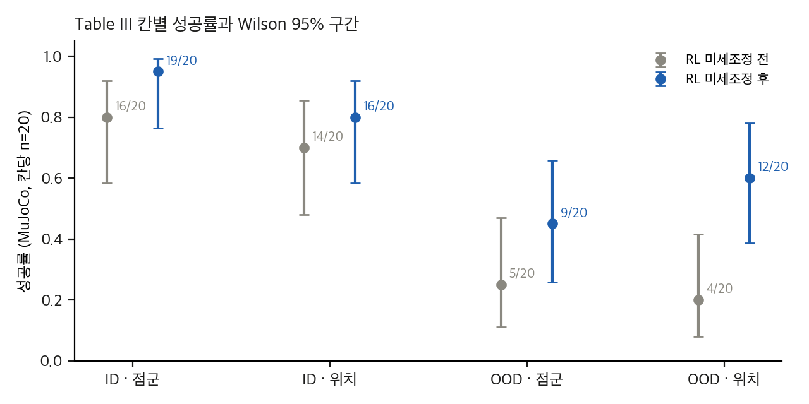
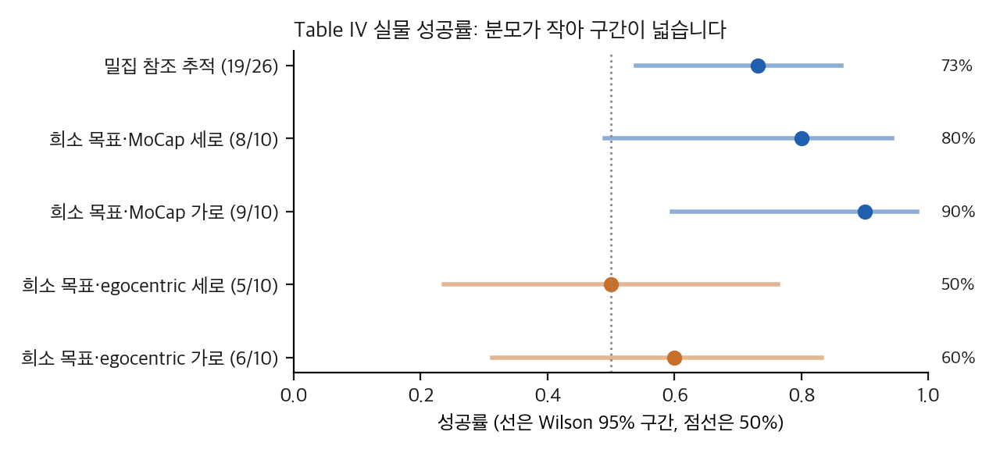
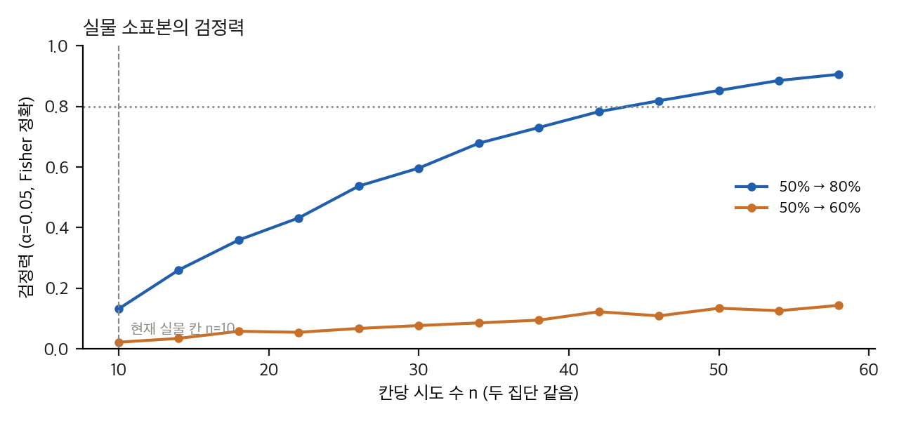
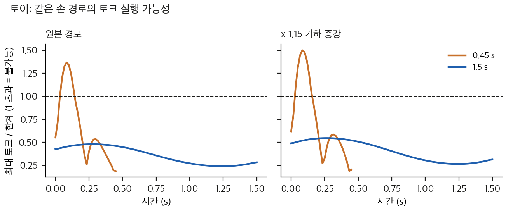

> **논문:** He, Xu, Li, Dong, Bian, Wang, Gui. *ULTRA: Unified Multimodal Control for Autonomous Humanoid Whole-Body Loco-Manipulation.* arXiv:2603.03279 (v3, 2026-10-17). IROS 2026 채택(Best Mobile Manipulation Paper Award Finalist 표기).
> 논문의 표와 그림은 라이선스(arXiv 비독점 배포) 때문에 싣지 않았습니다. 그래프는 논문 표의 수치와 직접 만든 토이로 그렸습니다.

---

## 논문이 묻는 것

휴머노이드 제어기는 두 방식으로 나뉘어 왔습니다. 참조 동작을 따라가는 추적기는 참조가 없거나 실현 불가능하면 무너지고, 목표만 주는 제어기는 세밀한 조정이 부족합니다. ULTRA는 두 방식을 **한 목표 조건부 정책**으로 묶으려 합니다.

파이프라인은 네 단계입니다.

1. **물리 기반 리타게팅:** 사람-물체 MoCap(OMOMO)을 Unitree G1 궤적으로 바꾸는 RL 정책입니다. 축별 스케일과 물체 크기 증강을 재학습 없이 적용해 데이터를 약 6배로 늘립니다.
2. **특권 교사:** 상태와 조밀한 참조를 보고 추적하는 정책입니다.
3. **모달리티 마스크 학생:** 고유감각, 목표, 물체 상태, 또는 점군을 받습니다. 잠재 변수는 교사 정보를 쓰는 사후 분포와 학생 관측만 쓰는 사전 분포를 맞춥니다.
4. **RL 미세조정:** 병렬 환경 일부를 목표 도달 과제로 바꿔 분포 밖(OOD) 목표를 개선합니다.

실물은 Unitree G1에서 상자와 가방 운반, 키보드 목표 추종을 시험합니다.

## 결과 재계산

**RL 미세조정 효과(표 III).** 칸당 20개 모션에서 OOD 위치 목표는 4→12, OOD 점군은 5→9로 올랐습니다. 저자는 "두 배, 세 배"라고 씁니다.

| 설정 | 전 → 후 | Fisher p | Holm p (4개) |
|---|---|---|---|
| ID · 점군 | 16 → 19 | 0.342 | 0.961 |
| ID · 위치 | 14 → 16 | 0.716 | 0.961 |
| OOD · 점군 | 5 → 9 | 0.320 | 0.961 |
| OOD · 위치 | 4 → 12 | 0.0225 | 0.090 |

OOD 위치는 보정 전에는 유의하지만, 네 검정을 함께 보면 유의하지 않습니다. 쌍 설계라면 결론이 달라질 수 있으나 에피소드별 결과가 없어 확인할 수 없습니다.

*그래프: 표 III의 칸별 성공률과 Wilson 95% 구간. 칸당 20회라서 구간이 약 ±20%p입니다.*

**표 II의 관통 주장.** 저자는 ULTRA가 관통을 줄인다고 씁니다. 10개 칸 중 8개에서는 ULTRA가 가장 좋습니다. 그러나 Largebox 관통 지속(0.008 대 OmniRetarget 0.000)과 Suitcase 관통 최대 깊이(0.017 대 0.012)에서는 지고 있습니다.

**실물 결과(표 IV).** 칸당 10회 이하입니다. MoCap 물체 자세 조건 80–90%, 점군 조건 50–60%입니다. 두 조건의 합계 차이는 Fisher p = 0.082입니다. 칸 간 차이를 구분하려면 집단당 24–44회가 필요합니다.

*그래프: 표 IV 실물 성공률과 Wilson 95% 구간. 점선은 50%입니다.*

*그래프: 칸당 시도 수 n에 따른 Fisher 정확 검정의 검정력(α = 0.05). 현재 실물 칸은 n = 10입니다.*

## 공식 코드를 읽으며 본 것

공식 저장소(Apache-2.0)는 학습 스크립트와 교사 추론 가중치를 줍니다. 읽으면서 확인한 차이는 다음과 같습니다.

- **보상 가중치 두 개가 읽히지 않습니다.** 설정 파일의 `ig`(상호작용)와 `cg`(접촉) 값은 함수 안에서 하드코딩된 값으로 대체됩니다. 논문 표 B의 kint, kct는 실제로 쓰이지 않습니다.
- **물체 위치 보상이 리타게팅 설정에서 0입니다**(`op: 0`). 물체 위치는 종료 조건으로만 제한됩니다.
- **학생 가중치는 공개되지 않았습니다.** 공개된 것은 교사 가중치뿐이라, 표 I, III, IV의 학생 결과는 저장소만으로 재현할 수 없습니다.
- **공개 교사 가중치는 논문과 데이터가 다릅니다.** 저장소 설명에 따르면 OMOMO 외에 AMASS와 BONES-SEED로 더 학습되었습니다. 두 데이터는 비상업 조건을 따릅니다.
- **실물 배포 스택은 저장소에 없습니다.** ROS 노드, 저수준 제어, 물체 추적, 깊이 점군 추출은 빠져 있습니다.

## 토이: 빠른 리타게팅은 토크 한계를 넘는다

운동학으로 만든 리타게팅 궤적은 동역학을 보지 않습니다. 평면 2링크 팔로 같은 손 경로를 따라가 보면, 0.45 s 경로에서 프레임의 25%가 토크 한계를 넘습니다. 기하 증강(x 1.15배)을 하면 최소 실행 시간이 약 9% 늘어납니다.

*그래프: 평면 2링크 팔의 최대 토크 대 한계 비율. 1을 넘으면 실행할 수 없습니다. 토이이며 ULTRA의 재현이 아닙니다.*

이것이 ULTRA가 증강 뒤에 물리 RL을 두는 이유를 설명합니다. 다만 토이는 접촉과 제어 오차를 다루지 않습니다.

## 구현할 수 있는가

- **공식 학습 전체:** NVIDIA GPU와 Linux, IsaacGym Preview 4가 필요합니다. GPU가 없는 맥에서는 할 수 없습니다.
- **교사 추론 한 모션:** IsaacGym 없이 MuJoCo로 돌릴 수 있는 구조로 보입니다. 설치와 데이터 확보 뒤에 시도할 수 있습니다. 아직 실행하지 않았습니다.
- **실물:** 배포 스택과 장비가 없어 재현할 수 없습니다.

## 정리

ULTRA는 새 알고리즘 하나보다 **단계들의 결합**이 기여입니다. 그래서 단계마다 증거 수준이 다릅니다. 표 III의 RL 효과는 방향은 맞지만 칸당 20회라 약합니다. 표 II의 우세는 8/10 칸이지만 관통 두 칸은 반대입니다. 실물은 칸당 10회입니다. 이 세 가지를 같이 보면, 논문이 보여 준 것은 "작동한다"는 가능성이고, 단계별 기여는 아직 검증되지 않았습니다.

공식 저장소, 프로젝트 페이지, 논문의 비교 대상(PHC, GMR, OmniRetarget, HDMI)은 저장소 목록과 함께 정리했습니다. 공개 코드가 있는 것은 ULTRA, InterMimic, GMR, PHC이고, HDMI는 공개 저장소에 라이선스가 없습니다.

## 자료

- [통합 리포트 PDF](report/report_public.pdf)
- [ULTRA: 논문 분석 (arXiv:2603.03279v3)](analysis/01_paper_analysis.md)
- [ULTRA: 선행연구와 관계](analysis/02_prior_work.md)
- [ULTRA: 표 재계산, 유의성, 토이](analysis/03_analysis.md)
- [ULTRA: 논문 ↔ 공식 코드 대조 (정적 읽기)](analysis/04_code_verification.md)
