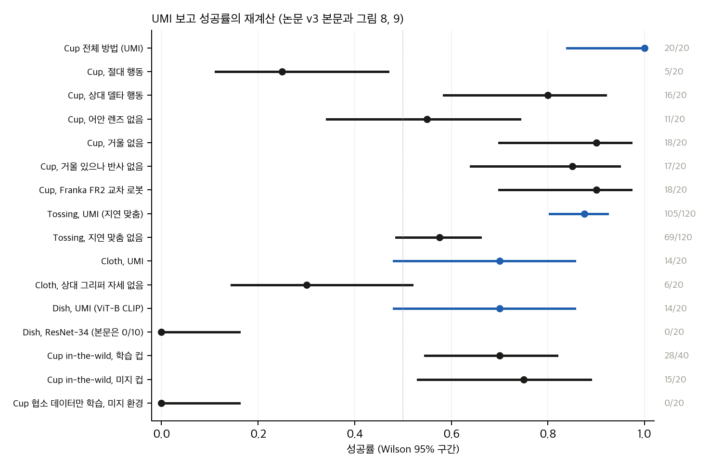
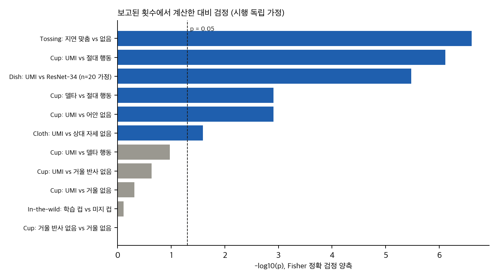

> **논문:** Cheng Chi, Zhenjia Xu, Chuer Pan, Eric Cousineau, Benjamin Burchfiel, Siyuan Feng, Russ Tedrake, Shuran Song. *Universal Manipulation Interface: In-The-Wild Robot Teaching Without In-The-Wild Robots.* RSS 2024, arXiv:2402.10329 (v3, 2024-03-06).
> 공식 코드는 GitHub real-stanford/universal_manipulation_interface(MIT)에 있습니다. 이 글의 그래프 두 장은 논문 보고 수치를 우리가 다시 계산해 그린 것이고, 논문 그림은 넣지 않았습니다. 논문 라이선스는 arXiv 비배타 배포 라이선스이기 때문입니다.

## 논문이 묻는 것

로봇 시연을 모으는 흔한 방법은 두 가지입니다. 실험실에서 원격 조작하거나, 인터넷 사람 영상을 쓰는 것입니다. 원격 조작은 설정 비용이 크고, 사람 영상은 사람과 로봇의 몸이 달라 행동을 옮기기 어렵습니다. UMI는 세 번째 길을 택합니다. **손에 드는 그리퍼**로 사람이 직접 시연하고, 그 데이터로 로봇에 배포할 수 있는 정책을 학습합니다.

시연 장치는 GoPro 하나와 3D 프린트 그리퍼로 이루어집니다. 손목 카메라의 155° 어안 영상을 왜곡 보정 없이 그대로 씁니다. 측면 거울 두 장이 카메라 주변부에 가상 카메라 두 대를 만들어 암묵적인 스테레오 정보를 줍니다. 행동은 GoPro 내장 IMU를 넣은 ORB-SLAM3로 얻습니다. 그리퍼 하나의 BoM은 약 73달러이고 GoPro 등 부품은 약 298달러입니다.

정책 쪽에서는 세 가지를 맞춥니다. 첫째, 추론할 때 카메라, 로봇 자세, 그리퍼 폭의 지연을 맞춰 관측을 동기화하고, 실행 지연은 미리 명령해 보상합니다. 둘째, 행동을 현재 엔드이펙터 자세 기준 상대 궤적으로 씁니다. 셋째, 양팔 과제에서는 두 그리퍼 사이 상대 자세를 관측에 넣습니다. 학습은 Diffusion Policy(RSS 2023)를 씁니다.

## 보고된 결과

| 과제 | UMI 결과 | 주요 대조 |
|---|---|---|
| 컵 세우기 (20회) | 20/20 | 어안 없음 11/20, 절대 행동 5/20, 델타 행동 16/20 |
| 동적 던지기 (120회) | 105/120 | 지연 맞춤 없음 69/120 |
| 양손 스웨터 접기 (20회) | 14/20 | 상대 자세 없음 6/20 |
| 접시 닦기 (20회) | 14/20 | ResNet-34 0% |
| 미지 환경 컵 (60회) | 43/60 | 협소 데이터만 학습 0/20 |

일반화 실험은 30곳에서 1400회 시연을 모은 것이 핵심입니다. 같은 구조를 실내 협소 데이터로만 학습하면 미지 환경에서 전혀 작동하지 않았습니다.

## 재계산 결과

보고된 성공 횟수에서 Wilson 구간과 Fisher 정확 검정을 다시 계산했습니다. 원자료가 없으므로 시행을 독립으로 가정한 값입니다.

*그림: 논문 보고 성공 횟수의 재계산. 점은 성공률, 선은 Wilson 95% 구간입니다. 우리가 그린 그래프입니다.*

가장 분명한 차이는 던지기의 지연 맞춤입니다. 105/120 대 69/120이고 p는 약 2.5 × 10⁻⁷입니다. 델타 행동 대비 상대 행동은 20/20 대 16/20으로 방향만 맞고 p = 0.11이라 확인되지 않았습니다. 절대 행동 대비에서만 유의합니다(p ≈ 8 × 10⁻⁷).

*그림: 보고된 횟수에서 계산한 대비 검정. 점선은 p = 0.05입니다. 우리가 그린 그래프입니다.*

거울 효과도 유의하지 않았습니다. 거울 없음 18/20, 반사 없음 17/20, 최종 20/20이고, 최종 대 반사 없음은 p = 0.23입니다. 20회씩 평가하면 이 정도 차이는 잡기 어렵습니다. 델타 대 상대 행동을 80% 검정력으로 보려면 한 팔당 약 35회가 필요합니다.

## 보고 수치의 어긋남

- 접시 닦기에서 ResNet-34는 본문에 0/10이라고 쓰였지만 그림 8은 20회입니다. 시행 수가 어디서 나왔는지 확인되지 않습니다.
- SLAM 캡션은 "1 cm, 4° 미만"이라고 씁니다. 개별 그리퍼 6.1 mm와 3.5°는 맞지만, 두 그리퍼 사이 상대 자세 RPE는 10.1 mm입니다.
- 소개문의 "70% OOD 성공률"은 미지 컵과 학습 컵 사이에 있는 값입니다. 전체 풀링은 71.7%입니다.

## 공식 코드와 논문 설정

공식 저장소를 정적으로 읽고 논문 설정과 대조했습니다. 실행, 설치, 체크포인트 다운로드는 하지 않았습니다. 상대 자세 식과 두 그리퍼 상대 자세, 원본 어안 입력, DDIM 50과 16 스텝, 사전학습 인코더 학습률 0.1배는 논문과 맞습니다.

다른 점도 있습니다. 기본 UNet 설정은 CLIP ViT-B/16 하나이고, 던지기와 접기에 쓴 ResNet-34는 주석 처리된 예시입니다. 회전 증강 ±5°는 기본 UNet에서 꺼져 있습니다. 에폭 120과 배치 64는 과제별 표와 다릅니다. 지연 값은 예시 설정이며, 논문이 하드웨어마다 잰 값과 같지 않습니다.

## 이 맥에서 할 수 있는 것

- **불가:** 실로봇 실험, 현장 시연 수집, 시각 SLAM의 MoCap 평가. 하드웨어와 사람이 필요합니다.
- **불가 (실용):** 기본 설정의 정책 학습. 공식 코드는 CUDA를 전제하고 README는 RTX 3090 24 GB에서 시험했다고 씁니다.
- **조건부:** 공식 SLAM 파이프라인 실행(리눅스 Docker와 GPL 포크 빌드), 공개 체크포인트 추론. 실행 승인 뒤에 할 일입니다.

## 정리

UMI는 시연 장치를 로봇에서 떼어 내어 현장 데이터를 모으게 했습니다. 상대 행동과 지연 맞춤은 동적 과제에서 실제 효과가 보입니다. 다만 "델타보다 낫다"와 "거울이 효과가 있다"는 이 실험 규모로는 확정되지 않습니다. 공식 코드를 쓰려면 논문 과제별 설정을 맞춰야 하고, 지연 값은 하드웨어마다 다시 재야 합니다.

## 자료

- [통합 리포트 PDF](report/report_public.pdf)
- [UMI 논문 분석 (arXiv:2402.10329)](analysis/01_paper_analysis.md)
- [UMI 선행연구와 관련 자료](analysis/02_prior_work.md)
- [UMI 수치 재계산과 검정 (논문 본문, 그림 8·9·11·12)](analysis/03_analysis.md)
- [UMI 공식 코드 대조 (정적 읽기)](analysis/04_code_verification.md)
