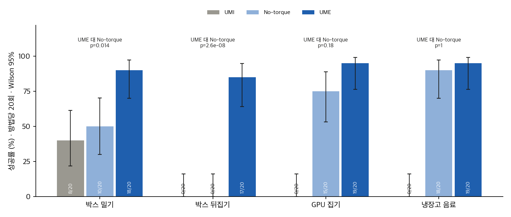
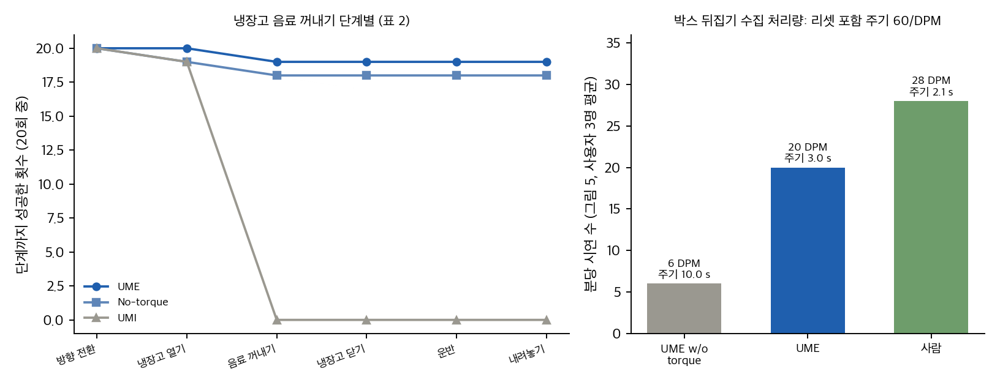
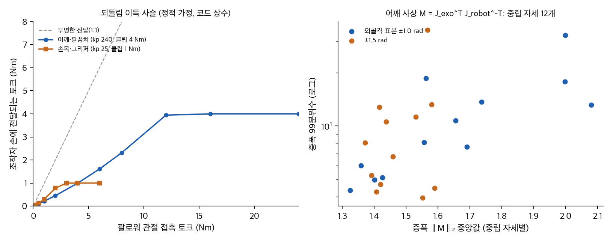

# 03. 수치 재계산, 일관성 검사, 토이, 주장 판정

재계산은 `analysis/recompute.py`(numpy, scipy, 약 20초), 토이는 `analysis/toy_retarget_torque.py`(numpy, 약 30초)입니다. 결과는 `recompute_results.json`, `toy_retarget_torque_results.json`에 있습니다. 검사 번호는 V(재계산), K(일관성), T(토이), C(주장)입니다.

**통계 가정.** 표 1의 성공 횟수는 비율 × 20으로 복원했고, 본문이 직접 적은 UME 횟수(18/20, 17/20, 19/20, 19/20)와 일치합니다(V1). 시행은 방법 사이에서 독립이라고 가정해 Fisher 정확 검정(양측)을 썼습니다. 논문에는 초기 조건이 방법 사이에 같은지(짝)와 정책 학습 반복 수가 없습니다. 따라서 p는 "이 한 번 학습된 정책의 20회 시행 잡음"만 반영하고, 학습 시드 분산은 반영하지 않습니다.

## 1. 표 재계산 (V)

### V1–V2. 표 1의 정수성과 구간

모든 비율이 20회 격자(0.05 단위)에 있어 정수 해가 있습니다(K3). Wilson 95% 구간(%):

| | 박스 밀기 | 박스 뒤집기 | GPU 집기 | 냉장고 음료 | 합계 (80회) |
|---|---|---|---|---|---|
| UME | 18/20 [69.9, 97.2] | 17/20 [64.0, 94.8] | 19/20 [76.4, 99.1] | 19/20 [76.4, 99.1] | 73/80 91.3% [83.0, 95.7] |
| No-torque | 10/20 [29.9, 70.1] | 0/20 [0, 16.1] | 15/20 [53.1, 88.8] | 18/20 [69.9, 97.2] | 43/80 53.8% [42.9, 64.3] |
| UMI | 8/20 [21.9, 61.3] | 0/20 [0, 16.1] | 0/20 [0, 16.1] | 0/20 [0, 16.1] | 8/80 10.0% [5.2, 18.5] |

UME의 점추정이 85–95%여도 구간 하한은 64–76%입니다. n = 20에서 85%, 90%, 95%는 서로 구별되지 않습니다(예: 0.95 대 0.90의 검정력 2%, 80% 검정력에는 방법당 약 455회 필요, V11).

### V3. 쌍별 Fisher 검정 (양측, 과제별)

| 비교 | 박스 밀기 | 박스 뒤집기 | GPU 집기 | 냉장고 음료 |
|---|---|---|---|---|
| UME 대 No-torque | **p = 0.014** (Holm 8개 보정 0.041, 12개 보정 0.069) | **p = 2.6e-8** | p = 0.18 | p = 1.0 |
| UME 대 UMI | p = 0.0022 (Holm8 0.0088) | p = 2.6e-8 | p = 3.0e-10 | p = 3.0e-10 |
| No-torque 대 UMI | p = 0.75 | p = 1.0 | p = 7.7e-7 | p = 3.4e-9 |

- **토크 입력의 효과**(UME 대 No-torque)는 박스 뒤집기에서 확실하고, 박스 밀기에서는 보정 방식에 따라 경계(UME 대 두 기준선의 8개 비교에만 Holm을 적용하면 0.041, 12개 전부면 0.069)입니다. **GPU 집기와 냉장고 음료에서는 검출되지 않습니다.**
- **팔 전체 관절 구성의 효과**를 보려면 두 기준선 모두 토크가 없는 상태의 UMI 대 No-torque 비교가 알맞습니다. GPU 집기(0/20 대 15/20)와 냉장고(0/20 대 18/20)에서 확실하고, 박스 두 과제에서는 차이가 없습니다(밀기 8/20 대 10/20 p = 0.75, 뒤집기 0 대 0). 단 UMI 쪽 구현 차이가 섞여 있습니다(C4, `04` D13).

### V4. 풀링과 층화

- 풀링(80회씩): UME 73/80 대 No-torque 43/80, Fisher p = 1.2e-7. UME 대 UMI 73/80 대 8/80, p = 2e-27.
- 과제를 층으로 한 Mantel–Haenszel 오즈비(0칸 때문에 Haldane 0.5 보정): 8.97. 층화 순열 검정 20,000회 모두에서 관측 이상의 차이가 나오지 않아 p ≤ 5e-5.
- 과제 묶음별(UME 대 No-torque): **힘 매개 과제**(박스 밀기+뒤집기) 35/40 대 10/40 **p = 2.0e-8**. **공간·이동 과제**(GPU+냉장고) 38/40 대 33/40 **p = 0.15**. 즉 토크 효과는 힘 매개 과제에서 나옵니다.

### V5–V6. 표 2 (냉장고 단계별)

- 모든 방법에서 단계별 성공 수가 단조 비증가이고(No-torque 20, 19, 18, 18, 18, 18 / UMI 20, 19, 0 … / UME 20, 20, 19, 19, 19, 19), 마지막 단계가 표 1의 냉장고 칸과 같습니다(K2).
- 단계 조건부 성공률: No-torque는 문 열기 19/20, 음료 꺼내기 18/19, 이후 18/18. UME는 문 열기 20/20, 음료 꺼내기 19/20, 이후 19/19. **No-torque와 UME의 차이는 문 열기와 음료 꺼내기의 각 1회 실패 차이(총 1회)**입니다. 본문의 "문을 열 토크가 부족해 가끔 실패"(§3.4)는 1/20 사례입니다.
- UMI는 문 열기 19/20 이후 음료 꺼내기 0/19. 본문 "한 번 열기 실패, 꺼내기 0"과 일치합니다.

### V7. 그림 5 (분당 시연 수)

- 막대 값 6, 20, 28(정수로 읽음). 20/6 = 3.33배(본문 "3.3×" 일치), 20/28 = 71.4%("71%" 일치). 막대가 정수 반올림이라면 비는 3.0–3.7배, 사람 대비 68–75%입니다.
- **사용자는 3명**입니다(그림 11의 세 쌍). 평균만 있고 분산, 신뢰구간, 검정이 없습니다. 과제는 박스 뒤집기 하나입니다.
- **주기 환산(K8).** 리셋이 한 분에 포함되므로 DPM의 역수가 한 시연의 전체 주기입니다. UME w/o torque 10.0초, UME 3.0초, 사람 2.1초. 박스를 눌러 세우고 되돌려 놓는 데 사람이 2.1초라면 매우 빠릅니다. 논문에 과제 길이가 없어 가능성을 판단할 수 없지만, "분당 시연 수"의 정의(리셋 포함 여부, 성공한 것만 센 것인지)를 프로젝트 영상으로 확인할 필요가 있습니다.

### V8. 비용 합계

- 표 4: 117×8 + 88×8 + 3.5×6 + 13×4 + 52 + 41 + 2×14 + 9 + 3×6 + 5×6 + 7 + 2 = **$1,900.0** (일치, K6). 모터 16개 $1,640이 86.3%.
- 표 5: 5200 + 900×4 + 386 + 37.5×3 + 52 + 45 + 7.5×14 + 1.6×16 + 7 = **$9,533.1** (일치, K7). 컴퓨터와 GPU는 표에 없습니다. 파워 캐스터 4개 $3,600은 Tidybot++ 스워브 모듈 4개 $1,200(본문 $300×4)의 3배입니다(§E.4).
- UME 재료비 $1,900은 팔로워 팔 $5,200의 37%입니다.

### V9–V10. 학습량과 모델 크기 산술

- 40k 스텝 × 배치 200 = 800만 샘플. 8시간 기준 초당 278 샘플입니다. 냉장고 과제를 가정(157개 시연, 에피소드 90초, 프레임율 30 Hz)하면 약 19 에포크, 10 Hz면 약 57 에포크입니다. 다른 과제의 시연 길이는 논문에 없어 계산하지 않았습니다.
- 표 3의 트랜스포머(은닉 512, FFN 3200, 인코더 4 + 디코더 7)는 약 55.0M 파라미터이고 공식 코드 기본값(은닉 256, FFN 2048, 인코더 4 + 디코더 6)은 약 14.7M으로 **3.7배**입니다(임베딩·헤드·ResNet18 제외 산술 추정, `04` D10).

### V11. 검정력

n = 20에서 0.90 대 0.50은 검정력 75%, 0.95 대 0.75는 30%, 0.95 대 0.90은 2%입니다. 80% 검정력에는 0.95 대 0.75가 방법당 약 55회, 0.95 대 0.90이 약 455회 필요합니다(시뮬레이션 추정). 따라서 박스 밀기·GPU·냉장고에서 "UME가 No-torque보다 높다"는 방향은 보이나 확정은 안 됩니다.

## 2. 일관성 검사 (K)

| 번호 | 항목 | 결과 |
|---|---|---|
| K1 | 표 1 UME 비율 × 20 대 본문 횟수 (§3.1–3.4) | 일치 (18, 17, 19, 19) |
| K2 | 표 2 마지막 열 = 표 1 냉장고 칸, 단계 단조성 | 일치 |
| K3 | 표 1·2 비율의 20회 정수성 | 모두 정수 가능 |
| K4 | "3.3배" = 20/6 (그림 5) | 일치 (3.33) |
| K5 | "71%" = 20/28 | 일치 (71.4%) |
| K6 | 표 4 합계 $1,900 | 일치 |
| K7 | 표 5 합계 $9,533.1 | 일치 |
| K8 | 그림 5의 주기 환산 2.1–3.0초 | 가능성 불명. 정의 확인 필요 (V7) |
| K9 | 사용자 수 | 본문에 수가 없고 그림 11에서 3명만 보임. 평균의 분산 없음 |
| K10 | §2.2 속도식 J† = (JᵀJ)⁻¹Jᵀ, J ∈ R^{3×n} | 왼쪽 역행렬은 열이 3 이하일 때만 정의됩니다. n > 3인 J에는 오른쪽 역행렬 Jᵀ(JJᵀ)⁻¹가 맞습니다. 어깨·손목은 3×3이라 실사용에서는 영향 없음 |
| K11 | 토크 사상식 두 가지: §2.2는 동적 일관 역행렬 J̄ᵀ, 부록 그림 6은 (Jᵀ)† | 3×3 정칙이면 두 식이 같고, 코드는 `pinv(Jᵀ)`(`04` D4) |
| K12 | "lightweight"(초록) 대 약 12 kg(부록 E.1) | 서술 긴장. 알루미늄으로 약 8 kg 추정(부록 E.1) |
| K13 | §3의 "all four tasks require base movement" | §3.1, §3.3, §3.4에 베이스 이동이 서술되고 §3.2(박스 뒤집기)에는 없음 |
| K14 | 학습 반복, 초기 조건 | 논문에 없음 |

## 3. 토이 T1: 되돌림 이득 사슬과 어깨 사상

`analysis/toy_retarget_torque.py` (numpy, 30초, 외골격·팔로워 어깨 3축 배치를 MJCF에서 옮김). 한계: 정적 가정과 코드 상수, 무작위 중립 자세 12개(외골격 0 자세가 팔로워 어느 자세에 대응하는지 논문과 코드에 없음), 임의의 외골격 관절 표본 범위(±1.0, ±1.5 rad).

### T1-A. 팔로워 토크 대 손에 전달되는 토크

D1(이득 0.5, 클립)과 D2(추종 오차 게이트)를 코드 상수로 계산합니다. 정적 가정: 추종 오차 = 토크 / kp.

| 팔로워 어깨 토크 (Nm) | 0.5 | 1 | 2 | 4 | 8 | 12 | 16 |
|---|---|---|---|---|---|---|---|
| 손에 전달 (Nm) | 0.11 | 0.22 | 0.45 | 0.99 | 2.31 | 3.94 | 4.0 (포화) |
| 비율 | 0.22 | 0.22 | 0.22 | 0.25 | 0.29 | 0.33 | 0.25 |

손목(kp 25, 클립 1 Nm): 팔로워 토크 1 Nm에서 0.31, 2 Nm에서 0.78, 2.4 Nm 이상에서 1.0 Nm로 포화. 게이트 이득은 오차 0°에서 0.207, 1°에서 0.25, 5°에서 0.40, 10°에서 0.48, 20°에서 0.50입니다. 즉 **작은 접촉 토크는 약 22–31%만 전달되고 큰 토크는 클립됩니다.** 사람이 느끼는 "저항감"은 팔로워 토크에 선형이 아니고, 박스 밀기의 "높은 토크가 나올 때까지 민다"(§3.1)에는 충분하지만 투명(1:1)하지는 않습니다. 정적 가정은 실제 동특성과 다릅니다. 실기 측정은 하지 않았습니다.

### T1-B. 어깨 구면 관절 사상 M = J_exoᵀ J_robot⁻ᵀ

- **가상일 보존.** τ_exo·q̇_exo = τ_robot·q̇_robot이 수치 오차 6e-14 이내로 맞습니다. 사상 자체는 일관됩니다.
- **두 모델의 0 자세 회전이 90° 다릅니다.** 외골격 어깨 세 축은 서로 직교하지 않습니다(0 자세에서 J1–J2 90°, J2–J3 120°, J1–J3 90°). OpenArm 어깨는 서로 직교하는 Z–X–Y형 배치입니다(`openarm.xml`의 축 선언 (0,0,1), (−1,0,0), (0,0,1)과 둘째 링크의 x축 90° 회전을 합치면 0 자세에서 (0,0,1), (−1,0,0), (0,−1,0)). 두 야코비안이 달라 M은 단위행렬이 아닙니다.
- **OpenArm 어깨 특이점.** MJCF의 축 선언으로 계산하면 J2 = 90°에서 야코비안이 랭크 2가 됩니다(최소 특이값 8e-9). 관절 범위(J2 −10°…190°) 안에 있고, J2 범위의 약 16%(q1 = q3 = 0 단면)에서 최소 특이값이 0.2 미만입니다. 코드는 감쇠 없는 `pinv`를 씁니다(D4).
- **사상 증폭.** 외골격 표본을 ±1.0 rad로 잡고 팔로워 자세를 코드와 같은 방식으로 추종해 구하면(수렴한 표본만, 팔로워 한계 때문에 수렴률 46–83%, 중립 자세 12개) M의 최대 특이값 중앙값은 1.3–2.1이고 **약 30%의 표본에서 2를 넘으며 99분위수는 중립 자세에 따라 약 4–35배**입니다. ±1.5 rad에서는 수렴률이 24–59%입니다. 팔로워 토크가 4–12 Nm 영역이면 증폭이 곧바로 4 Nm 클립(D1)에 닿습니다. 즉 클립이 증폭을 가립니다.
- **해석.** "하위 매니퓰레이터로 분리하면 특이점이 없다"(§2.2)는 말은 팔 전체의 특이점(팔꿈치와 손목 정렬 등)에는 해당하지만, **구면 어깨 자체의 오일러형 특이점은 남고** 토크 사상에서 증폭으로 나타납니다. OpenArm의 어깨 구성에서 특이점이 범위 안에 있다는 점은 MJCF에서 직접 확인했지만, 실제 과제 자세가 특이 근처에 가는지는 데이터가 없어 알 수 없습니다.

## 4. 주장 판정 (C)

판정: **지지**(재계산이 보고 수치를 확인하고 표본이 충분), **방향만**(수치는 맞으나 n이 작아 확정 못 함), **미지지**(표나 코드가 지지하지 않음), **확인 불가**(자료 없음).

| 번호 | 주장 (위치) | 근거 | 판정 |
|---|---|---|---|
| C1 | UME가 네 과제에서 85–95% (표 1) | 비율 일치(V1), Wilson 하한 64–76%(V2) | 지지 (측정치로서. 한 정책, n = 20) |
| C2 | 토크 없이는 박스 뒤집기 불가 (§3.2, 표 1) | 0/20 대 17/20, p = 2.6e-8 (V3) | **지지** |
| C3 | 토크가 박스 밀기에서 성공률을 올린다 (§3.1) | 10/20 대 18/20, p = 0.014 (Holm 12 비교 0.069) | 방향만 (보정에 따라 경계) |
| C4 | GPU 집기·냉장고에서 토크의 중요성 (§3.3, §3.4) | 15/20 대 19/20 p = 0.18, 18/20 대 19/20 p = 1 | **미지지** (검출 안 됨) |
| C5 | 팔 전체 관절 구성이 필수, UMI 방식은 불가 (§3.3, §3.4) | UMI 0/20 대 No-torque 15/20, 18/20(GPU, 냉장고 p < 1e-6). 단 UMI 구현에는 충돌 제약 없는 IK(D13), 입력과 행동 공간 차이가 섞임 | 방향 지지, 원인은 분리 안 됨 |
| C6 | 투명한 실시간 토크 피드백 (Cap1, 초록) | 정량 지표 없음. 코드에 이득 0.5, 추종 오차 게이트, 4 Nm/1 Nm 클립(D1, D2). 정적 가정에서 22–33% 전달(T1-A). 눈가림 칼 뽑기는 영상만 | **미지지** (정량 근거 없음, 코드와 "투명" 서술이 어긋남) |
| C7 | 토크 피드백이 수집 처리량을 3.3배로 올림, 사람의 71% (그림 5) | 산술 일치(K4, K5). 사용자 3명, 한 과제, 분산·검정 없음. 주기 2.1–3.0초(K8) | 방향만 (정의 확인 필요) |
| C8 | 재료비 $1,900 (표 4) | 합계 일치(V8). 범위는 외골격 부품 | 지지 (범위 한정) |
| C9 | 가볍고 휴대 가능 | 약 12 kg, 착용 2시간(부록 E.1) | 서술 긴장 (K12) |
| C10 | 범용 재타깃팅이 OpenArm, X-ARM, Franka에서 작동 (§2.2, 부록 C.2) | 지표 없음. 공개 코드는 OpenArm만(D14). Franka는 시뮬 영상만 | **확인 불가** (OpenArm 외) |
| C11 | 서브 매니퓰레이터 분리가 특이점을 피함 (§2.2) | 구면 어깨 특이점은 남고 OpenArm에서는 범위 안(T1-B) | 부분 지지 (팔 전체 특이점만) |
| C12 | 정책이 "active compliant"로 접촉을 조절 (§2.4) | 순응성은 고정 PD와 위치 목표에서 나옴(D5). 접촉력 정량 없음 | 서술 일치, 정량 없음 |
| C13 | 모든 모델 40k 스텝, 표 3 설정 (부록 D) | 공개 코드는 다른 기본값(D10)과 CVAE 없음(D9) | 코드와 논문 불일치 |
| C14 | 외란에 강건함: 음료 제거 시 재시도 (§3.4) | 영상만, 횟수 없음 | 확인 불가 |

## 5. 해석 요약

1. **토크 입력은 힘 매개 과제에서 확실히 효과가 있고, 나머지 두 과제에서는 효과가 보이지 않습니다.** 풀링 힘 과제 35/40 대 10/40(p = 2e-8), 공간·이동 과제 38/40 대 33/40(p = 0.15).
2. **UMI 기준선의 0%는 UMI 방식의 한계와 구현 선택이 섞여 있습니다.** 충돌 제약이 없는 IK와 현재 q에서 시작하는 100회 감쇠 최소제곱으로, 팔이 꺾이는 실패가 설계에서 나올 수 있습니다(D13).
3. **되돌림 토크는 "투명"하지 않고 의도된 한계가 걸려 있습니다.** 이득 0.5, 오차 게이트, 클립이 있습니다(D1, D2). 안전과 불안정 방지에 합리적이지만 논문 서술에서 빠져 있습니다.
4. **순응성의 원천은 고정 PD입니다.** 정책은 위치 목표만 냅니다(D5).
5. **공개 코드가 논문 설정과 다릅니다.** CVAE 없음, 트랜스포머 3.7배 작음(D9, D10).
