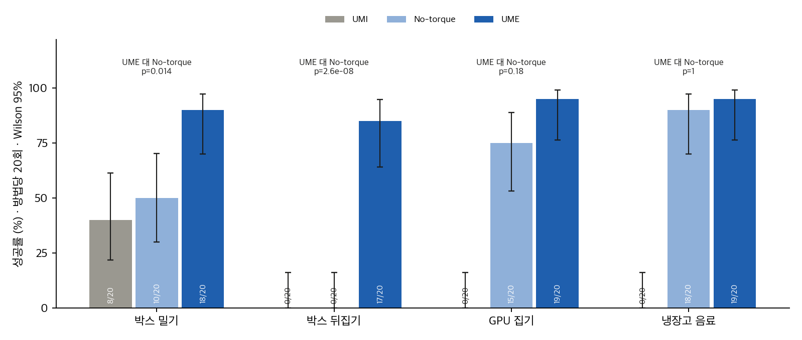
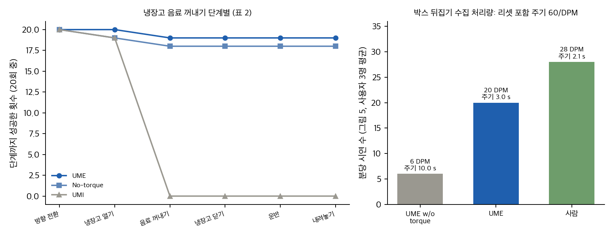
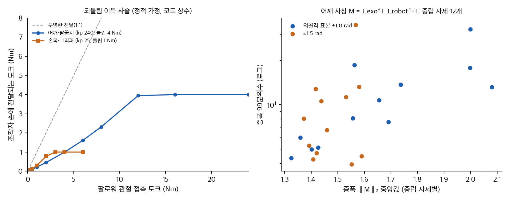

> **논문:** Litian Liang, Jingxi Xu, Xinda Qi, Yujun Cai, Houzhu Ding, Luqi Wang, Zhixin Sun, Jyh-Herng Chow, Ming Yang, Mark Cutkosky. *Universal Manipulation Exoskeleton: Learning Compliant Whole-body Policies with Real-time Torque Feedback.* CoRL 2026 포스터, arXiv:2606.14218 (v1, 2026-06-12).
> 공식 코드는 GitHub inclusionAI/Universal-Manipulation-Exoskeleton(Apache-2.0)에 있습니다. 논문은 arXiv 비독점 배포라서 논문 그림은 싣지 않았고, 이 글의 그림은 모두 우리가 다시 그린 그래프입니다.

## 논문이 묻는 것

ALOHA와 GELLO 같은 텔레오퍼레이션은 팔로워가 받는 관절 토크를 기록하지도, 사람에게 돌려주지도 않습니다. UMI 계열 손에 든 그리퍼는 힘을 몸으로 느끼지만 말단 자세만 기록해 좁은 공간에서 충돌을 IK에 맡겨야 합니다. UME는 두 가지를 한꺼번에 노립니다. 사람이 입는 상체 외골격으로 팔 전체 관절 구성을 기록하고, 팔로워의 접촉 토크를 외골격 모터로 돌려줍니다. 이 데이터로 ACT에 관절 토크 입력을 더한 정책을 학습해 네 과제(박스 밀기, 박스 뒤집기, GPU 집기, 냉장고 음료 꺼내기)에서 85–95%를 얻었다고 보고합니다.

핵심 설계는 세 가지입니다. 동축 배치로 사람 팔의 3-1-3 구조에 맞춘 낮은 감속비 모터 16개(재료비 약 $1,900, 약 12 kg), 팔을 어깨(3축)·팔꿈치(1축)·손목(3축)으로 나눠 독립적으로 재타깃팅하는 방식, 그리고 IMU 하나로 이동 베이스를 모는 방식입니다.

## 이 글에서 확인한 것

**1. 토크 입력은 힘 매개 과제에서 확실하고, 다른 과제에서는 보이지 않습니다.** 방법당 20회 성공 횟수를 비율에서 복원해 Fisher 검정을 했습니다. 박스 뒤집기는 No-torque 0/20 대 UME 17/20(p = 2.6e-8)입니다. 박스 밀기는 10/20 대 18/20으로 p = 0.014이지만 12개 비교에 Holm 보정을 하면 0.069입니다. GPU 집기(15/20 대 19/20, p = 0.18)와 냉장고(18/20 대 19/20, p = 1)는 차이가 검출되지 않습니다. 과제를 묶으면 힘 매개 과제는 35/40 대 10/40(p = 2e-8), 공간·이동 과제는 38/40 대 33/40(p = 0.15)입니다. 방법당 20회에서는 0.95 대 0.90을 구별할 검정력이 2%입니다.

*그래프 (우리가 그림). 표 1의 비율을 20회 격자로 복원하고 Wilson 구간과 UME 대 No-torque Fisher p를 붙였습니다.*

**2. 수집 처리량 3.3배와 사람의 71%는 산술이 맞지만 근거가 얇습니다.** 그림 5의 분당 시연 수 6, 20, 28에서 20/6 = 3.3, 20/28 = 71%입니다. 사용자는 그림 11에서 3명이고 과제는 박스 뒤집기 하나이며 분산이 없습니다. 리셋을 포함한 한 분 기준이므로 주기로 환산하면 10.0초, 3.0초, 2.1초입니다. 정의(성공한 것만 세는지, 리셋 포함 방식)를 영상으로 확인해야 합니다. 냉장고 단계별 표 2는 단조 감소하고 마지막 열이 표 1과 같습니다. No-torque와 UME의 차이는 사실상 한 번의 실패입니다.

*그래프 (우리가 그림). 왼쪽은 표 2의 단계별 성공 횟수, 오른쪽은 그림 5의 DPM과 60/DPM으로 환산한 주기입니다.*

**3. UMI 기준선의 0%는 구현 선택의 영향과 분리되지 않습니다.** UMI 기준선은 같은 UME 시연의 말단 자세만으로 ACT를 학습하고 전신 IK로 관절 위치로 바꿉니다. 공개 코드의 IK는 관절 한계만 있는 감쇠 최소제곱이고, 충돌 제약이나 자세 규제가 없습니다. 그래서 "팔이 꺾여 충돌한다"는 실패는 UMI 방식 일반의 한계라기보다 이 IK 구현의 결과일 수 있습니다.

## 공식 코드와 논문의 차이

공개 코드(하드웨어 CAD, 텔레오퍼레이션, 수집, ACT 학습·평가)는 구조상 논문과 맞지만, 논문에 없는 설정이 많습니다. 코드는 읽기만 했고 실행하거나 설치하지 않았습니다.

- **되돌림 토크는 축소·클립된 채 전달되어 "투명" 서술과 다릅니다.** 팔로워 상호작용 토크(측정 토크 − 중력·코리올리)에 0.5를 곱하고, 추종 오차에 따라 0.207에서 0.5로 변하는 tanh 게이트를 얹고, 어깨·팔꿈치는 ±4 Nm, 손목·그리퍼는 ±1 Nm로 클립합니다. 정적 가정(추종 오차 = 토크/kp)으로 계산하면 손에는 팔로워 토크의 약 22–33%가 전달되고 12 Nm(어깨)와 2.4 Nm(손목)에서 포화합니다.
- **순응성은 고정 PD에서 나옵니다.** 정책은 위치 목표(와 베이스 속도)만 냅니다. 팔로워는 kp 240 등 고정 이득의 PD에 중력 보상을 더합니다. 힘은 목표를 접촉 면 안쪽으로 얼마나 밀어 넣는지로 정해집니다.
- **ACT에서 CVAE가 빠졌습니다.** 학습에서도 잠재 변수가 0이고 L1 손실만 씁니다. 트랜스포머는 은닉 256, FFN 2048, 디코더 6층으로 표 3(512, 3200, 7층)보다 파라미터가 약 3.7배 작습니다. 표 3 설정을 CLI로 넘겼는지는 문서에 없습니다.
- **청크 실행.** 행동 20스텝, 2초를 2초마다 통째로 교체하고 시간 앙상블이 없습니다. 접촉 전환이 청크 안에서 개루프로 지나갈 수 있습니다.
- **범용 재타깃팅은 OpenArm 쌍만 공개되어 있습니다.** X-ARM과 Franka 코드는 없습니다.
- 시연 데이터, 체크포인트, 성공률 평가 스크립트는 저장소에 없습니다.

## 토이: 되돌림 이득 사슬과 어깨 사상

numpy 토이로 두 가지를 확인했습니다(30초). 하나는 위의 이득 사슬입니다. 다른 하나는 외골격과 OpenArm 어깨의 세 축 배치를 MJCF에서 옮겨 적고, 토크 사상 M = J_exoᵀ J_robot⁻ᵀ의 증폭을 본 것입니다. 사상은 가상일을 보존합니다(오차 6e-14). 그러나 OpenArm 어깨는 J2 = 90°에서 야코비안이 랭크를 잃고 이 값이 관절 범위(−10°…190°) 안에 있습니다. 외골격 0 자세가 팔로워 어느 자세에 대응하는지 코드에 없어 중립 자세 12개를 무작위로 잡았더니, 최대 특이값 중앙값은 1.3–2.1이고 99분위수는 약 4–35배였습니다. "서브 매니퓰레이터로 분리해 특이점을 피한다"는 설명은 팔 전체 특이점에는 맞지만 구면 어깨의 오일러형 특이점은 남습니다. 4 Nm 클립이 이 증폭을 가려 줍니다. 실제 과제 자세가 특이점 근처에 가는지는 데이터가 없어 알 수 없습니다.

*그래프 (우리가 그림). 왼쪽은 팔로워 접촉 토크 대 손에 전달되는 토크(정적 가정, 코드 상수), 오른쪽은 중립 자세 12개별 사상 증폭의 중앙값과 99분위수입니다. 외골격 표본 범위는 임의로 잡았습니다.*

## 구현 가능성

이 글의 계산은 CPU에서 모두 끝납니다. 반대로 논문의 실험은 재현하기 어렵습니다.

- **실물:** 모터 16개의 외골격, OpenArm 양팔 모바일 매니퓰레이터, 시연 수집은 하드웨어가 있어야 합니다.
- **학습:** 시연 데이터와 체크포인트가 공개되지 않았고, 학습 스크립트는 CUDA를 하드코딩합니다(논문은 RTX 4090 한 장 8시간).
- **가능한 것:** 합성 접촉 과제에서 토크 입력 유무, CVAE, 청크 교체 주기를 비교하는 축소판은 CPU나 맥 GPU에서 가능해 보입니다(추정, 미실행).

## 한계와 읽을 때 주의할 점

- 방법당 20회, 학습은 구성당 한 번으로 보이고 시드 분산이 없습니다. p는 시행 잡음만 반영합니다.
- "투명한 토크 피드백"에 정량 지표가 없습니다. 눈가림으로 칼을 뽑는 시연은 영상으로만 있습니다.
- 재료비 $1,900은 외골격 부품만입니다. 팔로워 로봇은 $9,533, 컴퓨터와 GPU는 별도입니다.
- 모터 토크는 전류 기반 추정이라 감속기 마찰이 섞입니다. 힘 센서와 같은 신호가 아닙니다.
- 이 글의 검산은 논문 표와 본문에서 복원한 정수에 대한 것입니다. 초기 조건 공유 여부를 모르므로 시행이 독립이라고 가정했습니다.

## 자료

- [통합 리포트 PDF](report/report_public.pdf)
- [01. 논문 분석: Universal Manipulation Exoskeleton (UME)](analysis/01_paper_analysis.md)
- [02. 선행연구와 관련 저장소](analysis/02_prior_work.md)
- [03. 수치 재계산, 일관성 검사, 토이, 주장 판정](analysis/03_analysis.md)
- [04. 공식 코드 대조와 구현 가능성](analysis/04_code_verification.md)
