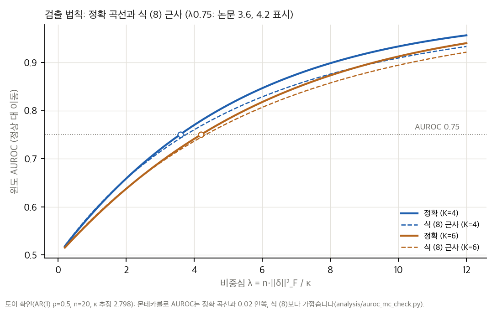
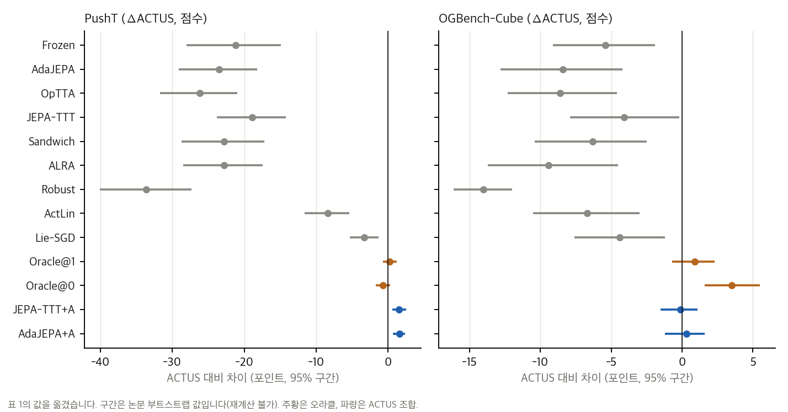
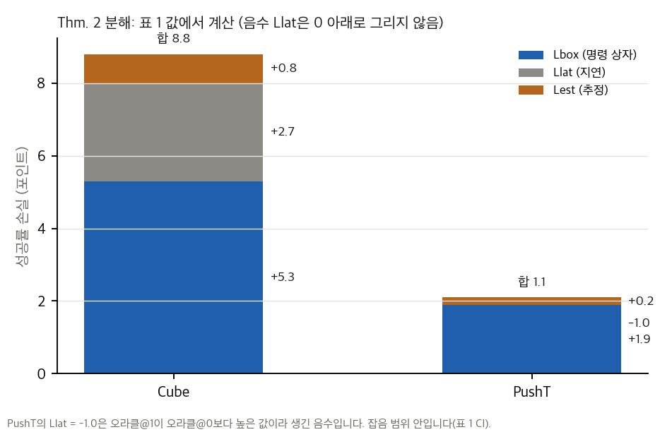

> **논문:** Siqing Li, Luming Yang, Yijia Jiao, Junze Deng, Alper Yilmaz. *How Uncertain Is My Action? Self-Correcting Visual Planning with Frozen World Models.* arXiv:2611.23620 (v1, 2026-11-17). 학회 표기는 없습니다. 공식 코드와 프로젝트 페이지는 찾지 못했습니다. 이 글의 그림은 우리가 그린 그래프입니다. 논문 그림은 쓰지 않았습니다(arXiv 비독점 라이선스).

## 논문이 묻는 것

세계모델로 계획하는 로봇은 명령이 그대로 실행된다고 믿습니다. 축이 조금 어긋나거나 관절이 미끄러지면 명령이 조용히 바뀌어 계획이 목표에서 벗어나지만, 고정된 모델은 이를 알아차릴 방법이 없습니다. 흔한 대응은 예측 오차를 줄이거나 가중치를 다시 맞추는 것입니다. 이 논문은 다른 길을 씁니다. 세계모델을 **거꾸로** 돌려, 가설 θ 아래에서 "관측되었어야 할" 잠재 상태를 예측하고, 실제 관측과의 잔차를 행동 변환의 방향으로 투영합니다.

## 이 글에서 확인한 것

**1. 검출 법칙의 수치는 맞습니다.** 윈도 검출 AUROC가 비중심 χ² 법칙을 따른다는 주장에서, 논문이 쓴 AUROC 0.75의 기준값(λ = 3.6, K=4와 4.2, K=6)은 정확 법칙과 맞습니다. 본문 식 (8)의 근사는 4–5% 크고, 큰 λ에서 AUROC를 0.02–0.03 낮게 예측합니다.

*그래프 (우리가 그림). 실선은 정확 비중심 χ²에서, 점선은 식 (8)에서 계산했습니다. 원은 논문이 쓴 λ0.75입니다.*

**2. 표 1의 산술은 모두 맞습니다.** 14행 전부 성공률 차이가 표의 ∆ 값과 맞습니다. 초록의 0.650 → 0.862(PushT), 0.378 → 0.432(Cube)도 맞습니다. 다만 Cube에서는 명목 대비 손실 14.2점 중 5.4점만 되찾고, 나머지 62%는 남습니다.

*그래프 (우리가 그림). 논문 표 1의 값을 옮겼습니다. 구간은 논문의 부트스트랩 값이며 우리가 다시 계산할 수 없습니다.*

**3. Cube의 손실은 주로 명령 상자 때문입니다.** 정리 2로 나누면 Cube 손실 8.8점은 명령 상자 5.3점, 지연 2.7점, 추정 0.8점입니다. 어떤 보정도 명령 상자 밖의 명령은 되돌리지 못합니다. 이 점은 논문 본문과 맞습니다.

*그래프 (우리가 그림). 표 1 값에서 계산했습니다. PushT의 지연 손실 -1.0은 0 아래로 그리지 않았습니다.*

**4. 본문 안에 맞지 않는 곳이 있습니다.** 
- Cube 회복 시험은 사전 추첨 15개와 3 시드라고 하면서 fleet은 60개입니다(15 × 3 = 45).
- 오라클 행의 명목 성공률이 Frozen과 다릅니다(Cube 0.485 대 0.520). 같은 조건이라면 같아야 합니다.
- 실로봇 실험에서 반복 잡음 기준이 3.2–5.1 mm와 2.0 mm로 두 가지입니다.
- 이 중 어느 것도 결론을 뒤집지는 않지만, 저자에게 확인할 거리입니다.

**5. 많은 주장은 확인할 수 없습니다.** 본문이 인용하는 표 S5–S19와 그림 S6–S14는 수락 뒤 공개된다고 합니다. 재현에 필요한 설정이 여기 있습니다. 그래서 공식 코드가 없는 현재로서는 본문 수치와 내부 일관성까지만 검사할 수 있었습니다.

## 구현할 수 있을까

- **재현은 하지 않았습니다.** 실로봇(SO-101)은 장비가 없고, 세계모델 학습은 CUDA GPU가 필요합니다.
- **구현은 조건부로 가능합니다.** 점수와 가우스-뉴턴 추정은 공개된 LeWM(MIT, PyTorch) 추론 위에 얹을 수 있습니다. 다만 MPS에서 JVP 동작은 확인하지 못했고, 환경과 체크포인트 설치가 먼저 필요합니다. 노력은 1–2주로 추정합니다(측정 전).

## 정리

고정된 세계모델을 거꾸로 읽는다는 발상은 깔끔하고, 검출 법칙의 수학은 맞습니다. 하지만 공식 코드와 보충 자료가 없어서 실험 결과를 독립적으로 확인하기 어렵습니다. 개선 폭은 PushT에서 크고 Cube에서 작습니다.

## 자료

- [통합 리포트 PDF](report/report_public.pdf)
- [01. 논문 분석: How Uncertain Is My Action? (ACTUS)](analysis/01_paper_analysis.md)
- [02. 선행연구와 관련 저장소](analysis/02_prior_work.md)
- [03. 수치 재계산, 일관성 검사, 토이 검증](analysis/03_analysis.md)
- [04. 주장 검증 (공식 코드 없음)](analysis/04_claim_verification.md)
