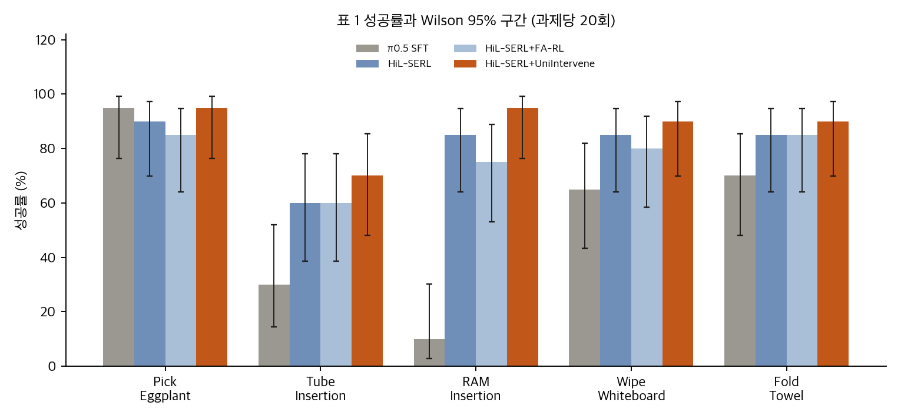
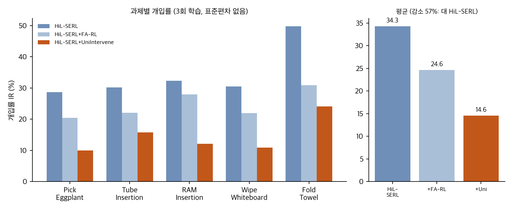
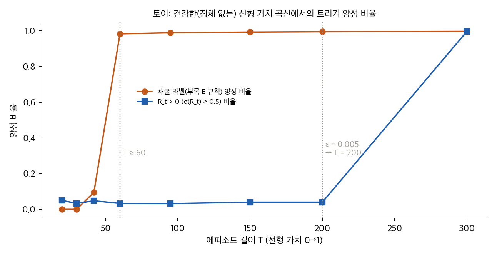

> **논문:** Haoyuan Deng, Yitong Gao, Yudong Lin, Haichao Liu, Zhenyu Wu, Ziwei Wang. *UniIntervene: Agentic Intervention for Efficient Real-World Reinforcement Learning.* CoRL 2026 포스터, arXiv:2606.12372 (v1, 2026-06-10).
> 공식 코드는 GitHub Denghaoyuan123/UniIntervene(MIT, 학습 파이프라인만)에 있습니다. 논문은 arXiv 비독점 배포 라이선스(CC BY 아님)라서 이 글에는 논문 그림을 넣지 않았고, 우리가 그린 그래프만 실었습니다.

## 논문이 묻는 것

사람 개입을 학습에 넣는 실로봇 RL(HiL-RL, 예: HIL-SERL)은 잘 되지만, 사람이 정책을 "진행이 없는 탐색"에서 끌어내는 일을 계속해야 합니다. UniIntervene은 이 일을 학습된 모듈에 맡깁니다.

1. **언제:** 최근 8단계의 가치 변화가 기준 진행률 ε보다 낮게 이어지면(시간 가치 위험, TVR) 정체로 보고 트리거합니다.
2. **어디로:** 과거 개입 구간에서 가치가 크게 오른 구간을 모은 기억에서, 현재 장면과 가장 비슷한 항목을 검색해 목표로 삼습니다.
3. **어떻게:** 목표 조건부 복구 정책이 8단계 행동 덩어리(FAST 토큰)를 냅니다.

가치는 Qwen3-VL-2B가 만든 은닉 상태 하나에서 읽는 머리들과, 성공/실패 라벨로 따로 학습한 프록시 가치 함수가 담당합니다. 실험은 UR7e 한 대, 5과제, 과제당 20회 평가입니다. 학습기 위에 얹는 모듈이라 비교는 "HiL-SERL" 대 "HiL-SERL + UniIntervene"입니다.

## 이 글에서 확인한 것

**1. 성공률 개선은 방향만 확실합니다.** 평균 성공률 88%(UniIntervene) 대 81%(HiL-SERL)는 +7.0 %p이고, 초록의 "8.6%"는 이 차이의 상대 증가율입니다. 100회 대 100회 Fisher p = 0.24, FA-RL(77%)에 대해서는 p = 0.062입니다. 과제별로는 모두 1–2회 차이(p > 0.6)입니다. 7 %p를 80% 검정력으로 구분하려면 팀당 약 416회가 필요합니다. Pick Eggplant에서는 SFT(95%)와 동률이라 "모든 과제에서 최고"는 동률을 포함해 맞습니다.

*그래프 (우리가 그림). 표 1의 성공률(과제당 20회)과 Wilson 95% 구간입니다.*

**2. 개입 감소 57%는 계산이 맞지만 분산이 없습니다.** 평균 개입률 34.3% → 14.6%는 평균의 비로 57.5% 감소입니다(과제별 47.7–65.2%). 개입률은 세 번의 독립 학습 결과라고 하는데 표준편차가 없어 검정하지 못했습니다. 대 FA-RL 차이는 Tube에서 6.3 %p에 불과해, 학습 간 표준편차가 약 2.8 %p만 되어도 구분되지 않습니다. 개입률이 모듈 학습에 쓰인 롤아웃의 사람 개입을 포함하는지도 적혀 있지 않습니다.

*그래프 (우리가 그림). 표 1의 개입률(IR)입니다. 논문에 표준편차가 없습니다.*

**3. 본문과 표가 어긋나는 곳이 있습니다.** §4.4는 "가치 예측을 뺀 변형의 F1 0.845가 가장 낮다"고 쓰지만 표 2의 최저는 TVR을 뺀 변형의 0.832입니다. Fold Towel 기억 후보 수가 표 5(3,574)와 그림 7(3,973)에서 다릅니다. 사례(그림 3)의 가치 곡선은 "매끄럽고 단조롭게 상승한다"는 설명과 달리 RAM Insertion에서 한 단계 만에 약 0.63에서 0.46으로 내려갑니다(그림 판독 값). 절제(표 2)는 40회라서 95% 대 85–90%의 p가 0.26–0.68입니다. 절제 변형의 개입률은 모두 HiL-SERL보다 39–48% 낮아서, 한 구성 요소보다 "자동 복구 경로가 있다"는 사실의 몫이 클 수 있습니다.

**4. 임계값 0.5는 부호 검사입니다.** `R_t`를 회귀 목표로만 쓰면 `σ(R̂) ≥ 0.5`는 `R̂ ≥ 0`, 곧 "창 안의 가치 증가율 평균이 ε = 0.005보다 낮다"는 조건입니다. ε = 0.005는 길이 약 200스텝 에피소드의 진행률입니다. 논문의 두 사례(42, 95스텝)에서는 건강한 진행이 ε의 2–5배라서 R이 음수이고, 가치가 거의 멈출 때만 양수가 됩니다.

## 토이로 본 것: 오프라인 라벨 규칙

학습용 트리거 라벨은 사람 개입이 아니라 프록시 가치 곡선에서 규칙으로 채굴합니다(decline, plateau, abrupt-drop). 부록 E에는 이 규칙의 임계값이 없습니다. 공식 설정값을 읽고 numpy로 다시 구현해, 정체가 **없는** 이상적 선형 가치(부록 C.1의 NTTG 라벨)에 적용했습니다(1초 안팎, 공식 코드는 실행하지 않았습니다).

- 길이 T = 20–30에서는 양성 비율이 0, T = 42에서 0.10입니다.
- T ≥ 60에서는 plateau 규칙(창 안 증분 ≤ 0.03인 비율 ≥ 0.6, 창 진폭 ≤ 0.12)이 **거의 모든 단계(98–99%)**를 양성으로 표시합니다. 7/(T−1) ≤ 0.12가 되는 길이입니다.
- 같은 곡선에서 `R_t > 0`의 비율은 건강한 구간에서 3–5%이고 T = 300에서야 100%가 됩니다.

*그래프 (우리가 그림). 토이입니다. 실제 프록시 가치는 선형이 아니고 잡음이 있어, 실제 데이터에서의 양성 비율은 알 수 없습니다. 논문 표 2의 F1은 Pick Eggplant와 RAM Insertion만 보고하며, 95단계인 Fold Towel의 F1은 없습니다.*

## 공식 코드와 논문의 차이

공식 저장소(커밋 `40f461f`)는 **오프라인 학습 파이프라인만** 있습니다. 로봇 배포, HIL-SERL 통합, 기준선, 평가, 데이터, 체크포인트가 없어 표 1, 2는 코드로 재현할 수 없습니다. 구조와 하이퍼파라미터 대부분(LoRA, 학습률, K, ε, γ_r, τ, 초점 손실, H = 8)은 논문과 맞습니다. 다른 점은 다음과 같습니다.

- **트리거 학습:** 논문 식 6은 위험 값 회귀이고 부록 E는 초점 손실 분류기인데, 코드는 같은 스칼라 하나에 두 손실을 함께 겁니다.
- **프록시 가치 함수:** 논문 식의 단조성 힌지 항이 코드에 없고, "CQL" 항은 이웃 상태의 log-sum-exp가 아니라 `relu(예측 − MC 수익)`입니다. 손실은 Smooth-L1이 아니라 가중 MSE입니다.
- **복구 정책의 학습 목표:** 논문은 실패 상태에서 목표로 이어지는 롤아웃 구간의 행동 복제인데, 코드는 기억에서 검색한 **다른 에피소드의 8스텝 궤적**을 목표로 학습합니다.
- **Fold Towel 기억 설정:** 논문 표 5는 span 16, δ 0.50인데 공식 설정은 span 32, δ 0.40입니다. 저장소 테스트가 이 값을 "paper numbers"라고 부릅니다.
- **검색 규칙:** 논문 식 7은 순수 코사인 최댓값인데 코드는 과제 필터, 같은 에피소드 제외, "목표 가치가 현재보다 높을 것" 조건을 더합니다.

## 구현 가능성 (Apple M4 Pro, CUDA 없음)

- **실로봇 평가: 불가.** UR7e, SpaceMouse와 HIL-SERL 통합 코드가 저장소에 없습니다.
- **공식 학습 파이프라인: 사실상 불가.** 입력 데이터와 체크포인트가 없고 코드가 CUDA를 전제합니다.
- **라벨 규칙과 트리거 로직의 소형 재구현: 가능.** 이 글의 토이가 그 예입니다.
- **MuJoCo 접촉 과제 축소 구현(값 모델, 트리거, 기억 복구, 시뮬 사람 개입): 조건부.** 노력은 2–4주로 추정합니다(측정 전).

이 글은 학습이나 로봇 실험을 하지 않았습니다.

## 한계

- 성공률은 과제당 20회입니다. 개입률은 3회 학습인데 표준편차와 개별 값이 없습니다.
- 개입률의 분모와, 모듈 학습용 롤아웃의 출처 및 사람 개입 비용 포함 여부는 논문과 코드에서 확인하지 못했습니다.
- 토이는 이상적 선형 가치와 공식 설정 임계값을 가정합니다. 실제 프록시 가치에는 적용되지 않을 수 있습니다.
- 그림 3의 값은 눈으로 읽은 근사입니다.

## 출처와 라이선스

- 논문: arXiv:2606.12372. arXiv 라이선스 페이지의 "view license"가 비독점 배포 라이선스(nonexclusive-distrib 1.0)를 가리킵니다(CC BY 아님). 논문 그림은 싣지 않았습니다.
- 학회: CoRL 2026 포스터. corl.org 채택 목록에서 확인했습니다.
- 공식 코드: github.com/Denghaoyuan123/UniIntervene (MIT). 이 글은 코드를 읽기만 했고 실행하거나 설치하지 않았으며 가중치와 데이터는 받지 않았습니다.
- 표 값과 본문 수치는 인용과 재계산을 위해 옮겼습니다. 그래프, 토이, 분석은 이 글의 작성자가 만들었습니다.

## 자료

- [통합 리포트 PDF](report/report_public.pdf)
- [01. 논문 분석: UniIntervene (arXiv:2606.12372)](analysis/01_paper_analysis.md)
- [02. 선행연구와 관련 저장소](analysis/02_prior_work.md)
- [03. 수치 재계산, 일관성 검사, 토이](analysis/03_analysis.md)
- [04. 공식 코드 대조](analysis/04_code_verification.md)
