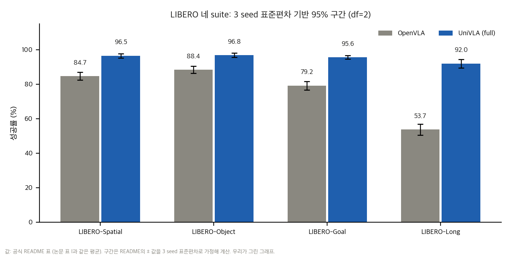
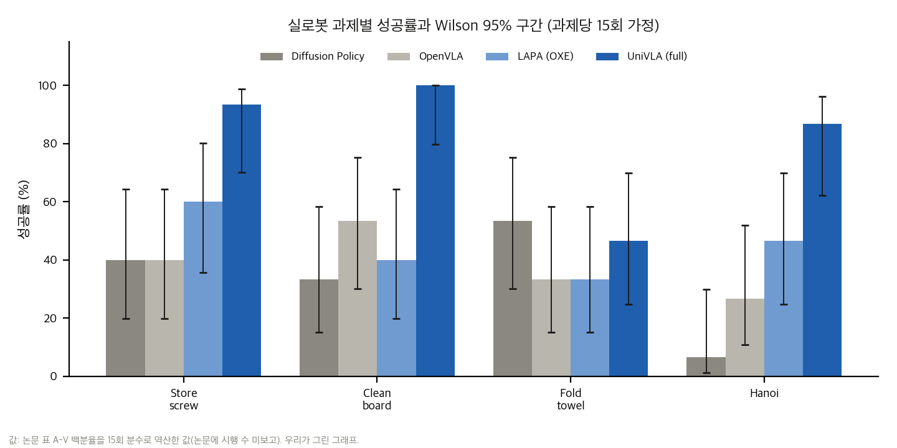

# 03. 수치 재계산, 일관성 검사 (V 라벨)

재현 실험은 하지 않았습니다. 논문 표와 공식 README의 값을 다시 계산하고, 본문과 표가 맞는지 검사했습니다. 계산 스크립트는 `analysis/recompute.py`, 결과는 `analysis/recompute_results.json`입니다. 그래프 두 장은 `analysis/plot_figures.py`로 만듭니다(`report/figures/own_*.png`).

## 0. 요약

- **평균과 표 값은 대부분 맞습니다.** LIBERO 평균 95.2, 실로봇 평균 81.7, CALVIN 평균 길이 3.80, SimplerEnv 과제별 값 등은 모두 재계산과 일치합니다(V1, V4, V6, V7, V8).
- **본문과 표가 어긋난 곳이 다섯 군데입니다.** (V2) 서론 18.5 대 결과 18.7, (V5) 디코더 어블레이션 "2.2"와 "42.1" 대 표의 2.7과 43.0, (V8) SimplerEnv 본문 42.7 대 표 47.9, (V9) 실로봇 표 A-V의 UniVLA(OXE) 평균 63.3 대 재계산 61.65, (V13) 데이터 규모 본문 "2.0%" 대 그림 2.7. 표 I의 MaIL 평균 83.5는 네 suite 값으로 81.2입니다(V1).
- **실로봇 차이는 과제별로 제한적으로만 구분됩니다.** 시행 수가 보고되지 않았고, 분수로 보면 과제당 15회입니다(V9). 전체 합으로 보면 UniVLA는 LAPA, OpenVLA, DP보다 뚜렷이 높습니다(p < 0.001, 과제를 독립으로 본 근사). 그러나 towel 과제는 UniVLA와 DP가 구분되지 않습니다(p = 1.0). 과제별로는 Store와 Hanoi에서 LAPA 대비 차이가 경계선입니다(p = 0.08, 0.05).
- **LIBERO 차이는 크지만, 본문에 있는 "작은 차이" 주장 몇 개는 약합니다.** 이력 입력의 Goal 효과(0.6%p)는 구분되지 않고(p = 0.65), 시각 질의 디코더의 Spatial 효과(1.5%p)도 구분되지 않습니다(p = 0.24). 같은 조건을 3 seed로 반복했는지는 논문에 없어서, 이 검정은 "한 번 실행 500회"를 가정합니다(V10).

## 1. 방법과 가정

| 항목 | 값 | 근거 |
|---|---|---|
| LIBERO 시행 수 | suite당 500 (과제 10 × 50) | 논문 [Sec. IV-A1], README "50 rollouts every task, totalling 500" |
| LIBERO seed 수 | 3 (논문 본문) | 표준편차 ± 값은 README에만 있음 |
| CALVIN 시행 수 | 1000 체인 | [App. B-1] |
| SimplerEnv 시행 수 | 과제당 72 (= 3 seed × 24회) | 성공률이 1/72 격자에 맞음 (2.8% = 2/72, 93.0% = 67/72). 본문 "24 trials" 언급과 맞음 |
| 실로봇 시행 수 | 과제당 15 | 모든 백분율이 k/15 격자 (6.7, 13.3, 20, 26.7, 33.3, 40, 46.7, 53.3, 60, 66.7, 73.3, 80, 86.7, 93.3, 100). **논문에 없음, 역산** |
| R2R 시행 수 | 미보고 (1,839 또는 100) | [Sec. IV-A2] |
| 검정 방법 | 두 비율: Fisher 정확 검정과 z 검정, Wilson 95% 구간, 3 seed는 t 구간 (df = 2) | scipy |

## 2. 표 재계산과 본문 대조 (V1–V8)

### V1. 표 I 평균 (LIBERO)

| 방법 | 네 suite 평균 (재계산) | 보고 평균 | 판정 |
|---|---|---|---|
| LAPA* | 65.7 | 65.7 | 일치 |
| Diffusion Policy | 72.4 | 72.4 | 일치 |
| Octo | 75.1 | 75.1 | 일치 |
| MDT | 76.1 | 76.1 | 일치 |
| OpenVLA | 76.5 | 76.5 | 일치 |
| **MaIL** | **81.2** | **83.5** | **불일치 (2.3%p)** |
| UniVLA Human | 88.75 | 88.7 | 일치 (반올림) |
| UniVLA Bridge | 92.5 | 92.5 | 일치 |
| UniVLA 전체 | 95.2 | 95.2 | 일치 |

- MaIL 값은 본문 "MaIL(83.5%)"에도 나옵니다. 어떤 suite 값이 틀렸을 가능성도 있지만, 논문만으로는 어느 칸인지 알 수 없습니다.

### V2. 본문 주장 (LIBERO)

| 본문 | 재계산 | 판정 |
|---|---|---|
| "OpenVLA보다 18.7%" [Sec. IV-A1] | 18.7 | 일치 |
| "LAPA보다 29.5%" [Sec. IV-A1] | 29.5 | 일치 |
| "OpenVLA보다 12.2%" (Human 88.7 − 76.5) | 12.2 | 일치 |
| "18.5% 상승" [서론, Sec. I] | 18.7 | **불일치 (서론)** |

### V3. 표 II (일반화)

- 세 설정 평균 성공률: UniVLA 68.9, LAPA 28.9, DP 24.4 (재계산 24.47, 반올림하면 24.5), OpenVLA 20.0. 점수 평균: UniVLA 2.49, LAPA 1.36, OpenVLA 0.98, DP 0.69. 모두 맞습니다(DP 성공률 0.07%p 차이는 반올림 표기).
- "Novel object에서 성공률 6.6%p 감소"(본문): 표 II에 원래 설정 값이 없습니다. 본문이 기준으로 삼은 값(93.3, 표 A-V의 Store 과제 UniVLA)과 맞지만, 다른 설정의 기준이 아닙니다. 판정: **기준 불명확**.

### V4. 표 III (잠재 행동 종류)

- Genie 82.3, 과제 무관 56.5, 과제 중심 88.7 (모두 일치).
- 본문 "6.4%p, Goal 13%p, Long 9.8%p" (모두 일치).

### V5. 표 IV (디코더)

| 항목 | 재계산 | 본문 | 판정 |
|---|---|---|---|
| 평균: 자동회귀 / w/o visual / 전체 | 73.6 / 92.5 / 95.2 | 같음 | 일치 |
| 전체 − w/o visual (평균) | **2.7** | "시각 임베딩으로 2.2%p" [Sec. IV-C] | **불일치** |
| 전체 − 자동회귀 (Long) | **43.0** | "Long 42.1%p" [Sec. IV-C] | **불일치** |

### V6. 표 V (이력)

- 지시문만 대 이력: Long 88.1 → 92.0 (3.9%p), R2R 30.6 → 47.1 (16.5%p). 본문과 일치합니다.

### V7. 표 A-II (CALVIN)

- 모든 방법의 평균 길이가 연속 성공률 합과 일치합니다(예: UniVLA 380.1/100 = 3.80). 본문 "CLOVER 대비 11.1%p, OpenVLA 대비 13%p" 일치.

### V8. 표 A-III (SimplerEnv)

| 방법 | 과제 네 개 성공률 평균 (재계산) | 표 전체 평균 | 판정 |
|---|---|---|---|
| RT-1-X | 1.05 | 1.1 | 일치 |
| Octo-Base | 15.98 | 16.0 | 일치 |
| **Octo-Small** | **29.5** | **30.0** | **불일치 (0.5%p)** |
| OpenVLA | 1.03 | 1.0 | 일치 |
| RoboVLM | 31.25 | 31.3 | 일치 |
| **UniVLA (전체)** | **47.95** | **47.9** | 일치 (표) |

- 본문 "UniVLA 42.7%", "OpenVLA보다 41.7%p, Octo-Base보다 26.7%p"는 모두 42.7 기준입니다. 표 기준으로는 46.9와 31.9가 맞습니다. **본문 불일치.** README 표는 47.9로 표 A-III와 같습니다. v2에서 본문과 표가 모두 42.7이었고(v2 텍스트 대조), v3에서 표만 고쳐졌습니다(`01` §1).
- 공식 README는 이 표에 대해 "입력 처리 버그를 고쳐 원 논문보다 높아졌다"고 밝힙니다. 따라서 42.7이 원래 수치이고 47.9가 수정 후 수치일 수 있습니다. 어느 쪽이 맞는지는 저자 확인이 필요합니다(`04` D1).
- 과제별 UniVLA 성공률(52.8, 55.6, 2.8, 80.6)은 "Stack green block" 과제에서 2.8%로 매우 낮습니다. 평균이 높은 것은 나머지 세 과제 덕입니다. 본문은 이 과제를 언급하지 않습니다.
- 표 전체 값으로 본 차이의 크기: UniVLA 대 RoboVLM, 대 Octo-Small은 288회 가정에서 p < 0.001 (V8b). 과제 네 개를 독립으로 본 근사입니다.

## 3. 실로봇 (V9)

### 3.1 표 A-V 평균

| 방법 | 재계산 성공 평균 | 보고 | 판정 |
|---|---|---|---|
| DP | 33.3 | 33.3 | 일치 |
| OpenVLA | 38.3 | 38.3 | 일치 |
| LAPA (OXE) | 45.0 | 45.0 | 일치 |
| UniVLA (Bridge) | 55.0 | 55.0 | 일치 |
| **UniVLA (OXE)** | **61.65** | **63.3** | **불일치 (1.65%p)** |
| UniVLA (전체) | 81.7 | 81.7 | 일치 |

- 표 A-V의 UniVLA (OXE) 행은 성공률 평균과 점수가 서로 다르게 움직입니다(점수 2.35는 맞음). 과제 수준 값을 몇 개 잘못 옮겼을 가능성이 있습니다.

### 3.2 시행 수 15 가정의 검정

| 비교 (60회 합산) | UniVLA 성공 | 상대 성공 | Fisher p (근사) |
|---|---|---|---|
| UniVLA(전체) 대 LAPA(OXE) | 49/60 (81.7%, 95% Wilson 70.1–89.4) | 27/60 (45.0%, 33.1–57.5) | 5e-5 |
| UniVLA(전체) 대 OpenVLA | 49/60 | 23/60 (38.3%) | 2e-6 |
| UniVLA(전체) 대 DP | 49/60 | 20/60 (33.3%) | 1e-7 |

과제별 Fisher (15회 대 15회, 근사):

| 과제 | 대 LAPA | 대 DP | 대 OpenVLA |
|---|---|---|---|
| Store the screwdriver (14 대 6, 9, 6) | 0.08 | 0.005 | 0.005 |
| Clean the cutting board (15 대 6, 5, 8) | 0.001 | <0.001 | 0.006 |
| Fold towel twice (7 대 5, 8, 5) | 0.71 | 1.00 | 0.71 |
| Stack hanoi (13 대 7, 1, 4) | 0.05 | <0.001 | 0.003 |

- 합산 검정은 과제를 독립으로 보며, 과제별 시행 수가 같다고 가정합니다. 과제별 검정도 다중 비교 보정을 하지 않았습니다(Holm 보정 시 Store 대 LAPA와 Hanoi 대 LAPA는 유의하지 않을 수 있습니다).
- 점수 차이(2.63 대 1.95 등)는 검정하지 않았습니다. 점수는 과제당 3점 척도이고 각 점수의 분포를 모르기 때문입니다.
- 과제에서 시행 수 15는 그림에서 본 값과 일치하지만, 논문이 확인해 주기 전까지 가정입니다.

## 4. LIBERO 통계 (V10)

### 4.1 구간 추정

| suite | UniVLA 전체: Wilson (n = 500) | UniVLA 전체: t 구간 (3 seed, README ±) | OpenVLA: t 구간 (3 seed, README ±) |
|---|---|---|---|
| Spatial | 96.5 [94.4, 97.7] | 96.5 [95.3, 97.7] | 84.7 [82.5, 86.9] |
| Object | 96.8 [94.9, 98.0] | 96.8 [95.6, 98.0] | 88.4 [86.4, 90.4] |
| Goal | 95.6 [93.4, 97.1] | 95.6 [94.6, 96.6] | 79.2 [76.7, 81.7] |
| Long | 92.0 [89.3, 94.1] | 92.0 [89.5, 94.5] | 53.7 [50.5, 56.9] |

- 3 seed 구간이 Wilson 구간보다 좁은 이유: 3 seed의 표준편차(0.4–1.0)는 시행 샘플링 오차보다 작습니다. 하지만 seed 3개로 표준편차를 추정하면 자유도가 2뿐이라 신뢰도가 낮습니다.
- UniVLA 대 OpenVLA(Spatial)의 Welch 검정: t = 19.9, p = 2e-4 (3 seed 기준).

### 4.2 쌍 비교 (z 검정, n = 500 한 번 실행 가정)

| 비교 | 차이 (%p) | z | p | 판정 |
|---|---|---|---|---|
| 전체 대 OpenVLA (Goal) | 16.4 | 7.8 | <1e-14 | 큼 |
| 전체 대 OpenVLA (Long) | 38.3 | 13.6 | ~0 | 큼 |
| **전체 대 w/o visual (Long)** | 6.0 | 3.03 | 0.002 | 유의 |
| 전체 대 w/o visual (Spatial) | 1.5 | 1.18 | 0.24 | **구분 안 됨** |
| 전체 대 자동회귀 (Long) | 43.0 | 14.9 | ~0 | 큼 |
| **이력 대 지시문만 (Long)** | 3.9 | 2.06 | 0.039 | 경계선 |
| **이력 대 지시문만 (Goal)** | 0.6 | 0.45 | 0.65 | **구분 안 됨** |
| 과제 중심 대 Genie (Goal) | 13.0 | 5.56 | 3e-8 | 큼 |
| 과제 중심 대 Genie (Long) | 9.8 | 3.56 | 0.0004 | 유의 |

- 주의: 이 검정은 **한 번 실행 500회 가정**입니다. 논문은 3 seed 평균이라 실제 분산은 더 클 수 있습니다. 각 세팅의 seed 값이 없으므로 이 결과는 참고용입니다.
- 표 III와 IV는 같은 LIBERO 설정이지만 사전학습 데이터가 다르므로(표 III는 Ego4D만, 표 IV는 전체) 서로 직접 비교하지 않습니다.

## 5. 데이터 규모와 그림 (V13)

- 그림 9의 LIBERO 값(92.5, 94.2, 95.2)과 표 I의 Bridge, 전체 값은 일치합니다. 그러나 본문의 "OpenX와 Ego4D를 더하면 평균이 2.0%p 오른다"는 Bridge에서 전체로 가는 상승(2.7%p)과 맞지 않습니다. OpenX만 더한 상승(1.7%p)과도 맞지 않습니다. **불일치.**
- 그림 9의 실로봇 점수 2.64(전체)는 표 A-V의 2.63과 0.01 차이입니다. 반올림 수준입니다.
- 그림 9의 R2R 값(약 30, 38, 44, 49)은 PDF 텍스트에서 읽은 값이며, 본문의 47.1과 어느 점이 대응하는지 확실하지 않습니다(판독 불확실).

## 6. 사전학습 데이터 혼합 (V11)

- 표 A-I의 비율과 공식 설정 `omni_magic_soup_plus_plus`의 가중치를 비교했습니다. 가중치를 정규화하면 Fractal 1.2%(표 A-I는 13.9%), Ego4D 4개 분할 합 10.0%(표 A-I는 3.0%), GNM 3개 합 14.9%(표 A-I 14.7%)입니다.
- 공식 코드의 `balance_weights` 옵션이 켜지면 샘플링 확률은 가중치에 데이터셋 크기를 곱한 값이 됩니다(`prismatic/vla/datasets/rlds/dataset.py` 558행). 표 A-I가 이 방식인지, 프레임 수 기준인지 논문만으로는 알 수 없습니다.
- 판정: **재계산 불가.** 데이터셋 크기와 `balance_weights` 설정을 알아야 합니다(`04` D10).

## 7. 디코더 파라미터 수 (V12)

- 공식 코드의 `ActionDecoder`(`vla-scripts/finetune_libero.py` 40–55행)는 MAP 풀링 두 개(시각, 잠재 행동, 각각 `vis_dim` 4096 → 512, 헤드 8, SwiGLU MLP 비율 4)와 `512 → 7 × 12` 투영으로 구성됩니다.
- 파라미터 수를 층 정의에서 직접 계산하면 **12,640,340 (12.64M)**입니다. 풀링 블록 하나는 6,298,624입니다. 본문과 표 A-VI의 12.6M과 맞고, 서론의 10.8M과는 맞지 않습니다.
- 이 계산은 `MAPBlock`(`prismatic/models/policy/transformer_utils.py` 84–130행)과 `SwishGLU` 정의를 기준으로 한 **정적 계산**입니다. 설치나 실행은 하지 않았습니다.

## 8. 이 분석에서 하지 않은 것

- **토이 실험은 만들지 않았습니다.** 논문의 중심 주장(과제 중심 잠재 행동이 전이를 높인다)은 대규모 사전학습과 시뮬레이터 평가가 필요합니다. 작은 토이로 확인할 수 있는 것은 "정의를 바꾸면 잠재 행동이 달라진다"는 당연한 결과뿐이어서 판단에 도움이 적다고 보았습니다.
- **재학습과 재평가는 하지 않았습니다.** 실행 가능성은 `04` §4와 
- **Fig. 8과 Fig. A-2의 정성 결과는 계량하지 않았습니다.** 프레임 쌍 선택 기준이 공개되지 않아서입니다.

## 9. 그래프 (우리가 그린 것)

그림 1: 공식 README의 평균과 ± 값으로 그린 그래프입니다. 구간은 3 seed 표준편차를 t 분포(df = 2)로 계산했습니다.

그림 2: 표 A-V의 백분율을 15회 분수로 역산해 그린 그래프입니다. 구간이 넓어서 과제별 차이는 대부분 구분되지 않습니다. Fold 과제에서 UniVLA와 나머지 방법의 차이가 특히 그렇습니다.
