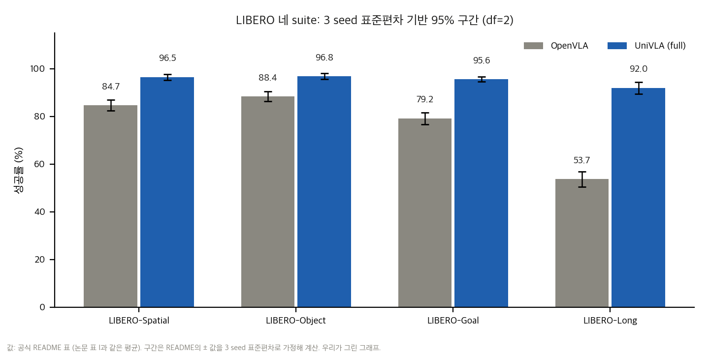
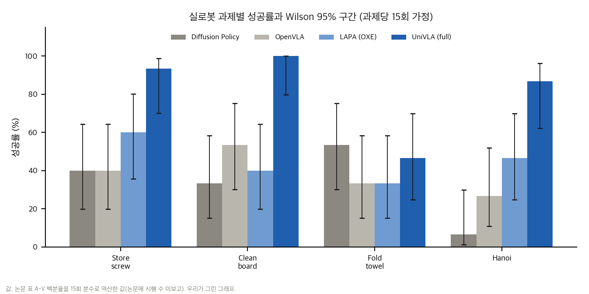

> **논문:** Qingwen Bu, Yanting Yang, Jisong Cai, Shenyuan Gao, Guanghui Ren, Maoqing Yao, Ping Luo, Hongyang Li. *UniVLA: Learning to Act Anywhere with Task-centric Latent Actions.* RSS 2025, arXiv:2505.06111 (v3, 2025-11-03).
> 공식 코드(Apache-2.0, OpenDriveLab/UniVLA)는 정적으로만 읽었고 실행하지 않았습니다. 논문 그림은 싣지 않고, 우리가 그린 그래프 두 장만 씁니다.

## 논문이 묻는 것

로봇 정책을 학습하려면 보통 행동 라벨이 필요합니다. 그러나 인터넷에 있는 로봇 영상과 사람 영상에는 행동 라벨이 없습니다. UniVLA는 이 영상들에서 **잠재 행동**을 뽑아 VLA의 어휘로 쓰자고 합니다. 핵심은 잠재 행동이 과제와 관계없는 움직임(다른 사람의 움직임, 카메라 흔들림)을 담지 않도록 나누는 것입니다.

방법은 세 단계입니다. 첫 단계는 DINOv2 패치 특징에서 언어 지시문을 조건으로 하여 과제 무관 코드북을 만들고, 둘째 단계는 그 코드북을 고정한 채 과제 중심 코드북을 새로 배웁니다. 정책은 Prismatic-7B 기반이고, 과제 중심 잠재 토큰 네 개를 다음 토큰으로 예측합니다. 잠재 행동은 작은 디코더(12.6M)로 행동 청크로 바뀝니다.

## 결과와 재계산

그림 1: 공식 README의 평균과 ± 값으로 그렸습니다. 구간은 3 seed 표준편차를 t 분포(자유도 2)로 계산한 값입니다.

LIBERO 네 suite의 평균 95.2%는 표 값에서 다시 계산해도 맞습니다. OpenVLA보다 18.7%p 높습니다. 다만 서론은 18.5%p라고 씁니다. 표 I에서 MaIL의 평균 83.5%는 네 suite 값으로 계산하면 81.2%입니다. 이 값들은 본문에도 나옵니다.

그림 2: 실로봇 결과를 과제당 15회 시행으로 가정하고 그렸습니다. 논문은 시행 수를 밝히지 않았습니다. 이 가정으로 합산하면 UniVLA(81.7%)는 LAPA(45.0%), OpenVLA(38.3%), Diffusion Policy(33.3%)보다 뚜렷이 높습니다. 그러나 과제별로는 차이가 작거나 구분되지 않습니다. 예를 들어 towel 접기 과제에서 Diffusion Policy는 8/15, UniVLA는 7/15입니다.

## 본문과 표가 어긋난 곳

- **SimplerEnv 전체 평균:** 표 A-III는 UniVLA 47.9%, 본문은 42.7%입니다. 공식 README는 입력 처리 버그를 고쳐 결과가 원 논문보다 높아졌다고 밝혀서, 어느 값이 최종인지 확인이 필요합니다.
- **디코더 어블레이션:** 본문은 시각 질의로 2.2%p, Long에서 자동회귀 대비 42.1%p 개선이라고 쓰지만, 표 IV의 차이는 2.7%p와 43.0%p입니다.
- **데이터 규모:** 본문의 "2.0%p 추가 상승"은 Bridge에서 전체 데이터로 가는 상승(2.7%p)과 맞지 않습니다.
- **디코더 파라미터:** 서론은 10.8M, 본문과 표 A-VI는 12.6M입니다. 공식 코드의 구조를 계산하면 12.64M이라 본문 값이 맞습니다.

## 공식 코드와 논문의 차이

- 잠재 행동 모델은 DINOv2 ViT-B/14(레지스터 포함), T5-base 지시문, 코드북 16, 토큰 4를 씁니다. 논문과 맞습니다.
- 1단계 디코더는 논문 본문에 "과거 프레임을 받지 않는다"고 쓰여 있지만, 식과 코드 모두 현재 프레임 `O_t`를 입력으로 씁니다.
- 평가 코드는 청크 12의 예측을 지수 가중치로 시간 앙상블합니다. 논문에는 이 내용이 없습니다.
- 사전학습 데이터 혼합(표 A-I)은 공식 설정의 가중치와 맞지 않습니다. 샘플링 방식(데이터셋 크기 곱)에 따라 달라지므로 직접 비교할 수 없습니다.
- 미세조정 학습률(3.5e-4)과 LoRA alpha 규칙은 논문에 없습니다.

## 구현할 수 있는가

이 맥(Apple M4 Pro, 24 GiB, CUDA 없음)에서 논문 수치를 재현하는 것은 불가능합니다. 사전학습은 32 A100에 960 A100-hours가 들었고, 미세조정은 8 GPU가 필요합니다. 공식 코드는 flash-attn과 CUDA를 전제로 합니다. 공개 체크포인트로 LIBERO 몇 과제를 추론해 보는 것은 조건부로 가능합니다. 모델 다운로드와 MPS 포팅이 필요하고, 속도는 측정하지 않았습니다.

## 정리

UniVLA는 라벨 없는 영상으로 잠재 행동을 배우는 흐름에서 설계 선택을 잘 정리한 논문입니다. 다만 본문 수치의 불일치와 실로봇 시행 수 누락 때문에, 표 값을 그대로 믿기보다는 정의 실험(과제 중심 대 과제 무관)의 구조를 참고하는 편이 안전합니다. 저자에게 확인할 질문은 SimplerEnv 최종 수치, 1단계 디코더 입력, 청크 앙상블, seed 원자료, 실로봇 시행 수입니다.

## 자료

- [통합 리포트 PDF](report/report_public.pdf)
- [01. 논문 분석: UniVLA (arXiv:2505.06111)](analysis/01_paper_analysis.md)
- [02. 선행연구 계보, 가까운 대안, GitHub와 자료](analysis/02_prior_work.md)
- [03. 수치 재계산, 일관성 검사 (V 라벨)](analysis/03_analysis.md)
- [04. 논문 ↔ 공식 코드 정적 대조와 구현 가능성](analysis/04_code_verification.md)
