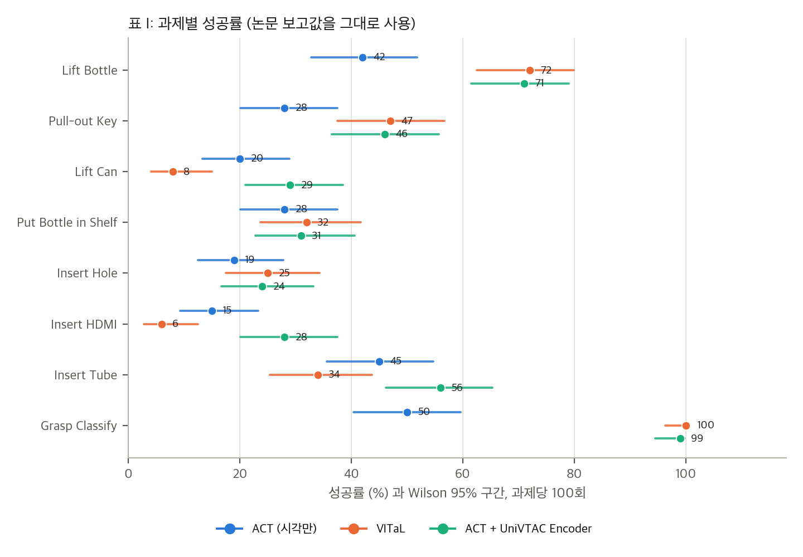
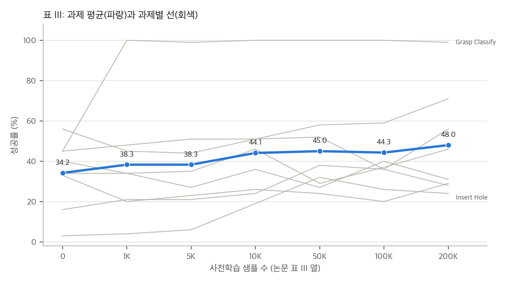
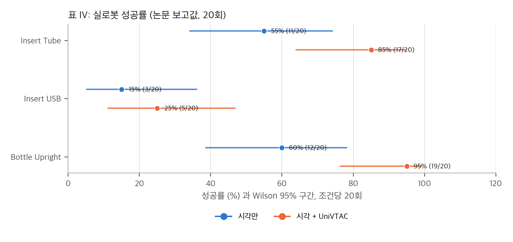

# 03. 수치 재계산과 검정

`analysis/recompute.py`가 논문 표의 보고값을 옮겨 적고 다시 계산합니다. 결과는 `analysis/recompute_results.json`에 있습니다 (numpy, scipy, 수 초). 시행 수는 논문이 밝힌 값을 씁니다: 표 I–III는 과제당 100회, 표 IV는 조건당 20회. 모든 셀이 정수 횟수로 떨어지는지 먼저 확인했습니다.

**검정의 한계.** 논문은 학습 시드를 몇 번 돌렸는지 보고하지 않습니다. 아래 구간과 p값은 **롤아웃 표집 변동만** 반영합니다. 학습 실행 사이의 변동은 빠져 있어서, 실제 차이의 불확실성은 여기서 보는 것보다 큽니다. 과제별 비교는 Fisher 정확 검정과 Holm 보정을, 차이 구간은 Newcombe 방식을 씁니다. 표 I의 두 방식 쌍체 자료는 없으므로 독립 표본으로 봅니다.

## 1. 확인 결과 요약

| 번호 | 확인 내용 | 결과 |
|---|---|---|
| V1 | 표 I 평균 재계산 | 일치. ACT 30.875 (보고 30.9), VITaL 40.5, Ours 48.0 |
| V2 | 표 II 평균 재계산 | 일치. Scratch 34.0, Contact 41.875 (41.9), Shape 41.625 (41.6), C+S 43.875 (43.9), Full 48.0 |
| V3 | 표끼리 같은 값 | 표 II의 Full = 표 I의 Ours, 표 III의 200K = 표 I의 Ours, 표 III의 0 = 표 II의 Scratch. 모두 일치 |
| V4 | 과제별 Ours 대 ACT | 차이 큰 과제 두 개만 Holm 후 유의 (Lift Bottle +29 pp, Grasp Classify +49 pp). 나머지는 보정 후 비유의 |
| V5 | 과제 평균 Ours 대 ACT | +17.1 pp, 95% 구간 12.8–21.4, z = 7.8. Grasp Classify를 빼면 +12.6 pp |
| V6 | 과제 평균 Ours 대 VITaL, 과제별 | +7.5 pp, 구간 3.5–11.5, p = 0.0003. 과제 여덟 개 중 다섯은 차이가 ±1 pp 안 |
| V7 | 표 II 절제 | Full 대 Scratch +14.0 pp, C+S 대 Scratch +9.9, Contact +7.9, Shape +7.6. **Full 대 C+S는 +4.1 pp, 구간 −0.1–8.3, p = 0.053** |
| V8 | 표 III 단조성 | 과제 평균은 단조 증가가 아닙니다. 1K와 5K가 같고 (38.25 = 38.25), 100K가 50K보다 낮습니다 (44.25 < 45.0) |
| V9 | 표 III 추세 | 1K–200K 여섯 점에서 평균과 log(샘플 수)의 Spearman ρ = 0.93 (p = 0.008). 과제별로 0 대 200K가 확실한 것은 Insert Hole과 Grasp Classify뿐 |
| V10 | 표 III 0열 평균 | **보고 34.2, 재계산 34.0.** 표 II의 Scratch 평균과 같은 값이어야 합니다. 1K, 5K, 100K의 0.05 반올림 차이는 그림 4 라벨과 어긋나지만 무시할 수준입니다 |
| V11 | 표 IV 실로봇 | 과제별 차이는 모두 Holm 후 비유의. 과제 평균 +25 pp, 구간 10.6–39.4. 60 대 60 합산 26/60 대 41/60, Fisher p = 0.010 |
| V12 | 데이터 규모 산술 | 14개 형상 × 14,000 프레임 = 196,000. 논문의 205,826 샘플과 5% 차이. "프레임"과 "샘플"의 정의가 없어서 확정할 수 없음 |
| V14 | 검출력 | 과제 하나(n = 100)는 p ≈ 0.5에서 약 20 pp 차이를 80% 검출력으로 봅니다. 과제 평균(여덟 과제)은 약 7 pp입니다. 시드 변동을 넣으면 더 큽니다 |

## 2. 표 I: 벤치마크 (과제별 Wilson 구간, 과제별 검정)

| 과제 | ACT | VITaL | Ours | Ours − ACT (95% 구간, pp) | p (Holm, ACT) | Ours − VITaL (95% 구간, pp) | p (Holm, VITaL) |
|---|---|---|---|---|---|---|---|
| Lift Bottle | 42 | 72 | 71 | +29.0 (15.3, 41.2) | 0.0004 | −1.0 (−13.4, 11.4) | 1.00 |
| Pull-out Key | 28 | 47 | 46 | +18.0 (4.6, 30.5) | 0.075 | −1.0 (−14.5, 12.6) | 1.00 |
| Lift Can | 20 | 8 | 29 | +9.0 (−2.9, 20.6) | 0.63 | +21.0 (10.4, 31.3) | 0.0014 |
| Put Bottle in Shelf | 28 | 32 | 31 | +3.0 (−9.6, 15.4) | 0.98 | −1.0 (−13.7, 11.7) | 1.00 |
| Insert Hole | 19 | 25 | 24 | +5.0 (−6.4, 16.3) | 0.98 | −1.0 (−12.8, 10.9) | 1.00 |
| Insert HDMI | 15 | 6 | 28 | +13.0 (1.6, 24.1) | 0.19 | +22.0 (11.8, 32.0) | 0.0004 |
| Insert Tube | 45 | 34 | 56 | +11.0 (−2.8, 24.2) | 0.63 | +22.0 (8.2, 34.6) | 0.016 |
| Grasp Classify | 50 | 100 | 99 | +49.0 (38.4, 58.7) | 1e−16 | −1.0 (−5.4, 2.8) | 1.00 |
| **평균** | **30.9** | **40.5** | **48.0** | **+17.1 (12.8, 21.4)** | — | **+7.5 (3.5, 11.5)** | — |

- 과제 평균 차이의 p는 과제별 이항 분산을 더한 Wald 검정입니다 (V5, V6). 평균 자체는 과제마다 같은 가중치를 준 값입니다.
- 참고로 800회를 한데 모은 카이제곱 검정은 Ours 대 ACT에서 p = 2e−12입니다. 과제 차이를 무시하므로 과장된 값입니다. 보고할 때는 과제 층화 방식을 씁니다.
- VITaL은 Grasp Classify에서 100%입니다. 이 과제는 VITaL의 강점이고, 우리 방식은 그와 비슷합니다.

그래프: 표 I의 과제별 성공률과 Wilson 95% 구간(과제당 100회). 논문 보고값을 우리가 다시 그렸습니다.

## 3. 표 II: 경로 절제

| 비교 | 차이 (pp) | 95% 구간 | p |
|---|---|---|---|
| Contact 대 Scratch | +7.9 | 3.6–12.1 | 0.0003 |
| Shape 대 Scratch | +7.6 | 3.3–11.9 | 0.0005 |
| Contact+Shape 대 Scratch | +9.9 | 5.6–14.1 | 5e−6 |
| Full 대 Scratch | +14.0 | 9.7–18.3 | 2e−10 |
| **Full 대 Contact+Shape** | **+4.1** | **−0.1–8.3** | **0.053** |

- 경로를 하나씩 더하면 효과는 확실합니다. 그러나 **pose 경로를 더한 효과(Full 대 C+S)는 경계선입니다.** 과제별로 봐도 보정 후 비유의입니다 (Pull-out Key가 가장 큼, +18 pp, Holm p = 0.10).
- 본문은 "Lift Bottle에서 pose 경로가 특히 중요하다"고 씁니다. 과제 한 개에서 +9 pp이고 원시 p = 0.23입니다. 이 해석은 약합니다.

## 4. 표 III: 데이터 규모

| 과제 | 0 | 1K | 5K | 10K | 50K | 100K | 200K | 0 대 200K (Holm p) |
|---|---|---|---|---|---|---|---|---|
| Lift Bottle | 56 | 45 | 44 | 51 | 58 | 59 | 71 | 0.24 |
| Pull-out Key | 40 | 34 | 35 | 46 | 29 | 37 | 46 | 1.00 |
| Lift Can | 33 | 20 | 23 | 26 | 24 | 20 | 29 | 1.00 |
| Put Bottle in Shelf | 34 | 34 | 27 | 36 | 27 | 40 | 31 | 1.00 |
| Insert Hole | 3 | 4 | 6 | 19 | 32 | 26 | 24 | 1e−4 |
| Insert HDMI | 16 | 21 | 21 | 24 | 38 | 36 | 28 | 0.30 |
| Insert Tube | 45 | 48 | 51 | 51 | 52 | 36 | 56 | 0.63 |
| Grasp Classify | 45 | 100 | 99 | 100 | 100 | 100 | 99 | 5e−19 |
| 평균 (재계산) | 34.0 | 38.25 | 38.25 | 44.13 | 45.0 | 44.25 | 48.0 | — |
| 평균 (표 III 보고) | **34.2** | 38.3 | 38.3 | 44.1 | 45.0 | 44.3 | 48.0 | — |

- **V8.** 과제 평균은 1K→5K에서 증가하지 않고, 50K→100K에서 줄어듭니다. 과제별로 감소 구간은 여섯 전이 중 1–3회입니다. 본문의 "단조롭게 증가한다"는 말은 평균의 전체 추세(V9)에만 맞고, 점마다 보면 맞지 않습니다.
- **V9.** 여섯 점에서 Spearman ρ = 0.93입니다. 전체적인 증가 추세는 있습니다. 하지만 샘플 수가 늘 때 학습 스텝 수도 같이 늘어나는 설계입니다(04 D5). 그래서 이 곡선이 "데이터 양" 효과인지 "학습량" 효과인지 분리되지 않습니다.
- **V10.** 0열 평균이 보고값(34.2)과 재계산값(34.0)이 다릅니다. 표 II의 Scratch 평균은 34.0이고 과제별 값도 0열과 같습니다. 0.2 pp 차이는 작지만, 표 간 일관성 문제입니다.

그래프: 표 III 과제 평균(파랑, 보고값)과 과제별 선(회색). 샘플 수 축은 논문의 열 간격을 그대로 썼습니다.

## 5. 표 IV: 실로봇 (조건당 20회)

| 과제 | 시각만 | 시각 + UniVTAC | 차이 (pp) | 95% 구간 | p (Fisher) | p (Holm) |
|---|---|---|---|---|---|---|
| Insert Tube | 11/20 (55%) | 17/20 (85%) | +30 | 1.5–53.0 | 0.082 | 0.16 |
| Insert USB | 3/20 (15%) | 5/20 (25%) | +10 | −15.2–34.0 | 0.69 | 0.69 |
| Bottle Upright | 12/20 (60%) | 19/20 (95%) | +35 | 9.0–56.7 | 0.020 | 0.059 |
| **과제 평균** | **43.3%** | **68.3%** | **+25** | **10.6–39.4** | z = 3.39 (p = 0.0007) | — |

- 합산 26/60 대 41/60은 Fisher p = 0.010입니다. 과제 세 개를 한데 모은 값이라 과제별 차이가 보정 후 비유의인 점을 가리는 면이 있습니다.
- V11: 실로봇 결과는 "방향이 맞고 크기는 크다"까지만 말할 수 있습니다. 조건당 20회로는 Insert USB나 Insert Tube의 크기를 확정할 수 없습니다.

그래프: 표 IV의 실로봇 성공률과 Wilson 95% 구간(조건당 20회). 우리가 논문 보고값으로 그렸습니다.

## 6. 해석에 미치는 영향

1. 벤치마크 평균 우위(+17.1 pp)는 과제별로 보면 **두 과제(Lift Bottle, Grasp Classify)에 몰려 있습니다.** Grasp Classify 하나가 평균 차이의 약 36%입니다. 일반적인 "촉각이 낫다"의 근거로는 약합니다.
2. VITaL 대비 우위(+7.5 pp)는 세 과제(Lift Can, Insert HDMI, Insert Tube)에서만 보정 후 유의합니다. 나머지 다섯 과제는 같은 수준입니다.
3. 절제 표에서 Full의 추가 효과(pose 경로)는 경계선입니다. 본문 결론의 "joint optimization of the full pipeline yields superior performance"는 이 차이에 기대고 있습니다.
4. 데이터 규모 곡선은 전체 추세가 있지만, 샘플 수와 학습 스텝의 혼동이 있어서 해석을 제한해야 합니다.

## 7. 재현 가능성 측면의 메모

- 논문의 통계 보고는 점 추정뿐입니다. 구간, 검정, 시드 수가 없습니다. 이 분석은 롤아웃 표집만 반영한 최소 구간을 제시합니다.
- 과제 여덟 개 모두 같은 방식으로 100회입니다. 과제별 n이 같아서 과제 평균의 가중치가 고르고, 검정 방식은 단순합니다.
- 공개 코드의 평가 루프는 "전문가가 성공시키는 시드만 쓰기"와 "예외 난 롤아웃을 세지 않고 다시 뽑기"를 포함합니다(04 D8). 이 선택이 보고 수치에 얼마나 영향을 주는지는 이 분석에서 측정하지 않았습니다.
