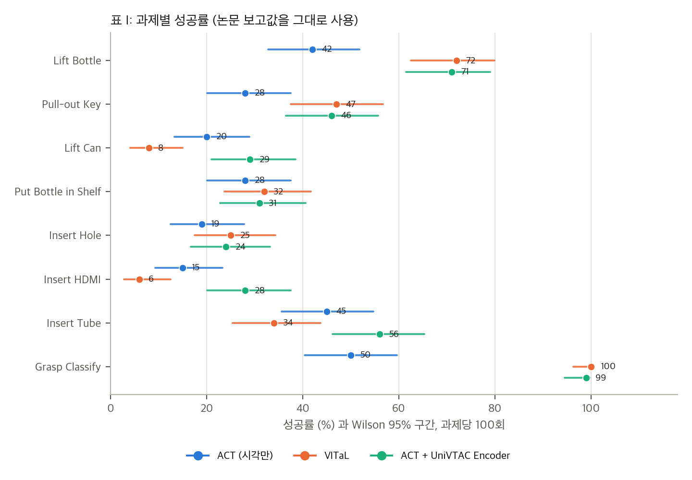
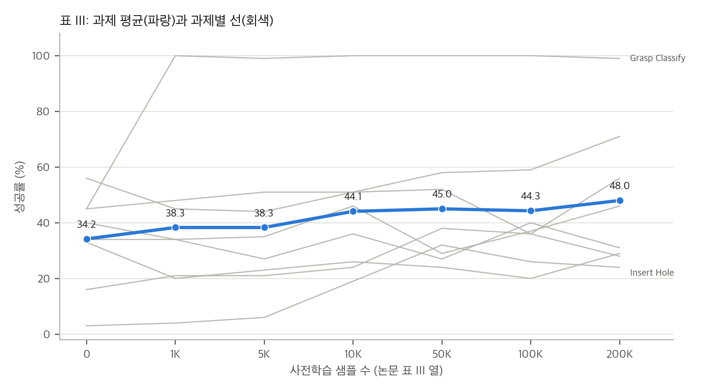
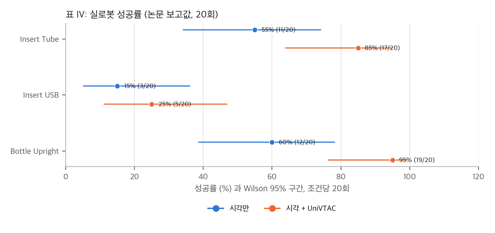

> **논문:** Baijun Chen, Weijie Wan, Tianxing Chen, 외. *UniVTAC: A Unified Simulation Platform for Visuo-Tactile Manipulation Data Generation, Learning, and Benchmarking.* arXiv:2602.10093 (v1, 2026-02-10). CoRL 2026 포스터로 공식 채택 목록에서 확인했습니다.
> 공식 코드는 GitHub `univtac/UniVTAC`에 있습니다. 이 글의 그래프는 논문 표의 보고값을 우리가 다시 그린 것입니다. 논문 그림은 넣지 않았습니다 (arXiv 비독점 배포 라이선스).

---

## 한눈에

- 시뮬레이션 벤치마크 8과제에서 ACT 기준선 30.9%, VITaL 40.5%, ACT + UniVTAC 인코더 48.0%입니다. 평균 차이는 +17.1 pp이고 재계산과 맞습니다.
- 과제별로 보면 차이는 두 과제에 몰려 있습니다. Grasp Classify(+49 pp)와 Lift Bottle(+29 pp)입니다. Grasp Classify가 평균 차이의 약 36%입니다.
- 절제 실험에서 촉각 경로를 하나씩 더하면 효과는 확실합니다. 그러나 pose 경로를 더한 효과(+4.1 pp)는 p = 0.053입니다.
- 실로봇 평균은 43.3%에서 68.3%로 올랐습니다. 과제당 20회라서 과제별 차이는 확실하지 않습니다.

## 무엇을 주장하나

논문은 세 가지를 냅니다. 첫째, 센서 세 종류를 지원하는 촉각 시뮬레이션 플랫폼입니다. 둘째, 촉각 이미지를 여러 목표로 재구성해 사전학습한 인코더입니다. 셋째, 접촉 중심 과제 여덟 개의 벤치마크입니다. 인코더의 목표는 세 가지입니다. 표식이 있는 이미지와 없는 이미지를 재구성하고(형상), 깊이 맵과 마커 좌표를 예측하고(접촉), 객체 자세 7차원을 회귀합니다(자세). 손실 가중치는 1.0, 0.5, 0.5입니다.

## 수치를 다시 계산하다

표 I과 표 II의 평균은 모두 보고값과 맞았습니다. 과제별 차이는 Fisher 정확 검정과 Holm 보정, Newcombe 구간으로 확인했습니다. 과제 평균의 차이는 과제별 이항 분산을 더한 Wald 검정입니다.

그래프: 표 I의 과제별 성공률과 Wilson 95% 구간(과제당 100회). 우리가 논문 보고값으로 그렸습니다.

| 비교 | 평균 차이 (pp) | 95% 구간 | 보정 후 유의한 과제 |
|---|---|---|---|
| Ours 대 ACT | +17.1 | 12.8 – 21.4 | Lift Bottle, Grasp Classify |
| Ours 대 VITaL | +7.5 | 3.5 – 11.5 | Lift Can, Insert HDMI, Insert Tube |

VITaL은 Grasp Classify에서 100%입니다. 우리 방식은 99%입니다. 여덟 과제 중 다섯 과제는 두 방법의 차이가 1 pp 안입니다.

## 절제: pose 경로는 경계선이다

| 설정 | 평균 (보고) | Scratch 대비 (pp) | 95% 구간 |
|---|---|---|---|
| Scratch | 34.0 | — | — |
| Contact | 41.9 | +7.9 | 3.6 – 12.1 |
| Shape | 41.6 | +7.6 | 3.3 – 11.9 |
| Contact + Shape | 43.9 | +9.9 | 5.6 – 14.1 |
| Full | 48.0 | +14.0 | 9.7 – 18.3 |

Full과 Contact+Shape의 차이는 +4.1 pp, 95% 구간 −0.1에서 8.3, p = 0.053입니다. 본문은 pose 경로가 필수라고 씁니다. 이 숫자로는 그렇게 말하기 어렵습니다.

## 데이터가 많을수록 좋아지는가

그래프: 표 III의 과제 평균(파랑, 보고값)과 과제별 선(회색). 샘플 수 축은 논문의 열 간격을 그대로 썼습니다.

과제 평균은 전체적으로 오릅니다. 여섯 점에서 Spearman ρ = 0.93입니다. 그러나 단조 증가는 아닙니다. 1K와 5K가 같고, 100K가 50K보다 낮습니다(44.3 대 45.0). 표 III의 0열 평균은 보고값 34.2인데, 표 II의 같은 조건 평균은 34.0입니다.

더 중요한 문제가 있습니다. 공개 코드의 사전학습은 에폭을 5로 고정합니다. 그래서 샘플이 1K이면 학습 스텝은 약 65번이고, 200K이면 약 1.25만 번입니다. 데이터 양의 효과와 학습량의 효과가 섞입니다. 이 곡선만으로 "데이터를 늘리면 좋아진다"고 결론내기 어렵습니다.

## 실로봇: 방향은 맞고 표본이 작다

그래프: 표 IV의 실로봇 성공률과 Wilson 95% 구간(조건당 20회). 우리가 논문 보고값으로 그렸습니다.

Insert Tube는 55%에서 85%, Bottle Upright는 60%에서 95%, Insert USB는 15%에서 25%입니다. 세 과제를 합치면 26/60에서 41/60이고 Fisher p = 0.010입니다. 과제 평균 차이는 +25 pp, 95% 구간은 10.6에서 39.4입니다. 과제별로는 보정 후 유의하지 않습니다. Insert USB는 3/20과 5/20이라서 차이를 말할 수 없습니다. 실로봇은 시뮬레이션에서 학습한 인코더를 미세조정 없이 옮긴 결과입니다.

## 공식 코드와 논문이 맞는 곳, 다른 곳

공식 저장소의 학습 설정은 논문 부록 B와 맞습니다. ACT의 학습률 1e-5, 가중치 감쇠 1e-4, 배치 64, 4000 스텝, 청크 50, 인코더 4층과 디코더 7층이 같습니다. 인코더 손실 가중치도 식 5와 같습니다.

다른 곳도 있습니다.

- **무효 시험 규칙이 없습니다.** 논문은 관통 깊이와 미끄럼으로 시험을 무효로 한다고 씁니다. 공개 저장소에서는 이 검사를 찾지 못했습니다. 과제 성공은 물체 포즈 조건만 봅니다.
- **촉각 폐루프 수집은 GelSight Mini에만 있습니다.** 논문은 세 센서 모두라고 씁니다. GF225와 XenseWS 분기는 고정된 그리퍼 위치를 씁니다.
- **평가 분모에서 예외 롤아웃이 빠집니다.** 실패로 세지 않고 다시 뽑습니다. 논문은 이를 밝히지 않습니다.
- **VITaL 기준선 설정이 ACT와 다릅니다.** 청크 20, dropout 0.025 등입니다. 같은 조건에서 학습했다는 논문 설명은 확인되지 않았습니다.
- **라이선스 표기가 엇갈립니다.** LICENSE 파일은 Apache-2.0이고, README는 MIT라고 씁니다.

## 구현 가능성

이 맥(M4 Pro, MPS, CUDA 없음)에서 Isaac Sim 벤치마크는 돌릴 수 없습니다. RTX GPU가 필요합니다. 인코더 사전학습은 코드가 CUDA로 고정되어 있어서 MPS로 바꾸는 패치가 필요하고, 데이터를 먼저 받아야 합니다. 실로봇 재현은 불가능합니다. 표 재계산과 통계 검정은 완료했습니다.

## 주의할 점

- 이 분석의 구간과 p값은 롤아웃 표집 변동만 반영합니다. 학습 시드 반복이 논문에 없어서, 실제 불확실성은 더 큽니다.
- 샘플 수 205,826의 단위(프레임인지 센서 샘플인지)가 논문에 정의되어 있지 않습니다.
- 공개 저장소의 평가 설정과 논문 표가 같은 실험인지는 확인하지 못했습니다.

## 자료

- [통합 리포트 PDF](report/report_public.pdf)
- [01. 논문 분석: UniVTAC](analysis/01_paper_analysis.md)
- [02. 선행 연구와 공식 자료](analysis/02_prior_work.md)
- [03. 수치 재계산과 검정](analysis/03_analysis.md)
- [04. 공식 코드 대조 (정적 읽기)](analysis/04_code_verification.md)
