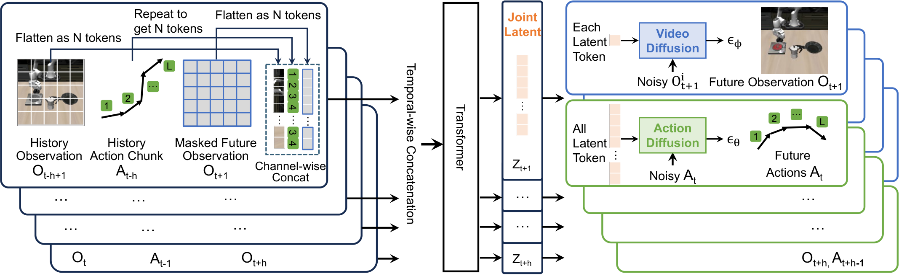
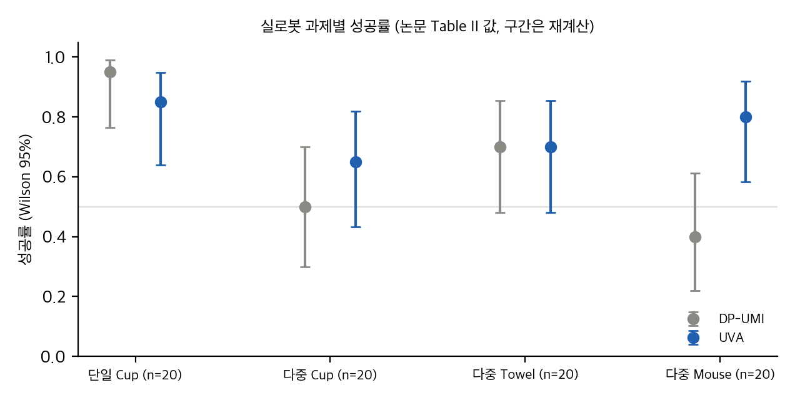
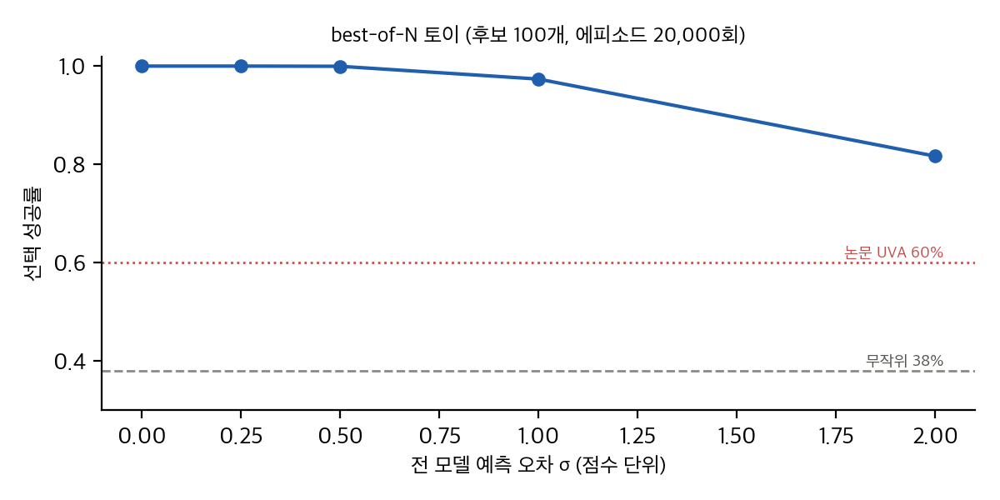

# UVA: 영상 생성과 행동 예측을 한 모델에 묶은 정책

Unified Video Action Model(UVA)은 영상 생성과 행동 예측을 한 Transformer의 잠재 표현으로 함께 학습한다. 추론 때는 영상 생성을 건너뛰고 행동 헤드만 돌린다. 논문은 RSS 2025에 실렸고, 공식 코드는 MIT 라이선스로 공개되어 있다.

## 한 줄 요약

영상은 학습 때 보조 신호로 쓰고, 추론 때는 가벼운 행동 확산 헤드만 실행해 속도를 맞춘다. 같은 모델을 마스크 전략만 바꿔 정책, 영상 생성, 순·역동역학에 쓴다.

## 방법

그림 2. 논문 그림 2 (네트워크 구조). © 저자, CC BY 4.0, 출처 arXiv:2503.00200 (v3).

과거 관측은 VAE 잠재 토큰으로, 과거 행동 청크는 같은 개수의 토큰으로 바꾼다. 미래 관측 토큰의 일부를 가리고 복원하도록 학습하면, Transformer 출력이 영상과 행동을 함께 담는 잠재 표현이 된다. 이 잠재에서 영상 헤드와 행동 헤드가 각각 노이즈를 제거한다.

## 확인한 것

- **추론 때 영상 생략은 코드에서도 확인된다.** 정책 추론 경로는 행동 샘플을 뽑은 뒤 바로 반환한다.
- **공동 손실 설계는 논문과 다르다.** 논문 식은 두 손실을 매 배치 합하지만, 공식 코드 기본값은 다섯 과제 모드 중 하나를 배치마다 고른다. 두 손실을 합하는 모드는 그중 하나뿐이다. 공식 설정은 영상 단계 뒤 행동 단계의 두 단계 학습이다.
- **Libero10 평가 규모가 본문과 부록에서 다르다.** 과제당 50회와 10회가 함께 나온다. 공식 기본 설정은 3회다.

## 수치를 다시 계산해 보니

그림 3. 우리가 그린 그래프. 실로봇 과제별 성공률과 Wilson 95% 구간 (논문 표 II 값, 과제당 20회).

- 실로봇 다중 과제 합계는 UVA 43/60, DP-UMI 32/60이다. Fisher 검정 p = 0.059로, 0.05에 약간 못 미친다.
- 과제 하나만 보면 Mouse가 8/20 대 16/20으로 p = 0.023이다. 세 과제를 함께 보면 보정을 하지 않아도 근거는 약하다.
- 블록 밀기 실험은 방법당 40회다. 0.38 대 0.60의 차이는 p = 0.073으로 유의하지 않다.
- 블록 밀기의 "완벽한 정책의 상한 50%" 주장은 GT 시뮬 선택의 0.75와 맞지 않는다.

## 작은 토이 하나

그림 4. 우리가 그린 그래프. 후보 100개 가운데 전 모델 예측으로 고르는 토이의 성공률. 예측 오차가 커져도 성공률은 쉽게 떨어지지 않는다. 논문 수치를 이 모델로 재현하지 못했다는 점이 더 중요하다.

이 토이는 검증이 아니다. 후보가 서로 독립이라는 가정이 강하다. 그래도 "전 모델만 정확하면 된다"는 직관이 이 설정에서는 성립하지 않을 수 있다는 감각은 준다.

## 구현 가능성

- 이 맥에서 원본 학습은 어렵다. 공식 설정은 여러 GPU를 가정하고, 학습 예산이 논문에 없다.
- PushT 체크포인트의 추론 평가는 조건부로 가능하다. 장치 코드를 바꾸고 환경을 설치해야 한다.
- 실로봇 재현은 로봇 하드웨어가 필요하다.

## 출처와 라이선스

- 논문: arXiv:2503.00200 v3. abs 페이지 라이선스는 CC BY 4.0이다. 원문 PDF에 저작권 표시는 없다.
- 그림 2는 논문 그림 2다. © 저자, CC BY 4.0, 출처 arXiv:2503.00200 (v3).
- 그림 3과 4는 우리가 재계산한 값으로 그렸다.
- 공식 코드는 MIT이다. 이 글에서는 코드를 실행하거나 설치하지 않았고, 정적으로만 읽었다.

## 자료

- [통합 리포트 PDF](report/report_public.pdf)
- [01. 논문 분석: Unified Video Action Model (arXiv:2503.00200)](analysis/01_paper_analysis.md)
- [02. 선행연구와 관련 자료](analysis/02_prior_work.md)
- [03. 수치 재계산, 표 간 일관성, CPU 토이](analysis/03_analysis.md)
- [04. 코드 대조와 구현 가능성](analysis/04_code_verification.md)
