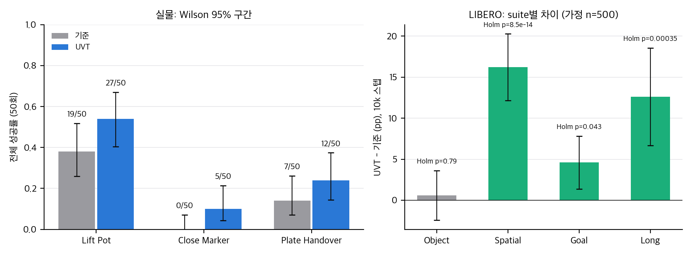
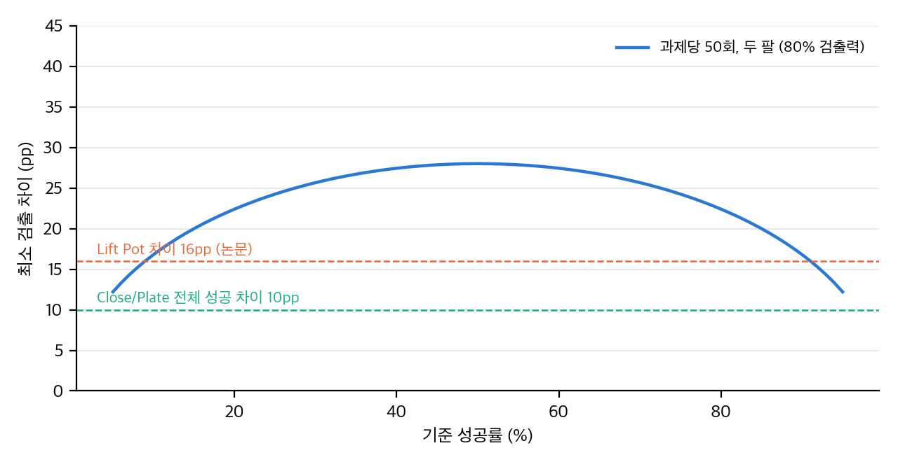
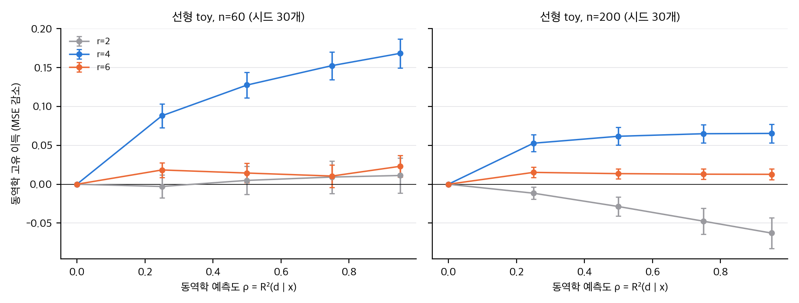

UVT는 VLA가 행동 청크를 직접 회귀하는 대신, 행동과 사전학습된 잠재 행동 모델(LAM)의 동역학 코드를 멀티모달 VAE로 합친 32차원 잠재를 맞추게 합니다. 디코더가 그 잠재를 행동으로 복원합니다. 구조와 추가 데이터는 바꾸지 않는다고 합니다. 논문은 LIBERO 10k 스텝 평균을 79.7%에서 88.2%로, 실물 세 과제에서 성공률 향상을 보고합니다. 이 글은 그 숫자를 다시 계산하고, 공개 코드와 맞춰 보고, 작은 선형 모형으로 이득의 출처를 확인한 결과입니다.

## 한 줄 요약

LIBERO 10k 평균 이득은 산술과 통계 모두에서 큽니다. 다만 이득은 Spatial과 Long에 몰려 있고, 100k에서는 개별 suite에서 유의하지 않으며, 논문에 동역학 정보를 뺀 같은 파이프라인 대조가 없어 "동역학 신호가 도움이 된다"는 주장은 아직 근거가 부족합니다.

## 무엇을 확인했나

- **표 재계산:** Table I, II의 평균 열 12개를 모두 다시 계산했습니다. 전부 맞습니다.
- **통계 검정:** 논문은 시행 수와 시드 수를 쓰지 않았습니다. 공식 코드 기본값(과제당 50회, suite당 500회)을 가정하고 suite별 Fisher와 Holm 보정을 했습니다. 10k 평균 차이는 +8.5pp(표준오차 1.1pp)입니다.
- **실물:** 과제당 50회에서 최소 검출 차이는 22–28pp입니다. 논문의 과제별 차이 10–16pp는 이 기준에서 검출되지 않습니다. 세 과제를 묶은 CMH는 p = 0.012로 유의하지만, 절반 성공의 정의가 저자 손에 있습니다.
- **코드 대조:** 융합 구조와 KL은 논문 식과 맞습니다. 손실 가중치(CE 0.5, KL 0.01), VLA 정렬 손실(공개 명령은 L1), 디코딩 가중치(공개 명령 1.0)는 논문과 다릅니다. 공개 명령의 인자 이름이 스크립트와 맞지 않아 첫 단계부터 막힐 가능성이 큽니다.
- **이득의 출처:** 선형 모형에서 같은 차원의 예측 불가능한 블록만 넣어도 MSE가 줄 수 있었습니다(n = 30, 압축 차원 r = 6). 동역학 고유 이득은 병목이 신호 차원 이상이고 데이터가 충분할 때만 양수였습니다. 동역학이 행동 신호와 직교하면(정렬 0) 데이터가 60개 이상일 때 이득은 모든 압축 차원에서 음수였습니다.

직접 계산: 실물 과제의 전체 성공률과 Wilson 95% 구간(왼쪽), LIBERO suite별 10k 차이와 Holm 보정 p값(오른쪽). 시행 수는 가정(suite당 500회)이고 시드 분산은 빠져 있습니다.

직접 계산: 과제당 50회, 두 팔 비교의 최소 검출 차이(80% 검출력, 양측 5%). 논문의 과제별 차이는 이 곡선보다 작습니다.

직접 계산(선형 toy): 같은 압축 차원에서 동역학 신호를 넣은 경우와 예측 불가능한 잡음 블록을 넣은 경우의 MSE 차이. 예측도 ρ와 압축 차원 r별, 시드 30개, 오차 막대는 95%.

## 판정

- **재현:** 공개 저장소로 VLA 학습은 CUDA GPU가 있어야 합니다. 이 저장소에는 UVT 체크포인트가 없고, π0.5 구현과 실물 코드도 없습니다. 최소 재현은 GPU 한 장으로 1–2주 규모로 추정합니다(확인하지 않음).
- **승격 조건:** "동역학 신호 자체가 도움이 되는가"의 판정은 아직 내릴 수 없습니다. 첫 실험은 같은 32차원 파이프라인에서 동역학 항을 제거한 행동 전용 대조입니다.
- **라이선스:** 논문은 CC BY-NC-SA 4.0이고, 공식 저장소에는 라이선스 파일이 없습니다. 이 글은 논문 그림과 표를 싣지 않고 직접 만든 그래프와 수치만 씁니다.

## 한계

- 시행 수와 시드 수를 논문이 밝히지 않아 LIBERO 차이의 불확실성을 정확히 알 수 없습니다.
- 선형 toy는 디코더를 학습하지 않고, 동역학 신호가 행동 부분공간에 있다고 가정했습니다. 직교하는 경우는 추가 검증에서 봤습니다(정렬이 없으면 데이터가 충분할 때 이득이 음수). 실제 LAM 코드와 MLP 디코더에서 같은 결과가 나오는지는 확인하지 않았습니다.
- π0.5 쪽 개선 0.7pp는 이 가정에서 검출되지 않습니다.

## 자료

- [통합 리포트 PDF](report/report_public.pdf)
- [01. 논문 분석: Unified Visuomotor Targets (arXiv:2608.03563v1)](analysis/01_paper_analysis.md)
- [02. 선행연구, 가까운 대안, 공식 자료](analysis/02_prior_work.md)
- [03. 표 재계산, 통계 검정, 유도, toy](analysis/03_analysis.md)
- [04. 논문 ↔ 공식 코드 대조 (UVT, arXiv:2608.03563)](analysis/04_code_verification.md)
