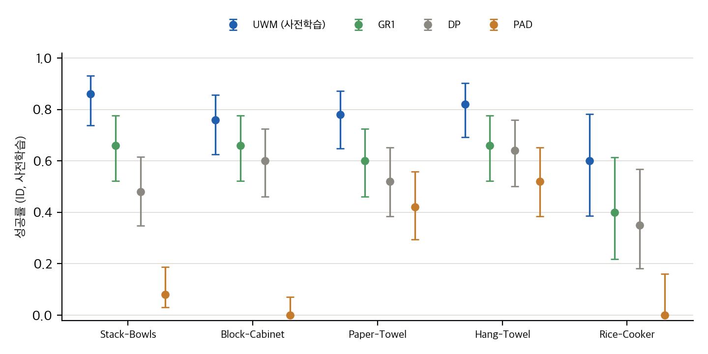
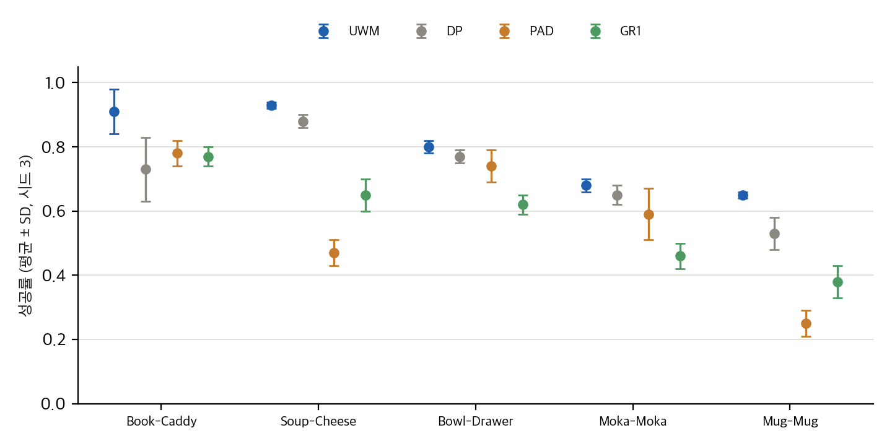
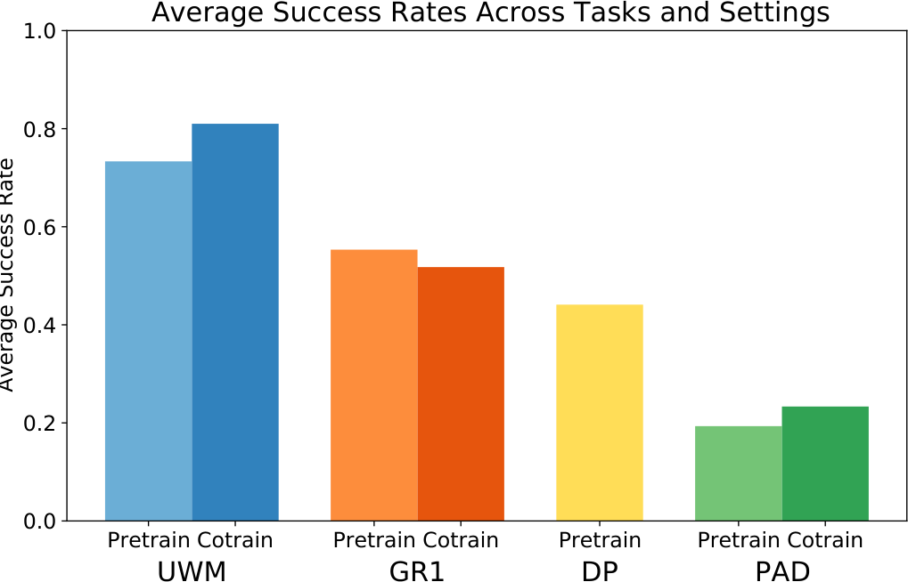

> **논문:** Chuning Zhu, Raymond Yu, Siyuan Feng, Benjamin Burchfiel, Paarth Shah, Abhishek Gupta. *Unified World Models: Coupling Video and Action Diffusion for Pretraining on Large Robotic Datasets.* RSS 2025, arXiv:2504.02792 (v3, 2025-05-23).
> 공식 코드는 GitHub WEIRDLabUW/unified-world-model에 있습니다(라이선스 파일 없음). 이 글의 그림은 논문 그림 한 장(출처 표기)과 우리가 그린 그래프 두 장입니다.

## 논문이 묻는 것

로봇 정책은 시연 데이터에 기대기 때문에 규모를 키우기 어렵습니다. 반면 행동 라벨이 없는 영상은 많습니다. 영상에는 물체가 어떻게 움직이는지, 행동이 장면을 어떻게 바꾸는지에 대한 정보가 들어 있습니다. 문제는 행동 정책과 영상 세계모델이 보통 서로 다른 모델이라서, 영상에서 얻은 동역학 지식이 정책으로 잘 넘어가지 않는다는 점입니다.

UWM은 Diffusion Transformer 하나에 두 확산 과정을 넣습니다. 행동 청크와 다음 관측의 잠재 표현이 각자 **독립인 확산 시각**을 가집니다. 시각을 어떻게 고르느냐에 따라 같은 모델이 정책, 순방향 동역학, 역동역학, 영상 예측 중 하나로 동작합니다.

시각을 완전 노이즈(T)로 두면 그 변수를 가리는 것과 같고(주변화), 노이즈가 없는 값(0)으로 두면 그 변수를 조건으로 씁니다. 행동 라벨이 없는 영상은 행동 시각을 T로 두어 가리면 같은 손실에 넣을 수 있습니다.

## 이 글에서 확인한 것

**실로봇 다섯 과제.** 저자들은 DROID에서 고른 2000 궤적으로 사전학습하고, Stack-Bowls, Block-Cabinet, Paper-Towel, Hang-Towel, Rice-Cooker에서 평가했습니다. 과제당 시도는 50회이고 Rice-Cooker는 20회입니다. 사전학습 UWM의 ID 다섯 과제 평균은 0.76으로, GR1(0.60)보다 높습니다. 그러나 과제별로 보면 Stack-Bowls의 ID와 OOD만 p < 0.05입니다. 칸당 50회로는 10–20pp 차이를 확실히 보기 어렵습니다. 80% 검정력을 얻으려면 Stack-Bowls ID 차이(0.86 대 0.66)만 해도 칸당 69회가 필요합니다.

*그래프: 논문 표 I의 사전학습 ID 값으로 그렸습니다. 구간은 칸당 50회(Rice-Cooker는 20회)의 Wilson 95% 구간입니다.*

**공동 학습의 효과.** 행동 없는 영상을 함께 학습하면 아홉 칸 모두 성공률이 올라갑니다(+4 ~ +12pp). 방향은 일관되지만 칸별 차이는 통계적으로 확인되지 않았습니다(p > 0.2).

**LIBERO.** LIBERO-90으로 사전학습하고 LIBERO-10의 다섯 과제를 교란 조건에서 평가했습니다. UWM의 과제 평균 차이는 DP보다 0.08 큽니다. 시드 3개의 표준편차를 가정하면 과제별 차이는 p = 0.03–0.23입니다. GR1보다는 네 과제에서 p ≤ 0.009입니다.

*그래프: 논문 표 II의 평균과 ±. 논문은 ±의 정의를 적지 않아 SD로 가정했습니다.*

**그림 6의 평균.** 논문의 막대그래프(과제와 설정 평균)는 표 I에서 계산한 칸 평균과 맞습니다. 구조는 논문 그림 2를 보면 됩니다(이 글에는 싣지 않았습니다).

*그림 6 (논문 원문). © 저자, CC BY 4.0, 출처 arXiv:2504.02792 (v3).*

**나머지 표.** 역동역학은 정책보다 궤적을 더 잘 따릅니다(Book-Caddy 0.65 대 0.47). 다만 시도 수가 150인지 50인지에 따라 결론의 강도가 다릅니다. 레지스터와 교차 어텐션 비교, 미래 관측 재구성, 인터넷 영상 추가는 방향만 맞고 대부분 확인되지 않습니다.

## 공식 코드와 논문의 차이

공식 저장소를 정적으로 읽고 논문과 대조했습니다. 실행하거나 설치하지는 않았습니다.

- **정책 샘플링.** 논문 식 2는 다음 관측을 시각 T의 순수 노이즈에서 시작한다고 씁니다. 코드는 10 스텝 DDIM에서 시각 90을 씁니다. 차이는 작을 수 있지만 확인하지 않았습니다.
- **LIBERO 설정.** 미세조정 스텝은 논문 10K, 설정 파일 20K입니다. 레지스터는 표 V의 8이 아니라 설정 파일의 24입니다.
- **행동 없는 샘플.** 논문은 무작위 노이즈로 채운다고 씁니다. 코드는 DROID 실제 행동을 시각 99에서 가립니다. 그 시각의 신호 계수는 0.016이라 정보는 거의 없지만 설명과 다릅니다.
- **라이선스.** 저장소에 LICENSE 파일도 메타데이터도 없습니다. 코드를 가져다 쓰려면 저자의 허가가 필요합니다.

## 구현 가능성 (Apple M4 Pro, CUDA 없음)

**판정: 부분 가능.** 이 맥에서 DROID 사전학습과 실로봇 재현은 할 수 없습니다. 원 설정은 A100 4장에서 24시간입니다. 공식 `requirements.txt`는 CUDA 휠을 요구해서 macOS에서 그대로 설치되지 않습니다.

- 구조 재구현과 작은 모델의 샘플러 검사는 가능합니다.
- LIBERO 사전학습 체크포인트의 추론과 시뮬 평가는 조건부로 가능합니다. 설치와 MPS 포팅, 체크포인트 다운로드가 필요합니다.
- 노력 추정(측정 전): 설치와 포팅 2–4일, LIBERO 추론 3–5일, 구조 재구현 1–2주.

## 한계

- 칸당 시도 수가 적어 실로봇 차이를 확실히 말하기 어렵습니다. 저자가 시도 수의 정의를 밝혀야 정확히 계산할 수 있습니다.
- 표 II와 표 III의 "±"와 시도 수가 정의되어 있지 않습니다.
- 사람 영상으로는 학습하지 않습니다. 순방향 동역학의 재구성에는 아티팩트가 있다고 저자도 인정합니다.
- PAD와 GR1은 저자가 UWM 코드베이스에 다시 구현한 기준선입니다. 원 구현과 같은 강도인지 확인하지 않았습니다.

## 출처와 라이선스

- 논문은 arXiv에 CC BY 4.0으로 공개되어 있습니다(arXiv abs 페이지의 license 링크 확인). 원문 PDF에서 저작권 표시는 찾지 못했습니다.
- 논문 그림은 그림 6 한 장만 실었습니다("© 저자, CC BY 4.0, 출처 arXiv:2504.02792 (v3)"). 그림 2는 로봇 카메라 장면 사진이 들어 있어 싣지 않았습니다. 로봇 사진, 장면 프레임, 시뮬 화면이 있는 그림은 넣지 않았습니다.
- 그래프, 재계산 스크립트, 분석 문서는 이 글의 작성자가 만들었습니다. 표 값과 본문 수치는 인용과 재계산을 위해 옮겼습니다.
- 공식 코드, 체크포인트, 데이터셋은 받거나 실행하지 않았습니다.

## 자료

- [통합 리포트 PDF](report/report_public.pdf)
- [01. 논문 분석: UWM (arXiv:2504.02792)](analysis/01_paper_analysis.md)
- [02. 선행연구와 관련 저장소](analysis/02_prior_work.md)
- [03. 수치 재계산, 일관성 검사, 주장 판정](analysis/03_analysis.md)
- [04. 공식 코드 대조와 구현 가능성](analysis/04_code_verification.md)
