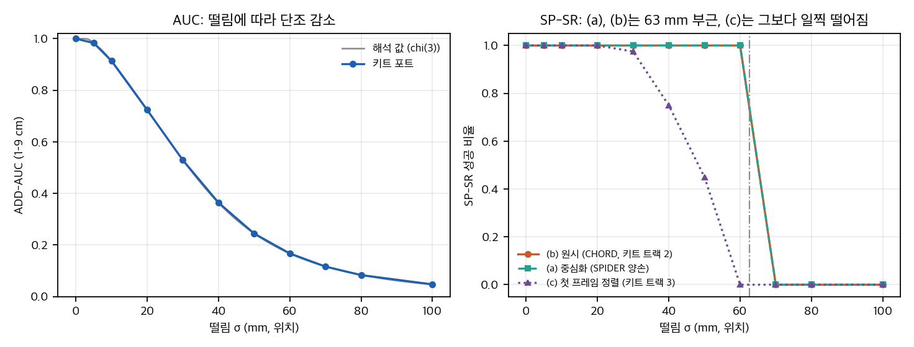

# 03. 검증 게이트별 분석, 숫자 점검, 기하 타당성 게이트 toy

- **근거:** 튜토리얼 페이지(`paper/tutorial.txt`), 챌린지 페이지와 FAQ, 저장소 `5226e34`의 코드와 문서, 키트 `metric_code/`. 코드는 읽기만 했고 실행하지 않았습니다.
- **요지:** 페이지는 파이프라인을 5개의 검증 게이트로 설명합니다. 코드에는 게이트마다 **자동 검사가 있는 곳과 사람이 보는 곳**이 섞여 있습니다. 자동 임계값이 가장 촘촘한 곳은 게이트 5(정책 산출물)와 게이트 4(리타겟 검사)입니다. 게이트 1(영상 검색)은 VLM의 불리언 판정에 기대고, 게이트 2(재구성)는 관통 검사가 기본값에서 꺼져 있습니다.

## 1. 다섯 게이트 한눈에 보기

| 게이트 | 입력 → 출력 | 도구·모델 | 자원 | 코드가 실제로 하는 검사 | 페이지에만 있거나 사람 검토에 맡긴 것 |
|---|---|---|---|---|---|
| **G1 질의 가능 구간** | 긴 영상 → 1–30 s 행동 구간, 설명, 개체 그래프, 프레임 임베딩 | VLM `Cosmos3-Nano` (vLLM), SigLIP-2 base, LangGraph | CUDA GPU | 구간 길이 1–30 s, 검증 루프 최대 3회, VLM 불리언 `is_correct`로 유효 여부 판정, 파싱 실패는 무효 | 엔티티·관계 신뢰도 0.5 설정은 **죽은 설정** (D10). 검증 점수에 임계 없음 (D11) |
| **G2 그럴듯한 재구성** | 영상 → 깊이, 마스크, 메시, 6D 자세, 손·몸, 장면 번들 | MoGe·UniDepth·Depth-Anything 3, SAM2·Grounding DINO, FoundationPose, SAM3D-Body, HaMeR/WiLoR/HaWoR, BundleSDF, DROID-SLAM, gsplat | Docker + GPU (A6000 48 GB, L40S 검증) | 다시점 QC: Chamfer ≤ 40, 실루엣 포함 ≥ 0.8, 불량 프레임 ≤ 5%, 정점 가속도 평활(기본 켜짐) | 관통 손실은 **기본 꺼짐** (가중치 0, D12). 깊이·마스크·자세 검토는 사람이 봄 (e2e 문서의 "review that scene") |
| **G3 시뮬레이션 자산** | 메시 → 강체 USD, 지지 자세, 낙하 시험 | CoACD (MIT), Isaac Sim, FoundationPose, simready-validate (Apache-2.0) | Isaac Sim (GPU) | 지지 자세 편차: 위 2°, 회전 3°, 이동 2 cm. 낙하 진단 JSON과 MP4 | 질량·축척·의미상 방향은 **검증하지 않음** (스킬 문서가 이를 명시). "SimReady 인증 아님" |
| **G4 리타겟 모션** | 재구성 번들 + MANO → 로봇 관절 parquet, 객체 URDF, 접촉 필드, QA 보고서 | IK 리타게터 (Sharpa, Dex3, Vega), 접촉 라벨러 (trimesh), 불변식 검사 | Docker 2개 + MANO (등록) + 데이터셋 | 스케일 분산 > 1e-3 (실패), 로더 정렬 > 1e-4 (실패), \|스케일−1\| > 0.01 (경고), 손바닥–EE 허용 1 cm (dex3) 또는 10 cm (sharpa), 유한값, 프레임 수 일치 | 접촉 검사는 **부호 없는 거리**라 관통을 못 봄 (D14). sharpa 10 cm 허용오차는 느슨함 (D15). 영상 육안 검토 |
| **G5 정책 산출물** | 모션 → RSL-RL 전문가 → 시연(3카메라) → LeRobot → GR00T 미세조정 → 평가 | Isaac Lab 2.3.1 + RSL-RL PPO, FlashCHORD (PPO·FlashSAC), GR00T N1.7 3B (외부 Isaac-GR00T) | 48 GB GPU 한 장 (문서 기준), driver 580 | 성공 판정 lift-hold (§2.5), 수집 감사 `ok`, 데이터셋 감사 `ok`, 개방루프 MSE/MAE 유한성 | 개방루프 지표 계산은 외부 환경에 있음 (저장소에서 확인 못함). 1회 성공과 "전체 성공"은 별도 게이트 |

## 2. 게이트별 분석

### 2.1 G1. 질의 가능 구간 (`video_ingestion_agent/`)

- **무엇을 판정하나:** 구간이 "올바른 행동 경계와 설명"인지. 판정은 VLM이 구간 MP4를 보고 내는 JSON입니다 (`critic.py`, `verify_clip`).
- **검사 로직 (코드):**
  - 짧은 구간 버림 (`segmenter.py` 188–199행, 1.0 s 미만). 긴 구간 자름 (381–388행, 30 s 초과).
  - 유효 판정은 `is_correct` 불리언 하나입니다 (`critic.py` 138행). `confidence`는 `verification_score`에 저장되지만 **임계와 비교하지 않습니다** (D11).
  - 파싱 실패는 `is_correct=False`, `confidence=0.0`으로 떨어뜨립니다 (124–135행). 안전한 쪽 기본값입니다.
  - 검증-보정 루프는 최대 3회 (`max_iterations: 3`).
- **죽은 설정:** `min_entity_confidence`와 `min_relationship_confidence`(기본 0.5)는 `config.py`와 YAML·문서(`configuration.rst`)에 있지만 `src/`에서 읽히지 않습니다. 문서는 "Minimum confidence to keep an entity"라고 설명합니다 (D10).
- **자원:** `device: "cuda"`, `vlm_backend: "vllm"`, `vllm_gpu_memory_utilization: 0.8`. CUDA 12.x 필요 (README). 맥에서는 이 경로를 그대로 쓸 수 없습니다.
- **라이선스:** VLM은 OpenMDW-1.1, SigLIP-2는 Apache-2.0 (HF 메타). 튜토리얼 산출물 "JSONL 클립 목록"은 `_write_segment_jsonl`로 만들어집니다 (`reconstruction_service` 관련 테스트에서 확인).
- **판단:** 게이트 1의 자동 검사는 "VLM이 맞다고 하면 통과"입니다. 임계로 걸러지는 것은 구간 길이뿐입니다. 페이지의 "queryable"은 검색 가능성이고, 검증 정확도는 측정하지 않습니다.

### 2.2 G2. 그럴듯한 재구성 (`reconstruction/`)

- **도구와 라이선스:** 모델 대부분은 저장소에 재배포되지 않고 빌드 때 가져옵니다. 라이선스 분포는 `02_prior_work.md` §5에 있습니다. NC·ND 항목이 여럿입니다 (UniDepth CC BY-NC 4.0, WiLoR와 HaWoR CC BY-NC-ND 4.0, FoundationPose와 FoundationStereo는 NVIDIA 비상업 라이선스).
- **자동 QC (다시점 HOI 워크플로 `mv_hoi`):** 임계값은 `config.yaml`과 `campaign_controller.py` 양쪽에 같은 값으로 있습니다.

| 항목 | 값 | 의미 |
|---|---|---|
| `max_chamfer_object`, `max_chamfer_human` | 40.0 | 단위가 적혀 있지 않음 (mm 또는 cm 중 무엇인지 확인 못함) |
| `max_chamfer_segment_*` | 50.0 | 구간 단위 Chamfer 상한 |
| `min_object_silhouette_bbox_containment` | 0.8 | 렌더 실루엣이 마스크 bbox에 들어가는 비율 |
| `min_object_segment_pixels` | 10 | 물체 마스크 최소 픽셀 |
| `max_object_silhouette_bad_frame_fraction` | 0.05 | 불량 프레임 허용 비율 |
| `max_silhouette_failure_coverage` | 0.5 | 실루엣 실패 구간 덮임 상한 |
| `min_accuracy_failure_run_frames` | 5 | 실패가 이 길이 이상 이어져야 기각 |

- **에고 정제 기본값 (`run_ego_reconstruction.py`, `GSPLAT_DEFAULTS`):** 정점 가속도 평활 가중치 100 (켜짐), 정규화 척도 0.01 m. 손-물체 관통 손실 가중치 0 (꺼짐), 여유 3 mm, SDF 해상도 96. 같은 관통 여유 값이 `run_ego_wilor.py`의 정제 인자에도 있습니다.
- **판단:** 페이지의 "physical plausibility"에 해당하는 자동 검사는 평활(떨림)입니다. 관통 검사는 평가 지표(PEN)에서만 계산되고 로컬 파이프라인의 기본 설정에는 없습니다 (D12). 이 차이는 중요합니다. 트랙 1은 PEN을 평가하는데, 재구성 기본값은 PEN을 최적화하지 않습니다.
- **사람 검토:** "Route B"는 `inspect` 뒤 Three.js 장면을 "review before retargeting"하라고 합니다. 자동 임계가 아니라 사람 검토입니다.

### 2.3 G3. 시뮬레이션용 과제 자산 (`mesh_to_usd/`)

- **지지 자세 추정 (기본값):** 위쪽 편차 2.0°, 회전 편차 3.0°, 평행이동 편차 0.02 m (`infer_recorded_support.py` 51–53행).
- **낙하 시험:** 완료 조건은 `drop_test_result.json`의 적재·접촉·정착·서 있음 진단, 비어 있지 않은 `drop_test.mp4`, 그리고 사람의 육안 검토입니다 (스킬 `mesh-to-usd-run`).
- **명시된 한계:** 스킬 문서는 "Do not call the scoped structural profile SimReady certification"이라고 적고, 파일만으로 물리 축척·질량·의미상 방향·실제 안정성을 추론하지 말라고 합니다. 페이지의 "simulation-ready task assets"는 이 한계와 함께 읽어야 합니다.

### 2.4 G4. 리타겟 모션 (`robotic_grounding/scripts/retarget/`, `tools/e2e/`)

- **실패 조건 (코드):** `ValueError`를 내는 두 가지.
  - 객체 `object_to_world`의 임베디드 스케일이 프레임마다 다르면 실패 (분산 > 1e-3).
  - 로더가 만든 궤적이 중력 정렬 회전이나 평행이동을 바꾸면 실패 (허용 1e-4, `ego_recon_to_dexmate_sharpa.py` 427–436행).
- **경고 조건:** 임베디드 스케일과 1의 차이가 0.01을 넘으면 경고 (1138행, 1321행). 경고는 `warnings` 리스트로 보고서에 남습니다.
- **접촉 라벨 (`contact_labels.py`):** 손가락 점 11개 (쪽당)와 객체 메시 사이의 `on_surface` **부호 없는 거리**가 0.018 m보다 작고, 2프레임 이상 이어지면 접촉. 법선은 부호와 무관하게 항상 안쪽 규약 (`normal_obj = -face_normals[tri_ids]`, `contact_labels.py` 177행). 관통 여부를 구분하지 못합니다 (D14). toy 4절에서 이 점을 수치로 봅니다.
- **불변식 (`planner/utils/validation.py`):** 손바닥과 엔드이펙터 거리 허용 dex3 0.01 m, sharpa 0.10 m. 코드 주석은 sharpa의 URDF 고정 오프셋이 약 4 cm라고 적어서 10 cm는 거의 검사하지 못합니다 (D15).
- **e2e 문서의 요구:** 보고서·IK·영상의 프레임 수 일치, 유한값, 58관절 순서, 미해결 QA 경고 없음, 영상 시작·상호작용·끝 육안 검토. 프레임 수와 유한성 검사는 코드에 있습니다. "미해결 QA 경고 없음"은 사람이 `warnings`를 보고 판단합니다.
- **자원:** MANO는 등록 후 수락이 필요합니다 (`SETUP.md` §5). 데이터셋 6종(taco, hot3d, arctic, grab, h2o, dexycb)은 각 원본에서 직접 내려받습니다. 접촉 라벨러와 불변식 검사는 CPU로 실행할 수 있습니다 (단, 메시와 모션 파일이 있어야 합니다).

### 2.5 G5. 정책 산출물 (`robotic_grounding/groot_finetune/`, `docs/e2e_workflow.md`)

**성공 판정 (lift-hold, 코드 `closed_loop/evaluation.py`와 `task_profiles/tissue_box_lift_hold.json`이 일치):**

| 조건 | 임계 | 단위 환산 (20 Hz) |
|---|---|---|
| 들기 최대 높이 | ≥ 0.10 m | — |
| 유지 높이 | ≥ 0.05 m, 연속 `min_hold_steps` = 20 샘플 | 1.0 s |
| 최종 높이 | ≥ −0.01 m | — |
| 안정 배치 (마지막 20 샘플) | 최대 높이 ≤ 0.03 m, 연속 차 ≤ 0.005 m, 범위 ≤ 0.01 m | 창 1.0 s |
| 최대 하강 (한 샘플당) | ≤ 0.01 m (들어 올린 뒤 유지 구간에서만) | — |

- 성공은 위 조건의 **논리곱**입니다. 이 정의는 짧은 접촉이나 튕김을 걸러냅니다. 물체 높이의 시간 추적이므로 손의 "접촉 여부"를 직접 재지 않습니다.
- `e2e_workflow.md`는 "`[DONE]`은 policy 성공이 아니다", "`successful_episodes`가 0이면 실패 결과"라고 적습니다. 이 문장은 코드 동작과 맞습니다.

**단계별 게이트 (문서):** 수집 감사 `semantic_audit.json` ok, 데이터셋 감사 `dataset_audit.json` ok (`audit_groot_run.py` 710행: `"ok": not audit.errors`), 체크포인트 완성, 개방루프 MSE·MAE 유한 (외부 Isaac-GR00T 로그에 있음, 저장소 안에서 확인 못함), 폐루프 성공 수.

**수집 시도 수 식:** `ceil(목표 / 파일럿 성공률 × 안전계수 1.125)` (`collection_env_count`, `tools/e2e/stages.py` 676행; 안전계수 기본값은 `cli.py` 409행). 타임아웃 상한은 **식만 문서에 있고** 코드는 `--collection-max-steps`를 사람이 넣은 값으로 씁니다 (D16).

**기록된 결과 (문서 주장, 원자료 없음):**
- 시뮬레이션 폐루프 "87 of 100 full cycles" (그림 캡션). 같은 문서는 "trained with 100 rollouts"라고 쓰고, 다른 절은 "200 successful simulation rollouts"를 씁니다 (D17).
- 실로봇 V2D Sim200→Real10 4/5, 원시 GR00T→Real10 0/5, 원시→Real30 0/5 (표본 각 5회). 로그와 영상은 저장소에 없습니다 (D18).

### 2.6 챌린지 지표 (게이트 5 이후 평가)

키트 `metric_code/`의 상수와 README 표가 일치합니다 (`04` §3, `analysis/page_checks.py` 결과 `kit_constants` 9개 모두 true).

| 지표 | 정의 (코드) | 임계 |
|---|---|---|
| AUC (트랙 2·3) | 물체 고정점의 ADD를 1–9 cm 임계에서 적분 (9점 사다리꼴, 0–1 정규화) | 1, 2, …, 9 cm |
| SP-SR | 에피소드 평균 위치 오차 ≤ 0.10 m **그리고** 평균 회전 오차 ≤ 0.5 rad 인 비율 | 0.10 m, 0.5 rad |
| MP-SR | 물체마다 평균 위치 < 0.03 m **그리고** 평균 회전 < 30° 인 비율 | 0.03 m, 30° |
| MPPE | 물체 원점에서 5 cm 떨어진 6점의 평균 위치 오차 (cm) | 5 cm 반경 |
| PEN (트랙 1) | 샘플 점의 `relu(−sdf)` 평균 ×100 (cm) | 관통 깊이, 임계 없음 |
| ACC (트랙 1) | 2차 시간 차분 `x[t−2] − 2x[t−1] + x[t]` 의 오차 | 임계 없음 |

## 3. 페이지·README 숫자 점검

`analysis/page_checks.py`로 계산했습니다 (결과: `analysis/page_checks_results.json`).

| 번호 | 확인 대상 | 결과 |
|---|---|---|
| N1 | 상금 $54K | 트랙당 우승 $6K + 준우승 $3K = $9K. 트랙 1·3 각 $9K, 트랙 2를 **티어 3개로 세면** 3 × $9K, 산업 혁신상 $9K. 합계 $54K. **트랙 2를 한 번만 세면 $36K.** 페이지 문장("Three winners per track"과 "Two winners per track")과 함께 보면 티어 단위 해석이 맞아 보입니다. 추정입니다 (D3). |
| N2 | 실로봇 4/5 대 0/5 | Fisher 양측 정확 검정 p = 0.048. 표본 5회씩이라 효과 크기의 신뢰구간은 넓습니다 (D18). |
| N3 | 시뮬 폐루프 87/100 | 캡션과 본문의 롤아웃 수가 다름 (100 대 200). 같은 실험인지 확인 못함 (D17). |
| N4 | Real10은 Real30의 1/3 | 10/30. 맞음. |
| N5 | 수집 시도 수 식 | 목표 10, 성공률 0.4, 안전계수 1.125 → 29회. 코드 식과 일치. |
| N6 | 미세조정 스텝 식 | 에폭 5, 에피소드 10, 프레임 600, 지평 16, 배치 32 → 915 스텝. 코드 식과 일치. |
| N7 | 타임아웃 상한 식 | 600 프레임, 30 fps, 배속 0.5, 20 Hz → 800 스텝, 15% 여유 → 920. 식은 문서에만 있고 자동 계산 코드는 없음 (D16). |
| N8 | lift-hold 시간 환산 | 20 샘플 @ 20 Hz = 1.0 s. 맞음. |
| N9 | 챌린지 지표 임계 (README와 코드) | SP-SR 0.10 m·0.5 rad, MP-SR 0.03 m·30°, AUC 1–9 cm: 키트 README와 코드 일치. |
| N10 | 챌린지 리더보드 집계 | 01 §4.4. 페이지 실시간 데이터와 저장소 정적 JSON(2026-09-29, 빈 파일)이 다름 (D7). |
| N11 | 루트 README "18 containerized modules" | Docker 디렉터리가 있는 모듈은 31개 (정의 차이 가능). 불일치로 기록 (D20). |
| N12 | README 설치 명령 `install_pacakages.sh` | 파일 없음. 실제는 `install_packages.sh` (D19). |
| N13 | "단일 RTX A6000 48 GB에서 전체 실행 가능" | 저장소에 측정 기록 없음. 주장으로만 적힘. |
| N14 | 샘플 영상과 ONNX 정책 (LFS) | 희소 복제에서 받지 않음. 정책 파일은 132바이트 LFS 포인터로 확인됨. |

## 4. 기하 타당성 게이트 toy (CPU, numpy만)

- **코드:** `analysis/gate_toy.py` (실행 약 4초, 결과 `analysis/gate_toy_results.json`). 저장소 코드는 가져오지 않고, 접촉 규칙만 `contact_labels.py`와 같은 꼴(18 mm, 2프레임)로 옮겼습니다.
- **합성 궤적:** 30 fps, 10 s. 6×6×10 cm 상자. 손가락 끝 구 4개 (반지름 8 mm). 10 cm를 최소 저크 곡선으로 들고 내리며, 접근은 1.5 s까지 진행.
- **정상 (400개):** 관통 0–2 mm, 측정 잡음 σ 0.05–0.3 mm.
- **결함 4종 (각 100개):**
  - 깊은 관통: 추가로 0.5–12 mm 안쪽으로.
  - 떨림: 물체 위치 잡음 σ 0.1–4 mm.
  - 튐: 1–3 프레임 동안 15–40 mm 이동.
  - 떠 있음: 들 때만 손을 22–40 mm 바깥으로 밀어 접촉을 잃음.
- **지표:** 관통 깊이 (프레임 × 구의 최대 또는 p99), 물체 가속도 p99 (m/s²), 프레임 간 최대 이동 (10 mm 고정), 물체가 움직일 때의 접촉 비율 (≥ 0.95).
- **격자:** 관통 임계 {1, 1.5, 2, 2.5, 3, 4, 6} mm × 가속도 임계 {1, 1.5, 2, 2.5, 3, 4, 6} m/s². 시드 3개 평균.

**결과 (시드 평균, 표준편차는 괄호):**

| 설정 | FRR 정상 기각 | FAR 결함 수용 | 결함별 FAR (깊은 관통 / 떨림 / 튐 / 떠 있음) |
|---|---|---|---|
| p99, 관통 3.0 mm, 가속도 2.5 (최선) | 1.1% (0.1) | 3.6% (1.8) | 7.3 / 7.0 / 0 / 0 |
| max, 관통 3.0 mm, 가속도 2.5 | 3.8% (1.2) | 3.2% (1.7) | 6.0 / 6.7 / 0 / 0 |
| p99, 관통 2.0 mm, 가속도 2.5 | 28.7% (0.8) | 1.5% (0.9) | — |
| p99, 관통 4.0 mm, 가속도 2.5 | 1.1% (0.1) | 6.3% (2.3) | — |
| p99, 관통 3.0 mm, 가속도 2.0 | 9.2% (1.0) | 3.0% (1.8) | — |
| p99, 관통 6.0 mm, 가속도 2.5 | 1.1% (0.1) | 10.6% (1.9) | — |

- **접촉 규칙만 쓸 때 결함 통과율:** 깊은 관통 99%, 튐 99%, 떨림 7%, 떠 있음 0%. 접촉이 "있는지"만 보면 관통을 거의 다 놓칩니다.
- **접촉 비율 하한 민감도 (p99, 3.0 mm, 2.5):** 0.90 → FRR 0%, FAR 3.7%. 0.95 → FRR 1.1%, FAR 3.6%. 0.98 → FRR 10.9%, FAR 3.0%.

**해석:**

1. **관통 임계는 2–3 mm 근처에서 정상과 결함이 맞붙습니다.** 정상 궤적의 최대 관통 깊이는 중앙값 1.8 mm, 95% 분위 2.95 mm입니다. 최대값 대신 p99를 쓰면 프레임 수에 따른 최댓값 잡음을 줄여서 정상 기각을 낮출 수 있습니다 (임계 2.5–3 mm에서 FRR 1.1%). 이 toy의 관통 임계 3 mm는 저장소의 `hand_object_penetration_margin = 0.003`과 같은 값입니다. 저장소는 이 값을 최적화 여유로만 쓰고, 검사 임계로는 쓰지 않습니다.
2. **가속도 임계는 2–3 m/s²에서 정상 분포의 꼬리와 만납니다.** 정상 p95는 2.07 m/s²입니다. 임계 2.0이면 정상 9%가 떨어지고, 임계 2.5 이상에서는 떨림 결함의 절반 가까이를 놓치지 않습니다 (떨림 FAR 7%는 대부분 σ 0.1–0.4 mm의 약한 결함입니다).
3. **튐과 떠 있음은 임계 없이도 다른 검사로 잡힙니다.** 프레임 간 최대 이동과 움직일 때 접촉 비율이 각각 담당합니다. 게이트는 지표를 여러 개 두는 편이 낫다는 뜻입니다.
4. **접촉 존재 검사는 관통을 구분하지 못합니다.** 깊은 관통 결함의 99%가 접촉 규칙을 통과합니다. 이것이 `contact_labels.py`의 부호 없는 거리 설계(D14)의 정량적 결과입니다. 관통 검사는 부호 있는 거리가 필요합니다.
5. **접촉 비율 임계 0.95는 정상 궤적에서도 경계에 있습니다.** 2프레임 디바운스 때문에 정상 궤적의 움직이는 프레임 중 5% 가까이가 접촉 밖에 남습니다. 임계를 0.98로 올리면 정상 기각이 10%를 넘습니다. 이 값은 궤적 길이와 디바운스에 따라 달라집니다.

**toy가 보여주지 못하는 것:**
- 실제 메시 기반 SDF, 손 모델 오차, 회전, 비대칭 잡음은 없습니다. 임계값은 이 단순 가정 위에서 나온 수치입니다.
- 결함 비율 (정상 400 : 결함 400)은 임의입니다. 실제 데이터에서는 정상 비율이 훨씬 높을 것입니다. 그때는 FAR과 FRR의 균형점이 달라집니다.
- FAR의 시드 간 표준편차 (1.8%p)는 평균 차이 일부와 비슷합니다. 세 시드로는 임계 비교의 순위를 확정할 수 없습니다.

## 5. 한계와 미확인

- 페이지의 실습 자료(노트북, 산출물 폴더)가 없어서 실습 결과를 재현하지 못했습니다.
- 재구성 모델 가중치, MANO, 데이터셋, 챌린지 데이터는 받지 않았습니다. 정량 검사의 실제 분포는 확인하지 못했습니다.
- 챌린지 Track 2 Tier 2 교란의 생성 분포는 저장소에 없습니다 (D9).
- 개방루프 MSE·MAE 계산은 외부 Isaac-GR00T 환경에 있어 확인하지 못했습니다.
- `chord/`의 SP-SR 해석과 키트 구현의 차이는 `02_prior_work.md` §6에 있습니다.

## 추가 검증 (2026-11-12): 키트 지표 numpy 포트와 SP-SR 정의 비교

- **방법:** `analysis/extra_kit_metrics.py` (numpy, scipy, matplotlib, CPU 약 3.5초, 시드 20261112). 키트 `metric_code/`의 수식을 읽고 손으로 다시 쓴 독자 구현입니다. 키트 파일은 import하거나 실행하지 않았습니다. 포함 지표는 PEN, SP-SR, MP-SR, ADD-AUC (1–9 cm), RPE, MPPE입니다. 결과는 `analysis/extra_kit_metrics_results.json`입니다.
- **합성 궤적:** 30 fps, 10 s, 바디 두 개(양손 모드). 바디 0은 +x로 15 cm, 바디 1은 −x로 15 cm 최소 저크 곡선으로 옮기고 5 cm 들었다 내립니다. 두 바디는 z축으로 각각 1.0 rad과 −0.6 rad 돌아갑니다. 물체는 6 × 6 × 10 cm 상자이고, 표면 점 200개로 ADD를 계산합니다.
- **임계:** SP-SR 0.10 m와 0.5 rad, MP-SR 0.03 m와 30도. 임계는 바꾸지 않았습니다.

**단위 테스트 (알려진 답, 40개 중 40개 통과):**

| 입력 | 확인한 값 | 답의 근거 |
|---|---|---|
| 항등 | SP-SR 세 정의 모두 1, MP-SR 1, AUC 1, MPPE 0, RPE 0, PEN 0 | 오차 없음 |
| 상수 위치 오프셋 0.035 m | 원시 SP-SR 위치 0.035 m, AUC 0.6875, MPPE 3.5 cm, RPE 0, MP-SR 실패 | 1–3 cm 임계는 실패, 4–9 cm는 통과 |
| 상수 회전 0.3 rad (z축) | 고리 점 (반지름 5 cm)의 ADD = 2r sin(θ/2), MPPE = 0.996 cm | 기하식 |
| 선형 드리프트 0.10 m와 0.25 m | 원시 평균 d/2 (0.05, 0.125 m) | 시간 평균 |
| 과도 오프셋 0.15 m (시정수 1 s) | 원시 평균 = 0.15 · mean(e^(−t/τ)) | 지수 평균 |
| 떨림 σ = 1 cm | ADD 빈도 = χ(3) 분포, 원시 평균 노름 = σ√(8/π) | 3차원 가우시안 |
| 상자 PEN | 안쪽 2 mm 점과 바깥 점 → 0.1 cm, 중심 점 (깊이 3 cm) → 3.0 cm, 회전·이동 후 같은 값 | 상자 부호 거리 |
| RPE | 바디 하나를 3 cm 이동 → 3.0 cm | 상대 위치 |
| MP-SR | 오프셋 0.02 m 통과, 0.035 m 실패, 회전 20도 통과, 40도 실패 | 임계 비교 |

**SP-SR 정의 세 가지 (같은 합성 궤적, 바디 두 개):**
- (a) SPIDER 양손 모드: 쪽별 시간 평균 오프셋을 뺀 뒤 위치 노름을 잽니다. 정적인 쪽은 빼고 나머지를 평균합니다 (`flashdexretarget/repo/src/evaluation/callbacks/tracking_performance.py`의 `_spider_errors`). 회전은 중심화하지 않습니다.
- (b) CHORD `spider_success`: 원시 시간 평균 오차입니다. 중심화는 빠져 있고, 중심화한 값은 진단용 `spider_centered_position_error`에만 있습니다 (`chord/repo/robotic_grounding/flash_chord/src/flash_chord/evaluation/metrics.py`).
- (c) 키트 SP-SR: 첫 프레임 강체 정렬 (`_warp_to_reference_start`) 뒤 원시 시간 평균 오차입니다. 정렬은 `_ALIGN_INITIAL_POSE`로 켜고 끕니다. 트랙 2 파일 (`track_2/SP-SR.py`, 221행)은 꺼져 있어서 정렬이 실행되지 않고, 트랙 2 SP-SR은 (b)와 같은 계산입니다. 트랙 3 파일 (`track_3/SP-SR.py`, 592행)은 켜져 있습니다. 이 포트는 트랙 3의 정렬 단계만 옮겼고, 트랙 3이 정렬 전에 쓰는 메시 기반 등록 (`_register_object_body`, `_score_registered_track3`)은 옮기지 않았습니다.

**같은 궤적에 섭동을 하나씩 준 결과 (위치 m / 회전 rad, 통과 여부):**

| 섭동 | (a) 중심화 | (b) 원시 (CHORD, 키트 트랙 2) | (c) 첫 프레임 정렬 (키트 트랙 3 정렬 단계) |
|---|---|---|---|
| 과도 오프셋 0.15 m | 0.020 / 0.00, 통과 | 0.015 / 0.00, 통과 | 0.135 / 0.00, **실패** |
| 지속 오프셋 0.15 m | 0.000 / 0.00, 통과 | 0.150 / 0.00, **실패** | 0.000 / 0.00, 통과 |
| 선형 드리프트 0.25 m | 0.063 / 0.00, 통과 | 0.125 / 0.00, **실패** | 0.125 / 0.00, **실패** |
| 회전 오프셋 0.6 rad (z축) | 0.000 / 0.60, **실패** | 0.000 / 0.60, **실패** | 0.059 / 0.00, 통과 |
| 떨림 σ 0.08 m | 0.127 / 0.00, **실패** | 0.127 / 0.00, **실패** | 0.167 / 0.00, **실패** |

해석:
1. **지속 오프셋**은 (a)와 (c)가 용서하고 (b)는 용서하지 않습니다. (a)는 시간 평균을 빼고, (c)는 첫 프레임에서 맞추기 때문입니다.
2. **드리프트**는 (a)만 부분적으로 용서합니다. 선형 드리프트 d의 중심화 오차는 d/4라서, 0.25 m 드리프트도 0.063 m로 줄어 임계 아래로 들어갑니다. (b)와 (c)는 d/2 = 0.125 m를 그대로 받습니다.
3. **과도 오프셋**은 (c)만 실패합니다. 첫 프레임의 오차를 기준으로 맞추면 그 오차가 전 구간에 옮겨져서, 잠깐 있다 사라지는 초기 오차가 오히려 0.135 m의 지속 오차로 남습니다. 이 경우 (a)와 (b)는 시간 평균이 작아 통과합니다.
4. **회전 오프셋**은 (a)와 (b)가 실패합니다. 회전은 중심화하지 않기 때문입니다. (c)는 회전을 지우지만, 정렬 변환이 위치까지 회전시켜서 0.059 m의 위치 오차를 새로 만듭니다. 이 값은 바디가 원점에서 떨어져 있을 때 생기고, 이 궤적에서는 임계 아래라서 통과합니다.
5. **떨림**은 셋 모두 실패합니다. 중심화와 정렬은 떨림을 상쇄하지 못합니다.

**인구 시뮬레이션 (에피소드 500개, 바디 두 개, 성공 비율):**

가정: 상수 오프셋 노름은 0부터 상한까지 균등, 드리프트 총량도 같은 방식, 방향은 구면에 균등하게, 바디와 에피소드마다 독립. 회전 오프셋은 축 무작위, 각도는 0부터 상한까지 균등. 떨림 σ는 위치에만 2 mm.

| 인구 | (a) 중심화 | (b) 원시 | (c) 첫 프레임 정렬 | (a)만 통과 | (b)만 통과 |
|---|---|---|---|---|---|
| 완만 (오프셋 ≤ 5 cm, 드리프트 ≤ 5 cm) | 1.000 | 1.000 | 1.000 | 0 | 0 |
| 넓음 (오프셋 ≤ 15 cm, 드리프트 ≤ 25 cm) | 1.000 | 0.468 | 0.566 | 266 | 0 |
| 넓음 + 회전 (≤ 0.6 rad) | 0.944 | 0.422 | 0.496 | 261 | 0 |

"(a)만 통과"는 (a)가 통과하고 (b)가 실패한 에피소드 수입니다. "(b)만 통과"는 그 반대입니다. 넓은 인구에서 (a)가 1.000인 것은 인구 설계에서 나온 결과입니다. 선형 드리프트만 있으면 중심화 오차가 d/4 ≤ 0.0625 m로 임계 0.10 m에 닿지 않습니다. (a)가 실패하려면 회전이나 떨림, 또는 선형이 아닌 오차가 필요합니다. 그래서 (a)의 성공 비율을 실제 데이터의 성공률로 읽으면 안 됩니다.

**떨림 민감도 (위치 떨림 σ, 에피소드마다 40개 세계):**

| σ (mm) | AUC 포트 | AUC 해석 (χ(3)) | SP-SR (b) 원시 | SP-SR (a) 중심화 | SP-SR (c) 정렬 | 원시 평균 노름 (m) |
|---|---|---|---|---|---|---|
| 0 | 1.000 | 1.000 | 1.00 | 1.00 | 1.00 | 0.000 |
| 10 | 0.914 | 0.913 | 1.00 | 1.00 | 1.00 | 0.016 |
| 20 | 0.724 | 0.724 | 1.00 | 1.00 | 1.00 | 0.032 |
| 30 | 0.529 | 0.530 | 1.00 | 1.00 | 0.98 | 0.048 |
| 40 | 0.364 | 0.364 | 1.00 | 1.00 | 0.75 | 0.064 |
| 50 | 0.245 | 0.245 | 1.00 | 1.00 | 0.45 | 0.080 |
| 60 | 0.167 | 0.167 | 1.00 | 1.00 | 0.00 | 0.096 |
| 70 | 0.117 | 0.117 | 0.00 | 0.00 | 0.00 | 0.112 |
| 80 | 0.084 | 0.084 | 0.00 | 0.00 | 0.00 | 0.128 |
| 100 | 0.048 | 0.047 | 0.00 | 0.00 | 0.00 | 0.159 |

그림: `report/figures/extra_kit_jitter.png` (왼쪽은 AUC와 해석 곡선, 오른쪽은 세 SP-SR 정의).

위치 떨림 σ에 따른 ADD-AUC(왼쪽)와 SP-SR 성공 비율(오른쪽). 회색 선은 χ(3) 분포로 구한 AUC 해석 값이고, 점선은 평균 노름이 0.10 m가 되는 σ ≈ 63 mm입니다. 직접 계산한 결과입니다.

해석:
1. AUC 포트는 떨림에 따라 단조롭게 줄고, 해석 값과 0.001 이내로 맞습니다. ADD와 AUC의 식이 떨림 입력에 대해 옳게 동작한다는 근거입니다.
2. SP-SR (a)와 (b)는 평균 노름이 1.60σ로 커져서 0.10 m를 넘는 σ ≈ 63 mm에서 떨어집니다. 시간 평균은 떨림을 상쇄하지 못합니다.
3. SP-SR (c)는 첫 프레임의 떨림도 전 구간에 옮겨 더하기 때문에 σ 30 mm부터 떨어지고, 60 mm에서는 0입니다. 첫 프레임 정렬은 떨림이 있을 때 성공 조건을 더 빡빡하게 만듭니다.

**한계와 미확인:**
- 합성 궤적은 상자 두 개와 15 cm 이동, 10 s짜리 하나입니다. 키트 기준 궤적의 분포와 같다고 볼 근거가 없습니다. 인구 결과는 가정한 분포에서만 유효합니다.
- 떨림은 위치에만 넣었습니다. 회전 떨림, 시간에 따라 이어지는 잡음, 프레임 누락은 없습니다.
- 키트의 기준 자료 (호스트 기준값), 메시 정점 자산, MHR 모델은 키트에 없어서 쓰지 못했습니다. PEN은 상자의 참 부호 거리로 계산했고, 키트 PEN이 쓰는 메시 내부 판정 (권선 수)은 옮기지 않았습니다.
- RPE 키트 코드는 트랙 3 폴더에 있습니다 (트랙 2 폴더에는 없습니다). 포트는 상대 위치 식만 옮겼고, 키트의 등록 기반 채점 경로는 옮기지 않았습니다. 트랙 2의 MPPE와 AUC는 같은 식을 씁니다.
- (c)는 키트 트랙 3 SP-SR의 정렬 단계만 재현한 것입니다. 메시 기반 등록을 포함한 전체 트랙 3 채점과는 다릅니다.
- (a)의 코드 (`tracking_performance.py`의 `_spider_step`)는 저장된 직전 스텝 참조 (`spider_prev_ref`)를 빼는 것으로 읽힙니다. 한 스텝 지연 여부는 명령 갱신 순서에 따라 달라서 확인하지 못했습니다. 지연을 넣은 진단 값으로 보면 이 궤적에서 정의 간 판정은 바뀌지 않았고, 항등 궤적의 위치 오차는 0.5 mm입니다.
- 에피소드 500개에서 성공 비율의 표준 오차는 최대 약 0.022입니다. 시드는 하나입니다.
- 회전 테스트의 측지각 값은 `sqrt(1 - d^2)` 때문에 1e-8 수준의 잡음이 있습니다. 허용오차는 1e-6으로 잡았습니다.

## 추가 검증 (2026-11-13): lift-hold 성공 판정기 numpy 포트와 합성 높이 트레이스

- **방법:** `analysis/extra_lift_hold.py` (numpy, CPU 약 1초, 난수 시드 20261113). 저장소 `robotic_grounding/groot_finetune/closed_loop/evaluation.py`의 `LiftHoldTracker.update`, `complete`와 `evaluate_lift_hold`의 식을 읽고 손으로 옮겨 쓴 독자 구현입니다. 저장소 파일은 import하거나 실행하지 않았습니다. 결과는 `analysis/extra_lift_hold_results.json`입니다.
- **임계:** `task_profiles/tissue_box_lift_hold.json`의 evaluator 블록에서 옮겼습니다 (들기 0.10 m, 유지 0.05 m를 20 샘플 연속, 최종 높이 −0.01 m 이상, 안정 배치는 마지막 20 샘플의 최대 0.03 m·연속 차 0.005 m·범위 0.01 m 이하, 샘플당 하강 0.01 m 이하). 샘플링 속도 20 Hz는 `groot_finetune/contracts.py`의 `VEGA_SHARPA_JOINT.fps=20`과 `groot_finetune/README.md`의 "At 20 Hz, 20 samples represent approximately one second"에서 옮겼습니다.
- **식에서 읽은 세부:** 첫 샘플이 기준 높이입니다. `evaluate_lift_hold`에서 첫 샘플은 샘플 수에 들지 않습니다 (N−1). 하강은 최대 들기가 0.05 m 이상이 된 뒤에만 셉니다. 안정 배치는 샘플 수가 20 이상일 때만 봅니다.

**알려진 답 테스트 (시나리오 9개, 20 Hz, 9개 모두 일치):**

| 시나리오 | 정답 | 판정 | 유지 최대 샘플 | 실패한 조건 |
|---|---|---|---|---|
| 깨끗한 들기 → 2 s 유지 → 내려놓기 | 성공 | 성공 | 67 | 없음 |
| 0.5 s 유지 후 0.1 s에 낙하 | 실패 | 실패 | 18 | 유지, 하강 |
| 끊김 (유지 두 번, 각 약 0.77 s) | 실패 | 실패 | 16 | 유지 |
| 끊김 뒤 두 번째 유지 1.2 s | 성공 | 성공 | 37 | 없음 |
| 4 s에 걸쳐 천천히 들기 | 성공 | 성공 | 97 | 없음 |
| 경계 바로 아래 유지 (약 0.95 s) | 실패 | 실패 | 19 | 유지 (1 샘플 차이) |
| 0.08 m까지만 들기 | 실패 | 실패 | 55 | 들기 |
| 0.15 m에서 든 채로 끝남 | 실패 | 실패 | 84 | 안정 배치 |
| 가만히 있음 | 실패 | 실패 | 0 | 들기 |

테스트는 `analysis/extra_lift_hold.py`가 실행 시 `assert`로 확인합니다. 깨끗한 시나리오에 0.3 m 상수 오프셋을 더해도 판정이 같습니다.

**프레임 속도 변화 (같은 물리 궤적을 샘플링만 바꿈, 판정 결과):**

| 시나리오 | 10 Hz | 20 Hz | 30 Hz |
|---|---|---|---|
| 깨끗한 들기-유지-내려놓기 | **실패** (하강 0.015 m/샘플, 배치 실패) | 성공 | 성공 |
| 끊김 (유지 두 번) | 실패 | 실패 (유지 16 샘플) | **성공 (유지 23 샘플, 거짓 채택)** |
| 0.5 s 유지 후 낙하 | 실패 | 실패 | 실패 |

판정이 샘플 수와 샘플당 변화량으로 정의되어 있어서, 같은 물리 동작의 판정이 샘플링 속도에 따라 뒤집힙니다. 깨끗한 내려놓기는 20 Hz에서 샘플당 0.0075 m이라 하강 한계 0.01 m를 통과하지만, 10 Hz에서는 0.015 m라 실패합니다. 끊김은 30 Hz에서 연속 유지가 20 샘플을 넘어 거짓 채택됩니다. 판정은 20 Hz에서만 "1.0 s"의 뜻을 가집니다.

**높이 측정 잡음 σ (모든 샘플에 독립 가우시안, 시나리오마다 200회):**

| σ (mm) | 깨끗한 성공 거부율 | 긴 유지 성공 거부율 | 천천히 든 성공 거부율 | 실패 시나리오 거짓 채택률 (6종 평균) |
|---|---|---|---|---|
| 0 | 0.00 | 0.00 | 0.00 | 0.00 |
| 0.5 | 0.00 | 0.33 | 0.00 | 0.00 |
| 1 | 0.56 | 1.00 | 0.56 | 0.00 |
| 2 | 1.00 | 1.00 | 1.00 | 0.00 |
| 5 | 1.00 | 1.00 | 1.00 | 0.00 |
| 10, 20 | 1.00 | 1.00 | 1.00 | 0.00 |

깨끗한 궤적이 어느 조건에서 떨어지는지 보면 원인은 샘플당 규칙입니다. σ = 1 mm에서 하강 조건이 57%, σ = 2 mm에서 하강 99.5%와 안정 배치 74.5%, σ = 5 mm에서는 둘 다 100%입니다. 유지 조건은 σ 5 mm까지 떨어지지 않았습니다. 잡음의 차이는 σ√2라서 샘플당 하강 한계 0.01 m(잡음 없을 때 여유 0.0025 m)와 연속 차 한계 0.005 m가 먼저 깨집니다. 거짓 채택은 잡음이 있어도 0이었습니다. 잡음이 실패 시나리오에도 같은 규칙을 깨뜨려서 실패가 더 확실해지기 때문입니다.

**임계 선택의 교환 (σ = 0 기준, 필요한 곳만 잡음 포함):**

| 바꾼 임계 | 값 | 거짓 채택 | 거짓 기각 |
|---|---|---|---|
| 유지 샘플 수 `min_hold_steps` | 10–16 | 끊김 시나리오 채택 (100%), 경계 아래 유지도 채택 (100%) | 0 |
| | 20 (저장소 값) | 0 | 0 |
| | 26 | 0 | 0 |
| 샘플당 하강 `max_descent_step_m` | 0.005 | — | 깨끗한 성공 100% (σ 0에서도 실패) |
| | 0.01 (저장소 값) | 측정 안 함 | σ 1 mm에서 55%, σ 2 mm에서 100% |
| | 0.02 | 측정 안 함 (빠른 낙하 0.075 m/샘플은 여기서도 막힘) | σ 2 mm에서 70%, σ 1 mm에서 0% |
| 안정 배치 연속 차 `max_terminal_step_m` | 0.003 / 0.005 / 0.012 | 측정 안 함 | σ 1 mm에서 77% / 50% / 56%. σ 2 mm에서는 모두 100% |
| 들기 `lift_threshold_m` | 0.07 | 0.08 m 들기 채택 100% | 0 |
| | 0.10 (저장소 값) | 0 | 0 |

해석:
1. **유지 샘플 수는 frame rate와 함께 골라야 합니다.** 20 샘플은 20 Hz에서 1.0 s입니다. 끊김 시나리오(16 샘플)와 경계 아래 시나리오(19 샘플)는 20을 하나 넘거나 못 넘는 차이입니다. 샘플 여유가 1–4개라서, 샘플링이 바뀌면 같은 물리 동작이 쉽게 뒤집힙니다 (위 표).
2. **하강 한계는 저장소 설정에서 가장 빠듯합니다.** 깨끗한 내려놓기가 샘플당 0.0075 m이라 0.005 m로 줄이면 성공이 하나도 안 나옵니다. 잡음이 1 mm만 넘어도 0.01 m도 깨집니다. 0.02 m는 잡음이 큰 환경에서 거부율을 낮추지만, 빠른 낙하를 얼마나 놓치는지는 측정하지 않았습니다.
3. **안정 배치의 연속 차 한계는 잡음 1 mm 근처에서 결정적이지 않습니다.** 값을 0.003에서 0.012로 바꿔도 거부율이 크게 변하지 않았습니다 (50–77%). 실제로 깨지는 조건은 하강 쪽이라서, 이 임계만 바꾸면 효과가 없습니다.
4. **이 판정은 잡음이 거의 없는 값에 맞춰져 있습니다.** 시뮬레이션 물체 높이를 그대로 쓰면 1 mm 이하라 문제가 없습니다. 영상 추정처럼 잡음이 수 mm인 신호에 쓰려면 평활화나 임계 재설계가 필요합니다. 저장소 코드가 어느 신호에 쓰이는지는 이 검증으로 확인하지 못했습니다.

**한계:**
- 합성 트레이스는 선형 보간한 꼭짓점입니다. 실제 물체의 접촉, 튕김, 회전은 없습니다. 판정 식은 높이만 보므로 접촉 여부는 알 수 없습니다 (이 판정의 원래 한계).
- 잡음은 독립 가우시안입니다. 실제 추정 오차는 시간 상관이 있을 수 있어 같은 σ에서도 결과가 다를 수 있습니다.
- 실패 시나리오 6종, 성공 3종이라서 거짓 채택률은 시나리오가 놓친 종류의 실패를 보지 못합니다. 특히 빠른 낙하(샘플당 0.01–0.02 m)는 측정하지 않았습니다.
- 포트는 저장소 실행 결과와 대조하지 않았습니다 (실행 금지). 옮긴 식의 정확성은 손으로 정한 정답 9개로만 확인했습니다.
- 04 C9의 임계 대조는 값 비교이고, 이 검증은 식이 임계에 따라 어떻게 움직이는지 봤습니다.
- 같은 저장소의 키트 지표(위 추가 검증)처럼 판정 값이 샘플링과 정의에 민감합니다. 키트 지표의 세 정의 차이와 같은 종류의 문제입니다.
