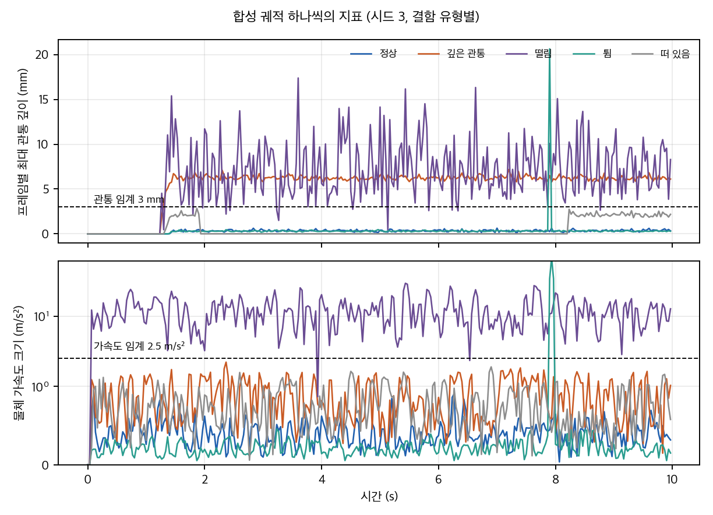
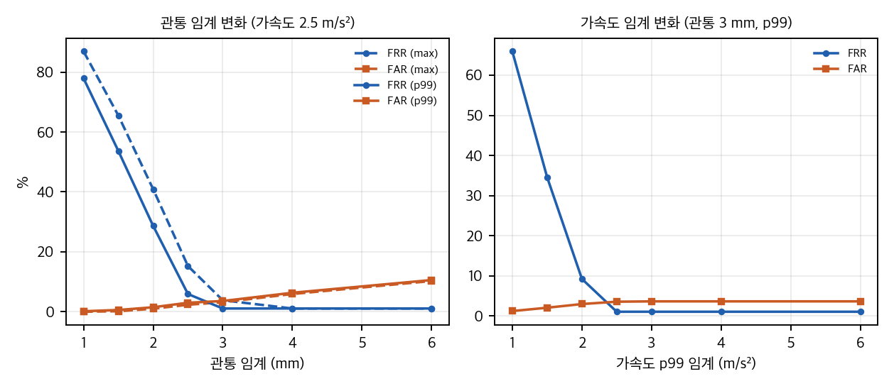
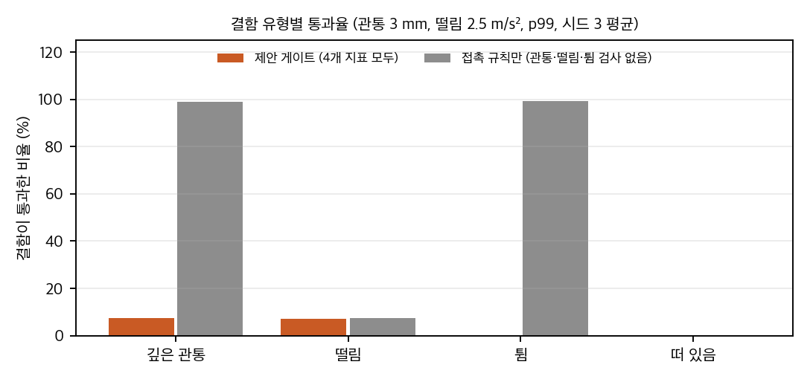
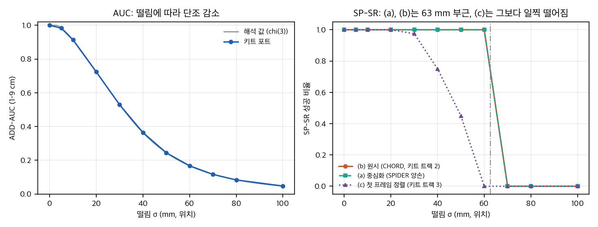

CoRL 2026 튜토리얼 *From Human Videos to Dexterous Robot Capability*는 사람 영상을 로봇 학습 데이터로 바꾸는 과정을 **검증 게이트** 다섯 개로 나눠서 설명합니다. 공개된 것은 튜토리얼 웹 페이지, 동반 챌린지 페이지, 그리고 `nvidia-isaac/video_to_data` 저장소입니다. 심사를 거친 논문이나 arXiv 판은 없습니다. 이 글은 페이지의 주장을 저장소 코드와 대조한 기록입니다. 접근일은 2026-11-12, 저장소 커밋은 `5226e34`(2026-11-09)입니다.

## 다섯 게이트

1. **질의 가능 구간:** VLM이 영상을 1–30초 행동 구간으로 나누고, 검증 루프를 최대 3회 돌립니다. 유효 여부는 VLM의 불리언 판정 하나로 정합니다. 검증 점수에는 임계가 없습니다.
2. **그럴듯한 재구성:** 깊이, 마스크, 메시, 손·몸, 6D 자세를 여러 모델로 만듭니다. 자동 QC는 다시점 워크플로에만 있고 실루엣 포함률 0.8 같은 임계가 붙습니다. 손-물체 관통 손실은 기본 설정에서 가중치 0입니다.
3. **시뮬레이션 자산:** 메시를 USD로 바꾸고 낙하 시험을 합니다. 지지 자세 편차는 2°, 3°, 2 cm 이내로 봅니다. 질량과 축척은 검증하지 않습니다.
4. **리타겟 모션:** 스케일과 정렬 오차는 실패 조건이고, 접촉 라벨은 18 mm 거리와 2프레임 디바운스로 정합니다. 이 접촉 라벨은 부호가 없어서 관통과 접촉을 구분하지 못합니다.
5. **정책 산출물:** lift-hold 성공 판정은 들기 0.10 m, 유지 0.05 m를 20 샘플 연속, 배치 안정성까지 봅니다. 이 판정은 코드와 프로파일이 일치합니다.

## 기하 게이트 toy

접촉 규칙만 쓰면 관통 결함을 거의 못 잡습니다. 합성 궤적에서 깊은 관통 결함의 99%가 접촉 규칙을 통과했습니다. 관통 깊이, 물체 가속도 p99, 프레임 간 최대 이동, 움직일 때의 접촉 비율을 함께 보면 결함 대부분을 걸러낼 수 있습니다.

합성 궤적 하나의 프레임별 최대 관통 깊이(위)와 물체 가속도(아래). 점선은 최선 임계입니다. 정상 궤적의 관통은 대부분 2–3 mm 아래에 머물고, 떨림과 깊은 관통 결함은 임계를 넘습니다.

임계값 3 mm와 가속도 2.5 m/s²에서 정상 기각은 1.1%, 결함 수용은 3.6%였습니다. 관통 임계를 2 mm로 낮추면 정상 기각이 28.7%까지 올라갑니다. 관통 임계를 6 mm로 올리면 결함 수용이 10.6%가 됩니다. 이 결과는 구형 손가락과 상자로 만든 합성 데이터에서 나온 수치입니다. 실데이터의 임계로 쓰면 안 됩니다.

관통 임계(왼쪽)와 가속도 임계(오른쪽)를 바꿀 때의 거짓 기각(FRR)과 거짓 수용(FAR). 시드 3개 평균입니다.

결함 유형별 통과율. 주황색 막대는 제안 게이트, 회색 막대는 접촉 규칙만 쓴 경우입니다. 접촉 규칙만 쓰면 깊은 관통과 튐이 거의 그대로 통과합니다.

## 챌린지 지표

챌린지 트랙 2의 SP-SR, MP-SR, AUC, MPPE 임계는 키트 채점 코드가 정본입니다. SP-SR은 0.10 m와 0.5 rad, MP-SR은 0.03 m와 30°입니다. 페이지의 "as defined in the CHORD manuscript"는 지표 이름의 출처를 밝히는 말입니다. 채점 기준이 CHORD 논문 본문에 숫자로 적혀 있지는 않았습니다.

## 키트 지표를 직접 옮겨 보기

챌린지 키트의 채점 식(PEN, SP-SR, MP-SR, AUC, RPE, MPPE)을 numpy로 옮기고, 답을 아는 합성 궤적 40개로 확인했습니다. 키트 코드는 실행하지 않고 읽어서 옮겼습니다.

SP-SR의 정의는 세 가지입니다. SPIDER 양손 모드는 궤적마다 시간 평균 오프셋을 뺀 뒤 위치를 잽니다. CHORD 평가 코드는 원시 시간 평균 오차를 씁니다. 키트 트랙 3은 첫 프레임을 맞춘 뒤 같은 오차를 씁니다. 같은 합성 궤적에서 지속 오프셋은 중심화와 첫 프레임 정렬이 용서하고 원시 평균은 실패시킵니다. 선형 드리프트는 중심화만 절반쯤 용서합니다. 첫 프레임 정렬은 잠깐 있다 사라지는 초기 오차를 전 구간에 남겨서 오히려 실패시킵니다.

떨림 σ를 키우면 AUC는 해석 곡선과 거의 같게 줄어듭니다. SP-SR은 평균 떨림 노름이 0.10 m를 넘는 σ 약 63 mm에서 떨어집니다. 첫 프레임 정렬을 쓰는 정의는 30 mm부터 떨어집니다.

위치 떨림 σ에 따른 ADD-AUC(왼쪽)와 SP-SR 성공 비율(오른쪽). 합성 궤적으로 직접 계산한 결과입니다. 왼쪽의 회색 선은 χ(3) 분포로 구한 해석 값입니다.

## 숫자 점검

- 상금 $54K은 트랙 2를 티어 세 개로 셀 때만 맞습니다.
- 실로봇 결과 4/5 대 0/5는 시행 5회씩이라 Fisher 양측 검정 p = 0.048입니다. 근거로 쓰기 어렵습니다.
- 시뮬레이션 폐루프 결과는 캡션에 100 롤아웃, 본문에 200 롤아웃으로 적혀 있어 확인이 필요합니다.

## 재현 가능성

이 파이프라인은 CUDA, Docker, Isaac Lab을 전제로 합니다. 등록형 자산(MANO, GR00T 모델 수락)도 필요합니다. 맥에서 재현하는 것은 불가능합니다. 노트북 대신 쓸 수 있는 CPU 점검(페이지 숫자, 키트 상수, 기하 toy)은 가능합니다.

## 출처와 라이선스

- 저장소 `LICENSE`: 문서와 스킬은 CC BY 4.0, 소스는 Apache-2.0입니다. 재구성 모델 여럿은 비상업 또는 비파생 조건이라 각자 확인해야 합니다.
- 이 글은 페이지 미디어를 싣지 않았습니다. 그림은 합성 궤적으로 직접 그린 것입니다.
- 분석 코드(`gate_toy.py`, `page_checks.py`, `plot_figures.py`, `extra_kit_metrics.py`)와 결과 JSON은 `publish/git/`에 있습니다.

## 자료

- [통합 리포트 PDF](report/report_public.pdf)
- [01. 튜토리얼 페이지와 챌린지 페이지 분석](analysis/01_page_analysis.md)
- [02. 선행연구 계보, 관련 저장소, GitHub 목록](analysis/02_prior_work.md)
- [03. 검증 게이트별 분석, 숫자 점검, 기하 타당성 게이트 toy](analysis/03_analysis.md)
- [04. 코드 검증: 페이지 주장 ↔ 저장소 코드, 키트 지표 상수, 구현 가능성](analysis/04_code_verification.md)
