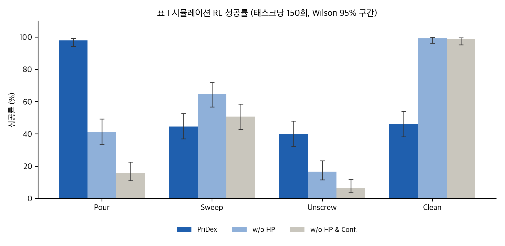
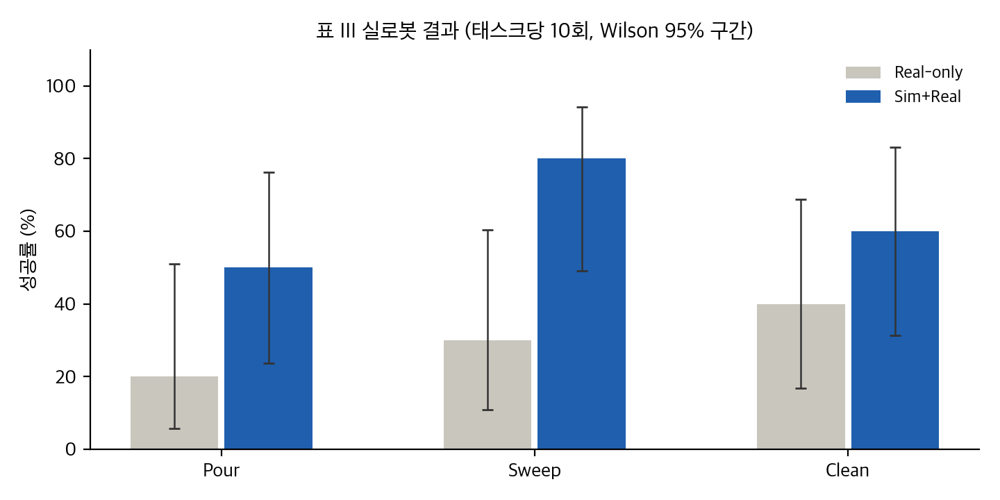

> **논문:** Yanghong Liu, Yang Chen, Kailang Xu, Bang Du, Feiyang Yang, Jiawei Xia, Zhengtao Yao, Yubiao Zhang, Masayoshi Tomizuka, Ruihai Wu, Wei Zhan. *From Human Videos to Bimanual Dexterous Manipulation Data: Confidence-Guided RL Refinement of Video Priors.* arXiv:2611.21908 (v1, 2026-11-16, cs.RO).
> 학회 표기는 확인하지 못했습니다. 공식 코드와 프로젝트 페이지는 찾지 못했습니다. 이 글의 그래프는 논문 수치로 우리가 그린 것입니다.

## 논문이 묻는 것

양손 다지 로봇의 시연은 비쌉니다. 사람 영상은 많지만, 손 재구성 오차와 사람-로봇 형태 차이 때문에 바로 로봇 학습에 쓰기 어렵습니다.

PriDex는 사람 손 자세를 그대로 옮기지 않습니다. 대신 **어디를 접촉하는지**와 **물체가 어떻게 움직이는지**만 남깁니다. 그래스프는 로봇 손 후보 중에서 접촉 영역에 맞는 것을 고릅니다. 물체 궤적은 참조로 쓰고, 그 궤적의 신뢰도가 낮을 때는 양손 손목의 상대 움직임 방향을 보조 안내로 씁니다. 강화학습은 이 참조를 로봇의 운동학과 접촉 제약에 맞게 다듬습니다. 성공한 전 과정 궤적은 이미지 기반 Diffusion Policy를 학습하는 데 쓰입니다.

## 이 글에서 확인한 것

**1. 평균 성공률 우위는 통계적으로 확인되지 않습니다.** 시뮬레이션 평균은 PriDex 57.2%, 두 번째인 손목 안내 제거 버전은 55.5%입니다. 풀링 Fisher 검정 p = 0.60입니다. PriDex가 확실히 앞서는 것은 Pour(98% 대 41%)와 Unscrew(40% 대 17%)입니다. Sweep과 Clean에서는 오히려 세 ablation 가운데 가장 낮습니다.

*그림: 논문 표 I의 태스크별 성공률(150회)과 Wilson 95% 구간. 논문 수치를 다시 그렸습니다.*

**2. 신뢰도 적응은 Pour에서 뚜렷하게 작동합니다.** 신뢰도 적응을 끄면 평균이 55.5%에서 43.0%로 떨어집니다. 풀링 p = 2×10⁻⁵입니다. 태스크별로는 Pour가 가장 크고, Clean에서는 차이가 없습니다.

**3. 증류 정책의 개선은 보정 후 Clean에서만 남습니다.** 증류 정책의 평균은 31.3%이고 손목 안내 제거 버전은 24.2%입니다. 태스크별 Fisher 검정에 Bonferroni 보정(×4)을 적용하면 Clean(p = 0.036)만 남습니다. Pour와 Sweep은 150 시도로는 구분되지 않습니다.

**4. 실로봇 결과는 방향이 맞지만 10회 시행입니다.** 실데이터만 쓴 경우 평균 30.0%(9/30), 시뮬레이션 사전학습을 더한 경우 63.3%(19/30)입니다. 풀링 p = 0.019이고, 태스크별로는 p ≥ 0.07입니다. 시뮬레이션 데이터 120개가 추가된 설계라 데이터 양의 효과와 섞여 있습니다.

*그림: 논문 표 III의 실로봇 성공률(태스크당 10회)과 Wilson 95% 구간. 논문 수치를 다시 그렸습니다.*

## 읽으면서 걸리는 것

- **표 오류:** H2S2R의 Sweep 성공률 3.0%는 150 에피소드로 만들 수 없는 값입니다. 저자 확인이 필요합니다.
- **교사-학생 격차:** 손목 안내 제거 교사의 Clean 성공률은 99.3%인데, 증류 정책은 6.0%입니다. 논문은 이를 다루지 않습니다.
- **재현 조건:** Isaac Sim 5.1, CUDA GPU, 양팔 다지 로봇이 필요합니다. 공식 코드가 없어 파이프라인 전체를 처음부터 맞춰야 합니다.

## 정리

PriDex의 방향은 흥미롭습니다. 사람 영상을 "재생할 궤적"이 아니라 "다듬을 우선정보"로 보는 관점입니다. 다만 본문의 수치만으로는 평균 우위를 확정할 수 없습니다. 특히 Pour와 Unscrew를 제외하면 기존 방법과의 차이가 분명하지 않습니다. 시드 수, 교사별 결과, 공식 코드가 공개되면 다시 볼 가치가 있습니다.

## 자료

- [통합 리포트 PDF](report/report_public.pdf)
- [01 논문 분석: PriDex](analysis/01_paper_analysis.md)
- [02 선행연구와 관계](analysis/02_prior_work.md)
- [03 수치 재계산과 해석](analysis/03_analysis.md)
- [04 주장 검증 (공식 코드 없음: 주장 C1–Cn 대조)](analysis/04_claim_verification.md)
