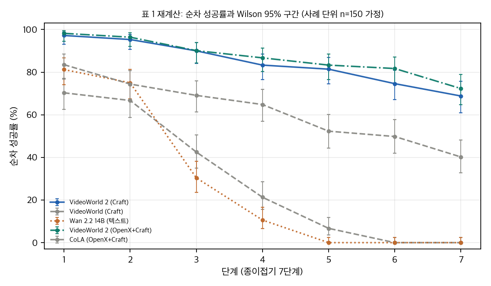
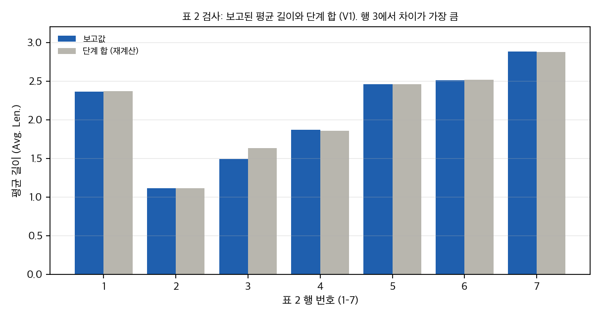

> **논문:** Zhongwei Ren, Yunchao Wei, Xiao Yu, Guixun Luo, Yao Zhao, Bingyi Kang, Jiashi Feng, Xiaojie Jin. *VideoWorld 2: Learning Transferable Knowledge from Real-world Videos.* CVPR 2026, arXiv:2602.10102 (v1, 2026-02-10. 2026-11-21 기준 v2 없음).
> 공식 코드는 GitHub ByteDance-Seed/VideoWorld의 `videoworld2/` 폴더(Apache-2.0)에 있습니다. 이 글의 그림은 우리가 표 값으로 그린 그래프 두 장입니다. 논문 그림은 쓰지 않았습니다.

## 논문이 묻는 것

VideoWorld는 라벨 없는 영상에서 규칙과 계획을 배우는 자기회귀 영상 모델입니다. 바둑 기보와 시뮬 로봇에서는 잘 되지만, 실제 손동작 튜토리얼처럼 외형이 다양하고 1분 가까이 이어지는 영상에서는 잠재 행동 코드가 배경과 조명 같은 외형을 함께 담아 실패합니다.

VideoWorld 2의 답은 외형을 행동 학습에서 떼어 내는 것입니다. 잠재 코드를 만드는 인코더는 행동 변화만 담고, 재구성 디코더 자리에 사전학습된 영상 확산 모델(Cosmos DiT 2B)을 둡니다. 확산 모델은 외형을 채우고, 잠재 코드는 자기회귀 Transformer(Cosmos AR 4B 구조)가 다음 토큰으로 예측합니다.

## 이 글에서 확인한 것

**1. 종이접기 7단계 성공률은 평가 표본 기준으로 크게 앞섭니다.** Craft 데이터만 쓴 설정에서 VideoWorld 2는 마지막 단계에서 68.8%입니다. 같은 단계의 Wan 2.2 14B와 VideoWorld는 0.0%입니다. 사례 150개를 독립으로 보면 VideoWorld 2의 95% 구간은 [61.0, 75.7]입니다.

*그림 1. 논문 표 1의 종이접기 순차 성공률을 다시 그린 그래프입니다. 구간은 사례 단위 150개 가정의 Wilson 95%입니다. 우리가 그렸으며 논문 그림이 아닙니다.*

**2. 하지만 학습 실행 분산이 없습니다.** 기준선은 한 번씩만 학습했고, 논문은 학습 시드와 반복 실행을 보고하지 않습니다. p값이 아무리 작아도 "학습을 다시 하면 같은 격차가 나온다"는 뜻은 아닙니다.

**3. "최대 70% 향상"은 기준이 없습니다.** 단계별 절대 차이의 최대는 74.7포인트이고, 기준선이 0%인 단계가 많아 상대 향상으로는 계산되지 않습니다.

**4. 본문과 표가 맞지 않는 곳이 여럿 있습니다.**
- CALVIN 표에서 LAPA 10% 행의 평균 길이는 보고값 1.49인데, 단계별 성공률을 더하면 1.63입니다.
- 절제 표 3c의 마지막 행(72.3 / 80.9)은 기본 설정(68.8 / 77.5)과 다릅니다.
- 본문의 "LPIPS 약 0.9 개선"은 표의 차이(0.07)와 맞지 않습니다.
- 부록의 "종이접기 55.3%"는 5.2시간 대 7시간(74%)과 맞지 않습니다.

*그림 2. 표 2의 보고된 평균 길이(파랑)와 단계별 성공률의 합(회색)입니다. 두 값이 거의 같은 행이 대부분이지만 행 3은 0.14 차이가 납니다. 우리가 그렸으며 논문 그림이 아닙니다.*

**5. 공식 코드는 논문과 학습 설정이 다릅니다.** 학습률은 1e-4가 아니라 약 4.3e-5입니다. 본문은 재구성 손실을 버린다고 쓰지만, 알고리즘 1과 코드는 재구성 손실을 더합니다. 색 증강과 제어 가중치 0.5도 논문에 없습니다.

**6. 공개 저장소에는 자기회귀 단계 학습 코드가 없습니다.** dLDM 학습과 추론 스크립트는 있지만, AR 4B 학습, CALVIN 평가, 단계 분류기 코드는 찾지 못했습니다. README는 AR 학습용 잠재 코드 파일을 제공한다고 쓰지만, 이를 쓰는 학습 코드는 없습니다.

## 이 맥에서 재현할 수 있나

**재현은 불가능합니다.** 학습에는 CUDA GPU 여러 장과 OpenX 규모의 데이터가 필요합니다. 공식 설치 스크립트는 CUDA 전용 패키지를 요구합니다. 가능한 것은 공식 dLDM 체크포인트와 Cosmos 2B로 한 사례를 추론하는 일인데, Cosmos 2B는 NVIDIA 게이트 라이선스이고 CUDA 의존성을 MPS용으로 바꿔야 합니다. 이 부분은 아직 해 보지 않았습니다.

## 라이선스와 그림

- 논문은 arXiv abs 페이지의 "view license"가 CC BY 4.0을 가리킵니다. PDF 본문과 첫·마지막 쪽에는 저작권 고지가 없습니다.
- 논문 그림은 손동작 튜토리얼 프레임, 데이터셋 프레임, 생성 영상이 섞여 있어 게시본에서 뺐습니다. 그래프 두 장은 우리가 표 값으로 그렸습니다.

## 정리

VideoWorld 2는 "외형을 확산 모델에 맡기면 행동 코드가 전이된다"는 설계를 잘 보여 줍니다. 다만 지금 공개된 증거로는 기준선과의 격차가 학습 실행 사이에서도 유지되는지 알 수 없고, 로봇 과제 이득의 크기도 확정할 수 없습니다. 같은 설계를 우리 실험에 옮긴다면 시드 여러 개로 학습 분산부터 재야 합니다.

## 자료

- [통합 리포트 PDF](report/report_public.pdf)
- [01. 논문 분석: VideoWorld 2 (arXiv:2602.10102)](analysis/01_paper_analysis.md)
- [02. 선행연구, 가까운 대안, 공식 코드](analysis/02_prior_work.md)
- [03. 수치 재계산, 일관성 검사, 주장 판정](analysis/03_analysis.md)
- [04. 공식 코드 대조와 구현 가능성](analysis/04_code_verification.md)
