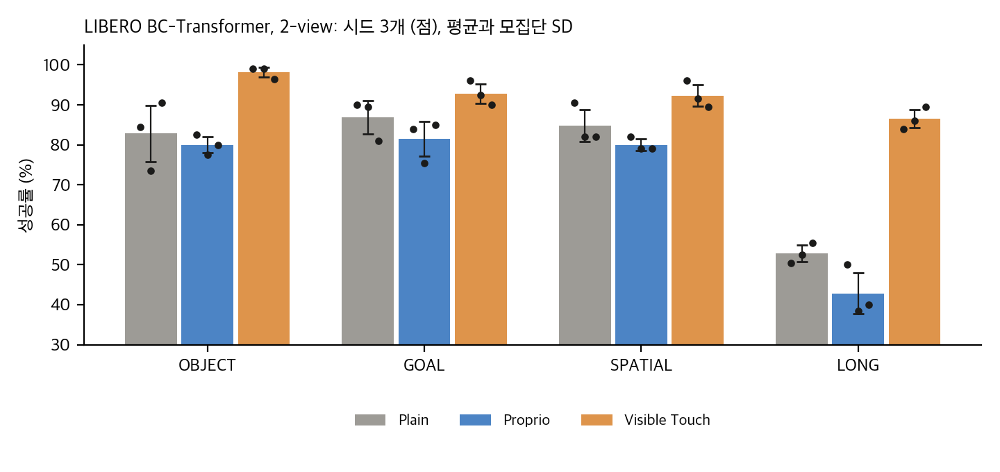
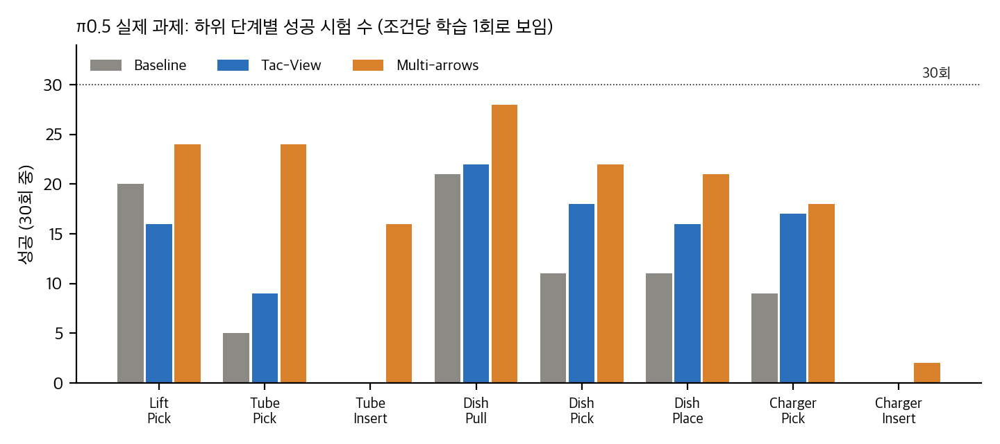
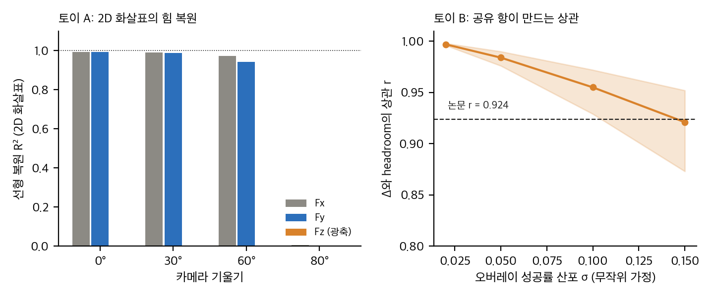

> **논문:** Dogan, Sun, Xu, Wu, Peng, Hong, Cui (UCLA). *Visible Touch: Rendering Contact for Visuomotor Policies.* CoRL 2026 Spotlight, arXiv:2609.14156 (v2, 2026-10-07; v1 2026-09-12).
> **라이선스:** arXiv 페이지의 CC BY 4.0입니다. 그래도 이 글은 논문 그림을 싣지 않았습니다. 그래프는 논문 표의 수치를 옮겨 직접 그렸습니다.
> **코드:** 프로젝트 페이지가 링크한 저장소는 센서 몰드 생성 도구뿐입니다. 읽기만 했고 실행하거나 설치하지 않았습니다. 오버레이 코드와 실험 코드는 공개되어 있지 않습니다.

---

## 논문이 하는 주장

대부분의 정책은 영상과 고유감각만 씁니다. 촉각을 넣는 기존 방법은 상태 벡터에 이어 붙이거나, 별도 인코더를 달거나, 점 구름으로 바꿉니다. 이 논문은 병목이 접촉 정보 자체가 아니라 **전달 방식**이라고 주장합니다. 접촉 신호를 정책이 이미 보는 영상 좌표에 화살표로 그리면, 구조를 바꾸지 않고도 이미지 기반 정책이 씁니다.

구현은 이렇습니다. 손가락 센서 요소 위치와 측정값을 forward kinematics와 카메라 외부 파라미터로 옮겨 핀홀 모델로 투영합니다. 화살표는 요소별, 손가락 평균, 크기 막대 세 가지를 비교합니다. 센서는 3×3 자석과 자력계 9개로 된 저비용 자기식 센서이고, 부품 비용은 50달러 미만이라고 합니다.

## 헤드라인 수치는 대부분 맞습니다

표에서 값을 옮겨 다시 계산했습니다.

- LIBERO BC-Transformer 2-view 평균 개선: 원문 +15.7 pp, 재계산 +15.6 pp.
- miniVLA 미세조정 평균 개선: +25.3 pp, 재계산 +25.3 pp.
- 실제 π0.5 과제 macro 평균 개선: +30.3 pp, 재계산 +30.3 pp.

다만 표의 "±"는 신뢰구간이 아니라 시드 3개의 모집단 표준편차입니다. 표본 표준편차로 바꾸면 약 20% 커집니다.

그래프: LIBERO BC-Transformer 2-view의 시드별 성공률(점)과 평균 ± 모집단 표준편차. 논문 부록의 시드별 표 값으로 직접 그렸습니다.

## 통계적으로 확실한 것은 적습니다

시드가 3개이고 과제당 20회 시험이라서, 시드 단위 Welch 검정으로 보면 다음과 같습니다.

- LONG(+33.7 pp)만 분명합니다(p=0.0001).
- OBJECT(+15.3, p=0.09), GOAL(+6.0, p=0.17), SPATIAL(+7.5, p=0.10)은 구분되지 않습니다.

평균 +15.7 pp는 LONG이 주로 끌고 갑니다.

실제 실험은 조건당 30회 시험이고 학습은 1회로 보입니다. Fisher 검정을 8개 하위 단계에 적용하고 Holm으로 보정하면 Tube Pick과 Tube Insert만 남습니다. 과제 평균 기준 macro +30.3 pp는 Tube 단계에 크게 기댑니다. 최종 단계만 보면 차이는 +26.7 pp입니다.

그래프: π0.5 실제 과제의 하위 단계별 성공 시험 수(30회 중). 논문 부록의 표 값으로 직접 그렸습니다. 조건당 학습 1회로 보입니다.

## 비교가 공정하지 않은 곳

- **miniVLA 기준선:** 과제마다 다른 학습 레시피의 단일 실행 중 가장 나은 값을 씁니다. 반면 오버레이 값은 5시드 평균입니다. 레시피를 맞춘 차이는 +10.5 pp에서 +43.1 pp까지 흩어집니다. 같은 기준선 모델이 레시피에 따라 GOAL 48.5%와 37.4%로 달라집니다.
- **사전학습 계산량:** 본문은 대조 모델이 더 많은 계산을 썼다고 하지만, 오버레이 모델이 학습 스텝을 3배(200k 대 60k) 더 썼습니다.
- **시뮬 접촉은 오라클 힘:** LIBERO 오버레이는 MuJoCo 접촉 힘에서 만들어집니다. 실제 센서의 잡음과 드리프트가 없는 상태의 개선입니다.
- **비교 구현이 하나씩:** 상태 벡터 기준선(Proprio)과 별도 영상 채널 기준선(Tac-View)은 각각 한 가지 구현입니다. 학습형 촉각 인코더와의 비교는 없습니다.

## 2D 화살표가 놓치는 것

화살표는 2차원입니다. 카메라 광축 방향의 힘은 화면에서 거의 움직이지 않습니다. 간단한 numpy 토이에서 카메라가 광축에 맞으면 2D 화살표로 가로와 세로 힘은 거의 완벽히 선형 복원되지만, 광축 방향 힘은 선형으로 거의 복원되지 않았습니다. 논문은 원근 효과로 깊이 정보가 들어간다고 하지만 정량 검증은 없습니다.

그래프: 왼쪽은 토이 A(카메라 기울기별 2D 화살표의 선형 복원 R²), 오른쪽은 토이 B(오버레이 성공률 산포에 따른 헤드라인 상관의 중앙값). 우리가 만든 numpy 토이 결과입니다.

논문은 과제 난이도와 개선의 상관을 r=0.924로 보고합니다. 토이 B는 진짜 효과가 없는데도 두 값이 같은 항을 공유하면 비슷한 상관이 나온다는 것을 보입니다. 그러니 이 상관을 "시각 실패가 많은 과제에서 더 돕는다"는 증거로 읽으면 안 됩니다.

## 구현할 수 있을까

공식 저장소에서 몰드 생성 도구와 센서 설계 파일은 확인했습니다. 몰드 치수는 논문 BOM(자석 Ø2 mm)과 저장소 설정(Ø3 mm)이 어긋납니다. 오버레이 투영 코드, LIBERO와 π0.5 실험 코드, PCB 레이아웃은 저장소에 없습니다.

- **전면 재현은 불가능합니다.** π0.5 실험은 H200 급 GPU와 실로봇이 필요하고, miniVLA 사전학습은 GPU 여러 장이 필요합니다.
- **부분 구현은 가능합니다.** 투영 오버레이는 논문 식으로 numpy에서 구현할 수 있고, 몰드 도구는 CAD 환경이 있으면 돌릴 수 있습니다. 소형 LIBERO 설정에서 접촉 유무를 비교하는 것도 시간을 들이면 가능합니다.

## 정리

Visible Touch는 촉각을 정책의 입력 좌표에 맞춘다는 설계 원칙이 흥미롭습니다. 다만 근거의 상당 부분은 시드 3개, 시험 30회, 그리고 구현이 한 가지뿐인 비교에서 나옵니다. 결론을 가져다 쓰려면 원자료와 오버레이 코드가 필요합니다.

## 자료

- [통합 리포트 PDF](report/report_public.pdf)
- [Visible Touch: Rendering Contact for Visuomotor Policies (arXiv:2609.14156) 논문 분석](analysis/01_paper_analysis.md)
- [Visible Touch 선행연구와 관련 자료 (arXiv:2609.14156)](analysis/02_prior_work.md)
- [Visible Touch 수치 재계산과 일관성 검사 (arXiv:2609.14156 v2)](analysis/03_analysis.md)
- [Visible Touch 논문 ↔ 공식 저장소 대조와 구현 가능성 (arXiv:2609.14156 v2)](analysis/04_code_verification.md)
