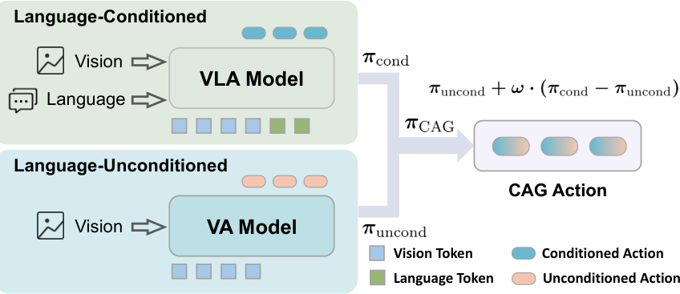
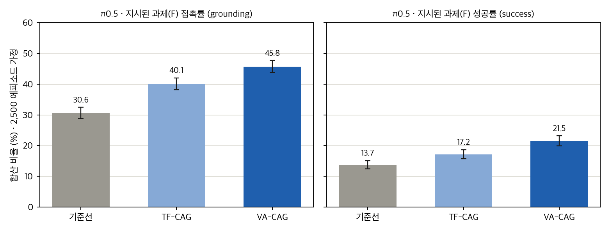
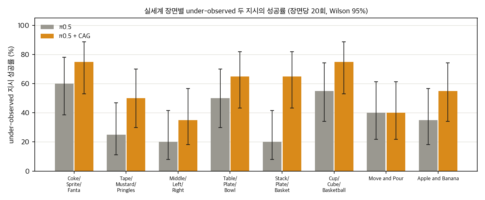
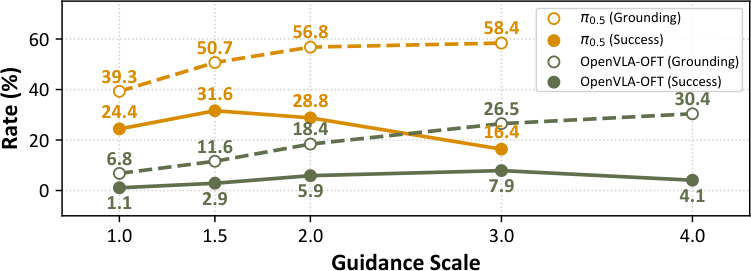
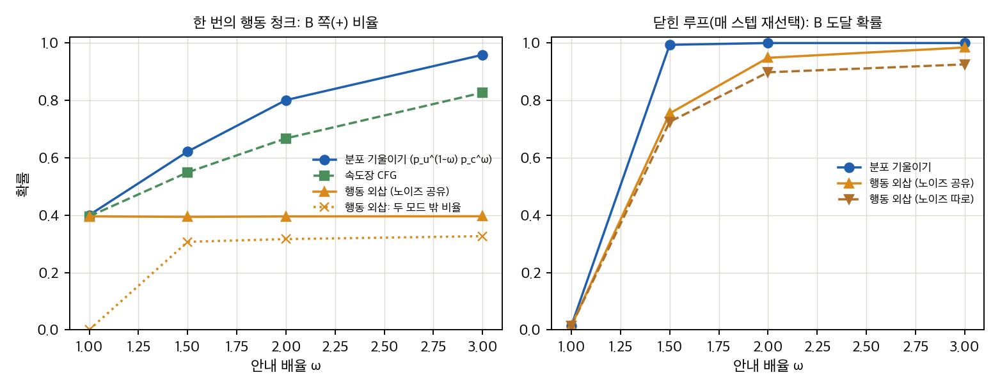

> **논문:** Yu Fang, Yuchun Feng, Dong Jing, Jiaqi Liu, Yue Yang, Zhenyu Wei, Daniel Szafir, Mingyu Ding. *When Vision Overrides Language: Evaluating and Mitigating Counterfactual Failures in VLAs.* CoRL 2026 스포트라이트, arXiv:2602.17659 (v3, 2026-11-04).
> 공식 코드는 GitHub yuffish/VLA-CF(MIT)에 있습니다. 이 글의 그림은 논문 그림 두 장(출처 표기)과 우리가 그린 그래프입니다. 코드는 읽기만 했고 실행하지 않았습니다.

## 논문이 묻는 것

장면 하나에서 일부 과제만 시연된 데이터로 미세조정한 VLA는, 같은 장면에서 다른 지시를 받아도 훈련 과제를 하는 경향이 있습니다. 논문은 이를 "반사실 실패"라 부르고 두 가지를 내놓습니다. 같은 LIBERO 장면에 다른 지시를 주는 벤치마크 LIBERO-CF(네 스위트, 50과제)와, 언어를 받은 가지와 받지 않은 가지의 행동 청크를 `a_uncond + ω(a_cond − a_uncond)`로 합치는 추론 방식 CAG입니다. 비조건 가지는 같은 모델에서 언어를 뺀 것(TF)이거나 언어 없이 따로 미세조정한 모델(VA)입니다.

*그림 3 (논문 원문). © 저자, CC BY 4.0, 출처 arXiv:2602.17659.*

## 이 글에서 확인한 것

**1. 표 수치는 대부분 일치합니다.** 표 1–7의 평균 열, 표 2와 표 3·4의 교차 참조, 본문 문장 속 수치 20개를 다시 계산했습니다. 표 3과 표 7의 "Average"는 네 스위트 값의 단순 평균이라, 과제 수(15/10/10/15)로 가중하면 π0.5 접촉률이 0.1–0.5 %p 낮아집니다. 결론은 바뀌지 않습니다.

**2. CF-Long의 비율은 스위트당 500회 가정과 맞지 않습니다.** 과제당 50회, 10과제라면 비율은 0.2의 배수여야 합니다. CF-Long 열 48개 중 24개(예: 62.9, 4.9)는 그렇지 않고, 450회 또는 550회 기준이면 48개가 모두 가능합니다(시행 수 가정). 다른 세 스위트는 750/500/750회로 모두 맞습니다. 공식 코드에는 이 집계를 하는 코드가 없어 저자 확인이 필요합니다.

**3. π0.5의 개선은 통계적으로 분명하고, π0의 성공률 개선은 구분되지 않습니다.** 스위트당 에피소드 750/500/500/750회를 가정해 합산하면 π0.5 접촉률은 30.6 → 40.1%(TF), 45.8%(VA), 성공률은 13.7 → 17.2%, 21.5%입니다(비쌍 Fisher p < 1e-3). π0의 성공률은 TF −0.2, VA +0.8 %p입니다(p = 0.38).

*그래프 (우리가 그림). 표 3의 값을 시행 수 가정으로 합산한 비율과 Wilson 95% 구간입니다.*

**4. CAG는 훈련 과제 성공을 더 많이 줄입니다.** π0.5 VA에서 지시 과제 성공은 +8.5 %p, 훈련 과제 성공은 −24.7 %p입니다. 두 과제 중 하나를 끝낸 비율은 74.1 → 57.9%로 줄었습니다. 훈련 과제로 가는 것을 줄이는 것이 목적이지만, 지시 과제 성공이 그만큼 따라 늘지는 않았습니다.

**5. 실세계 +9.4%, +17.2%는 여섯 주요 장면의 세 지시(in-domain 포함) 평균입니다.** under-observed 지시만 합산하면 성공이 120회 중 46 → 73회(38.3 → 60.8%, p = 0.0008)입니다. 장면 하나(20회)로 보면 Stack/Plate/Basket만 분명합니다(4 → 13회). 본문의 "공간 추론에서 접촉률 +16.6%"는 표 9, 10에서 다시 읽으면 장면별 +6.7과 +3.4로 나옵니다. "Plate 60%, Bowl 40%"는 표에서 성공률 값입니다(접촉률은 80%, 50%).

*그래프 (우리가 그림). 논문 표 9, 10의 분수에서 다시 계산한 장면당 20회 성공률과 Wilson 95% 구간입니다.*

**6. 안내 배율은 보고 스위트에서 골랐습니다.** 그림 4의 곡선은 CF-Spatial의 VA-CAG 값이고 표 3에 같은 값이 들어갑니다. 논문의 ω는 π0 계열 1.5, OpenVLA-OFT 3.0인데 공식 README의 예시는 TF 2.0, OpenVLA-OFT 2.0입니다.

*그림 4 (논문 원문). © 저자, CC BY 4.0, 출처 arXiv:2602.17659.*

## 토이로 본 것

v1·v2의 부록은 CAG를 `P(a|o)P(l|a,o)^ω`로 읽을 수 있다고 쓰고, v3는 "CFG에서 영감을 얻은 행동 공간 외삽 휴리스틱"이라고 씁니다. 이 차이를 1차원 가우시안 혼합 토이로 확인했습니다. 모드 A는 훈련 과제, 모드 B는 지시된 과제이고, 시각만 보는 정책의 B 비중 0.1과 언어를 받은 정책의 B 비중 0.4는 가정입니다.

- **한 번의 청크.** 공식 구현처럼 같은 노이즈로 두 끝점을 만들어 외삽하면, B쪽으로 가는 비율은 언어 가지의 비율(0.4)에서 변하지 않고 두 모드 밖 행동이 약 3분의 1 생깁니다. 분포 기울이기는 ω = 3에서 0.96, 속도장 CFG는 0.83입니다.
- **닫힌 루프.** 매 스텝 다시 뽑는 위치 이동에서는 평균 행동이 ω배로 기울어, B 도달이 ω = 1의 1.4%에서 ω = 1.5의 75.5%로 오릅니다.

효과가 한 청크의 모드 선택이 아니라 폐루프에서의 평균 이동에서 나올 가능성을 시사하지만, 이는 1차원 토이에서만 확인한 것이고 VLA의 증거는 아닙니다.

*그래프 (우리가 그림). 왼쪽은 한 청크에서 B 쪽(+) 비율, 오른쪽은 닫힌 루프의 B 도달 확률입니다.*

## 공식 코드와 논문의 차이

CAG 식, TF와 VA 두 변형, π0.5 VA의 학습 설정(배치 32, 30k 스텝, 5e-5, EMA 0.999), 스위트 구성(15/10/10/15/15)은 논문과 맞습니다. 다른 점은 다음과 같습니다.

- README 예시의 안내 배율이 논문과 다릅니다(위 6번).
- π0 VA의 학습 설정은 명시되지 않아 기본값(학습률 2.5e-5, EMA 0.99)을 쓰는 것으로 읽히고, 논문 서술(5e-5, 0.999)과 다릅니다.
- 두 가지는 같은 노이즈를 받고 순차로 호출됩니다. 논문은 병렬 실행을 전제로 지연을 보고합니다.
- 평가는 조건 네 개 중 하나라도 만족하면 에피소드를 끝내고, 접촉은 에피소드 중 한 번이라도 그리퍼 몸체가 닿으면 참입니다.
- 표 3의 Faithful과 Biased 집계 코드, X-VLA와 실세계 코드는 저장소에 없습니다.

## 한계

논문 PDF와 공개 코드(정적 읽기)만 썼습니다. 에피소드 단위 결과가 없어 쌍체 검정을 하지 못했고, 시행 수는 부록 B.1에서 가정했습니다. 그림에서 읽은 값은 실세계 평균 막대 비교에만 썼습니다. 토이는 1차원 혼합이고 상태에 무관한 모드 확률을 가정합니다. 논문 수치와 다르게 읽힌 곳(CF-Long 분모, 공간 추론 문장)은 저자 확인이 필요합니다.

## 자료

- [통합 리포트 PDF](report/report_public.pdf)
- [01. 논문 분석](analysis/01_paper_analysis.md)
- [02. 선행연구와 관련 저장소](analysis/02_prior_work.md)
- [03. 수치 재계산과 해석](analysis/03_analysis.md)
- [04. 공식 코드 대조와 구현 가능성](analysis/04_code_verification.md)
