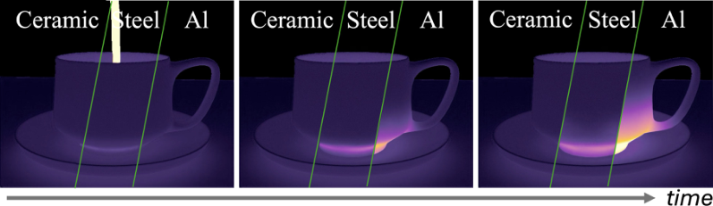
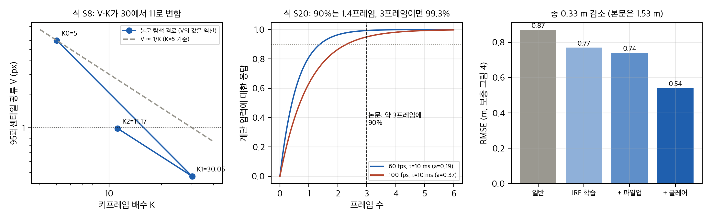
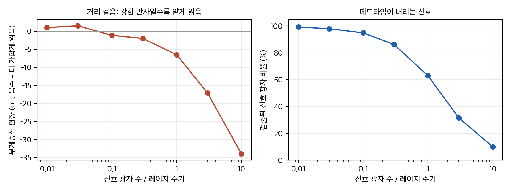
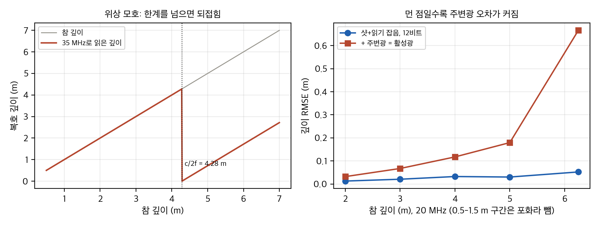

> **논문:** Sacha Jungerman 외. *VisionSIM: Beyond Idealized Sensors — A Multi-Modal Simulator for Robot Perception.* CoRL 2026 스포트라이트, arXiv:2611.08368 (v1, 2026-11-05, 단일 버전).
> 공식 코드는 GitHub WISION-Lab/visionsim(GPL-3.0-or-later)에 있습니다. 코드는 정적으로 읽기만 했고 실행하거나 설치하지 않았습니다. 이 글의 그림은 논문 그림 한 장(출처 표기)과 우리가 그린 그래프입니다.

## 논문이 묻는 것

로봇 시뮬레이터는 보통 깨끗한 영상을 내놓습니다. 실제 카메라는 모션 블러가 있고, 단일 광자 LiDAR는 레트로리플렉터 앞에 허상을 보고하며, 열화상은 방금 닿은 손자국을 한동안 남깁니다. VisionSIM은 장면을 Blender로 한 번 렌더링하고, 그 위에 센서별 물리 측정 모델(광자 히스토그램, 상관 탭, 비동기 이벤트, 열 복사)을 얹어 같은 장면을 여러 센서로 비교할 수 있게 합니다. 단일 광자 dToF와 iToF LiDAR, 열화상, 이벤트, SPAD, 일반 카메라, 스테레오, IMU를 지원한다고 주장합니다.

*그림 3 (논문 원문). 세 컵이 열확산도 차이로 서로 다른 속도로 데워집니다. © 저자, CC BY 4.0, 출처 arXiv:2611.08368.*

증거는 사례 연구 세 개(dToF 디지털 트윈, 데이터셋 이식, 센서 묶음 비교), 네 모달리티의 실측 대조, 100개 실내 장면 데이터셋입니다. 모든 평가는 열린 고리이고 로봇 폐루프 검증은 없습니다(논문 8절).

## 이 글에서 확인한 것

**1. 핵심 식은 맞고 서술 산술이 여섯 곳에서 어긋납니다.** 열확산도의 알루미늄 대 유리 비는 97/0.5 = 194배인데 본문은 "약 500배"라 씁니다. iToF 위상 오차 0.13 rad은 40 MHz에서 7.75 cm인데 본문은 5.3 cm입니다. 마이크로볼로미터 필터는 3프레임이 아니라 1.4프레임에 90%에 닿습니다(3프레임이면 99.3%). 키프레임 탐색 예제의 K2는 8% 어긋나고, 같은 장면의 기본 프레임율이 200 fps와 99.8 fps로 두 번 쓰입니다.

*그래프 (우리가 그림). 왼쪽: 키프레임 탐색 경로에서 V·K가 30에서 11로 변합니다. 가운데: 마이크로볼로미터의 계단 응답과 논문의 "3프레임" 표시. 오른쪽: 보충 그림 4의 RMSE 분해. 값은 논문에서 옮겼습니다.*

**2. 디지털 트윈의 효과 크기가 어긋납니다.** 본문은 모델링으로 RMSE가 약 1.53 m 줄었다고 쓰지만, 같은 실험의 보충 그림 4는 0.87 → 0.77 → 0.74 → 0.54 m, 총 0.33 m입니다. 기여는 IRF 30%, 파일업 9%, 글레어 61%입니다. 논문은 "더 좁은 자르기" 때문이라 설명하지만 영역 수치가 없습니다.

**3. 파일업의 방향은 맞습니다.** 비마비형 데드타임(11 ns)을 가진 SPAD를 numpy로 흉내 냈더니, 신호가 주기당 광자 3개일 때 거리가 17 cm, 10개일 때 34 cm 더 가깝게 읽혔고 검출되는 신호 광자는 10%까지 줄었습니다. 낮은 플럭스에서는 편향이 사라집니다. IRF 폭은 가정한 값이라 크기는 논문의 실측이 아니라 방향 확인입니다.

*그래프 (우리가 그림). 10만 주기, 한 시드. 왼쪽은 무게중심 편향(cm), 오른쪽은 검출된 신호 광자 비율입니다.*

**4. iToF의 실패 모드는 식 2로 설명됩니다.** 3탭 정현파 모델을 직접 구현하면 35 MHz에서 4.283 m를 넘는 깊이가 되접히고, 주변광이 활성광과 같아지면 먼 점일수록 오차가 3.2 cm에서 66.6 cm로 커지며, 완전 용량을 넘는 가까운 점은 포화합니다.

*그래프 (우리가 그림). 왼쪽: 위상 모호로 되접히는 복호 깊이. 오른쪽: 잡음만 있을 때와 주변광이 활성광과 같을 때의 깊이 RMSE.*

**5. 공개 코드에는 논문의 가장 큰 사례가 없습니다.** 2026-11-21 main(논문보다 16일 뒤)을 정적으로 읽었습니다. 능동 SPAD(dToF) 모델은 외부 라이브러리 SPCSim에 기대고 있고 열린 PR #39에만 들어 있으며, 데드타임, 글레어, IRF 학습 코드는 찾을 수 없습니다. 마이크로볼로미터 관성도 없고, iToF 문서는 "잡음 없는 측정"이라고 명시합니다. 이벤트 임계값은 사건마다가 아니라 픽셀당 한 번 샘플됩니다. 반면 키프레임 탐색(식 S8), RPC 렌더링, 비트팩 저장, IMU 모델은 논문과 일치합니다.

**6. 실측 대조는 모두 장면 하나입니다.** 열 7.6%, iToF 0.13 rad, 이벤트 1.5%와 5.8%, SPAD 0.221 대 0.229는 한 장면에서 한 번 잰 값이고 분산이 없습니다. 방향 확인은 되지만 검정이나 신뢰구간은 만들 수 없습니다.

## 구현 가능성

논문 전체 재현은 어렵습니다. 이유는 GPU가 아니라 코드(dToF 부재), 데이터(100장면 자산과 체크섬이 아직 공개되지 않음), 하드웨어(ADS6311, FLIR, Chronoptics, Prophesee, Pi-Imaging 실기)입니다. 공개된 수동 SPAD, 이벤트, RGB, IMU, iToF, 정적 열 모델은 CPU로 돌 수 있어 보이지만 우리는 설치하거나 실행하지 않았습니다. dToF 전방 모델과 IRF 학습은 합성 데이터로 직접 구현할 수 있습니다(토이는 0.3초).

## 한계와 확인하지 않은 것

- 공식 코드는 정적으로만 읽었고 실행하지 않았습니다. 데이터셋과 가중치는 받지 않았습니다.
- 토이의 IRF 폭, 배경 플럭스, 노출은 가정입니다. 논문의 실측과 크기를 비교하지 않았습니다.
- 그림 5 지표의 정의(SPAD 0.221이 무슨 평균인지)와 디지털 트윈 RMSE의 자르기 영역은 논문에 없어 확인하지 못했습니다.
- 라이선스: 논문은 arXiv에서 CC BY 4.0입니다. 코드는 GPL-3.0-or-later이며 상업용은 별도 문의입니다.

## 자료

- [통합 리포트 PDF](report/report_public.pdf)
- [01. 논문 분석: VisionSIM (arXiv:2611.08368)](analysis/01_paper_analysis.md)
- [02. 선행연구와 구성 요소의 출처: VisionSIM (arXiv:2611.08368)](analysis/02_prior_work.md)
- [03. 수치 재계산, 일관성 검사, 토이, 주장 판정: VisionSIM (arXiv:2611.08368)](analysis/03_analysis.md)
- [04. 논문과 공식 코드 대조: VisionSIM (arXiv:2611.08368)](analysis/04_code_verification.md)
