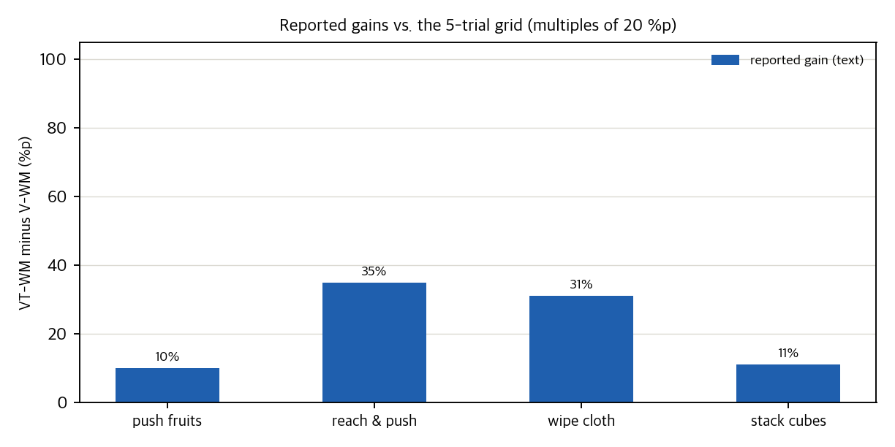

> **논문:** Carolina Higuera, Sergio Arnaud, Byron Boots, Mustafa Mukadam, Francois Robert Hogan, Franziska Meier. *Visuo-Tactile World Models.* arXiv:2602.06001 (v1, 2026-02-05).
> 공식 코드는 확인되지 않았습니다. 프로젝트 페이지에는 arXiv 링크만 있습니다. 이 글의 그림은 우리가 그린 그래프 하나입니다. 논문 그림은 arXiv 비독점 라이선스라서 싣지 않았습니다.

## 논문이 묻는 것

시각만 쓰는 세계 모델은 로봇 팔의 움직임은 잘 그립니다. 그런데 가려진 물체가 사라지거나, 손이 닿지도 않았는데 천이 밀리거나, 물체가 순간이동하는 식으로 물리를 어깁니다. 이 논문은 손가락 끝의 촉각 센서(Digit 360) 영상을 같은 트랜스포머 토큰 열에 넣어 같은 데이터로 학습한 VT-WM과, 시각만 쓴 V-WM을 비교합니다.

비교 축은 두 가지입니다. 첫째는 예측 영상의 물리 정합성입니다. 물체 영속성(가려진 물체를 계속 기억하는가)과 인과 준수(움직일 힘이 없는 물체가 가만히 있는가)를 CoTracker 키포인트의 정규화 Fréchet 거리로 잽니다. 둘째는 그 예측으로 CEM 계획을 세워 실로봇에 zero-shot으로 옮길 때의 성공률입니다.

## 수치를 다시 맞춰 보니

그림: 본문 보고 개선 폭(10, 35, 31, 11%p)과 과제당 5회 시행에서 나올 수 있는 값(20%p 간격)의 대조. 우리가 그린 그래프이며 논문 그림이 아닙니다.

- **접촉 인식 지표:** 객체 영속성 평균 33%, 인과 준수 평균 29%가 "거리 감소"로 보고됩니다. 보고된 t와 p를 맞추면 과제별 롤아웃 수가 대략 30–60쯤으로 읽힙니다. 방향은 믿을 만합니다. 다만 "33% better"는 낮을수록 좋은 거리의 감소이므로 표현을 구별해서 읽어야 합니다.
- **실로봇 성공률:** 과제당 5회 시행이면 성공률은 20%p 간격입니다. 본문의 10%p, 11%p, 31%p, 35%p는 이 간격으로 나올 수 없습니다. 새 과제 77%도 10회 시행으로는 불가능합니다. 시행 수나 평균 방식이 본문과 다른 것으로 보입니다. 그래서 "최대 35% 더 높다"는 주장은 크기를 확인할 수 없습니다.
- **내부 표기:** 촉각 입력이 "2 프레임"이면서 "0.16 s"라고 되어 있는데, 30 Hz에서 두 설명은 함께 맞지 않습니다.

## 맥에서 해 볼 수 있는가

전체 재현은 어렵습니다. 173M 모델을 80k 스텝 학습하는 데 A100급 GPU 32장을 썼습니다. 실로봇 평가에는 Franka 팔과 Allegro 손, Digit 360 센서가 필요합니다. 공식 코드가 없으므로 재구현 노력도 큽니다. 맥에서 할 수 있는 것은 보고 수치 재계산과 작은 2D 접촉 실험 정도입니다.

## 읽을 때 기억할 점

- 촉각이 "물리를 잡아 준다"는 정성 예시(그림 5, 12)는 설득력이 있습니다.
- 정량 결과는 방향은 맞지만 크기는 확정하기 어렵습니다. 원자료(시행 수와 성공 수)를 보기 전까지는 강한 결론을 피하는 게 낫습니다.
- V-WM 대조군의 파라미터와 학습 설정이 본문에 없어서, 촉각 효과와 모델 차이를 완전히 나누기 어렵습니다.

## 자료

- [통합 리포트 PDF](report/report_public.pdf)
- [01. 논문 분석: Visuo-Tactile World Models](analysis/01_paper_analysis.md)
- [02. 선행 연구와 공개 상태](analysis/02_prior_work.md)
- [03. 수치 재계산과 일관성 검사](analysis/03_analysis.md)
- [04. 주장 검증 (공식 코드 없음): C1–C8](analysis/04_claim_verification.md)
