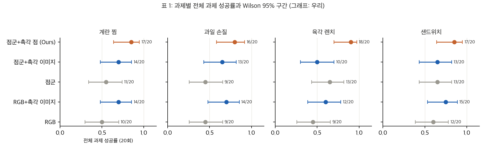
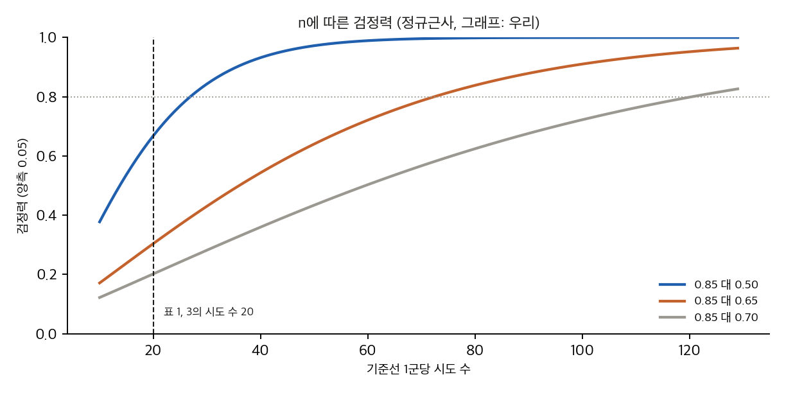
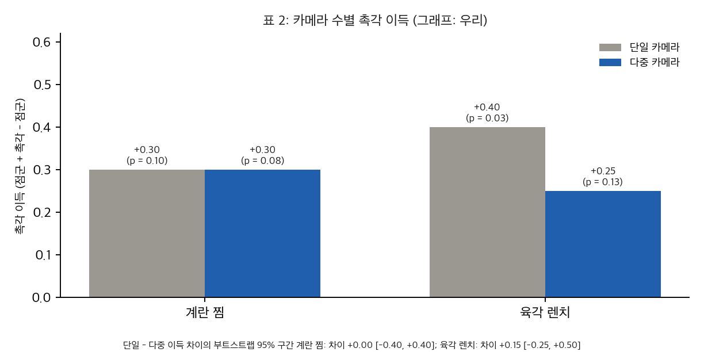

> **논문:** Binghao Huang, Yixuan Wang, Xinyi Yang, Yiyue Luo, Yunzhu Li. *3D-ViTac: Learning Fine-Grained Manipulation with Visuo-Tactile Sensing.* CoRL 2024 (PMLR v270), arXiv:2410.24091 (v2, 2025-01-06).
> 공개 코드는 하드웨어(펌웨어, 판독 소프트웨어)만 있고 정책 학습 코드는 없습니다. 이 글의 그래프는 모두 우리가 그린 것입니다. 논문 그림은 넣지 않았습니다.

## 논문이 묻는 것

손가락 끝의 접촉 정보는 카메라가 잘 못 봅니다. 계란을 쥘 때 얼마나 세게 잡는지, 렌치가 손 안에서 어떻게 돌았는지는 가림이 있으면 시각만으로 알기 어렵습니다. 3D-ViTac은 얇고 연한 핀형 그리퍼에 16×16 압저항 촉각 패드를 붙이고, 촉각 점을 관절 상태의 기구학으로 3D 좌표에 올린 뒤 카메라 점군과 한 집합으로 합칩니다. 그 위에 조건부 확산 정책(Diffusion Policy)을 얹어 관절 행동 시퀀스를 생성합니다.

## 실험에서 확인한 것

**1. 전체 과제 성공률은 기준선보다 높습니다.** 실로봇 네 과제(계란 찜, 과일 손질, 육각 렌치, 샌드위치)에서 촉각 점을 쓴 방식은 전체 과제 성공률이 0.80–0.90이었고, 점군만 쓴 기준선은 0.45–0.65였습니다(표 1, 과제당 20회). 과제를 묶은 Cochran-Mantel-Haenszel 검정은 네 기준선 모두에 대해 유의했습니다(p ≤ 0.016). 그러나 과제 하나씩 보면 Holm 보정 후 어느 비교도 유의하지 않습니다.

*그래프 (우리). 표 1의 값을 옮겨 Wilson 95% 구간을 그렸습니다.*

**2. 시도 수 20회로는 차이를 가리기 어렵습니다.** 0.85와 0.65의 차이를 80% 검정력으로 보려면 군당 73회가 필요합니다. 20회로는 검정력이 0.22입니다. 과제별 비유의는 효과가 없다는 뜻이 아니라 표본이 작다는 뜻일 가능성이 큽니다.

*그래프 (우리). 정규근사, 양측 0.05. 점선은 논문 표의 시도 수 20입니다.*

**3. "가림이 심할수록 촉각이 더 중요하다"는 확정되지 않았습니다.** 카메라를 하나만 쓴 경우 육각 렌치에서 촉각 이득은 +0.40이었고 여러 대를 쓴 경우는 +0.25였습니다. 두 이득의 차이는 +0.15이고 95% 구간은 [−0.25, +0.50]이라 0을 포함합니다.

*그래프 (우리). 표 2의 값을 옮겼습니다.*

**4. 논문의 표와 본문이 맞지 않는 곳이 있습니다.** 본문은 과제마다 4단계라고 쓰지만 표 1, 2에는 단계 세 개와 전체 과제 열만 있습니다. 촉각 일관성 실험의 하중 면적(176.7 mm²)은 2×2 단위 블록보다 훨씬 넓어서 "블록마다 균일 하중"이라는 설명과 맞지 않을 수 있습니다.

## 코드와 촉각 전처리

- **정책 학습 코드는 공개되지 않았습니다.** 프로젝트 페이지의 "Method Code" 저장소는 README 한 개뿐이며, 사전학습은 다른 논문(VT-Refine)의 저장소를 가리킵니다. 논문 방법에는 사전학습 단계가 없습니다.
- **공개된 촉각 판독 노드는 값을 가공합니다.** 시작 시 기준값을 빼고, 임계값 12를 빼고, 0–100으로 자른 뒤, 프레임의 최댓값으로 나눕니다. 이 방식은 같은 접촉 패턴에서 힘이 세든 약하든 같은 출력을 냅니다. 논문이 힘의 양을 강조하는 것과 긴장이 있습니다. 정책이 원자료를 썼는지 이 출력을 썼는지는 알 수 없습니다.
- **라이선스가 세 가지로 적혀 있습니다.** 저장소 README는 CC BY-NC 4.0, 펌웨어 머리말은 MIT 식 문구, ROS 패키지는 `TODO`입니다. 재사용 전에 확인해야 합니다.

## 이 맥에서 할 수 있는 것

- **가능:** 표 재계산과 검정, 촉각 점 표현의 기하 구현(FK로 촉각 단위를 3D에 올리고 시각 점과 합치기), 촉각 정규화가 힘 정보를 지우는지 합성 데이터로 확인.
- **조건부:** 소형 확산 정책을 MPS에서 가림이 있는 2D 합성 과제에 학습해 보기. 설치와 학습 시간에 대한 승인이 필요합니다.
- **불가:** 실로봇 표 재현(양팔 로봇, 촉각 패드 4개, RealSense 3대, 데모 약 200회, 평가 수백 회), VT-Refine 사전학습(CUDA 컨테이너, Isaac Gym, cuRobo).

판정은 **부분 구현 가능, 결과 재현 불가**입니다. 근거와 노력 추정은 분석 문서에 있습니다.

## 자료

- [통합 리포트 PDF](report/report_public.pdf)
- [01. 논문 분석: 3D-ViTac (arXiv:2410.24091)](analysis/01_paper_analysis.md)
- [02. 선행연구와 관련 저장소](analysis/02_prior_work.md)
- [03. 수치 재계산과 일관성 검사](analysis/03_analysis.md)
- [04. 주장 검증과 공개 코드 대조](analysis/04_claim_verification.md)
